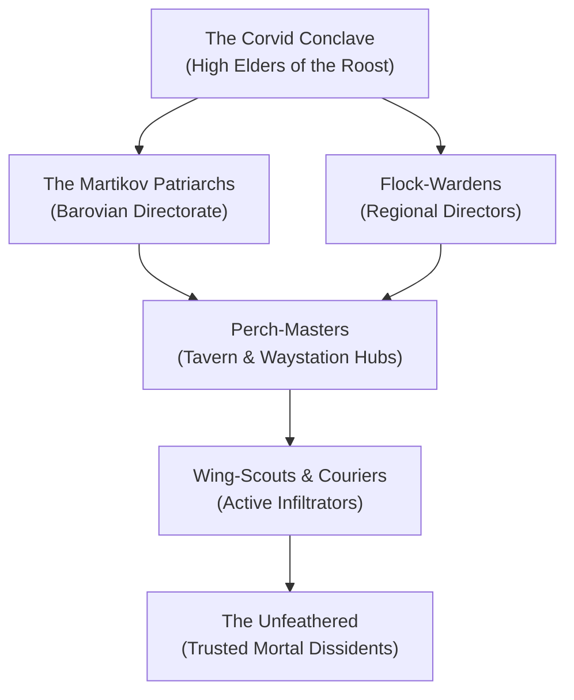

# The Keepers of the Feather

The **Keepers of the Feather** is a covert, plane-spanning resistance order comprised predominantly of **Wereravens**—lycanthropes touched by the mysterious grace of the [[../NPCs/Gods/Pale Night|Raven Queen]]. While the common folk of the Domains of Dread whisper of them as watchful guardian spirits, they are in truth a disciplined, clandestine intelligence and insurgent network operating beneath the very noses of the Darklords.

They wage an endless, silent war against the tyranny of dread sovereigns like **Count Strahd von Zarovich**, the necromancers of Darkon, and the monstrous horrors born of the Shadowfell. Where the Dark Powers trap and torment, the Keepers preserve sparks of hope, rescue doomed souls from the slaughterhouses of the High-Born, and protect the fragile strands of fate that weave through the Mists.

> _"In the darkest mist, when the wolves howl and the fangs draw near, look to the eaves. A single black feather on your sill means you are not forgotten."_
> — Proverb of the Barovian Underground

---

## The Nature of the Wereravens

In the Shattered Loom setting, the wereravens of the Keepers are not cursed monsters driven by mindless bloodlust. Their lycanthropy is a **sacred planar covenant**, originally bestowed upon ancient mortal bloodlines by the **Raven Queen** during the early age of the Shadowfell.

- **The Raven Form**: Unlike ravenous werewolves, wereravens can shift at will between human, giant raven, and hybrid forms. Their avian forms are perfectly adapted for reconnaissance, slipstream travel through the Mists of Ravenloft, and delivering encrypted dispatches across impossible distances.
- **The Silver Thread**: Wereravens possess an instinctive sensitivity to the **Threads of the Loom**. They can detect when a soul's destiny is being unnaturally severed or corrupted by vampirism, necromancy, or dark vestige pacts.
- **Vow of Discretion**: To preserve their survival against overwhelmingly powerful Darklords, every Keeper takes an unbreakable blood vow never to reveal their true nature to the uninitiated unless an innocent life is in mortal peril.

---

## Doctrine & Sacred Mandates

The doctrine of the Keepers of the Feather is passed down through oral tradition, encrypted tavern ledgers, and secret ciphers sewn into tapestries and wine barrel staves.

### The Three Feathers of Conduct

1. **The Mandate of the Hearth**: Protect the innocent without drawing the tyrant's gaze. A rescued child or a hidden dissident does more to preserve the realm than a suicidal frontal assault.
2. **The Mandate of the Beak**: Disrupt the Darklords through economic, social, and logistical sabotage. Spoil the blood-vats, liberate shipment manifests, poison wolf packs, and smuggle silver weapons to town militias.
3. **The Mandate of the Memory**: Act as the living eyes of the Raven Queen. When a soul falls heroically or a great secret is unraveled, witness it, memorize it, and sing it into the ravens' roosts so its memory will never fade into the Void.

---

## Organization & Hierarchy

### 1. The Corvid Conclave (High Elders)
The secretive steering council of the order, operating from secluded cloisters hidden in the mountain crags between Barovia, Darkon, and Dementlieu. They communicate with the **Fortress of Memories** via shadow-messengers and interpret omens from the Raven Queen.

### 2. The Martikov Bloodline (Barovian Wing)
The central operational family in Barovia, led by **Urwin and Danika Martikov** at the **Blue Water Inn** in Vallaki and **Davian Martikov** at the **Wizard of Wines Winery**. They control Barovia's wine distribution, using wine deliveries to conceal messages, weapons, and escaped "Kine."

### 3. Perch-Masters (Tavern Hubs)
The backbone of their intelligence network. The Keepers establish taverns, inns, and trading posts along major trade roads throughout the Domains of Dread. These establishments serve as safe houses, dead-drop locations, and medical stations for wounded insurgents.

### 4. Wing-Scouts
Agile younger wereravens who take flight across the Old Svalich Woods and the mists, gathering intelligence on patrol routes, werewolf packs, and vampire movements.

---

## Relationships with Other Factions

### The Pale Lodge
**Allied and Co-operative.** The Keepers work closely with agents of the [[The Pale Lodge/The Pale Lodge|Pale Lodge]]. During the party's mission to Barovia, the Keepers covertly watched over the party, recognizing their pursuit of the Crimson Weave Loom Fragment.

### The Ulmist Inquisition
**Uneasy Truce.** While both fight the dark horrors of Ravenloft, the Ulmist Inquisitors are intensely dogmatic and often view any form of lycanthropy with suspicion. The Keepers avoid direct contact with Inquisitor strike teams.

### The Kargat & The Blood-Lords
**Deadly Enemies.** The vampire lords of Barovia and the secret police of Darkon hunt wereravens relentlessly. Any captured Keeper faces public execution or extraction in the Blood-Mills.

---

## Campaign Connections & Barovian Lore

During the party's recent incursion into Barovia:
- The Keepers observed the party's arrival past the Silent Spire and their battle with the Headless Horseman.
- At the **Blue Water Inn**, Urwin Martikov quietly guided the party toward the truth of the Swamp Fane and the dark ritual in Berez.
- With the party's execution of **Baba Lysaga** and the placement of the **Planar Anchor**, the Keepers were able to fortify southern Barovia, weakening the regional grip of Strahd's wolf-packs and giving the human resistance its first true hope in centuries.

---
[[../Planes of Existence/The Material Plane/Shadowfell|Shadowfell]]
[[The Pale Lodge/The Pale Lodge|The Pale Lodge]]
[[../Species/Hag Dragon|Hag Dragon]]
