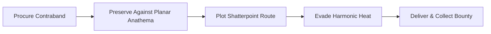
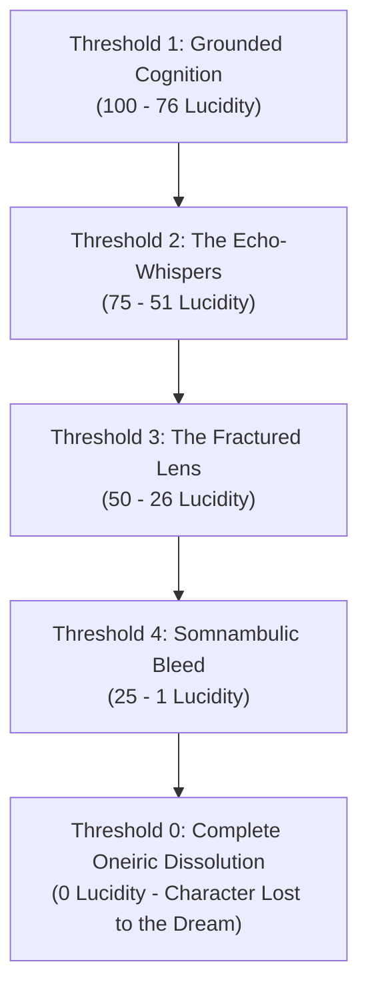

# ⚖️ Custom Rules & Mechanics
### *Modular Homebrew Systems for the Shattered Multiverse*

> *"When reality shatters, the old laws shatter with it. Standard spellcraft, mortal trade, and forest tracking can no longer account for the scars in the tapestry, the harmonic echoes of broken filaments, or the apex monsters prowling the spaces between the planes."*  
> — **Malakor the Weft-Stripper**, Fence of the Fractured Nexus

---

## 📖 System Overview

The **Project Shattered Loom** campaign introduces specialized modular rulesets designed to enrich interplanar campaigns, providing tactile mechanical systems for illicit trade, dimensional hazards, eldritch madness, and apex monster hunting while remaining seamlessly compatible with core **D&D 5th Edition**.

All custom rules in this compendium are designed for player use, providing transparent DC scales, operational procedures, and risk-reward calculations.

---

## 📜 Active Rule Modules

| Module | System Focus | Key Mechanics | Ruleset Link |
| :--- | :--- | :--- | :--- |
| **Module I** | **The Interplanar Black Market & Smuggling Ruleset** | Contraband Classification (Class I–IV), Planar Anathema, Harmonic Detection & Heat, Smuggling Run Resolution, Bribes & Interception. | [[Custom Rules/The Interplanar Black Market & Smuggling Ruleset|The Interplanar Black Market & Smuggling Ruleset]] |
| **Module II** | **The Eldritch Madness & Dream-Fracture Ruleset** | The Lucidity Index (0–100), Thresholds of Dream-Fracture, Double-Edged Forbidden Insights, Grounding Mechanics, and d20 Afflictions Table. | [[Custom Rules/The Eldritch Madness & Dream-Fracture Ruleset|The Eldritch Madness & Dream-Fracture Ruleset]] |
| **Module III** | **The Interplanar Hunting, Harvesting & Trophy-Crafting Ruleset** | Planar Spoor Tracking, Carcass Decay Clocks, Component Extraction Yields, Lodge Trophy-Forges, Spoor Marks Currency, and 22 Planar Lodges. | [[Custom Rules/The Interplanar Hunting, Harvesting & Trophy-Crafting Ruleset|The Interplanar Hunting, Harvesting & Trophy-Crafting Ruleset]] |
| **Compendium** | **Planar Bestiary & Hunting Lodges Compendium** | Comprehensive directory of all 22 branch lodges across every plane, lodge masters, barter facilities, and apex quarry recipes. | [[Custom Rules/Planar Bestiary & Hunting Lodges Compendium|Planar Bestiary & Hunting Lodges Compendium]] |

---

## 🔍 Module I Highlight: The Shadow Weft

### 1. What is the Shadow Weft?
While sovereign planar authorities—such as the **Consortium of the Gilded Caliper**, the **Council of Chains** in Aurous Grasp, and celestial arbiters—patrol official portals and levy heavy soul-tariffs, the **Shadow Weft** exploits the tears between drifting shards. Smugglers, fences, and void-runners move high-value planar contraband across dimensional fractures using hidden docks and pocket-dimension bazaars.

---

## 🌀 Module II Highlight: The Lucidity Index & Dream-Fracture

### 1. What is Dream-Fracture?
In realms where the fabric of reality is warped by slumbering primordial titans—such as the **City of Ry'leh** and the deep chambers of **The Submerged Ziggurat**—madness is not merely a mental illness, but the friction of a finite mind attempting to inhabit an un-woven dream.

---

## 🏹 Module III Highlight: Planar Hunting & Trophy-Crafting

### 1. The Apex Spoor
Planar monsters possess hides infused with elemental resistance, bones resonating with Loom-harmonics, and glands harboring potent magical venom. The **Grand Guild of the Iron Spoor** maintains permanent hunting lodges on all 22 planes to track quarry, salt carcasses before planar decay ruins them, and forge epic gear.

* **Four Component Tiers**: Defensive Layers (Hides/Carapace), Offensive Matrices (Fangs/Horns), Alchemical Secretions (Venoms/Bile), and Planar Essence Cores (Hearts/Gems).
* **The 22 Lodges**: From the **Timber-Weft Lodge** in the Material Plane to the **Drowned Lantern Lodge** in Ry'leh and the **Iron-Chain Keep** in the Nine Hells.

---

## 🛠️ Forthcoming Rule Modules

The following systems are currently in active field-testing:

* **Module IV: Void Navigation & Filament Sails** — Custom travel mechanics for piloting spelljammers along the golden filaments connecting drifting shards.
* **Module V: The Mark of Telara Resonances** — Awakening special planar abilities through communion with surviving loom relics.

---

> [!TIP]
> **Explore Active Modules**:
> * Black Market & Contraband: **[[Custom Rules/The Interplanar Black Market & Smuggling Ruleset|The Interplanar Black Market & Smuggling Ruleset]]**
> * Eldritch Sanity & Ry'leh: **[[Custom Rules/The Eldritch Madness & Dream-Fracture Ruleset|The Eldritch Madness & Dream-Fracture Ruleset]]**
> * Hunting, Harvesting & Crafting: **[[Custom Rules/The Interplanar Hunting, Harvesting & Trophy-Crafting Ruleset|The Interplanar Hunting, Harvesting & Trophy-Crafting Ruleset]]**
> * 22 Planar Lodges Atlas: **[[Custom Rules/Planar Bestiary & Hunting Lodges Compendium|Planar Bestiary & Hunting Lodges Compendium]]**
