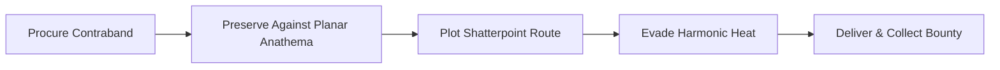
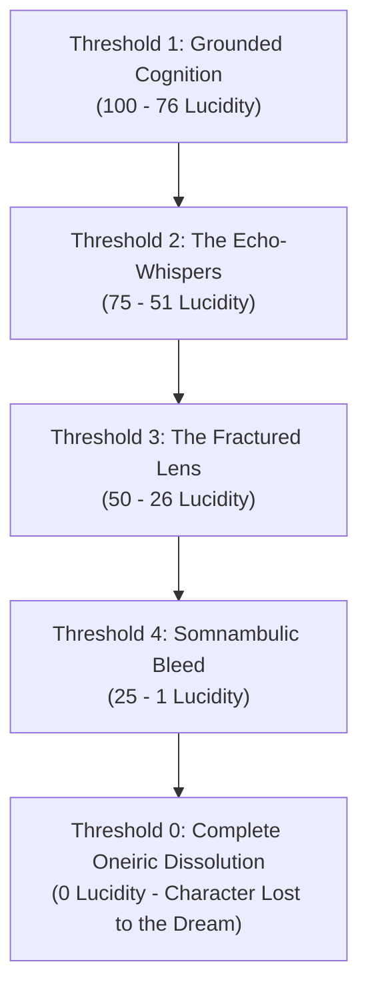

# ⚖️ Custom Rules & Mechanics
### *Modular Homebrew Systems for the Shattered Multiverse*

> *"When reality shatters, the old laws shatter with it. Standard spellcraft and mortal trade can no longer account for the scars in the tapestry, the harmonic echoes of broken filaments, or the illicit commerce that thrives in the spaces between the planes."*  
> — **Malakor the Weft-Stripper**, Fence of the Fractured Nexus

---

## 📖 System Overview

The **Project Shattered Loom** campaign introduces specialized modular rulesets designed to enrich interplanar campaigns, providing tactile mechanical systems for illicit trade, dimensional hazards, and cosmological resonance while remaining seamlessly compatible with core **D&D 5th Edition**.

All custom rules in this compendium are designed for player use, providing transparent DC scales, operational procedures, and risk-reward calculations.

---

## 📜 Active Rule Modules

| Module | System Focus | Key Mechanics | Ruleset Link |
| :--- | :--- | :--- | :--- |
| **Module I** | **The Interplanar Black Market & Smuggling Ruleset** | Contraband Classification (Class I–IV), Planar Anathema, Harmonic Detection & Heat, Smuggling Run Resolution, Bribes & Interception. | [[Custom Rules/The Interplanar Black Market & Smuggling Ruleset|The Interplanar Black Market & Smuggling Ruleset]] |
| **Module II** | **The Eldritch Madness & Dream-Fracture Ruleset** | The Lucidity Index (0–100), Thresholds of Dream-Fracture, Double-Edged Forbidden Insights, Grounding Mechanics, and d20 Afflictions Table. | [[Custom Rules/The Eldritch Madness & Dream-Fracture Ruleset|The Eldritch Madness & Dream-Fracture Ruleset]] |

---

## 🔍 Module I Highlight: The Shadow Weft

### 1. What is the Shadow Weft?
While sovereign planar authorities—such as the **Consortium of the Gilded Caliper**, the **Council of Chains** in Aurous Grasp, and celestial arbiters—patrol official portals and levy heavy soul-tariffs, the **Shadow Weft** exploits the tears between drifting shards.

Smugglers, fences, and void-runners move high-value planar contraband across dimensional fractures using hidden docks and pocket-dimension bazaars.

### 2. Core Pillars of Smuggling

1. **Dimensional Scarcity**: Mundane items from one plane (pure spring water, timber, gentle snowfall) are worth fortunes in extreme planes (Avarice, the Nine Hells, the Abyss).
2. **Planar Anathema**: Smuggled goods must be protected from hostile dimensional physics (holy water evaporating in the Abyss; infernal brimstone turning inert in Stygia).
3. **Harmonic Heat**: Reality resonates with a baseline hum. Forcing items through unauthorized rifts raises local **Heat**, triggering patrols by the Consortium, Riftborn hounds, and planar cruisers.

### 3. Contraband Quick Reference
| Classification | Description & Examples | Typical Base Value | Heat Generated |
| :--- | :--- | :--- | :--- |
| **Class I: Regulated Goods** | Unprocessed timber, untaxed spices, planar spirits, uncertified spell components. | 50 – 500 gp | +1 Heat |
| **Class II: Restrictive Contraband** | Slag-forged weapons, stolen astral charts, unregistered portal keys, living fauna. | 500 – 2,500 gp | +2 Heat |
| **Class III: Anathema Cargo** | Concentrated necrotic shards, void-matter canisters, holy relics in fiendish realms. | 2,500 – 10,000 gp | +3 Heat |
| **Class IV: Cosmic Heresies** | Uncut Loom shards, memory vials of dead deities, bottled Great Dreamer ichor. | 10,000+ gp / Priceless | +5 Heat |

---

## 🌀 Module II Highlight: The Lucidity Index & Dream-Fracture

### 1. What is Dream-Fracture?
In realms where the fabric of reality is warped by slumbering primordial titans—such as the **City of Ry'leh** and the deep chambers of **The Submerged Ziggurat**—madness is not merely a mental illness, but the friction of a finite mind attempting to inhabit an un-woven dream.

### 2. The Four Thresholds of Lucidity

* **Double-Edged Insights**: As Lucidity falls, adventurers gain strange alien boons (*Glimpse of the Unwoven*, *Oneiric Sight*, *Warp the Dreaming*) at the cost of vulnerability to psychic feedback.
* **Grounding Agency**: Players actively restore Lucidity through alchemical stabilization (*Phials of Loom-Sap*), Loom-thread meditation, and psychological anchors.

---

## 🛠️ Forthcoming Rule Modules

The following systems are currently in active field-testing:

* **Module III: Void Navigation & Filament Sails** — Custom travel mechanics for piloting spelljammers along the golden filaments connecting drifting shards.
* **Module IV: The Mark of Telara Resonances** — Awakening special planar abilities through communion with surviving loom relics.

---

> [!TIP]
> **Explore Active Modules**:
> * Black Market & Contraband: **[[Custom Rules/The Interplanar Black Market & Smuggling Ruleset|The Interplanar Black Market & Smuggling Ruleset]]**
> * Eldritch Sanity & Ry'leh: **[[Custom Rules/The Eldritch Madness & Dream-Fracture Ruleset|The Eldritch Madness & Dream-Fracture Ruleset]]**
