# 👁️ The Eldritch Horror Hunting & Sanity-Harvesting Ruleset
### *A Modular System of Psychic Stalking, Cognitive Fortification, Non-Euclidean Dissection, and Void-Relic Forging*

> *"You cannot hunt an aberration as you would a wolf. A wolf leaves mud on the ferns; an eldritch horror leaves a bruise on the memory of the glade. If you track its blood, you follow a color that doesn't exist. And when you open its ribcage, you must pray your own sanity doesn't spill out onto the slab before its heart stops beating. Protect your mind before your blade—for out here, a cracked skull will kill only you, but a cracked mind will drag your entire lodge into the Maw."*  
> — **Grand Inquisitor Sylas the Blind**, Sovereign Order of the Severed Eye

---

## 📖 System Philosophy & Core Design

In **Project Shattered Loom**, aberrations, void-entities, and cosmic parasites originating from the **Far Realm**, the abyssal drowned halls of **Ry'leh**, the **Entropic Wake of the Abyss**, or shattered planar rifts cannot be tracked or butchered through mundane woodcraft. 

Their anatomies exist across four or more spatial dimensions, their blood carries psychic static, and their organs defy three-dimensional physics. Dissecting a specimen is not merely physical surgery—it is active psychological warfare against the surgeon's mind.

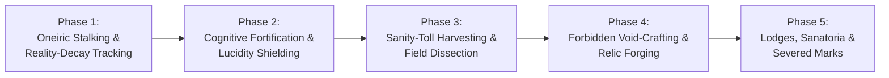

### The Three Axioms of Eldritch Butchery
1. **The Gaze Must Be Severed**: Never gaze directly into a sensory organ or exposed neural fold of an aberration without optical or psionic dampening.
2. **The Organic Is Conceptual**: Eldritch flesh does not merely rot; it evaporates into paradox vapor, corrupting local planar fabric unless anchored by cold iron, axiomatic salt, or dimensional needles.
3. **Cognitive Defense Precedes the Scalpel**: A hunter who undertakes field harvesting without mental shielding, cognitive anchors, or a dedicated Anchor Assistant is simply an abomination in incubation.

### System Integration
This modular ruleset interfaces directly with:
1. **[[Custom Rules/The Eldritch Madness & Dream-Fracture Ruleset|The Eldritch Madness & Dream-Fracture Ruleset (Module II)]]**: Operating on the **Lucidity Index (0–100)** as the mental hit-point pool risked during stalking, combat, and autopsies.
2. **[[Custom Rules/The Interplanar Hunting, Harvesting & Trophy-Crafting Ruleset|The Interplanar Hunting, Harvesting & Trophy-Crafting Ruleset (Module III)]]**: Adapting harvest timing, tool kits, and crafting mechanics to cosmic horrors.
3. **[[Custom Rules/Eldritch Horror Bestiary - Creature Entries|Eldritch Horror Bestiary: Comprehensive Creature Entries]]**: Providing full statblocks, hunting profiles, and harvest tables for quarry.

---

## 🧭 Phase 1: Psychic Spoor, Reality Decay & Oneiric Tracking

Eldritch horrors rarely leave physical footprints; they leave **metaphysical scars** and warp local reality.

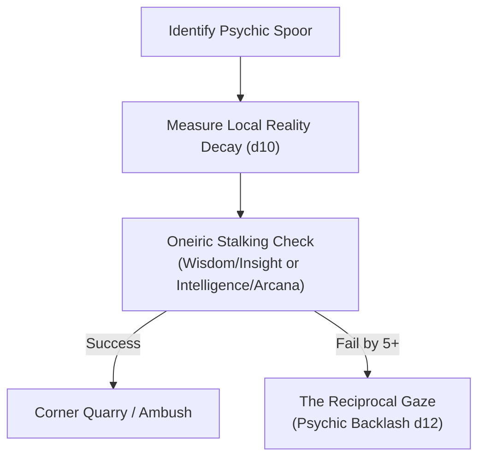

### 1. The Oneiric Stalking Check
To track an eldritch quarry across shattered terrain or dreaming expanses, the lead tracker makes an **Eldritch Stalking Check** combining **Wisdom (Insight)** or **Intelligence (Arcana)**, supplemented by **Survival**:

| Quarry Classification | Characteristic Spoor Phenomena | Base Stalking DC | Base Reality Decay |
| :--- | :--- | :---: | :---: |
| **Tier I: Dream-Leeches & Larvae (CR 5–8)** | Inverted bird songs, spontaneous sour metallic taste, wilting concentric spirals in grass. | **DC 14** | Stage 1 (Minor) |
| **Tier II: Dimensional Warp-Stalkers (CR 9–12)** | Shadow slippage, compass needles spinning counter-clockwise, localized gravity ripples, glass frosting in warm air. | **DC 16** | Stage 2 (Moderate) |
| **Tier III: Mind-Leviathans & Harbingers (CR 13–16)** | Mass waking nightmares among wildlife, weeping stone walls, non-Euclidean angles in natural trees, spontaneous blood condensation. | **DC 18** | Stage 3 (Severe) |
| **Tier IV: Primordial Sleeper Scions (CR 17–20)** | Reality fractures, spontaneous somnambulism, localized amnesia across entire settlements, water flowing backward into the sky. | **DC 20** | Stage 4 (Critical) |
| **Tier V: Void Sovereigns & Outer Gods (CR 21+)** | Complete planar unraveling, stars rearranging into weeping eyes, thoughts spoken aloud by the wind, dissolution of causality. | **DC 24** | Stage 5 (Cataclysm) |

### 2. Environmental Reality Decay Hazards (d10)
While tracking within the hunting perimeter of an eldritch horror, roll a **d10** every 4 hours or upon entering a lair zone to determine local spatial instability:

| d10 | Reality Hazard | Environmental & Mechanical Effect |
| :---: | :--- | :--- |
| **1** | **Chirality Flip** | Left and right invert across a 300-ft zone. Creatures suffer -2 to Dexterity checks and attack rolls until they spend 10 minutes acclimating. |
| **2** | **Acoustic Inversion** | Whispers roar like thunder, but screaming produces no sound. Verbal spell components require a DC 13 Constitution save or fail. |
| **3** | **Echoing Footsteps** | Footsteps echo backwards in time, heard 30 seconds before a creature walks. Stealth checks are made with disadvantage. |
| **4** | **Starlight Brine Seep** | Ground turns into bubbling, glowing violet sludge. Walking through it deals 2d6 acid/psychic damage and forces a DC 13 Lucidity save (1d4 drain). |
| **5** | **Angle Compression** | Corners in ruins or rocky ravines pinch spacetime. Moving through narrow corridors costs 4 feet of movement for every 1 foot moved. |
| **6** | **The Bleeding Mirages** | Reflections in water, polished steel, and eyes show the party drowning in starlight. Disadvantage on Wisdom (Perception) checks. |
| **7** | **Static Fog of the Un-Made** | Dense, iridescent mist rolls in. Visibility reduced to 15 ft; nonmagical compasses, clocks, and maps melt or un-write themselves. |
| **8** | **Gravitational Shear** | Gravity fluctuates between 0.5g and 2g unpredictably. High jumps trigger falling damage on landing unless DC 14 Acrobatics check succeeds. |
| **9** | **The Memory Siphon** | Hunters momentarily forget a beloved companion's name or home town. Each tracker must make a DC 15 Wis save or lose **1d6 Lucidity**. |
| **10** | **Temporal Stutter** | Local time skips forward or backward 1d4 minutes at random. Spells with 1-minute durations randomly terminate early (roll 1d6 each round; on a 1, spell ends). |

### 3. The Reciprocal Gaze: Psychic Backlash (d12 Table)
Eldritch quarry are hyper-aware of telepathic resonance. When a tracking check fails by **5 or more**, or when a hunter uses divination magic (*Scrying*, *Locate Creature*, *Detect Thoughts*) without cognitive wards, the quarry looks back down the scrying thread. Roll on the **Reciprocal Gaze Table**:

| d12 | Backlash Phenomenon | Mechanical Consequence |
| :---: | :--- | :--- |
| **1** | **Synesthetic Bleed** | Tracker smells sound and hears colors. Disadvantage on Perception checks for 1d4 hours. |
| **2** | **Memory Echo** | Tracker relives their worst suppressed nightmare. Loses **1d8 Lucidity**; gains 1 level of exhaustion. |
| **3** | **Telepathic Shriek** | Quarry projects an acoustic blast down the thread. Party takes 3d6 psychic damage and is deafened for 10 minutes (DC 14 Con save halves). |
| **4** | **Spatial Inversion** | Distances fold. Party walks 2 miles in the wrong direction, emerging into a dangerous planar sinkhole or hazard zone. |
| **5** | **The Stalking Eye** | Quarry becomes the stalker. It gains advantage on initiative and surprises the party upon encounter. |
| **6** | **Un-Woven Whisper** | Cosmic static burns the caster's mind; highest unexpended spell slot (up to 5th level) is drained into harmless void-sparkles. |
| **7** | **Visual Paranoia** | Tracker hallucinates writhing tentacles beneath comrades' skin. Disadvantage on Charisma and Insight checks for 24 hours. |
| **8** | **Phantom Limb Bloom** | Tracker feels phantom claws sprouting from their shoulder blades. Suffers disadvantage on attack rolls and Dexterity checks for 1 hour. |
| **9** | **Oneiric Hemorrhage** | Blood weeps from the tracker's nose and ears. Suffers 4d6 psychic damage and loses **2d6 Lucidity** (DC 15 Wis save halves). |
| **10** | **Cyclopean Vertigo** | Horizon appears as an infinite vertical cliff. Tracker falls prone and cannot stand for 1d4 rounds unless an ally uses an action to physically shake them. |
| **11** | **Soul-Tether Drag** | Quarry establishes an astral thread. For the next 24 hours, the quarry knows the party's exact distance and heading. |
| **12** | **Paradox Revelation** | The mind fractures slightly, but glimpses sublime truth. Tracker loses **1d10 Lucidity**, but gains advantage on all attack rolls and spell save DCs against the quarry for 24 hours. |

### 4. Tracking Equipment & Paradox Snares
* **Euclidean Chalk & Axiomatic Pegs (50 gp)**: Cold-forged iron pitons and chalk mixed with pulverized granite from Mechanus. Driving them into corners locks local angles to strict 90 degrees, preventing quarry from phase-shifting through terrain.
* **Resonance Bells of Mechanus (120 gp)**: Set of 3 brass chiming bells tuned to 432 Hz. When rung during a stalk, their chime reveals non-Euclidean camouflage within 60 ft, granting advantage on checks to spot hidden aberrations.
* **Chirality Net (200 gp)**: Woven from silver-plated lead wire and cold-spun loom-strands. Thrown weapon (range 15/30 ft). Aberrations restrained by this net cannot teleport, phase-shift, or turn ethereal (escape DC 16 Strength or Arcana).
* **Void-Bait (Distilled Memory Phials) (175 gp)**: Concentrated alchemical vial of intense emotional memory (grief, triumph, or terror). Shattering it on a stone draws aberrations within 1 mile toward the scent, providing ambush opportunities.

---

## 🛡️ Phase 2: Cognitive Fortification & Lucidity Shielding
### *(Extraordinary Measures to Protect Yourself from Sanity Loss)*

The greatest hunters of the Sovereign Order of the Severed Eye know that armor protects only the meat; without mental fortifications, a hunter becomes a hollow vessel before the first strike lands. 

Hunters employ five distinct layers of sanity protection:

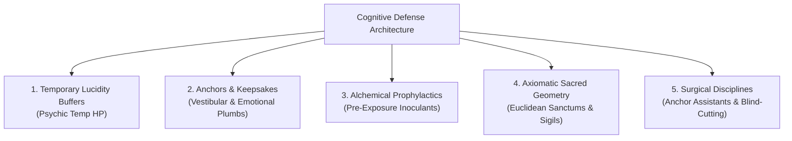

---

### 1. The Temporary Lucidity Buffer Mechanics
Similar to Temporary Hit Points, **Temporary Lucidity** acts as an ablative psychological buffer that absorbs mental trauma before a character's core Lucidity Index is diminished:
* **Absorption**: Whenever a character suffers Lucidity Drain from sanity checks, eldritch spells, psychic backlash, or field autopsies, Temporary Lucidity is lost first.
* **No Stacking**: Temporary Lucidity from different sources does not stack; take the highest value.
* **Duration**: Unless otherwise noted, Temporary Lucidity fades after 8 hours or upon completing a long rest.

---

### 2. Cognitive Anchors & Grounding Keepsakes (Mortal Mementos)

Anchors are physical objects that ground the sensory apparatus and soul to three-dimensional, causal reality.

| Anchor / Keepsake | Crafting / Value | Protective Mechanic & Sanity Defense |
| :--- | :---: | :--- |
| **Axiomatic Iron Pendulum** | 80 gp | A weighted bob of pure meteorite iron hung on a braided linen cord. As a **reaction** when rolling a Wisdom or Intelligence save against Lucidity drain, the hunter focuses on the true gravitational plumbline, adding **+1d6 to the saving throw**. Usable 3 times per long rest. |
| **Memento of True Origin** | Priceless / Quest | A deeply personal, non-magical keepsake from an unbroken home plane (e.g., a mother's locket, a dried sun-rose, a family signet, a carved wooden toy). **Once per long rest**, when you fail a Sanity Toll or Lucidity saving throw, you can invoke the memory of home to turn the failure into a **success**. Alternatively, you can permanently crush the keepsake to instantly restore **4d10 Lucidity**. |
| **Cold-Iron Tuning Resonator** | 150 gp | A dual-tined fork struck against armor as a bonus action. Produces an unbroken harmonic vibration for 1 minute. While active, the user and all allies within 15 feet have **advantage on saving throws against telepathic intrusion, psychic fright, and sensory hallucinations**. |
| **Braided Telaran Soul-Filament** | 250 gp | A golden strand woven from unspun Loom-thread worn as a cord around the forehead or wrist. Functions as a sacrificial soul-ground: it absorbs up to **20 points of Lucidity Drain** directly, glowing brighter with each hit. Once 20 points are absorbed, the thread turns to brittle ash. |
| **Lead-Wired Hearthstone** | 45 gp | A river pebble taken from the hunter's birthplace, wrapped in spiral lead wire. Carried in the pocket, it grounds psychic static, reducing all ambient Lucidity drain from planar exposure by **1 point (minimum 1)**. |

---

### 3. Alchemical Prophylactics & Chemical Inoculants

Veteran void-surgeons never touch an eldritch organ without chemical dampeners in their blood.

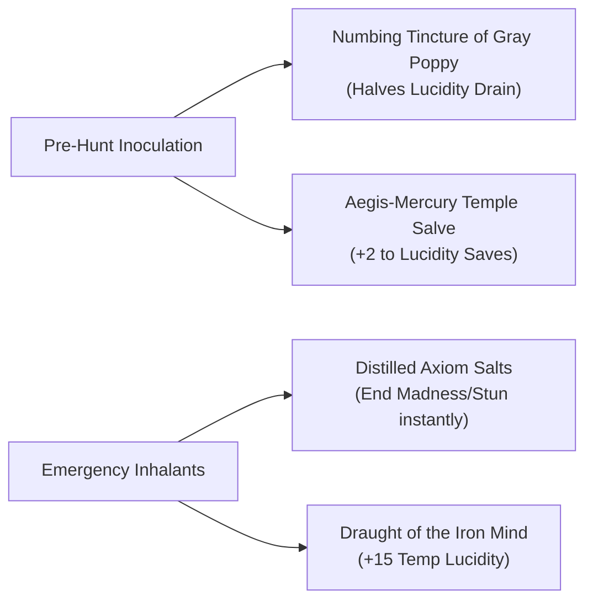

* **Numbing Tincture of Gray Poppy (60 gp per dose)**:
  * *Application*: Ingested 10 minutes prior to combat or harvesting.
  * *Effect*: Chemically drapes the conscious mind in cold velvet. For 1 hour, the user gains **resistance to psychic damage** and **halves all Lucidity drain** (rounded down, minimum 1).
  * *Drawback*: Disadvantage on Initiative rolls and Dexterity saving throws for the duration.
* **Aegis-Mercury Temple Salve (90 gp per pot - 4 doses)**:
  * *Application*: Rubbed across the forehead, temples, and behind the ears.
  * *Effect*: Creates a thin chemical film that reflects stray telepathic probing. Grants a **+2 bonus to all Wisdom and Intelligence saving throws** against eldritch gaze attacks, sanity tolls, and madness checks for 4 hours.
* **Distilled Axiom Salts / Vitreous Ammonia (40 gp per capsule)**:
  * *Application*: Inhaled as a **Bonus Action** or **Reaction**.
  * *Effect*: Pungent mineral ammonia blended with pulverized Mechanus gear-dust violently shocks the central nervous system back to Euclidean geometry. Immediately ends the **stunned**, **frightened**, or **incapacitated** conditions caused by psychic trauma, and ends any temporary sensory hallucination (such as those from Threshold 3 Dream-Fracture).
  * *Drawback*: The user takes 1d4 piercing damage and cannot gain inspiration for 1 hour.
* **Starlight Brine Micro-Inoculation (Specialized Conditioning)**:
  * *Conditioning*: A radical procedure performed by Order Apothecaries. The hunter micro-doses purified starlight brine over 7 days, building scarred mental calluses.
  * *Benefit*: Permanently reduces all Lucidity loss from aberration autopsies and Reciprocal Gaze checks by **2 points** (minimum 1).
  * *Cost*: Permanently reduces the character's **Maximum Lucidity from 100 to 95**, as their thoughts are forever laced with fine crystalline scar tissue.
* **Draught of the Iron Mind (120 gp)**:
  * *Application*: Consumed as an action.
  * *Effect*: Coats the ego in alchemical lead. The drinker gains **15 Temporary Lucidity** for 8 hours.

---

### 4. Esoteric Wards & Field Sacred Geometry

Eldritch horrors warp space; hunters reclaim space using axiomatic geometry.

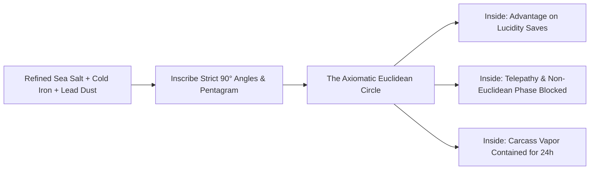

#### The Axiomatic Euclidean Circle (The Salt-and-Lead Grid)
Before conducting an autopsy or taking a short rest in eldritch territory, a hunter can spend **10 minutes** using chalk, refined salt, powdered cold iron, and lead filings (cost: 25 gp of materials) to scribe a 10-foot-radius containment circle:
* **Euclidean Integrity**: Non-Euclidean entities cannot enter the circle or reach into it with appendages or phase-shifts unless they succeed on a DC 16 Charisma saving throw.
* **Mental Shelter**: Any creature inside the circle has **advantage on all Lucidity saving throws** and is completely shielded from telepathic intrusion, scrying, and the Reciprocal Gaze.
* **Vapor Containment**: Eldritch organs dissected within the boundary cannot dissolve into paradoxical vapor for 24 hours, even without cold-iron salting kegs.

#### The Severed Eye Sigil
Hunters who brand or engrave the stylized lidless eye with a crossed iron needle onto their shields, breastplates, or leather dissection aprons gain passive protection:
* When struck by an attack dealing psychic damage, the sigil flares, **reducing psychic damage by an amount equal to your Wisdom modifier** (minimum 1) and redirecting that amount back to the attacker as radiant damage.

#### Loom-Weave Grounding Pikes (Set of 4: 100 gp)
Four heavy 3-foot iron rods driven into the earth in a square around the hunter and linked by copper braided cable:
* Diverts cognitive feedback loops directly into the ground. While standing within the square, any Lucidity drain suffered by the hunter is reduced by **1d4 points**.

---

### 5. Surgical Disciplines & Team Protocols

Field dissection does not have to be a solitary descent into madness. The Order of the Severed Eye utilizes rigid surgical teamwork to divide mental strain.

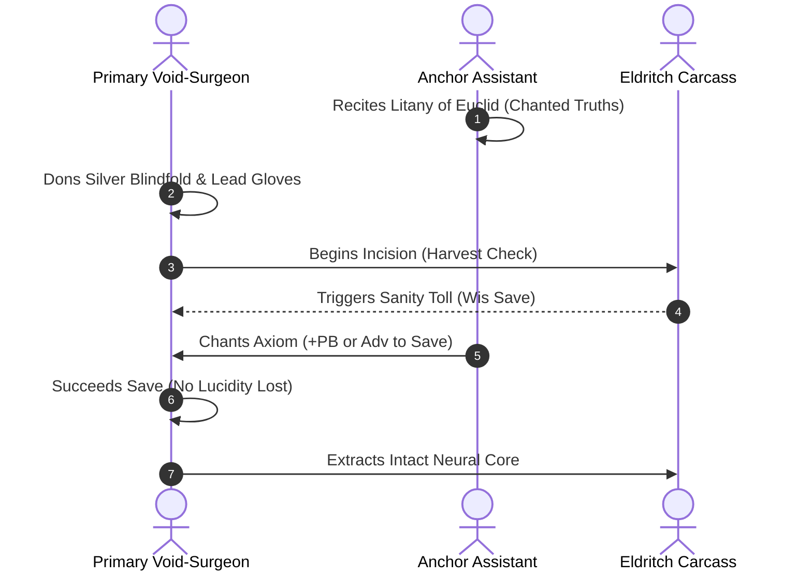

#### A. Cooperative Dissection: The Anchor Assistant
A second character proficient in **History**, **Religion**, **Performance**, or **Arcana** can act as an **Anchor Assistant**:
* **The Litany of Real Things**: Throughout the 15-minute dissection, the assistant stands over the surgeon, reading aloud from genealogical scrolls, immutable mathematical proofs (Euclid's axioms), or describing home landscapes in vivid sensory detail.
* **Mechanical Benefit**: The surgeon makes their Sanity Toll saving throw with **advantage**, or adds the assistant's **proficiency bonus** to their saving throw.
* **Divided Trauma**: If the surgeon still fails the saving throw, the assistant can choose to absorb **half of the Lucidity drain** (rounded down), sparing the surgeon from severe madness thresholds.

#### B. The Blindfold Dissection Discipline (Inquisitor's Blind Cutting)
A surgeon who equips the *Silver-Filament Blindfold* or deliberately blinds themselves during dissection operates entirely through tactile memory, ultrasonic clicks, and cold-iron probes:
* **Complete Gaze Immunity**: The surgeon is **immune to all gaze-based sanity tolls** (such as staring into non-Euclidean eye-clusters or pulsing cores).
* **Halved Drain**: Any inevitable psychic resonance drain is halved.
* **The Price of Darkness**: The surgeon makes the Harvesting check with disadvantage unless they possess blindsight, tremorsense, or the *Silver-Filament Blindfold*.

#### C. Chanted Axiomatic Litanies
Characters with the **Acolyte**, **Sage**, or **Inquisitor** background, or proficiency in Religion/History, can memorize the **Three Sacred Litanies of Euclid**:
1. **The First Litany (Axiom of the Line)**: Recited as a bonus action. Grants an ally within 30 ft **+1d4 on their next mental saving throw** made within 1 minute.
2. **The Second Litany (Axiom of the Plane)**: Recited as an action. Cleanses 1 active sensory distortion or minor hallucination from an ally who can hear you.
3. **The Third Litany (Axiom of the Solid Sphere)**: Chanted during a short rest. Grants all listening party members **1d8 Temporary Lucidity** until their next rest.

---

## 🔪 Phase 3: Sanity-Risk Harvesting & Field Dissection Mechanics

Harvesting an eldritch abomination is a race against time, decay, and psychological collapse.

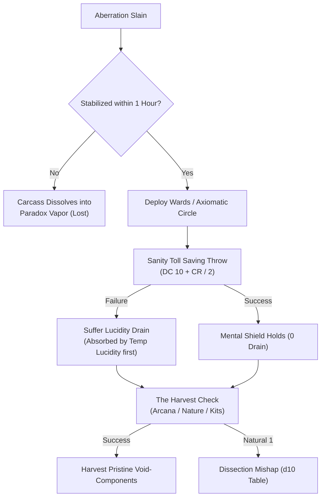

### 1. Carcass Vapor Decay & Temporal Dissolution
Unlike beasts whose flesh spoils slowly, eldritch carcasses are maintained by alien physics. Once life ceases, their matter begins to **un-weave**:
* **The Dissolution Clock**: An unstabilized eldritch carcass dissolves into caustic, lavender-colored paradox vapor in **1 hour per monster size category** (Medium: 1 hour; Large: 2 hours; Huge: 3 hours; Gargantuan: 4 hours).
* **Stabilization Methods**:
  * **Cold-Iron Salting**: Dumping 1 keg of cold-iron salt (75 gp) over incisions preserves the carcass for **72 hours**.
  * **Axiomatic Suture**: Sealing open cavities with lead-wire stitches within the *Axiomatic Euclidean Circle* halts dissolution for **24 hours**.
  * **Chrono-Stasis Needles (35 gp each)**: Driving three needles of quenched void-glass into major nerve hubs stops cellular time in the corpse for **48 hours**.

### 2. The Dissection Procedure
* **Harvest Duration**: 15 minutes per component per size category.
* **Primary Skill**: **Intelligence (Arcana or Nature)** + **Alchemist's Supplies** or **Poisoner's Kit**.
* **Base Target DC**: `12 + Monster Challenge Rating (CR)` (Max DC 26 for CR 17+).

### 3. The Sanity Toll: Lucidity Saving Throw
Before making the harvesting roll for any component, the harvester (and any unshielded observers within 10 feet) must make a **DC (10 + CR / 2) Wisdom or Intelligence saving throw**:
* **On a Success**: Cognition holds; 0 Lucidity lost.
* **On a Failure**: The harvester suffers **Lucidity Drain** according to monster tier and organ danger:

| Quarry Tier | Typical Save DC | Standard Lucidity Drain (Failed Save) | Secondary Trauma |
| :--- | :---: | :---: | :--- |
| **Tier I (CR 5–8)** | **DC 13** | **1d6** | Mild headache, taste of iron. |
| **Tier II (CR 9–12)** | **DC 15** | **2d6** | Auditory whisper bleed for 1 hour. |
| **Tier III (CR 13–16)** | **DC 17** | **3d8** | Roll on the Master d20 Dream-Fracture Afflictions Table. |
| **Tier IV (CR 17–20)** | **DC 19** | **4d10** | Immediate psychic paralysis and blindness for 1 hour. |
| **Tier V (CR 21+)** | **DC 22** | **5d10 + 10** | Instant drop to Threshold 4 (Somnambulic Bleed) + permanent sensory quirk. |

> [!TIP]
> **Lucidity Protection in Action**: Remember to apply your *Temporary Lucidity buffers*, *Aegis-Mercury Salve*, *Axiomatic Iron Pendulum*, and *Anchor Assistant bonuses* before rolling this save!

### 4. Master Eldritch Organ & Component Harvesting Table

| Component Category | Characteristic Appearance & Nature | Harvest DC Modifier | Inherent Sanity Hazard | Primary Crafting Application |
| :--- | :--- | :---: | :---: | :--- |
| **Non-Euclidean Chitin Plate** | Shimmering shell plates that fold into four dimensions; blades slide off them strangely. | **Base DC** | Standard Tier Save | Deflective armor, void-shields, spatial bracers. |
| **Barbed Proboscis / Paradox Fang** | Teeth and spikes that taper into microscopically sharp, impossible angles. | **Base DC - 1** | Standard Tier Save | Piercing weapons, armor-piercing arrows, surgical knives. |
| **Translucent Neural Tendril** | Glass-like nerve fibers that continue pulsing with faint purple telepathic sparks. | **Base DC + 2** | +2 to Sanity Save DC | Psionic staves, telepathic whips, synaptic bows. |
| **Bioluminescent Ocular Lens** | Lidless crystalline eyes that track movement even after extraction from the skull. | **Base DC + 1** | +2 Save DC; Gaze-based | Truesight goggles, scrying lenses, anti-invisibility circlets. |
| **Dimensional Warp Bladder** | Rubbery, pulsing organ that feels infinitely cold and smells like crushed ozone. | **Base DC + 3** | +3 to Sanity Save DC | Teleportation mantles, spatial storage pouches, void-step boots. |
| **Vial of Void-Bile / Starlight Ichor** | Luminescent liquid that floats upward in droplets when exposed to air. | **Base DC** | Con Save vs Toxic Acid | Alchemical draughts, cognitive poisons, spell catalysts. |
| **The Singularity Core (Essence)** | The black, pulsating heart that anchors the entity's soul to the Far Realm. | **Base DC + 4** | +4 Save DC; Roll Backlash on fail | Legendary Void-Relics, planar engines, artifact forging. |

### 5. Dissection Mishaps & Critical Failures (d10 Table)
When a harvesting check results in a **Natural 1** or fails by **5 or more**, roll on the **Dissection Mishap Table**:

| d10 | Mishap Phenomenon | Catastrophic Effect |
| :---: | :--- | :--- |
| **1** | **Spontaneous Implosion** | The organ collapses into a micro-singularity. The component is destroyed, and all creatures within 10 ft take 4d6 force damage (DC 15 Dex save halves). |
| **2** | **Corpse Psychic Death-Wail** | Severed vocal sacs release a trapped ultrasonic shriek. The surgeon and assistants are deafened for 1 hour and lose **2d8 Lucidity**. |
| **3** | **Caustic Bile Rupture** | Internal glands rupture, spraying pressurized starlight bile. The surgeon takes 4d8 acid and 2d8 psychic damage, and their gloves melt. |
| **4** | **Spatial Hand Inversion** | The surgeon's hands momentarily phase into the Ethereal Plane. For the next 24 hours, the surgeon cannot hold objects with a grip stronger than 5 lbs. |
| **5** | **Parasitic Spore Bloom** | Dormant oneiric spores burst from the tissue. All within 10 ft must succeed on a DC 15 Con save or contract *Dream-Rot* (lose 1d6 Lucidity every long rest). |
| **6** | **The Awakening Reflex** | The dead creature's muscular reflex triggers an attack. The nearest creature is struck by a claw/tentacle using the monster's original attack bonus and damage. |
| **7** | **Memory Flashback Intrusion** | The surgeon's mind is flooded with the alien's memories of swimming through the stars. The surgeon is incapacitated with sensory overload for 10 minutes. |
| **8** | **Carcass Vapor Flash** | The entire carcass turns into violet smoke in seconds; all remaining unharvested components are ruined. |
| **9** | **Astral Parasite Hatching** | 1d4 **Astral Spawn** (CR 3 aberrations) burst from the abdomen and attack immediately. |
| **10** | **Paradox Rupture** | A miniature rift to the Far Realm tears open for 1 round. A random tentacle lashes out, grappling the surgeon and dragging them 10 feet toward the tear (DC 16 Str save escapes). |

### 6. Specialized Dissection Gear: Instruments to Master the Slab
Dissecting an eldritch abomination without proper surgical equipment is nearly suicidal. Veteran void-surgeons rely on specialized tools categorized into four functional disciplines to lower DCs, prevent mishaps, speed up extractions, and maximize component yields:

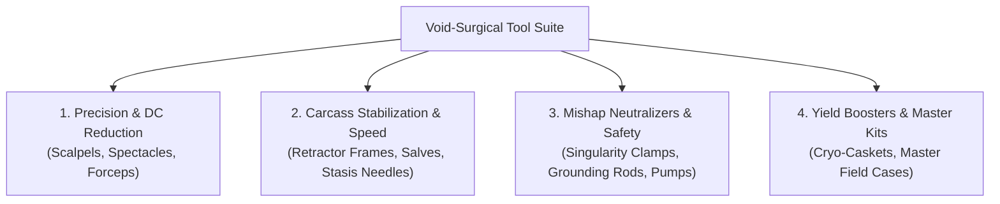

#### A. Precision & DC Reduction Instruments
* **Resonant Ultrasonic Scalpels (220 gp)**: Dual-bladed shears with clockwork quartz resonators vibrating at 12,000 Hz. They part multi-dimensional muscle like warm oil. Adds **+3 to all Eldritch Harvest Checks** and completely ignores chitin hardness.
* **Cold-Light Focusing Spectacles (140 gp)**: Brass ocular frames fitted with polarized starlight quartz lenses. Illuminates hidden organ seams, neural junctions, and spatial folds in sharp contrast. Adds **+2 to Harvest Checks** and allows operating in total darkness without penalty.
* **Chirality Forceps of Mechanus (180 gp)**: Spring-loaded pincers of meteoric iron that counter spatial torque. Adds **+2 to Harvest Checks** when extracting delicate neural tendrils, sensory lobes, or ocular lenses.
* **Obsidian-Tipped Bone Chisels (60 gp)**: Diamond-honed volcanic glass that cuts through non-Euclidean carapace plates without dulling, sliding, or causing structural vibration.

#### B. Carcass Stabilization & Speed Tools
* **Planar Viscosity Salve (75 gp per jar - 3 applications)**: Pungent amber grease distilled from Mechanus gear-oil and crushed lodestones. Smeared over an incision, it chemically "pins" shifting 4D tissue into static 3D geometry for 30 minutes, **lowering the Harvest DC by 2**.
* **Gimballed Retractor Frame (260 gp)**: A heavy framework of brass counterweights and cold-iron spreaders clamped into the body cavity. Keeps shifting dimensional angles locked open. Grants **advantage on the Harvest Check** and prevents the ribcage or cavity from collapsing.
* **Quick-Slough Alchemical Acid (90 gp per flask)**: An enzymatic wash that cleanly dissolves outer connective membranes around deep organs without damaging chitin or cores, **halving the harvesting time** (reducing it to 7.5 minutes per component).
* **Temporal Stasis Needles (Set of 3: 105 gp)**: Driven into major nerve hubs; halts cellular time in the corpse for **48 hours**, halting the vapor dissolution clock completely.

#### C. Mishap Neutralizers & Safety Apparatuses
* **Fail-Safe Singularity Clamp (160 gp)**: A heavy lead collar clamped onto volatile organs (singularity cores, warp bladders). If a **Natural 1 or failure by 5+** occurs on the Harvest Check, the clamp detonates its lead ablative buffer, **completely nullifying the mishap effect** and preserving the component (the clamp is destroyed).
* **Galvanic Neural Grounding Rod (130 gp)**: Driven into the base of the skull before cutting; discharges a continuous low-voltage galvanic current that neutralizes post-mortem nerve reflexes, **completely preventing Mishap 2 (Corpse Psychic Death-Wail) and Mishap 6 (The Awakening Reflex)**.
* **Vitreous Siphon Pump (110 gp)**: Hand-cranked brass vacuum syringe with a lead-lined chamber. Safely siphons corrosive void-bile and starlight ichor without incision risks (**automatically succeeds on collecting liquid components without rolling for mishaps**).
* **Acoustic Null-Flask (120 gp)**: Hermetically sealed lead-lined brass flask that preserves shouting or buzzing neural lobes without deafening or shocking the carrier.
* **Lead-Lined Dissection Gauntlets (100 gp)**: Grants **advantage on Dexterity saving throws** against corrosive bile, caustic acid, and psionic contact shocks.
* **Aroma-Filter Plague Mask (35 gp)**: Packed with dried sage, lavender, and charcoal. Grants **advantage on Constitution saves** against gaseous carcass vapors and nausea.

#### D. Yield Boosters & Master Field Kits
* **Cryo-Preserving Field Casket (350 gp, 25 lbs)**: A stasis-cooled chest lined with cold iron and astral salts. Keeps harvested components in pristine masterwork grade. Relics crafted from components preserved in this casket require **25% less crafting time** and can produce **1 additional dose** of alchemical tonics.
* **The Master Void-Surgeon's Field Case (Deluxe Kit - 850 gp or 15 Severed Marks, 20 lbs)**:
  * A velvet-lined, lead-shielded mahogany trunk containing the full suite of precision tools: Ultrasonic Scalpel, Mechanus Forceps, Focusing Spectacles, Retractor Frame, Siphon Pump, 3 Vacuum Jars, and Salves.
  * **Mechanical Mastery**: While using the Master Case, the surgeon has **advantage on all Harvest Checks**, adds **+2 to the check**, and **never triggers Mishap 8 (Carcass Vapor Flash)** on a failed check.

---

### 7. Master Dissection & Field Surgical Equipment Catalog

| Tool / Item | Market Cost | Weight | Mechanical Property & Practical Ease of Harvest |
| :--- | :---: | :---: | :--- |
| **Resonant Ultrasonic Scalpels** | 220 gp | 1 lb | **+3 to Harvest Checks**; ignores chitin hardness and low-light visual penalties. |
| **Cold-Light Focusing Spectacles** | 140 gp | 0.5 lbs | **+2 to Harvest Checks**; highlights non-Euclidean seams; allows cutting in darkness. |
| **Chirality Forceps of Mechanus** | 180 gp | 1 lb | **+2 to Harvest Checks** when extracting delicate neural tendrils and ocular lenses. |
| **Obsidian-Tipped Bone Chisels** | 60 gp | 2 lbs | Cleanly fractures non-Euclidean carapace plates without blade deflection. |
| **Planar Viscosity Salve (3 doses)** | 75 gp | 1 lb | **Lowers the Harvest DC by 2** for 30 minutes by pinning tissue into 3D space. |
| **Gimballed Retractor Frame** | 260 gp | 12 lbs | Grants **advantage on Harvest Checks**; locks collapsing cavities open. |
| **Quick-Slough Alchemical Acid** | 90 gp | 2 lbs | **Halves extraction duration** (to 7.5 minutes per component per size category). |
| **Temporal Stasis Needles (Set of 3)** | 105 gp | 1 lb | Freezes carcass cellular time for **48 hours**, stopping vapor dissolution. |
| **Fail-Safe Singularity Clamp** | 160 gp | 4 lbs | **Nullifies any Natural 1 / critical mishap** on a volatile organ (consumed on use). |
| **Galvanic Neural Grounding Rod** | 130 gp | 5 lbs | Driven into skull; **prevents Mishap 2 (Death-Wail) and Mishap 6 (Awakening Reflex)**. |
| **Vitreous Siphon Pump** | 110 gp | 3 lbs | Extracts void-bile/ichor automatically with zero risk of splash or mishap. |
| **Lead-Lined Dissection Gauntlets** | 100 gp | 4 lbs | Grants **advantage on Dexterity saving throws** vs acid, bile, and psionic contact shocks. |
| **Silver-Filament Blindfold** | 150 gp | 0.5 lbs | Grants complete immunity to visual Sanity Tolls; gives blindsight 10 ft for dissection. |
| **Acoustic Null-Flask** | 120 gp | 2 lbs | Preserves screaming neural lobes without acoustic or psychic deafening. |
| **Lead-Glass Vacuum Jars (Set of 3)** | 90 gp | 6 lbs | Preserves volatile liquids, starlight brine, and singular cores indefinitely. |
| **Aroma-Filter Plague Mask** | 35 gp | 1 lb | Grants **advantage on Constitution saves** against gaseous carcass vapors and nausea. |
| **Cold-Iron Salting Keg** | 75 gp | 30 lbs | Halts carcass vapor dissolution for **72 hours** (treats up to 1 Huge or 2 Large corpses). |
| **Cryo-Preserving Field Casket** | 350 gp | 25 lbs | Components retain pristine grade: **-25% void-crafting time** and **+1 potion dose**. |
| **Master Void-Surgeon's Field Case** | 850 gp | 20 lbs | Complete deluxe suite: grants **advantage on all Harvest Checks**, **+2 bonus**, and **immunity to Carcass Vapor Flash (Mishap 8)**. |

---

## 🔮 Phase 4: Forbidden Void-Crafting & Relic Forging

Transforming eldritch carcass trophies into equipment yields **Void-Relics**—instruments that channel alien geometry to produce terrifying combat effects.

### The Lucidity Cost of Forging
Crafting a Void-Relic requires an artisan who can hold alien concepts in their mind without shattering:
* **The Forging Sanity Toll**: For every day spent forging a Void-Relic, the crafter must make a **DC (12 + Item Tier) Wisdom saving throw** or suffer **1d6 Lucidity drain**. Utilizing an *Axiomatic Euclidean Circle* in the smithy negates this daily check.
* **Void-Attunement Quirk**: Void-Relics whisper in Deep Speech, feel perpetually cold to the touch, or cast shadows that bend in the wrong direction. Attuning to a Void-Relic lowers your **Starting Lucidity threshold by 5** while attuned.

---

### Master Void-Crafting Recipes

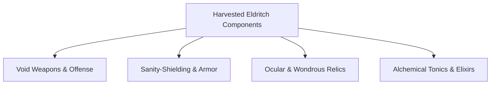

#### Category 1: Void Weapons & Offensive Implements

| Item Name | Required Eldritch Components | Base Cost & Time | Relic Properties & Tactical 5e Mechanics |
| :--- | :--- | :---: | :--- |
| **Blade of the Inverted Angle (+2)** | 2 Paradox Fangs + 1 Intact Neural Tendril + Crucible Steel | 4 Days / 600 gp | *Weapon (Any Sword), Rare (Attunement)*. Deals an extra **2d6 psychic damage** on hit. Critical hits ignore physical armor, calculating damage against **AC 10 + Dex modifier**. |
| **Spoor-Harpoon of the Deep Watcher (+3)** | 1 Barbed Proboscis + 1 Kraken Filament + Cold Iron | 7 Days / 1,500 gp | *Weapon (Pike/Spear), Very Rare (Attunement)*. Reach 15 ft. On hit, tethers target psionically. Target cannot teleport, phase-shift, or plane-shift while tethered (escape DC 18 Str). |
| **Bow of the Distant Maw (+2)** | 1 Warp-Stalker Chitin Rib + 2 Neural Tendrils | 5 Days / 950 gp | *Weapon (Longbow), Rare (Attunement)*. Arrows fired phase through solid cover up to 3 feet thick, ignoring half and three-quarters cover. Target takes +1d8 force damage. |
| **Stiletto of the Un-Made Point (+1)** | 1 Non-Euclidean Chitin Spire + Quenched Lead | 3 Days / 400 gp | *Weapon (Dagger), Rare*. When thrown, automatically returns to hand through a spatial fold. On hit, forces DC 14 Wis save or target is blinded by whispering shadows for 1 round. |

#### Category 2: Defensive Armor & Sanity-Protecting Relics

| Item Name | Required Eldritch Components | Base Cost & Time | Relic Properties & Tactical 5e Mechanics |
| :--- | :--- | :---: | :--- |
| **Aegis of the Severed Gaze** | 3 Non-Euclidean Chitin Plates + Lead Wire + Steel Boss | 5 Days / 850 gp | *Shield (+2), Rare (Attunement)*. Wielder is **immune to madness, charm, and confusion effects**. When struck by a spell, reflect **3d8 psychic damage** back to caster (2/day). |
| **Mantle of the Void-Walker** | 1 Translucent Leech-Pelt + Astral Salts + Fine Silk | 4 Days / 750 gp | *Wondrous Item (Cloak), Rare (Attunement)*. Grants **resistance to psychic and force damage**. As a bonus action, step through a spatial fold to teleport 30 ft (3/day). |
| **Torc of Axiomatic Sanity** | 1 Preserved Neural Node + 50 gp Gold Filigree + Cold Iron | 4 Days / 650 gp | *Wondrous Item, Rare (Attunement)*. The wearer gains **+3 on all Wisdom and Intelligence saving throws** against Lucidity drain, madness, and telepathy. Wearer gains **10 Temporary Lucidity** at the end of every long rest. |
| **Helm of the Euclidean Sentinel** | 2 Warp-Stalker Chitin Horns + Mechanus Brass Band | 6 Days / 1,100 gp | *Armor (Helmet), Very Rare (Attunement)*. Wearer cannot be surprised, cannot be flanked, and is immune to gaze attacks. Aberrations within 10 ft cannot turn invisible. |
| **Amulet of the Unblinking Eye** | 1 Bioluminescent Ocular Lens + Lead Setting | 3 Days / 500 gp | *Wondrous Item, Rare*. The wearer can cast *Detect Thoughts* at will (DC 15) without risk of psychic backlash. Wearer cannot fall asleep against their will. |

#### Category 3: Wondrous Utensils & Consumable Tonics

| Item Name | Required Eldritch Components | Base Cost & Time | Relic Properties & Tactical 5e Mechanics |
| :--- | :--- | :---: | :--- |
| **Ocular Circlet of the Thousand Lids** | 4 Preserved Aberrant Lenses + Gold Filigree | 6 Days / 1,200 gp | *Wondrous Item, Very Rare (Attunement)*. Grants **truesight 60 ft** and **telepathy 120 ft**. Wearer cannot be blinded, surprised, or deceived by illusions. |
| **Draught of the Un-Woven Mind (3 Doses)** | 1 Flask of Starlight Brine + Void-Bile + Lavender | 2 Days / 300 gp | *Potion, Rare*. Drinking grants **immunity to psychic damage** for 1 hour and allows casting *Synaptic Static* (DC 16) once within that hour. |
| **Philter of Sleepless Clarity (2 Doses)** | 1 Dream-Ichor Flask + 1 Translucent Leech-Pelt | 2 Days / 180 gp | *Potion, Uncommon*. Grants immunity to magical sleep, nightmares, and dream-invasions for 24 hours. Drinker regains 2d10 lost Lucidity upon drinking. |
| **Scalpel of the Fourth Dimension** | 1 Paradox Fang + Mechanus Brass + Silver Wire | 4 Days / 550 gp | *Wondrous Item, Rare*. Master void-surgical tool. Grants **+4 to all Eldritch Harvest Checks** and bypasses ethereal and folded-space obstacles. On a roll of 18–20 on the Harvest Check d20, **doubles the harvested component yield**. |
| **Lantern of True Dimensions** | 1 Warp-Stalker Luminescent Organ + Brass Casing | 4 Days / 600 gp | *Wondrous Item, Rare*. Sheds bright axiomatic light for 30 ft. Aberrations within the light cannot enter the Ethereal Plane, teleport, or use Slippery Geometry. |

---

## 🪙 Phase 5: Lodges, Bounties & The Severed Mark

The **Sovereign Order of the Severed Eye** and the **Grand Guild of the Iron Spoor** maintain hunting lodges, sanatoria, and bounties across planar hubs.

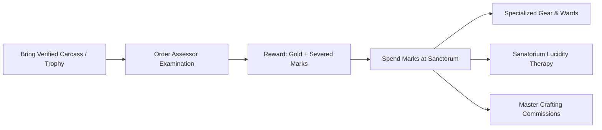

### 1. Inquisitorial Hunter Ranks
Hunters rise through the ranks of the Order by bringing in verified eldritch trophies:
1. **Acolyte of the Veil (Rank 1)**: Completed 1 Tier I hunt. Permitted to purchase lead-lined gear and access the Order's alchemical apothecary.
2. **Void-Skinner (Rank 2)**: Completed 3 Tier II hunts. Granted access to the Euclidean Dissection Labs and qualified to lead field harvests.
3. **Harpooner of the Deep (Rank 3)**: Slain at least 1 Tier III Harbinger. Entitled to lodge master crafting facilities and command hunting retinues.
4. **Grand Inquisitor (Rank 4)**: Slain a Tier IV Primordial Scion. Wears the ceremonial Blindfold of White Iron; holds voting authority in the Conclave of the Severed Eye.

### 2. Eldritch Trophy Exchange & Severed Marks
The Order pays bounties in gold and **Severed Marks**—hexagonal coins of meteoric silver stamped with a needle-pierced lidless eye:

* **Tier I: Dream-Leeches & Larvae (CR 5–8)**: 5 Severed Marks + 300 gp.
* **Tier II: Dimensional Warp-Stalkers (CR 9–12)**: 15 Severed Marks + 900 gp.
* **Tier III: Mind-Leviathans & Harbingers (CR 13–16)**: 35 Severed Marks + 2,000 gp.
* **Tier IV: Primordial Sleeper Scions (CR 17–20)**: 75 Severed Marks + 5,000 gp + Guild Title of *High Inquisitor*.
* **Tier V: Void Sovereigns (CR 21+)**: 150 Severed Marks + 15,000 gp + Grand Estate in the Fractured Nexus.

### 3. Severed Mark Redemption Catalog
Severed Marks can be spent exclusively at Order Chapterhouses:

| Service / Item | Mark Cost | Description & Mechanical Benefit |
| :--- | :---: | :--- |
| **Phial of Concentrated Loom-Sap** | 8 Marks | Restores **4d10 Lucidity** instantly and removes 1 level of Exhaustion. |
| **Master Void-Surgeon's Field Case** | 15 Marks | Complete deluxe surgical suite in a lead-lined trunk; grants advantage and +2 on Harvest Checks, and prevents Carcass Vapor Flash (Mishap 8). |
| **Fail-Safe Singularity Clamps (Pack of 2)** | 4 Marks | Single-use ablative lead buffers that nullify any Natural 1 or critical mishap while extracting volatile cores. |
| **Sanatorium Cold-Salt Bath (3 Days)** | 12 Marks | Submersion in mineral brine and pulverized cold iron; restores **all lost Lucidity** and cures 1 indefinite Dream-Fracture Affliction. |
| **Chrono-Weave Suture Therapy** | 20 Marks | An Order chronomancer repairs torn neural Loom-threads; permanently restores **+5 Maximum Lucidity** lost to micro-inoculations or traumatic breaks. |
| **Lead-Lined Plating (Armor Upgrade)** | 15 Marks | Adds lead mesh interior to any armor suit. Wearer has resistance to psychic damage from Far Realm ambient radiation. |
| **Axiomatic Weapon Quenching** | 18 Marks | Quenches a masterwork weapon in silver-mercury brine; weapon deals an extra **1d8 radiant/force damage** to aberrations. |

---

## 🚨 Phase 6: Emergency Madness Protocols in the Field

When a hunter's Lucidity drops to **0** or they succumb to an acute **Threshold 4 Somnambulic Compulsion** mid-hunt, companions must act immediately to prevent total party collapse.

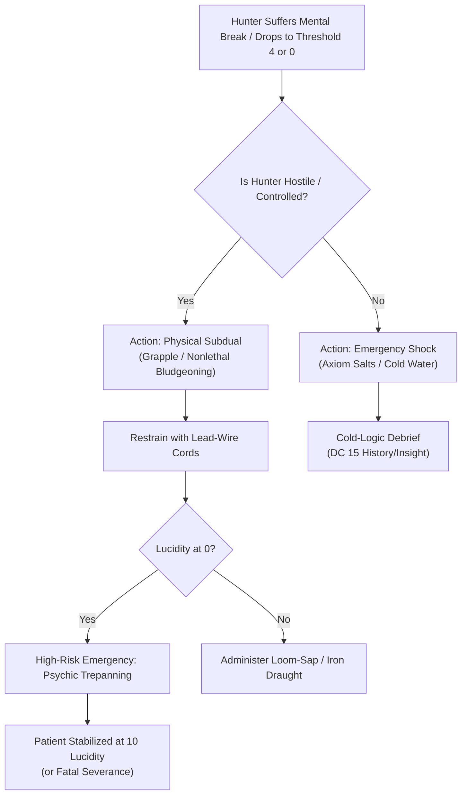

### 1. Subduing an Afflicted Ally
* **Lead-Wire Shackles (25 gp)**: Designed specifically to restrain telepathically convulsing hunters. Prevents the afflicted hunter from utilizing somatic spell components or psionic traits (escape DC 16 Athletics).
* **Nonlethal Subdual**: Melee attacks can declare nonlethal damage to knock an ally unconscious at 0 HP, temporarily suppressing violent somnambulic compulsions without killing them.

### 2. Emergency Shock Procedures
* **Cold-Logic Interrogation (Action)**: An ally makes a **DC 15 Intelligence (History) or Wisdom (Insight) check**, shouting core personal truths (names of parents, true birthplace, sacred vows) into the victim's face. On a success, the victim's violent compulsion is suppressed for 1 minute, allowing them to drink an alchemical draught.
* **The Cold-Water Inversion**: Dousing an afflicted hunter in ice-cold brine shocks their neural network, granting them an immediate saving throw with advantage to break free from magical or psionic charm/confusion.

### 3. Emergency Field Trepanning (High-Risk Last Resort)
If a character drops to **0 Lucidity** and is within minutes of dissolving into an Astral Spawn, a void-surgeon with **Medicine proficiency** and a **Healer's Kit** can attempt emergency cranial venting:
* **The Procedure**: The surgeon spends 3 actions using an obsidian needle to relieve psychic pressure behind the patient's temple.
* **The Check**: **DC 17 Wisdom (Medicine)** or **DC 17 Intelligence (Arcana)**.
  * **Success**: The patient's soul-thread is pinned back to three-dimensional reality. They stabilize at **10 Lucidity** and regain consciousness with 1 HP, suffering 1 level of exhaustion.
  * **Failure**: The soul-thread snaps. The patient takes 6d10 psychic damage; if this reduces them to 0 HP, they permanently dissolve into liquid starlight.

---

## 🗺️ Cross-Vault Links

* **Madness Rules Core**: [[Custom Rules/The Eldritch Madness & Dream-Fracture Ruleset|Module II: The Eldritch Madness & Dream-Fracture Ruleset]]
* **Harvesting Rules Core**: [[Custom Rules/The Interplanar Hunting, Harvesting & Trophy-Crafting Ruleset|Module III: The Interplanar Hunting, Harvesting & Trophy-Crafting Ruleset]]
* **Creature Statblocks & Field Bestiary**: [[Custom Rules/Eldritch Horror Bestiary - Creature Entries|Eldritch Horror Bestiary: Comprehensive Creature Entries]]
* **Guilds & Planar Hunting Lodges**: [[Custom Rules/Planar Bestiary & Hunting Lodges Compendium|Planar Bestiary & Hunting Lodges Compendium]]
* **Eldritch Faction Guide**: [[Factions/The Order of the Severed Eye|The Order of the Severed Eye]]
* **Inquisitor Profiles**: [[NPCs/Key NPCs - The Order of the Severed Eye|Key NPCs: The Order of the Severed Eye]]
* **Central Rules Hub**: [[Custom Rules/Custom Rules|Custom Rules & Mechanics Hub]]
