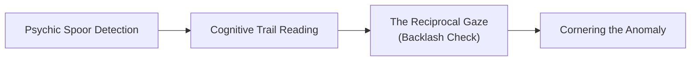

# 👁️ The Eldritch Horror Hunting & Sanity-Harvesting Ruleset
### *A Modular System of Psychic Stalking, Paradox Dissection, Lucidity Hazard, and Void-Relic Forging*

> *"You cannot hunt an aberration as you would a wolf. A wolf leaves mud on the ferns; an eldritch horror leaves a bruise on the memory of the glade. If you track its blood, you follow a color that doesn't exist. And when you open its ribcage, you must pray your own sanity doesn't spill out onto the slab before its heart stops beating."*  
> — **Grand Inquisitor Sylas the Blind**, Sovereign Order of the Severed Eye

---

## 📖 System Philosophy & Core Design

In **Project Shattered Loom**, aberrations, void-entities, and cosmic parasites originating from the **Far Realm**, the **City of Ry'leh**, the **Entropic Wake of the Abyss**, or shattered planar rifts cannot be harvested through mundane butchery. 

Their anatomies exist across four or more spatial dimensions, their blood carries psychic static, and their organs defy three-dimensional physics. This modular system integrates directly with:
1. **[[Custom Rules/The Eldritch Madness & Dream-Fracture Ruleset|The Eldritch Madness & Dream-Fracture Ruleset (Module II)]]**: Using the **Lucidity Index (0–100)** as the mental health currency risked during field autopsies.
2. **[[Custom Rules/The Interplanar Hunting, Harvesting & Trophy-Crafting Ruleset|The Interplanar Hunting, Harvesting & Trophy-Crafting Ruleset (Module III)]]**: Adapting harvest DCs, carcass preservation, and trophy recipes for cosmic abominations.

---

## 🧭 Phase 1: Psychic Spoor & Oneiric Tracking

Eldritch abominations rarely leave physical tracks; they leave **metaphysical scars** on the local Loom-weave.

### 1. The Oneiric Stalking Check
To locate an eldritch quarry, the lead tracker makes an **Eldritch Stalking Check** combining **Wisdom (Insight)** or **Intelligence (Arcana)**:

| Quarry Classification | Characteristic Spoor Clues | Base Stalking DC |
| :--- | :--- | :---: |
| **Tier I: Dream-Leeches & Larvae (CR 5–8)** | Inverted bird songs, sudden migraines, sour metallic taste in the air. | **DC 14** |
| **Tier II: Dimensional Warp-Stalkers (CR 9–12)** | Shadow slippage, compass needles spinning backward, localized gravity ripples. | **DC 16** |
| **Tier III: Mind-Leviathans & Harbingers (CR 13–16)** | Mass hallucinations, weeping walls, non-Euclidean angles in natural trees/caves. | **DC 18** |
| **Tier IV: Primordial Sleeper Scions (CR 17+)** | Reality-fractures, spontaneous somnambulism, spontaneous memory amnesia across towns. | **DC 20** |

### 2. The Reciprocal Gaze: Psychic Backlash (d8)
Eldritch entities are telepathically sensitive. Whenever a tracking check fails by 5 or more, the entity senses the mental thread reaching for it. Roll on the **Reciprocal Gaze Table**:

| d8 | Psychic Backlash Effect | Mechanical Consequence |
| :---: | :--- | :--- |
| **1** | **Synesthetic Bleed** | The tracker smells sound and hears colors. Disadvantage on Perception checks for 1d4 hours. |
| **2** | **Memory Echo** | The tracker relives their worst nightmare. Loses **1d8 Lucidity**; gain 1 level of exhaustion. |
| **3** | **Telepathic Shriek** | The quarry projects an acoustic blast. The party takes 3d6 psychic damage and is deafened for 10 minutes. |
| **4** | **Spatial Inversion** | Distances fold. The party walks 2 miles in the wrong direction, emerging into a hostile planar hazard. |
| **5** | **The Stalking Eye** | The quarry begins hunting the party; gains surprise on the opening round of combat. |
| **6** | **Un-Woven Whisper** | A player's highest-level unexpended spell slot is consumed by cosmic static. |
| **7** | **Visual Paranoia** | Tracker believes their allies have tentacles beneath their clothing. Disadvantage on Charisma checks for 24h. |
| **8** | **Paradox Revelation** | The mind fractures slightly, but glimpses truth. Tracker loses 1d10 Lucidity, but gains advantage on all attack rolls against the quarry for 24 hours. |

---

## 🔪 Phase 2: Sanity-Risk Harvesting & Field Dissection

Harvesting an eldritch abomination is inherently dangerous. Dissecting an organ that vibrates with fourth-dimensional geometry or contains trapped psychic screams directly attacks the harvester's **Lucidity**.

### 1. The Dissection Procedure
Harvesting an eldritch component takes **15 minutes per size category** and requires specialized gear:
* **The Harvest Check**: **Intelligence (Arcana or Nature)** + **Alchemist's Supplies** or **Poisoner's Kit**.
* **Target DC**: `12 + Monster Challenge Rating (CR)` (Max DC 26 for CR 17+).

### 2. The Sanity Toll: Lucidity Saving Throw
Before rolling the harvest check, the harvester must make a **DC (10 + CR / 2) Wisdom saving throw**:
* **On a Success**: The harvester shields their cognition with disciplined meditation or protective wards; no Lucidity is lost.
* **On a Failure**: The harvester suffers **Lucidity Drain** according to the creature's tier:
  * **Tier I (CR 5–8)**: 1d6 Lucidity drain.
  * **Tier II (CR 9–12)**: 2d6 Lucidity drain.
  * **Tier III (CR 13–16)**: 3d8 Lucidity drain + roll on the d20 Dream-Fracture Afflictions Table.
  * **Tier IV (CR 17+)**: 4d10 Lucidity drain + immediate temporary blindness/psychic paralysis for 1 hour.

### 3. Specialized Eldritch Dissection Equipment

| Tool / Item | Market Cost | Purpose & Mechanical Protection |
| :--- | :---: | :--- |
| **Lead-Lined Dissection Gauntlets** | 100 gp | Advantage on Dexterity saves vs corrosive void-acid or psionic contact shocks. |
| **Silver-Filament Blindfold** | 150 gp | Allows harvester to "see" through telepathic touch; grants advantage on the Sanity Toll saving throw. |
| **Cold-Iron Salting Keg** | 75 gp | Halts eldritch flesh from dissolving into paradoxical vapor for 72 hours. |
| **Acoustic Null-Flask** | 120 gp | Preserves screaming neural lobes without rupturing the eardrums of those carrying it. |

---

## 🔮 Phase 3: Forbidden Void-Crafting

Trophy-crafting with eldritch materials yields **Void-Relics**—items that wield devastating aberrant power but carry cognitive side-effects.

### Master Void-Crafting Recipes

| Item Name | Required Eldritch Components | Base Cost & Time | Relic Properties & Tactical 5e Mechanics |
| :--- | :--- | :---: | :--- |
| **Blade of the Inverted Angle (+2)** | 2 Paradox Teeth + 1 Intact Neural Tendril | 4 Days / 600 gp | Deals an extra 2d6 psychic damage. Critical hits ignore physical armor, calculating damage against AC 10 + Dex. |
| **Aegis of the Severed Gaze** | 3 Non-Euclidean Chitin Plates + Lead Wire | 5 Days / 850 gp | Shield (+2). While held, wearer is immune to madness, charm, and confusion effects. When struck by a spell, reflect 3d8 psychic damage back to caster (2/day). |
| **Mantle of the Void-Walker** | 1 Translucent Jelly-Pelt + Astral Salts | 4 Days / 750 gp | Armor / Cloak. Grants resistance to psychic and force damage. As a bonus action, step through a spatial fold to teleport 30 ft (3/day). |
| **Ocular Circlet of the Thousand Lids** | 4 Preserved Aberrant Lenses + Gold Filigree | 6 Days / 1,200 gp | Wondrous Item (Very Rare). Grants truesight 60 ft and telepathy 120 ft. Wearer cannot be blinded or surprised. |
| **Draught of the Un-Woven Mind (3 Doses)** | 1 Flask of Starlight Brine + Void-Bile | 2 Days / 300 gp | Alchemical Tonic. Drinking grants immunity to psychic damage and allows casting *Synaptic Static* (DC 16) once within 1 hour. |
| **Spoor-Harpoon of the Deep Watcher (+3)** | 1 Barbed Kraken Filament + Crucible Steel | 7 Days / 1,500 gp | Weapon (Pike/Spear). Reach 15 ft. On hit, tether target psionically. Target cannot teleport or plane shift while tethered (escape DC 18 Str). |

---

## 🪙 Phase 4: Bounties & The Severed Mark

The **Order of the Severed Eye** rewards hunters who bring in verified eldritch trophies with **Severed Marks**—hexagonal silver coins stamped with an open lidless eye:

* **Eldritch Trophy Exchange**:
  * **Lesser Aberration (CR 5–8)**: 5 Severed Marks + 300 gp.
  * **Greater Aberration (CR 9–12)**: 15 Severed Marks + 900 gp.
  * **Eldritch Harbinger (CR 13–16)**: 35 Severed Marks + 2,000 gp.
  * **Cosmic Sovereign / Sleeper Scion (CR 17+)**: 75 Severed Marks + 5,000 gp + Guild Title of *High Inquisitor*.
* **Severed Mark Redemption**: Can be exchanged at any Order Sanctorum for *Phials of Loom-Sap*, lead-lined weapon cases, psionic warding rings, and master trophy commissions.

---

## 🗺️ Cross-Vault Links

* **Parent Ruleset**: [[Custom Rules/The Eldritch Madness & Dream-Fracture Ruleset|Module II: The Eldritch Madness & Dream-Fracture Ruleset]]
* **Planar Lodges Compendium**: [[Custom Rules/Planar Bestiary & Hunting Lodges Compendium|Planar Bestiary & Hunting Lodges Compendium]]
* **Dedicated Faction**: [[Factions/The Order of the Severed Eye|The Order of the Severed Eye]]
* **Leadership Profiles**: [[NPCs/Key NPCs - The Order of the Severed Eye|Key NPCs: The Order of the Severed Eye]]
* **Central Rules Hub**: [[Custom Rules/Custom Rules|Custom Rules & Mechanics Hub]]
