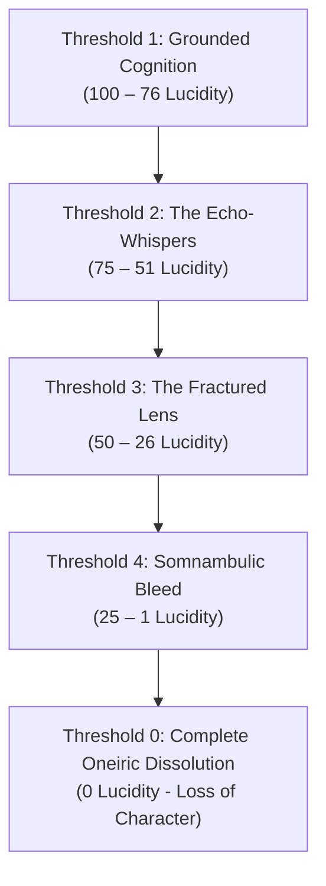
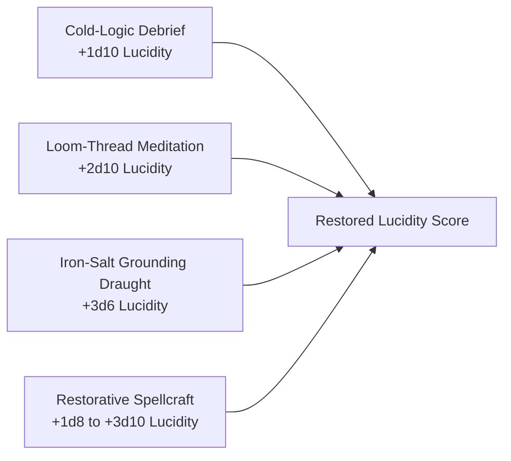

# 🌀 The Eldritch Madness & Dream-Fracture Ruleset
### *A Modular System of Mental Cohesion, Non-Euclidean Paradox, and Forbidden Insight*

> *"The mind of mortal kind was woven for a world of three dimensions, straight lines, and orderly cause and effect. In the presence of the Great Dreamer, those lines do not bend—they dissolve. Madness here is not a disease of the brain; it is the friction of finite thought attempting to inhabit an infinite, un-woven dream."*  
> — **Archivist Mauren Coldsteel, Treatise on the Somnolent Nexus**

---

## 📖 System Philosophy & Design Goals

The standard D&D 5e Madness system (DMG pp. 258–260) relies on binary saving throws that inflict arbitrary short-term, long-term, or indefinite penalties. In **Project Shattered Loom**, exploring realms such as the **City of Ry'leh**, the **Submerged Ziggurat**, or the **Entropic Wake of the Great Dreamer** requires a more dynamic, atmospheric, and tactical system.

### **Core Pillars of the Dream-Fracture System**:
1. **The Lucidity Index (0–100)**: Sanity is not a binary toggle, but a measurable mental health resource that erodes under cosmic stress and recovers through grounding anchors.
2. **Double-Edged Forbidden Insights**: As a character's Lucidity drops and their grip on reality slips, they gain eerie eldritch capabilities—such as the ability to see through walls, speak in the alien tongue of the un-woven, or telekinetically warp matter—at the cost of growing psychic vulnerability.
3. **Tactile Grounding Mechanics**: Players have agency to actively restore their Lucidity using alchemical tonics, Loom-thread meditation, psychological debriefs, and restorative spellcraft.
4. **Vivid Roleplay Afflictions**: A dedicated d20 table of surreal, narrative-rich sensory and behavioral distortions replaces generic paralysis or catatonia.

---

## 🧭 The Lucidity Index (0–100)

Every player character possesses a **Lucidity Score**:
* **Maximum Lucidity**: **100 Points** (Representing complete mental stability and grounding in three-dimensional reality).
* **Starting Lucidity**: Characters enter Ry'leh or eldritch shatterpoints with **100 Lucidity**, unless previously exposed to eldritch phenomena.
* **Tracking**: Players track their current Lucidity alongside Hit Points and Spell Slots.

---

## ⚡ Sources of Dream-Fracture: How Lucidity Drains

Whenever a character is exposed to cosmic paradoxes, aberrant telepathy, or the dream-presence of the Great Dreamer, the DM calls for a **Lucidity Check** (typically a **Wisdom** or **Intelligence** saving throw). Failing the saving throw drains Lucidity according to the severity of the exposure:

| Exposure Tier | Triggering Event / Phenomenon | Typical Save DC | Lucidity Drain (Failed Save) | Half on Success? |
| :---: | :--- | :---: | :---: | :---: |
| **Tier I: Minor Dissonance** | Witnessing non-Euclidean architecture; tasting starlight brine; hearing ambient whisper-static. | **DC 13** | **1d6** | None |
| **Tier II: Moderate Fracture** | Telepathic intrusion by an Aberration; drinking from the Tides of Thought; long resting in Ry'leh without wards. | **DC 15** | **2d6 + 2** | Half (Min 1) |
| **Tier III: Severe Trauma** | Failing a save in the Chamber of Eyes; taking 30+ psychic damage in a single attack; falling into an Abyssal Well. | **DC 17** | **3d8 + 4** | Half |
| **Tier IV: Cosmic Cataclysm** | Gazing upon the Great Dreamer; witnessing the death of an entire planar shard; entering the Sanctum of the Sleeper. | **DC 20** | **4d10 + 6** | Half |

> [!NOTE]
> **Psychic Damage Translation**: Whenever a character takes direct **psychic damage** while in Ry'leh, they simultaneously lose Lucidity equal to **half the psychic damage taken** (rounded down).

---

## 🌀 The Four Thresholds of Dream-Fracture

As Lucidity drops into lower tiers, the character shifts into new psychological thresholds. Each threshold imposes distinct behavioral penalties and grants unique **Forbidden Insights**.

### **Threshold 1: Grounded Cognition (100 – 76 Lucidity)**
* **Mental State**: Stable, rational, and fully anchored to mortality.
* **Symptom**: Subtle pressure behind the temples; a faint, rhythmic humming reminiscent of breathing waves when standing near water.
* **Mechanical Effect**: None. The character operates normally.

### **Threshold 2: The Echo-Whispers (75 – 51 Lucidity)**
* **Mental State**: The boundary between external sensory input and internal thought begins to blur. The character hears murmurs in unfamiliar languages that sound eerily like their own voice.
* **Cognitive Penalty**: Disadvantage on Wisdom (Perception) checks made to notice mundane sounds or stealth, as your hearing is crowded by ethereal whispers.
* **Forbidden Insight (Glimpse of the Unwoven)**: You can understand and speak Deep Speech and Abyssal. Once per short or long rest, you can cast *Dissonant Whispers* (2nd level, DC = 8 + your proficiency bonus + your Charisma or Wisdom modifier) without expending a spell slot or material components.

### **Threshold 3: The Fractured Lens (50 – 26 Lucidity)**
* **Mental State**: The character perceives three-dimensional space as an artificial flat tapestry. Angles that should be acute appear obtuse; shadows move seconds after the objects casting them.
* **Cognitive Penalty**: Whenever you take psychic damage, you suffer an additional **1d8 psychic damage** as your mind lacks the structural rigidity to deflect mental trauma. Furthermore, rolling a natural 1 on any attack roll, ability check, or saving throw triggers a temporary sensory hallucination (you are incapacitated until the start of your next turn).
* **Forbidden Insight (Oneiric Sight)**: You gain **Truesight** out to a range of 30 feet, allowing you to see into the Ethereal Plane, perceive invisible creatures, and identify illusions automatically.

### **Threshold 4: Somnambulic Bleed (25 – 1 Lucidity)**
* **Mental State**: The subconscious mind of the Great Dreamer has begun to co-opt the character's neural pathways. The character frequently catches themselves sleepwalking, writing prophecies in alien script, or forgetting which memories belong to them and which belong to beings across other worlds.
* **Cognitive Penalty**: At the start of each dawn, you must make a **DC 16 Wisdom saving throw**. On a failure, you are seized by an alien somnambulic compulsion (e.g., carving spiral glyphs into your gear, hoarding salt, seeking deep water, or refusing to speak except in rhymes) that dictates your behavior for 4 hours.
* **Forbidden Insight (Warp the Dreaming)**: You can bend local reality using sheer psychic will. Once per long rest, you can cast *Confusion* or *Telekinesis* (DC = 8 + your proficiency bonus + your Charisma or Wisdom modifier) without expending a spell slot or components.

### **Threshold 0: Complete Oneiric Dissolution (0 Lucidity)**
* **The Final Severance**: The character's soul-thread snaps. Their physical body dissolves into liquid starlight, permanently transforming into an **Astral Spawn** (CR 3 aberration), or their consciousness is absorbed into the Tides of Thought. The character permanently becomes an NPC under the DM's control unless resurrected by *True Resurrection* or a direct divine intervention by Telara.

---

## 🌿 The Grounding System: Restoring Lucidity

Lucidity does **not** passively regenerate upon completing a rest within the City of Ry'leh or other eldritch domains. To restore Lucidity, characters must proactively engage in **Grounding Actions**:

### **1. Grounding Procedures & Actions**
* **Cold-Logic Debrief (Short Rest)**: An ally with proficiency in **History**, **Arcana**, or **Insight** spends 30 minutes grounding the affected character by asking rigid, factual questions about their past, family, and home realm. With a successful **DC 15 Intelligence (History) or Wisdom (Insight) check**, the patient regains **1d10 Lucidity** (can only benefit once per short rest).
* **Loom-Thread Tethering (10 Minutes)**: Meditating while holding an intact **Loom-Thread** or unspun filament of Telara grounds the soul to cosmic reality, restoring **2d10 Lucidity**.
* **Consuming an Iron-Salt Draught (Action)**: Drinking this pungent alchemical tonic (brewed from refined sea salt, cold iron dust, and dried lavender) shocks the nervous system back to waking consciousness, restoring **3d6 Lucidity**, but forcing a DC 13 Constitution saving throw; on a failure, the character gains **1 level of exhaustion**.
* **Leaving the Domain**: Spending 24 continuous hours on a stable plane (such as the Material Plane or the Fractured Nexus) passively restores **10 Lucidity per day**.

### **2. Magical Restorations**
* **Calm Emotions (2nd Level)**: Suppresses the penalties and benefits of the character's current Dream-Fracture Threshold for the spell's duration, treating them as if they were in Threshold 1. Does not restore Lucidity points.
* **Lesser Restoration (2nd Level)**: Restores **1d8 + your spellcasting ability modifier** Lucidity points.
* **Greater Restoration (5th Level)**: Restores **3d10 + your spellcasting ability modifier** Lucidity points and cures one active Dream-Fracture Affliction.
* **Heal (6th Level)**: Fully restores all lost Lucidity and clears all temporary madness afflictions.
* **Mind Blank (8th Level)**: Grants total immunity to Lucidity loss, madness checks, and dream-bleed for 24 hours.

---

## 🎲 The Master d20 Dream-Fracture Afflictions Table

When a character's Lucidity crosses downward into a lower threshold (from 1 to 2, 2 to 3, or 3 to 4), roll a **d20** to determine their specific acute affliction, which persists until their Lucidity rises into a higher threshold or is cured by *Greater Restoration*:

| d20 | Affliction Name | Psychological & Mechanical Manifestation |
| :---: | :--- | :--- |
| **1** | **Inverted Gravity Vertigo** | You perceive the sky as a bottomless ocean pit. You cannot willingly look upward or make ranged attacks at aerial targets without making a DC 14 Wis save. |
| **2** | **Echo-Speech (Echolalia)** | You must repeat the last three words spoken by any creature within 30 feet before you can speak your own sentence aloud. |
| **3** | **Chirality Reversal** | Your brain swaps left and right. Your speed is reduced by 10 feet as you constantly stumble, and you suffer a -2 penalty to Dexterity checks. |
| **4** | **The Phantom Eye** | You feel a third, heavy eye blinking in the center of your forehead. You suffer disadvantage on concentration checks as it stares into your brain. |
| **5** | **Memory of a World Un-Made** | You vividly remember an entire lifetime in a city that was wiped out before the Loom broke. You refer to companions by names of dead strangers. |
| **6** | **Liquid Light Phobia** | You are terrified of reflective liquids and bioluminescence. While within 10 feet of glowing water or mirrors, you are frightened. |
| **7** | **The Slumbering Stutter** | Your speech is interspersed with long, eerie pauses where your eyes roll back and you murmur fragments of alien poetry. |
| **8** | **Synesthetic Agony** | Loud noises taste like burning ash, and bright lights feel like needles on your skin. You gain vulnerability to thunder and radiant damage. |
| **9** | **The Sleeper's Mirror** | You believe that everyone around you is asleep, and that waking them will cause the multiverse to evaporate. You whisper and move with frantic stealth. |
| **10** | **Grip of the Tentacle** | Your fingers feel rubbery and boneless. You have disadvantage on Dexterity (Sleight of Hand) checks and cannot use finesse weapons effectively. |
| **11** | **Paranoia of the Angles** | You refuse to stand near corners or architectural intersections, believing that monsters dwell in acute angles below 90 degrees. |
| **12** | **The Drowned Breath** | You feel as if your lungs are constantly filled with cold saltwater. You can hold your breath indefinitely, but you cough up kelp upon taking damage. |
| **13** | **Temporal Desynchronization** | Your reflexes lag behind reality. You roll initiative with disadvantage and cannot take reactions during the first round of any combat. |
| **14** | **The Hunger for Thought** | Mundane food tastes like dry chalk. You can only satisfy your hunger by meditating near psychic creatures or drinking starlight brine. |
| **15** | **The Whispering Shadows** | You believe your shadow is plotting your assassination with the shadows of your companions. You constantly look behind yourself in combat. |
| **16** | **Obsession with Spirals** | You feel an overwhelming urge to draw, carve, or walk in concentric spirals. Spending 1 hour without tracing a spiral causes 1 level of exhaustion. |
| **17** | **The Somnolent Weight** | Your physical body feels four times heavier. Your jump distance is halved, and you have disadvantage on Strength (Athletics) checks. |
| **18** | **Alien Mercy** | You believe that enemies are merely frightened dreamers who must be put to sleep peacefully. You cannot deal lethal damage with your attacks. |
| **19** | **The Cyclopean Stare** | You stare unblinkingly at nearby creatures. Your Charisma (Intimidation) checks have advantage, but your Charisma (Persuasion) checks have disadvantage. |
| **20** | **The Great Dreamer's Resonance** | Your eyes glow with pale violet starlight. Aberrations treat you as friendly unless attacked, but celestial and lawful creatures treat you with hostility. |

---

## 🛠️ Integration with Campaign Vaults

* **Regional Context**: Read how this ruleset governs the streets, spires, and trenches of the city in **[[Planes of Existence/City Of Ry'leh/City Of Ry'leh|City Of Ry'leh (The Extradimensional City)]]**.
* **Dungeon Application**: See specific chamber-by-chamber DC tables and ocular hazards in **[[Planes of Existence/City Of Ry'leh/The Submerged Ziggurat|The Submerged Ziggurat (Megadungeon Gazetteer)]]**.
* **Cartography & Navigation**: Review astral approach currents and navigation risks in **[[Planes of Existence/City Of Ry'leh/Map of the City of Ry'leh|Map of the City of Ry'leh]]**.
* **Central Rules Hub**: Access all modular rulesets in **[[Custom Rules/Custom Rules|Custom Rules & Mechanics Hub]]**.
