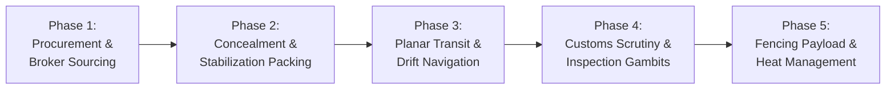
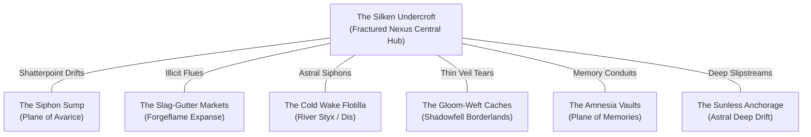
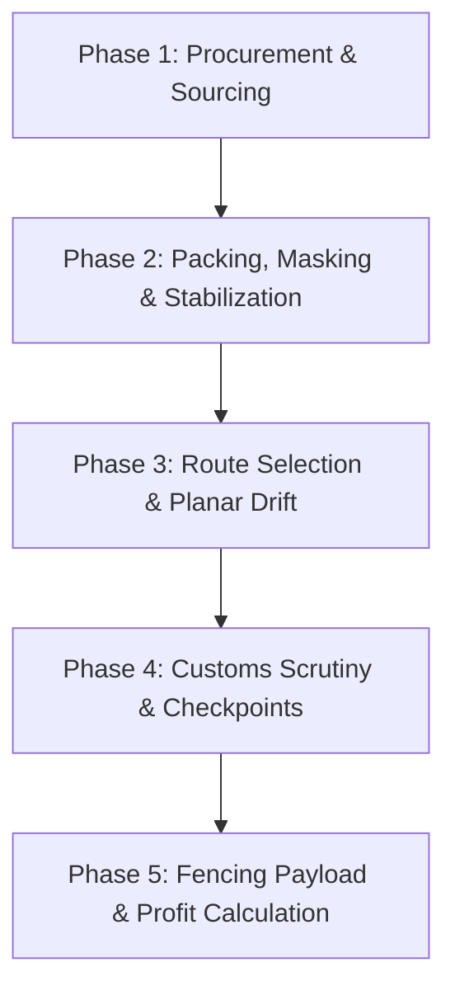
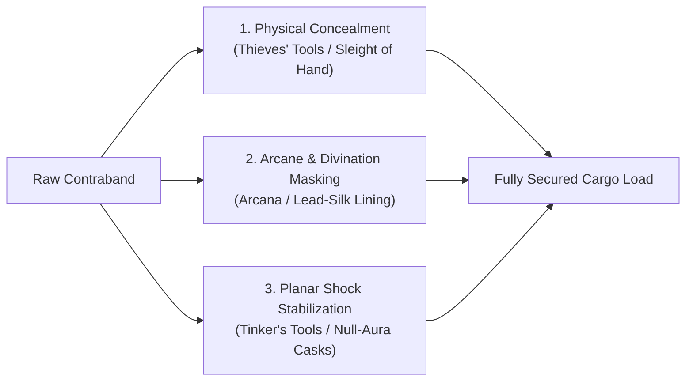
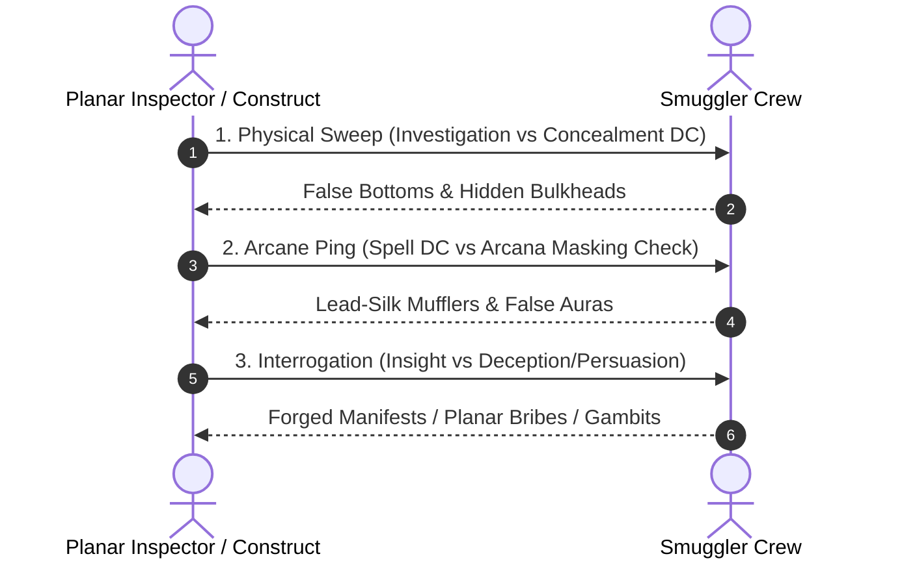
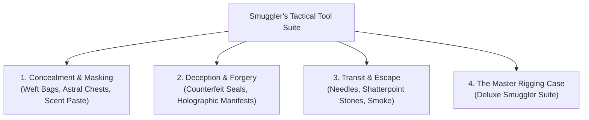
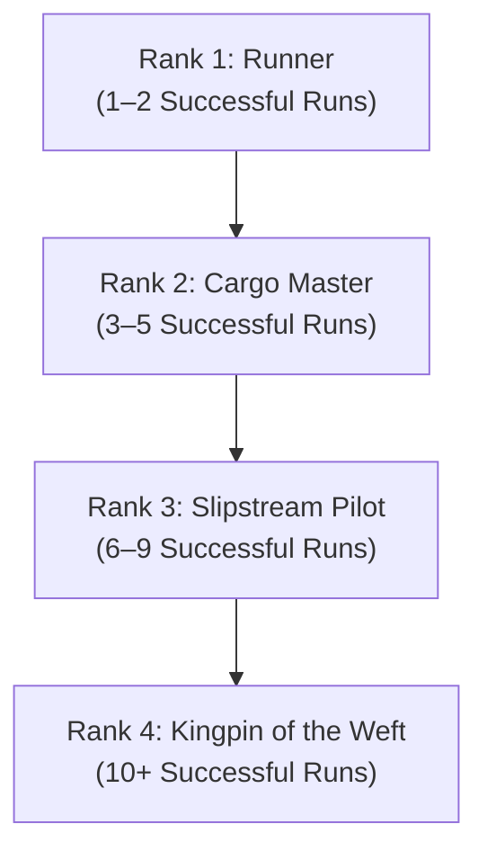

# ⚖️ The Interplanar Black Market & Smuggling Ruleset
### *The Shadow Weft, Shatterpoint Bazaars, Concealment Apparatuses, and the Unseen Trade of the Shattered Loom*

> *"The gods gave each plane its purpose, and the laws of reality gave each its borders. But Telara’s Loom shattered, and in the cracks between the shards, we built our shops. You think a wall of celestial fire or a Consortium patent warden can stop commerce? If a fire-giant wants frost-wine from Stygia, or an archdevil needs unminted soul bullion that doesn't ping an Inevitable's audit, they don't hire priests or merchants. They hire us. Pack light, muffle your harmonic hum, and always carry enough lead-grease to blind a border hound."*  
> — **Malakor the Weft-Stripper**, Fence of the Fractured Nexus

---

## 📖 1. Overview & Cosmological Foundations

When **Telara’s Loom** was severed during the Great Betrayal, the neat boundaries of existence were torn into frayed ribbons. While sovereign planar authorities—such as the **[[The Consortium of the Gilded Caliper|Consortium of the Gilded Caliper]]**, the **Council of Chains** in [[Plane of Avarice The Gilded Eternity|Aurous Grasp]], celestial arbiters, and the archdevils of [[The Nine Hells]]—expend immense energy patrolling authorized portals, collecting soul-tariffs, and enforcing patent orthodoxy, they only govern the solid filaments.

Running parallel to legitimate cosmic commerce is **The Shadow Weft** (also called **The Frayed Exchange** or **The Under-Lattice**). This is an informal, ruthlessly efficient confederation of black markets, illicit docks, pocket-dimension bazaars, and contraband cartels that exploit the scars of the Shattering to move goods that *should not exist, should not be moved, or should not be sold*.

### The Three Axioms of the Shadow Weft
1. **Scarcity Is Dimensional**: An item utterly mundane on one plane (e.g., pure spring water, unprocessed timber, a cold winter breeze) is worth a king's ransom on another (such as the Plane of Fire, the Nine Hells, or the [[Plane of Avarice The Gilded Eternity|Plane of Avarice]]).
2. **Every Plane Has an Anathema**: Smuggling is not merely about avoiding taxes; it is about keeping goods alive or stable against native planar physics. Holy water boils into toxic fume in the Abyss; infernal brimstone freezes inert in Stygia; unrefined Vorzath void-matter unknits normal matter on contact.
3. **The Loom Humming Never Lies**: Smugglers must contend with the **Harmonic Residual**—the baseline hum of existence. Opening illicit rifts or transporting high-potency artifacts alters the pitch, alerting border hounds, Riftborn stabilizers, and planar customs cruisers unless shielded with lead-silk mufflers.

---

## 🏙️ 2. Major Black Market Hubs & Shadow Bazaars

The Under-Lattice operates through seven primary clandestine trading centers spanning the multiverse:

### 1. The Silken Undercroft ([[The Fractured Nexus]])
Suspended directly beneath the floating marble shards of the Fractured Nexus, clinging to the undersides of the Great Islands via web-riggings and gravity-defying anchors.
* **Atmosphere**: Bathed in the violet gloom of the Tide of Threads, smelling of ozone, stale pipe-weed, and melted sealing wax.
* **Specialty**: Unlicensed portal keys, stolen star-metal, astral navigational charts through rift storms, and illegal passage aboard stealth [[Magic/Spell Jammers|Spelljammers]].
* **Authority Avoidance**: Operated just below the sensory sweeps of the **Riftborn Guardians**. The merchants speak in sign language and vibrational clicks to avoid resonating with the Loom’s Harmonic pitch.

### 2. The Obsidian Bazaar & The Siphon Sump ([[Plane of Avarice The Gilded Eternity]])
While the upper bazaar gleams with ostentatious displays, the **Siphon Sump** operates in the hollows carved out of the petrified gold reefs beneath the molten sea.
* **Atmosphere**: Heavy with oppressive heat, sulfuric vapors, and the clinking of unregistered platinum ingots.
* **Specialty**: Blood-debt contracts, unminted soul bullion, stolen ancestral heirlooms, and relics scrubbed of divine provenance.
* **Authority Avoidance**: The **Council of Chains** and their **Coinbound Enforcers** demand a 30% tithe on all transactions. Black marketeers use lead-lined grease-cloth to muffle the magical chime of enchanted gold.

### 3. The Slag-Gutter Markets ([[Plane of Eternal Craft Forgeflame Expanse]])
Hidden deep in the subterranean vents beneath Metallos and the root-hollows of Timberforge.
* **Atmosphere**: Thick with choking chemical smoke, pressurized steam hiss, and rhythmic, muffled hammering.
* **Specialty**: Stolen industrial blueprints, unregistered Warforged Soulcores (smuggled away before the **[[The Ironbound Covenant|Ironbound Covenant's]]** Binding Rite), unrefined divine ores, and illegal non-guild modifications.
* **Authority Avoidance**: **Consortium Caliper Wardens** constantly test tool dimensions and alloy purities. Smugglers use acid-etch dissolvers to scrub guild trademarks.

### 4. The Cold Wake Flotilla ([[The Nine Hells]] & River Styx)
A cluster of ironclad barges lashed together, drifting perpetually along the fog-bound loops of the River Styx where Stygia bleeds into Avernus.
* **Atmosphere**: Freezing fog, the agonizing wails of soul-larvae, and water that erases memory at a splash.
* **Specialty**: Deserter fiends, contraband soul coins, Blood War munitions redirected from frontline supply trains, and unrecorded infernal pacts.
* **Authority Avoidance**: Avoids the customs citadels of Dis by navigating through submerged planar eddies known only to renegade Merrenoloths.

### 5. The Amnesia Vaults ([[Plane of Fragmented memories|Plane of Fragmented Memories]])
A labyrinth of shifting glass mirrors and drifting clouds of vaporous recollection.
* **Atmosphere**: Eerily quiet; whispering echoes of forgotten childhoods, screams, and forgotten battle orders.
* **Specialty**: Extracted high-value memories (military battle plans, true names of fiends, vault combinations), stolen identities, and bottled selective trauma.
* **Authority Avoidance**: Mirrored labyrinths confuse pursuers; divinations cast into the vaults reflect false targets.

### 6. The Sunless Anchorage (Deep Astral Drift)
A hollowed-out skull of a dead primordial floating in the deep silver void of the Astral Sea.
* **Atmosphere**: Zero-gravity dry docks, silent ether-currents, flickering oil lamps, and cloaked pirate skiffs.
* **Specialty**: Black-market Spelljammer hulls, unregistered helms, astral dreadnought hide, and contraband gunpowder.
* **Authority Avoidance**: Protected by an active dimensional-scrambling beacon that blinds githyanki astronavigators.

---

## 📦 3. The Contraband Classification Index

Contraband across the planes is categorized into four **Hazard Classes**. The class dictates inspection DCs, penalties, market multipliers, and physical volatility:

| Class | Classification | Characteristic Cargo Manifests | Customs Penalty if Caught | Base Market Multiplier | Base Concealment DC |
| :---: | :--- | :--- | :--- | :---: | :---: |
| **I** | **Restricted / Tariff Evasion** | Untaxed astral ore, exotic spices/water, unregistered spelljammer riggings, mundane weapon shipments. | Confiscation + Fine (2x cargo value) + 1 Heat | **1.5x – 2x** | **DC 13** |
| **II** | **Prohibited Goods** | Unlicensed portal keys, Fey euphoria draughts, guild-patented blueprints, extracted memories, raw elemental fire cores. | Confiscation + Hard Labor / Imprisonment + 2 Heat | **3x – 5x** | **DC 16** |
| **III** | **High Contraband** | Unbound soul-coins/larvae, Blood War siege munitions, forbidden necromantic artifacts, counterfeited divine treaties, enslaved Riftborn. | Immediate Execution / Soul-Binding + 3 Heat | **6x – 10x** | **DC 19** |
| **IV** | **Cosmic Anathema** | Vorzath null-matter / unmaking entropy, raw Loom fragments, Far Realm reality-parasites, unredacted true names of Elder Evils. | Multi-Planar Bounty / Complete Eradication + 5 Heat | **15x – 50x+** | **DC 22** |

---

## 🚀 4. Smuggling Mechanics: The Five-Phase Smuggling Run

To execute an interplanar smuggling operation, the Dungeon Master and players resolve five sequential operational phases:

---

### Phase 1: Procurement & Broker Negotiations
The crew must locate a broker, agree on terms, and secure the cargo without alerting guild informants.

* **Finding a Supplier Check**: The party makes a **Charisma (Investigation or Deception)** check or **Wisdom (Insight)** check:
  * **Class I Contraband**: **DC 10** (Docks, taverns, low-level fences).
  * **Class II Contraband**: **DC 15** (Specialized syndicates in the Silken Undercroft or Siphon Sump).
  * **Class III Contraband**: **DC 20** (Fiendish contraband runners, disgraced Consortium arbiters).
  * **Class IV Contraband**: **DC 25** (Doomsday cultists, void-divers touching Vorzath's rim).
* **Procurement Mishap (Failure by 5+)**: The contact is an undercover Caliper Warden or syndicate plant. The crew gains **+1 Heat** before loading the cargo.

---

### Phase 2: Packing, Masking & Stabilization
Planar contraband is chemically, magically, and dimensionally unstable. The crew must disguise the payload across three distinct security fronts:

1. **Physical Concealment Check**:
   * **Check**: **Dexterity (Thieves' Tools or Sleight of Hand)**.
   * **Mechanic**: Establishes false bottoms, hidden ship bulkheads, or deceptive mundane packaging (e.g., soul-coins packed into salted dire-boar carcasses).
   * **Result**: Becomes the **Passive Concealment DC** against physical customs searches.
2. **Arcane & Divination Masking Check**:
   * **Check**: **Intelligence (Arcana)** or spellcraft (*Nystul's Magic Aura*, *Nondetection*).
   * **Mechanic**: Shields magical signatures from sensory wards, *Detect Magic*, and *Locate Object*.
   * **Thresholds**:
     * *Check 14 or Lead-Silk Bag*: Masks cargo against divinations of 2nd level or lower.
     * *Check 18+*: Disguises the cargo aura as a mundane transmutation school for 48 hours.
     * *Check 22+*: Completely scrubs the cargo's planar resonance; undetectable by magical scans.
3. **Planar Volatility Stabilization Check**:
   * **Check**: **Intelligence (Tinker's Tools)** or **Wisdom (Survival / Medicine)**.
   * **Mechanic**: Insulates goods against foreign planar atmospheres. Failing this check triggers **Planar Shock** during transit (see Section 5).

---

### Phase 3: Route Selection & Planar Drift Navigation
Smugglers must choose between official checkpoints, wild rifts, or void slipstreams:

| Route Type | Navigation Check | Customs Risk | Inherent Environmental Danger |
| :--- | :--- | :---: | :--- |
| **Route A: The Legitimate Toll-Gate** | None (Walk straight through). | **Extreme (100%)** | Zero travel hazards; guaranteed Phase 4 inspection. |
| **Route B: The Shatterpoint Drift** | **DC 16 Survival or Arcana** | **Zero (0%)** | Unstable frayed rifts; roll on Planar Drift Mishaps on a failure. |
| **Route C: Spelljammer Astral Slipstream** | **DC 14 Vehicles (Air/Space)** | **Moderate (35%)** | Astral patrols, githyanki corsairs, ether-reefs. |
| **Route D: The Stygian / Planar Bleed** | **DC 15 Con or Wis Save** | **Low (15%)** | Memory-draining waters, necrotic rot, soul-larvae swarms. |

#### Planar Drift Mishaps Table (d10 Table)
When traversing Route B, C, or D and the navigation check fails by 5 or more, roll on this table:

| d10 | Planar Drift Mishap | Mechanical & Tactical Emergency |
| :---: | :--- | :--- |
| **1** | **Harmonic Inversion Vortex** | The ship/crew is pulled into an impossible gravitational eddy; takes 4d10 force damage and loses 1d4 days. |
| **2** | **Stygian Memory Bleed** | Crew breathes River Styx spray. Each member must make a DC 15 Wis save or forget the buyer's drop coordinates. |
| **3** | **Ether-Reef Grounding** | Spelljammer hull strikes a calcified astral spine; speed halved until 4 hours of repair work are completed. |
| **4** | **Temporal Desynchronization** | Crew arrives 1d6 days earlier or later than intended, complicating buyer rendezvous. |
| **5** | **Githyanki Raider Skiff** | An astral hunting party spots the runner running dark; roll immediate naval/skiff initiative. |
| **6** | **Planar Condensation Storm** | Cargo sweats volatile elemental ichor. Smugglers must make DC 14 Dex saves or take 3d6 elemental damage. |
| **7** | **The Screaming Veil** | Rift shrieks with dead souls. Spellcasters lose their highest unexpended spell slot to psychic static. |
| **8** | **False Destination Drift** | Party emerges at an entirely different planar shard (e.g. Shadowfell instead of Avarice). |
| **9** | **Cargo Anchor Fracture** | Straps snap in the hold. Contraband tumbles; one container breaks open, releasing localized planar hazard. |
| **10** | **The Inevitable's Beacon** | Drift intersects a Marut monitoring eye. Party's planar coordinates are broadcast to local law enforcers (+2 Heat). |

---

### Phase 4: Customs Scrutiny & Checkpoint Encounters
When confronting a customs gate, portal checkpoint, or cutter patrol, inspectors launch a **Scrutiny Contest**:

#### Planar Inspector Archetypes & Sensory Modifiers
* **Consortium Caliper Wardens ([[Plane of Eternal Craft Forgeflame Expanse]])**:
  * Utilize *Divination Rods of Metric Weight* (+7 Investigation). They weigh containers against official patent tare-weights.
* **Coinbound Wardens ([[Plane of Avarice The Gilded Eternity]])**:
  * Possess *Greed-Sense* (Passive Perception 16 for unhallowed gold, debt markers, or unregistered gems).
* **The Inevitable Scrutiny ([[The Fractured Nexus]] / Lawful Gates)**:
  * Employs *Kolyarut or Marut constructs* with Truesight 60 ft (+9 Insight; immune to mundane deception and bribes).
* **Dis Tax-Reapers ([[The Nine Hells]])**:
  * Patrol with paired Hell Hounds (+5 Perception with advantage on scents of mortal blood or divine magic).

#### Smuggler Maneuvers & Gambits
* **The Planar Bribe**:
  * Corrupt inspectors will look away for the right currency:
    * *Plane of Avarice*: 15% of the gross cargo value in unregistered bullion.
    * *The Nine Hells*: An unassigned minor soul-debt chit or signed favor.
    * *Plane of Eternal Craft*: Stolen metallurgical formulas or unpatented alloy samples.
* **Paperwork Forgery**:
  * A character proficient with a **Forgery Kit** can fabricate a *Planar Seal of Free Transit* (**DC 16 Dexterity check**). Success grants **advantage on Charisma (Deception) checks** during inspection.
* **Harmonic Detuning Gambit**:
  * A bard or spellcaster can deliberately strum or pluck a nearby Loom strand (**DC 15 Arcana check**). This triggers a phantom breach siren elsewhere in the facility, drawing away 1d4 inspectors.
* **Stygian Silt Flash**:
  * Smugglers throw pulverized Stygian silt into an inspector's eyes; blinds them and erases their memory of the past 30 seconds!

---

### Phase 5: Contraband Exposure & Fencing the Payload

#### 1. Planar Shock & Exposure Mechanics
If contraband is exposed to opposing planar air without protective containers (*Null-Aura Casks*), it suffers **Planar Shock**:

| Origin Plane | Destination Environment | Exposure Result (1d4 rounds after unmasking) |
| :--- | :--- | :--- |
| **Elemental Fire / Craft** | **Plane of Water / Stygia** | Rapid thermal collapse. Cracks brittle; loses 50% market value or shatters into slag. |
| **The Abyss / Nine Hells** | **Radiant / Celestial Shards** | Cargo begins smoking violently, emitting deafening psychic wails (DC 15 Con save or deafened). |
| **Shadowfell** | **Feywild / Avarice** | Colors bleach into ash; joy and light leech into cargo, neutralizing its necrotic properties. |
| **Vorzath Void / Far Realm** | **Any Stable Plane** | Dissolves 1 foot of container matter per round; deals 2d10 necrotic/force damage on touch. |

#### 2. Fencing the Payload & Calculating Profit
Upon reaching the drop-point, the crew haggles with the broker:

$$\text{Final Payout} = \text{Base Cargo Value} \times \text{Class Multiplier} \times \text{Haggling Modifier}$$

* **The Haggling Contest**: A **Charisma (Persuasion)** check contested by the fence's **Wisdom (Insight)**:
  * **Smuggler wins by 5+**: +20% bonus payout in rare planar currency (Astral Diamonds, Soul Coins, or Spoor Marks).
  * **Smuggler ties or wins within 4**: Full agreed contract payout.
  * **Fence wins within 4**: Payout reduced by 20% due to "market volatility."
  * **Fence wins by 5+**: The fence attempts a double-cross (ambush in the alley, alert to bounty hunters, or payment in cursed script).

---

## 🧰 5. Smuggler Tools, Concealment Apparatuses & Gear
### *(Specialized Instruments to Make Smuggling Easier, Safer & Undetectable)*

Smuggling across the planes without specialized masking apparatuses is a swift path to a Marut execution cell. The Under-Lattice relies on specialized contraband equipment:

#### A. Concealment & Masking Apparatuses
* **Lead-Silk Weft Bag (350 gp, 4 lbs)**: Woven from astral silk interlaced with beaten lead filaments. Any item placed inside cannot be detected by divination magic of 4th level or lower, nor by the *Divine Awareness* of angels or fiends. Capacity: 4 cu. ft. / 60 lbs.
* **False-Bottom Astral Chest (650 gp, 25 lbs)**: Appears as an ordinary ironwood sea chest. Sliding a hidden rune-latch opens a pocket extradimensional space (10 cu. ft.) that **does not rupture or create a planar tear** when brought inside a *Bag of Holding* or *Portable Hole*.
* **Planar Scent-Baffle Paste (150 gp per jar - 4 applications)**: Shimmering paste of grave-moss, gold leaf, and sulfur. Smearing across crates or clothing **masks the scent and aura of cargo from celestial, fiendish, and blink hounds for 12 hours**.
* **Resonant Muffling Blankets (120 gp, 6 lbs)**: Heavy felt blankets woven from deadened Loom fibers. Wrapped around magical or planar engines, it **completely silences their Harmonic Residual hum**, preventing border listening posts from pinging the vessel.
* **Null-Aura Specimen Cask (200 gp, 10 lbs)**: Lead-lined brass cylinder with vacuum air-locks. Completely shields cargo against **Planar Shock**, preserving volatile elemental and necrotic cargo indefinitely.

#### B. Deception & Forgery Gear
* **Counterfeit Caliper Seal (800 gp, 1 lb)**: A magical brass stamp reproducing the official wax sigil of the **Consortium of the Gilded Caliper**. The wax radiates authentic verification runes for 72 hours before fading. Grants **+5 to Forgery Kit checks** when fabricating cargo waybills.
* **Holographic Manifest Projector (280 gp, 2 lbs)**: Clockwork brass disc that projects an illusory, fully animated shipping manifest and official guild seals above crates, granting **advantage on Charisma (Deception) checks** during customs sweeps.
* **Chameleon Cargo Shroud (300 gp, 8 lbs)**: Tarpaulin woven with displacer beast fiber. Blends crates seamlessly into the surrounding ship deck or wagon bed, adding **+3 to the cargo's Concealment DC**.

#### C. Transit & Escape Gadgets
* **Thread-Cutter's Needle (Rare Wondrous Item, 750 gp - Attunement)**: A dagger-sized spindle of tarnished star-metal. Plunged into a portal threshold as an action, it locks the portal open or closed for 10 minutes without disturbing the local **Harmonic Residual**, preventing gate alarm bells from sounding.
* **Pocket Shatterpoint Keystone (450 gp, single use)**: A fractured crystal node. Crushing it tears open a momentary dimensional rift, allowing a ship or party to instantly step 500 feet through a spatial fold to escape customs cordons.
* **Stygian Silt Flash Pellets (Set of 3: 180 gp)**: Thrown as a reaction (range 20 ft). Detonates into cold Stygian fog; all creatures within 10 ft must succeed on a DC 14 Con save or be **blinded for 1 round and forget the last 30 seconds of their memory**.
* **Phase-Bypass Smoke Bomb (140 gp)**: Releases dense violet ether-smoke. Creatures inside the 15-ft cloud gain the ability to phase through nonmagical portcullises, cargo gates, and bulkheads up to 2 feet thick for 1 minute.

#### D. The Master Smuggler's Rigging Case (Deluxe Kit)
* **Market Cost**: 950 gp or 18 Spoor/Severed Marks (Weight: 20 lbs).
* **Contents**: 1 Lead-Silk Weft Bag, 1 jar of Scent-Baffle Paste, 2 Resonant Muffling Blankets, 1 Counterfeit Seal, Holographic Projector, and 3 Stygian Flash Pellets packed in a false-bottomed leather case.
* **Masterwork Benefit**: While utilizing the Master Rigging Case, the crew has **advantage on all Concealment and Forgery checks**, adds a **+2 bonus to Deception against customs officials**, and **cargo in their hold is immune to Planar Shock**.

---

### Master Smuggler Equipment Catalog

| Equipment / Item | Market Cost | Weight | Primary Mechanical Bonus & Smuggling Utility |
| :--- | :---: | :---: | :--- |
| **Lead-Silk Weft Bag** | 350 gp | 4 lbs | Blocks divinations of 4th level or lower and fiendish/celestial awareness; holds 60 lbs. |
| **False-Bottom Astral Chest** | 650 gp | 25 lbs | 10 cu. ft. secret space; safe inside *Bags of Holding* without dimensional rupture. |
| **Planar Scent-Baffle Paste** | 150 gp | 1 lb | Masks scent and planar aura from hounds for **12 hours** (4 applications). |
| **Resonant Muffling Blankets** | 120 gp | 6 lbs | **Silences Harmonic Residual hum** of engines and magical cargo completely. |
| **Null-Aura Specimen Cask** | 200 gp | 10 lbs | **Prevents Planar Shock** and atmospheric decay indefinitely. |
| **Counterfeit Caliper Seal** | 800 gp | 1 lb | **+5 to Forgery Kit checks**; wax radiates authentic verification runes for 72 hours. |
| **Holographic Manifest Projector** | 280 gp | 2 lbs | Grants **advantage on Deception checks** when presenting cargo manifests. |
| **Chameleon Cargo Shroud** | 300 gp | 8 lbs | **+3 to Passive Concealment DC** of crates and wagons via displacer weave. |
| **Thread-Cutter's Needle** | 750 gp | 1 lb | Locks portals open/shut for 10 min without triggering harmonic alarms. |
| **Pocket Shatterpoint Keystone** | 450 gp | 1 lb | Single-use: instant 500-ft emergency dimensional escape jump. |
| **Stygian Silt Flash Pellets (3)** | 180 gp | 1 lb | Blinds pursuers and **erases their memory of the past 30 seconds** (DC 14 Con). |
| **Phase-Bypass Smoke Bomb** | 140 gp | 1 lb | 15-ft cloud: allows phasing through gates, walls, and bulkheads up to 2 ft thick. |
| **Master Smuggler's Rigging Case** | 950 gp | 20 lbs | Deluxe suite: **Advantage on Concealment & Forgery**, **+2 Deception**, and cargo immunity to Planar Shock. |

---

## 🔥 6. The Multi-Planar Heat System

Smuggling across planes leaves scars in the tapestry. The **Heat Tracker** measures how aggressively multi-planar regulators, inquisitors, and bounty hunters hunt the crew:

* **Heat 0 (Ghost)**: Clean record. Customs treat the crew as ordinary interplanar voyagers.
* **Heat 1 (Noticed)**: Local dock inspectors take note. Customs check DCs increase by **+2**.
* **Heat 2 (Flagged)**: Consortium Caliper Wardens and Council of Chains circulate wanted broadsheets. Gate tolls **double**; port authorities demand cargo manifests upfront.
* **Heat 3 (Hunted)**: Professional bounty hunters (Rift-Stalkers, Merrenoloth corsairs, Bone Devil bailiffs) are dispatched to intercept the crew's ship.
* **Heat 4 (Marked)**: Planar portals actively recognize the crew. Passing through any official portal triggers alarm sirens automatically unless bypassed with a **DC 22 Arcana check**.
* **Heat 5 (Loom Target)**: **The Inevitables (Maruts)** and cosmic regulators deem the party an existential threat to planar order. High-tier strike teams hunt them across all planes simultaneously.

### Cooling Off: Reducing Heat
* **Lay Low in the Silken Undercroft**: Spending 1 downtime week in the Fractured Nexus without committing crimes: **-1 Heat**.
* **Sacrifice a Scapegoat**: Planting forged contraband manifests on a rival merchant crew: **-1 Heat**.
* **Planar Memory Scrub**: Paying an amnesia-weaver in the [[Plane of Fragmented memories|Plane of Memories]] (Cost: 2,500 gp or a prized personal secret): **-2 Heat**.
* **Divine / Archdevil Contract**: Performing a high-leverage covert black-ops job for a planar ruler to expunge records: **Resets Heat to 0**.

---

## 🏴‍☠️ 7. Major Smuggling Syndicates & Underworld Ranks

### 1. Syndicate Profiles
1. **The Frayed Silk Syndicate**:
   * *Base*: The Silken Undercroft ([[The Fractured Nexus]]).
   * *Specialty*: Unlicensed dimensional keys, passenger extraction, star-metal.
   * *Motto*: *"Threads were meant to be tied where we want them."*
2. **The Gilded Siphon Cartel**:
   * *Base*: Aurous Grasp ([[Plane of Avarice The Gilded Eternity]]).
   * *Specialty*: Blood-gold, tax evasion, stolen war chests, unregistered patent blueprints.
   * *Motto*: *"If the Council of Chains hasn't melted it down yet, it belongs to whoever has the strongest sack."*
3. **The Ashen Keel**:
   * *Base*: The Cold Wake Flotilla ([[The Nine Hells]] / River Styx).
   * *Specialty*: Diverted Blood War munitions, soul-larvae contraband, Stygian water vials.
   * *Motto*: *"Neither demon nor devil cares about the toll as long as the iron arrives."*
4. **The Unravelers**:
   * *Base*: Fringe drift-shards near the Great Void.
   * *Specialty*: Class IV Cosmic Anathema—Vorzath maw-matter, entropic null-cores, reality-parasites.
   * *Motto*: *"What was shattered must never be re-woven."*

### 2. Smuggler Renown Ranks & Privileges
* **Rank 1: Runner**: Access to safe houses in the Silken Undercroft; can purchase basic false-bottom packs and scent pastes.
* **Rank 2: Cargo Master**: 15% discount on counterfeit seals and lead-silk bags; access to underground dry-docks.
* **Rank 3: Slipstream Pilot**: Entitled to secret astral drift maps; ability to purchase Void-Keystones and hire renegade Merrenoloth navigators.
* **Rank 4: Kingpin of the Weft**: Commands an entire smuggler flotilla; can call upon safe-haven sanctuaries across all 7 major shadow bazaars.

---

## 🎲 8. Master Smuggling Complications Table (1d20)

Roll on this table whenever an unexpected complication arises during transit, inspection, or delivery:

| d20 | Complication | Narrative & Mechanical Emergency |
| :---: | :--- | :--- |
| **1** | **The Harmonic Flare** | A Loom strand snaps nearby. The portal flickers violently; DC 14 Dex save or fall into an adjacent planar drift. |
| **2** | **The Stygian Leak** | A container of River Styx water cracks. One crew member must make a DC 15 Wis save or forget the last 24 hours. |
| **3** | **Undercover Caliper Warden** | The inspector turns out to be a High Arbiter in disguise, attempting to trace the contraband to its manufacturing den. |
| **4** | **Greed-Taint Flare** | Cargo absorbed the aura of Avarice. A party member becomes obsessed with keeping it (DC 15 Wis save to resist). |
| **5** | **Dimensional Sniffer Hounds** | Patrol arrives with twin celestial blink hounds trained to smell stolen astral thread (+8 Perception). |
| **6** | **Toll Price Surge** | The gatekeeper suddenly demands three times the normal bribe due to an imminent surprise audit by an Inevitable. |
| **7** | **The Vorzath Micro-Void** | A speck of null-entropy eats through the hold floor. Requires 30 points of radiant damage to seal. |
| **8** | **Counterfeit Payment** | The buyer pays in minted coins from Avarice that melt into worthless lead sludge 1 hour after leaving. |
| **9** | **Rival Cartel Ambush** | A hit-squad from the *Gilded Siphon* ambushes the crew at the drop point to hijack the payload. |
| **10** | **The Screaming Soul** | A soul-larva container cracks; the soul shrieks at 120 decibels, alerting all guards within 1,000 feet. |
| **11** | **Harmonic Detune** | The pitch of the Loom drops an octave. All conjuration and teleportation spells have a 50% misdirection chance for 1 hour. |
| **12** | **Planar Quarantine** | An outbreak on the destination plane triggers an emergency lockdown; all authorized gates are sealed shut. |
| **13** | **Corrupted Waybill** | The forged manifest lists an expired clearance code; smuggler must succeed on a DC 16 Deception check instantly. |
| **14** | **Unstable Shatterpoint** | The secret rift has collapsed into a razor-sharp planar vortex. Requires a DC 16 Arcana check to re-stabilize. |
| **15** | **The Sentient Cargo** | The contraband (a relic or construct) awakens and demands political asylum or threatens to scream. |
| **16** | **Githyanki Astral Corsairs** | A raider skiff spots the crew running dark in the Astral Sea and attempts to harpoon their cargo bay. |
| **17** | **The Inevitable's Shadow** | A Marut steps onto the dock. It isn't hunting the party yet, but its presence increases all checkpoint DCs by +5. |
| **18** | **Blood War Conscription** | Infernal recruiters intercept the barge on the Styx and attempt to impress the crew into frontline legion service. |
| **19** | **Planar Condensation** | Extreme temperature contrast causes cargo to sweat liquid fire or acid, endangering the bearers. |
| **20** | **Double-Cross Contract** | The buyer hired two separate crews to steal the same shipment; the rival crew is waiting at the drop with drawn steel. |

---

## 🗺️ 9. Cross-Vault Links & Campaign Integration

* **Custom Rules Master Hub**: [[Custom Rules/Custom Rules|Custom Rules & Mechanics Hub]]
* **Capital of Smuggler Transit**: [[The Fractured Nexus]]
* **Avarice Underworld & Council of Chains**: [[Plane of Avarice The Gilded Eternity]]
* **Forgeflame Expanse & Consortium Enforcers**: [[The Consortium of the Gilded Caliper]]
* **Holy Crusade Against Contraband**: [[The Ironbound Covenant]]
* **Astral Runner Ships & Stealth Rigging**: [[Magic/Spell Jammers|Spell Jammers]]
* **Apex Hunting & Raw Carcass Trade**: [[Custom Rules/The Interplanar Hunting, Harvesting & Trophy-Crafting Ruleset|Module III: Interplanar Hunting Ruleset]]
* **Cosmic Aberration Butchery**: [[Custom Rules/The Eldritch Horror Hunting & Sanity-Harvesting Ruleset|Module IV: Eldritch Horror Dissection Ruleset]]
