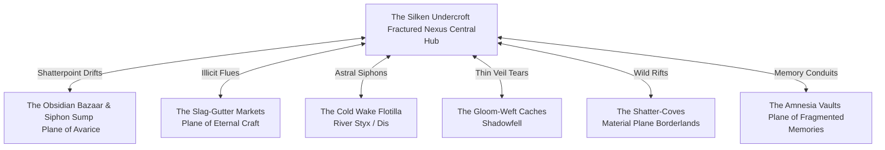
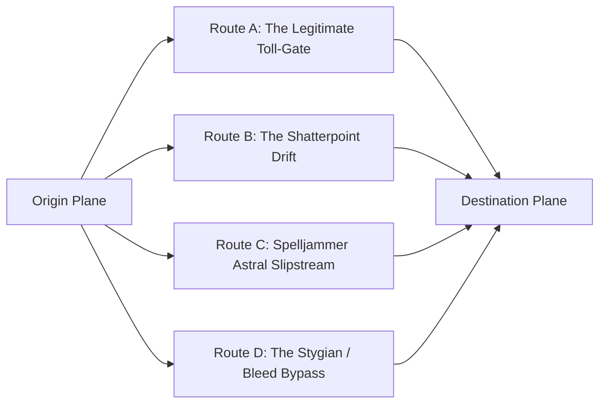

---
tags:
  - ruleset
  - mechanics
  - planar-travel
  - black-market
  - smuggling
  - factions
---

# The Interplanar Black Market & Smuggling Ruleset
### *The Shadow Weft, Shatterpoint Bazaars, and the Unseen Trade of the Shattered Loom*

> *"The gods gave each plane its purpose, and the laws of reality gave each its borders. But Telara’s Loom shattered, and in the cracks between the shards, we built our shops."*  
> — **Malakor the Weft-Stripper**, Fence of the Fractured Nexus

---

## 1. Overview & Cosmological Foundations

When **Telara’s Loom** was shattered during the Great Betrayal, the neat boundaries of existence were torn into frayed ribbons. While sovereign planar authorities—such as the **[[The Consortium of the Gilded Caliper|Consortium of the Gilded Caliper]]**, the **Council of Chains** in [[Plane of Avarice The Gilded Eternity|Aurous Grasp]], the celestial arbiters, and the archdevils of [[The Nine Hells]]—expend immense energy patrolling authorized portals, collecting soul-tariffs, and enforcing patent orthodoxy, they only govern the solid filaments.

Running parallel to legitimate cosmic commerce is **The Shadow Weft** (also called **The Frayed Exchange** or **The Under-Lattice**). This is an informal, ruthlessly efficient confederation of black markets, illicit docks, pocket-dimension bazaars, and contraband cartels that exploit the scars of the Shattering to move things that *should not exist, should not be moved, or should not be sold*.

### Core Principles of the Interplanar Underworld
1. **Scarcity is Dimensional**: An item utterly mundane on one plane (e.g., pure spring water, unprocessed timber, a cold winter breeze) is worth a prince's ransom on another (such as the Plane of Fire, the Nine Hells, or the [[Plane of Avarice The Gilded Eternity|Plane of Avarice]]).
2. **Every Plane Has an Anathema**: Smuggling is not merely about avoiding taxes; it is about keeping items alive or stable against native planar physics. Holy water boils into toxic fume in the Abyss; infernal brimstone freezes inert in Stygia; unrefined Vorzath void-matter unknits normal matter on contact.
3. **The Loom Humming Never Lies**: Smugglers must contend with the **Harmonic Residual**—the baseline hum of existence. Opening illicit rifts alters the pitch, alerting border hounds, Riftborn stabilizers, and planar customs cruisers.

---

## 2. Major Black Market Hubs & Shadow Bazaars



### 1. The Silken Undercroft ([[The Fractured Nexus]])
Suspended directly beneath the floating marble shards of the Fractured Nexus, clinging to the undersides of the Great Islands via web-riggings and gravity-defying anchors.
* **Atmosphere**: Bathed in the violet gloom of the Tide of Threads, smelling of ozone, stale pipe-weed, and melted sealing wax.
* **Specialty**: Unlicensed portal keys, stolen star-metal, astral navigational charts through rift storms, and illegal passage aboard stealth [[Magic/Spell Jammers|Spelljammers]].
* **Authority Avoidance**: Operated just below the sensory sweeps of the **Riftborn Guardians**. The merchants speak in sign language and vibrational clicks to avoid resonating with the Loom’s Harmonic pitch.

### 2. The Obsidian Bazaar & The Siphon Sump ([[Plane of Avarice The Gilded Eternity]])
While the upper bazaar gleams with ostentatious displays, the **Siphon Sump** operates in the hollows hollowed out of the petrified gold reefs beneath the molten sea.
* **Atmosphere**: Heavy with oppressive heat, sulfuric vapors, and the clinking of unregistered platinum ingots.
* **Specialty**: Blood-debt contracts, unminted soul bullion, stolen ancestral heirlooms, and relics scrubbed of their divine provenance.
* **Authority Avoidance**: The **Council of Chains** and their **Coinbound Enforcers** demand a 30% tithe on all transactions. Black marketeers use lead-lined grease-cloth to muffle the magical chime of enchanted gold.

### 3. The Slag-Gutter Markets ([[Plane of Eternal Craft Forgeflame Expanse]])
Hidden deep in the subterranean vents beneath Metallos and the root-hollows of Timberforge.
* **Atmosphere**: Thick with choking chemical smoke, pressurized steam hiss, and rhythmic, muffled hammering.
* **Specialty**: Stolen industrial blueprints, unregistered Warforged Soulcores (smuggled away before the **[[The Ironbound Covenant|Ironbound Covenant's]]** Binding Rite), unrefined divine ores, and illegal non-guild modifications.
* **Authority Avoidance**: **Consortium Caliper Wardens** constantly test tool dimensions and alloy purities. Smugglers use acid-etch dissolvers to scrub guild trademarks.

### 4. The Cold Wake Flotilla ([[The Nine Hells]] & River Styx)
A cluster of ironclad barges lashed together, drifting perpetually along the fog-bound loops of the River Styx where Stygia bleeds into Avernus.
* **Atmosphere**: Freezing fog, the agonizing wails of soul-larvae, and water that erases memory at a splash.
* **Specialty**: Deserter fiends, contraband soul coins, Blood War munitions redirected from frontline supply trains, and unrecorded infernal pacts.
* **Authority Avoidance**: Avoids the customs citadels of Dis by navigating through submerged planar eddies known only to renegade Merrenoloths.

### 5. The Amnesia Vaults ([[Plane of Fragmented memories|Plane of Fragmented Memories]])
A labyrinth of shifting glass mirrors and drifting clouds of vaporous recollection.
* **Atmosphere**: Eerily quiet; whispering echoes of forgotten childhoods, screams, and forgotten battle orders.
* **Specialty**: Extracted high-value memories (military battle plans, true names of fiends, vault combinations), stolen identities, and bottled selective trauma.

---

## 3. The Contraband Classification Index

Contraband across the planes is categorized into four **Hazard Classes**. The class determines inspection DCs, penalties, and planar volatility:

| Class | Classification | Typical Items | Typical Penalty if Caught | Base Market Multiplier |
| :---: | :--- | :--- | :--- | :---: |
| **I** | **Restricted / Tariff Evasion** | Untaxed astral ore, exotic spices/water, unregistered spelljammer riggings, mundane weapon shipments. | Confiscation + Fine (2x cargo value) + 1 Heat | **1.5x - 2x** |
| **II** | **Prohibited Goods** | Unlicensed portal keys, Fey euphoria draughts, guild-patented blueprints, extracted memories, raw elemental fire cores. | Confiscation + Imprisonment/Hard Labor + 2 Heat | **3x - 5x** |
| **III** | **High Contraband** | Unbound soul-coins/larvae, Blood War siege munitions, forbidden necromantic artifacts, counterfeited divine treaties, enslaved Riftborn. | Immediate Execution / Soul-Binding + 3 Heat | **6x - 10x** |
| **IV** | **Cosmic Anathema** | Vorzath null-matter / unmaking entropy, raw Loom fragments, Far Realm reality-parasites, unredacted names of Elder Evils. | Multi-Planar Bounty / Total Eradication + 5 Heat | **15x - 50x+** |

---

## 4. Smuggling Mechanics: The Five-Phase Smuggling Run

To execute an interplanar smuggling operation, the Dungeon Master and players run through five distinct phases:

```
[Phase 1: Procurement & Sourcing] 
                 │
[Phase 2: Packing, Masking & Stabilization]
                 │
[Phase 3: Route Infiltration & Planar Transit]
                 │
[Phase 4: Customs Scrutiny & Checkpoint Encounters]
                 │
[Phase 5: Contraband Exposure & Fencing Payload]
```

---

### Phase 1: Procurement & Sourcing
The crew must identify a broker, negotiate the cut, and acquire the illicit freight.
* **Finding a Supplier**: A player makes a **Charisma (Investigation or Deception)** check or a **Wisdom (Insight)** check.
  * **DC 10 (Class I)**: Common criminal contacts, docks, tavern whispers.
  * **DC 15 (Class II)**: Specialized brokers in the Silken Undercroft or Obsidian Bazaar.
  * **DC 20 (Class III)**: Fiendish supply-runners, renegade mages, disgraced guild-arbiters.
  * **DC 25 (Class IV)**: Doomsday cultists, void-divers, entities touching Vorzath's rim.
* **Procurement Mishap (Failure by 5+)**: The contact is a syndicate plant, an undercover Caliper Warden, or a bounty tracker. The crew gains **+1 Heat** before the run even begins.

---

### Phase 2: Packing, Masking & Stabilization
Planar contraband rarely sits quietly in a burlap sack. Smugglers must camouflage the cargo physically, magically, and dimensionally.

#### 1. Physical Concealment
* **Check**: **Dexterity (Thieves' Tools or Sleight of Hand)**.
* **Purpose**: Creates false bottoms, secret compartments within spelljammer hulls, or hides goods within mundane bulk cargo (e.g., hiding soul coins inside casks of salted dire-boar meat).
* **Concealment Value**: The result of this roll becomes the **Passive Concealment DC** against physical customs searches.

#### 2. Arcane & Divination Masking
* **Check**: **Intelligence (Arcana)** or spell casting (*Nystul's Magic Aura*, *Nondetection*, lead-lined shielding).
* **Purpose**: Bypasses magical divination scanners, *Detect Magic*, and *Locate Object*.
* **DC Threshold**:
  * *Lead & Silk Lining*: Passive DC 14 against divination of 2nd level or lower.
  * *Arcana Check result 15+*: Masks cargo as mundane transmutation aura.
  * *Arcana Check result 20+*: Erases planar signature entirely for 48 hours.

#### 3. Volatility Stabilization
Certain items react violently to foreign planar air.
* **Check**: **Wisdom (Survival or Medicine)** or **Intelligence (Tinker's Tools)**.
* **Effect of Failure**: The cargo begins degrading or leaking (see *Section 5: Planar Exposure & Contraband Decay*).

---

### Phase 3: Route Infiltration & Planar Transit
Smugglers must choose how they cross planar boundaries:



* **Route A: The Legitimate Toll-Gate (High Scrutiny, Low Hazard)**
  * Passing through an official archway (e.g., The Iron Gateway in Metallos, or The Chain Gate in Aurous Grasp).
  * **Hazard**: Zero travel dangers.
  * **Customs Risk**: Maximum. Guaranteed Phase 4 Checkpoint Encounter.
* **Route B: The Shatterpoint Drift (Zero Scrutiny, High Hazard)**
  * Traversing unstable, frayed filaments or wild rifts where the Loom snapped.
  * **Customs Risk**: Zero inspectors.
  * **Hazard Check**: Party navigator must make a **DC 16 Wisdom (Survival) or Intelligence (Arcana)** check. 
    * *Failure*: The ship/party suffers a **Planar Drift Mishap** (rolls on the *Planar Drift Hazard Table*).
* **Route C: Spelljammer Astral Slipstream (Balanced)**
  * Running dark through the Astral Sea using specialized stealth rigging on ships like *The Whispering Wraith* or *Aether Gale*.
  * **Hazard Check**: Pilot makes a **DC 14 Dexterity (Vehicles: Air/Space)** check to evade astral patrols and githyanki raiders.
* **Route D: The Stygian / Planar Bleed Bypass (Extreme Corrosive Hazard)**
  * Crossing where two planes physically bleed together (e.g., Feywild/Shadowfell twilights, River Styx undercurrents).
  * **Hazard Check**: Each character makes a **DC 15 Constitution or Wisdom saving throw** to resist memory fog, apathy, or necrotic planar rot.

---

### Phase 4: Customs Scrutiny & Checkpoint Encounters
When encountering a planar border checkpoint or patrol, the inspector initiates a **Scrutiny Contest**.

#### Planar Customs Stat Blocks & Inspection Modifiers
* **The Caliper Customs Cohort ([[Plane of Eternal Craft Forgeflame Expanse]])**:
  * Uses *Divination Rods of Metric Weight* (+7 Investigation). They check mass against registered patent tables.
* **The Coinbound Wardens ([[Plane of Avarice The Gilded Eternity]])**:
  * Possess *Greed-Sense* (Passive Perception 16 for any unhallowed treasure or debt markers).
* **The Inevitable Scrutiny ([[The Fractured Nexus]] / Lawful Gates)**:
  * Employs *Kolyarut or Marut constructs* with Truesight 60 ft. (+9 Insight, cannot be persuaded by mundane lies).
* **The Dis Tax-Reapers ([[The Nine Hells]])**:
  * Hell Hound sniffers (+5 Perception with Advantage on scent of mortal blood or divine magic).

#### Resolving the Search
1. **The Physical Sweep**: The inspector makes an **Intelligence (Investigation)** check against the smugglers' **Concealment DC** (from Phase 2).
2. **The Arcane Ping**: The inspector casts or activates a sensory ward. If the contraband's Arcana Masking check did not beat the inspector's spell DC (standard DC 15), the illicit aura flares bright crimson.
3. **The Interrogation**: The face of the smuggler party must contest the inspector's **Wisdom (Insight)** with **Charisma (Deception or Persuasion)**.

#### Smuggler Maneuvers & Gambits
* **Planar Bribe**:
  * Inspectors on non-lawful planes have a **Price of Looking Away**. Gold is rarely enough; bribes require planar leverage:
    * *Plane of Avarice*: 15% of the cargo's gross value in untaxed bullion.
    * *The Nine Hells*: An unassigned minor soul-debt chit or signed favor.
    * *Plane of Eternal Craft*: A rare metallurgical recipe or unpatented alloy sample.
* **Paperwork Forgery**:
  * A smuggler with a **Forgery Kit** can fabricate a *Planar Seal of Free Transit* (**Dexterity check vs. DC 16**). A success grants advantage on Charisma (Deception) checks during inspection.
* **Creating a Harmonic Distraction**:
  * A bard or spellcaster can deliberately detune a nearby Loom filament (**DC 15 Arcana check**). This triggers a false breach alert elsewhere in the hub, pulling 1d4 inspectors away.

---

### Phase 5: Contraband Exposure & Fencing the Payload

#### 1. Planar Shock & Contraband Decay
If contraband is exposed to the ambient atmosphere of an opposing plane without specialized shielding (*Null-Aura Containers*), it experiences **Planar Shock**:

| Origin Plane | Target Plane | Exposure Effect (1d4 rounds after unmasking) |
| :--- | :--- | :--- |
| **Elemental Fire / Craft** | **Plane of Water / Stygia** | Rapid cooling. Cracks brittle; loses 50% value or shatters. |
| **The Abyss / Nine Hells** | **Radiant / Celestial Shards** | Cargo begins smoking violently, emitting loud psychic screams (DC 15 Con save or deafened). |
| **Shadowfell** | **Feywild / Avarice** | Colors bleach into ash; joy and light leech into the cargo, neutralizing its necrotic properties. |
| **Vorzath Void / Far Realm** | **Any Stable Plane** | Disintegrates 1 foot of container matter per round; causes 2d10 necrotic damage on touch. |

#### 2. Fencing the Payload & Calculating Profit
Upon reaching the drop-point, the crew negotiates with the buyer.
* **Base Profit**: Cargo Base Value $\times$ Contraband Class Multiplier.
* **The Haggling Contest**: A **Charisma (Persuasion)** check contested by the fence's **Wisdom (Insight)**.
  * **Smuggler wins by 5+**: +20% bonus payout in rare planar currency.
  * **Smuggler ties or wins within 4**: Standard agreed payout.
  * **Fence wins**: Fence detects panic or market desperation; reduces payout by 20%.
  * **Fence wins by 5+**: The fence attempts a double-cross (ambush in the alley, alert to bounty hunters, or payment in cursed script).

---

## 5. The Multi-Planar Heat System

Smuggling across planes leaves ripples in the Weave. The **Heat Tracker** measures how heavily hunted the party is across the multiverse:

```
[Heat 0: Ghost] ──> [Heat 1: Noticed] ──> [Heat 2: Flagged] ──> [Heat 3: Hunted] ──> [Heat 4: Marked] ──> [Heat 5: Loom Target]
```

* **Heat 0 (Ghost)**: No active bounties. Checkpoints treat the crew as regular travelers.
* **Heat 1 (Noticed)**: Local city watch or minor syndicates take note. Customs check DCs increase by +2.
* **Heat 2 (Flagged)**: The **[[The Consortium of the Gilded Caliper|Consortium]]**, Council of Chains, or Inquisitors circulate broadsheets with party likenesses. Gate tolls double.
* **Heat 3 (Hunted)**: Professional bounty hunters (Rift-Stalkers, Merrenoloth corsairs, Bone Devil bailiffs) are dispatched to intercept the party’s ship.
* **Heat 4 (Marked)**: Planar portals actively recognize the party. When passing through any official gate, an alarm siren sounds automatically unless bypassed with a DC 22 Arcana check.
* **Heat 5 (Loom Target)**: **The Inevitables (Maruts)** and cosmic regulators deem the party an existential threat to planar order. High-tier strike teams hunt them across all planes simultaneously.

### Cooling Off: Reducing Heat
* **Lay Low in the Fractured Nexus**: Spending 1 downtime week in the Silken Undercroft without committing crimes: **-1 Heat**.
* **Sacrifice a Scapegoat**: Planting forged cargo manifests on a rival merchant crew: **-1 Heat**.
* **Planar Identity Scrub**: Paying a master memory-weaver in the [[Plane of Fragmented memories|Plane of Fragmented Memories]] (Cost: 2,500 gp or a prized secret memory): **-2 Heat**.
* **Divine / Archdevil Intercession**: Performing a high-leverage service for a planar ruler to expunge records: **Resets Heat to 0**.

---

## 6. Smuggler Tools, Gear & Magic Items

### Lead-Silk Weft Bag
*Wondrous Item, Rare*  
Woven from astral spider silk interlaced with beaten lead filaments. 
* Any item placed inside this bag cannot be detected by divination magic of 4th level or lower, nor by the sensory traits of fiends or celestials (*Divine Awareness*).
* Capacity: 4 cubic feet / 60 pounds.

### False-Bottom Astral Chest
*Wondrous Item, Very Rare*  
To all mundane and magical inspections, this appears as an ordinary ironwood sea chest. 
* However, sliding a hidden rune-catch accesses a pocket extradimensional space (10 cu. ft.) that does *not* rupture when brought inside a *Bag of Holding* or *Portable Hole*, bypassing the standard dimensional tear hazard through specialized dampening filaments.

### Planar Scent-Baffle Paste
*Adventuring Gear (Alchemical), Uncommon (Cost: 150 gp per jar)*  
A pungent, shimmering ointment made of crushed grave-moss, pulverized gold leaf, and sulfur. 
* Smearing this grease across crates or clothing masks the scent and planar aura of the cargo from planar beasts (such as Hell Hounds, Blink Dogs, and Rift Hounds) for 12 hours.

### Thread-Cutter's Needle
*Wondrous Item, Rare (Requires Attunement)*  
A dagger-sized spindle crafted from tarnished star-metal.
* As an action, the wielder can plunge the needle into a portal threshold. The portal remains locked open or closed (wielder's choice) for 10 minutes without causing a shift in the local **Harmonic Residual**, preventing alarm bells from ringing.

### Counterfeit Caliper Seal
*Wondrous Item, Rare (Cost: 800 gp)*  
A magical brass seal that stamps the official wax mark of the **Consortium of the Gilded Caliper**.
* The wax glows with authentic verification runes for 72 hours before fading to inert tallow. Grants a +5 bonus to Forgery Kit checks when preparing cargo manifests for lawful trade lanes.

---

## 7. Major Smuggling Syndicates

### 1. The Frayed Silk Syndicate
* **Base**: The Silken Undercroft ([[The Fractured Nexus]])
* **Specialty**: Interplanar passenger flight, rescue of condemned prisoners, unlicensed dimensional keys.
* **Philosophy**: *"Threads were meant to be tied where we want them."*
* **Rival**: The Riftborn Guardians.

### 2. The Gilded Siphon Cartel
* **Base**: Aurous Grasp ([[Plane of Avarice The Gilded Eternity]])
* **Specialty**: Blood-gold, stolen war chests, tax evasion, unregistered patent designs.
* **Philosophy**: *"If the Council of Chains hasn't melted it down yet, it belongs to the man with the strongest sack."*
* **Rival**: The Consortium of the Gilded Caliper.

### 3. The Ashen Keel
* **Base**: The Cold Wake Flotilla ([[The Nine Hells]] / River Styx)
* **Specialty**: Diverted Blood War weaponry, soul-larvae contraband, Stygian water vials.
* **Philosophy**: *"Neither demon nor devil cares about the toll as long as the iron arrives."*
* **Rival**: Dis Port Inquisitors.

### 4. The Unravelers
* **Base**: Nomadic, fringe drift-shards near the Void
* **Specialty**: Class IV Contraband—Vorzath maw-matter, entropic null-cores, reality poisons.
* **Philosophy**: Fanatical nihilists who believe smuggling unmaking matter into stable planes will complete the work of the Shattered Loom.
* **Rival**: The Ironbound Covenant and all lawful authorities.

---

## 8. Random Complications Table (1d20)

Roll on this table when a complication arises during transit, customs, or delivery:

| d20 | Complication |
| :---: | :--- |
| **1** | **The Harmonic Flare**: A filament snaps nearby. The portal flickers, scrambling local gravity. Everyone must succeed on a DC 14 Dex save or fall into an adjacent planar drift. |
| **2** | **The Stygian Leak**: A container of River Styx water or memory-fog cracks. One crew member must make a DC 15 Wis save or forget the last 24 hours (including the drop coordinates). |
| **3** | **Undercover Caliper Warden**: The cargo inspector turns out to be a High Arbiter in disguise, attempting to trace the contraband back to its production den. |
| **4** | **Greed-Taint Flare**: The cargo absorbed the aura of the Plane of Avarice. A party member becomes obsessed with keeping it for themselves (DC 15 Wis save to resist). |
| **5** | **Dimensional Sniffer Hounds**: A patrol arrives with twin celestial blink hounds trained to smell stolen astral thread. |
| **6** | **Toll Price Surge**: The gatekeeper suddenly demands three times the normal bribe due to an imminent inspection by an Inevitable. |
| **7** | **The Vorzath Micro-Void**: A speck of unmaking entropy in the hold starts consuming the hull of the vessel or wagon. Requires 30 points of radiant damage to seal. |
| **8** | **Counterfeit Payment**: The buyer pays in minted coins from the Plane of Avarice that melt into worthless sludge 1 hour after leaving the drop site. |
| **9** | **Rival Ambush**: A crew from the *Gilded Siphon* attacks the party at the drop point to steal the cargo and collect the buyer’s bounty. |
| **10** | **The Screaming Soul**: A soul-larva container cracks open; the soul wails at 120 decibels, alerting all guards within 1,000 feet. |
| **11** | **Harmonic Detune**: The pitch of the Loom drops an octave. All teleportation and conjuration spells have a 50% chance of misdirection for 1 hour. |
| **12** | **Planar Quarantine**: A disease outbreak on the destination plane has triggered an emergency border lockdown; all authorized gates are sealed shut. |
| **13** | **Corrupted Waybill**: The forged manifest lists an expired clearance code; the smuggler must talk fast before the gate wardens raise the portcullis. |
| **14** | **Unstable Shatterpoint**: The secret rift the party planned to use has collapsed into a razor-sharp planar vortex. Requires a DC 16 Arcana check to stabilize. |
| **15** | **The Sentient Cargo**: The contraband (a relic or construct) awakens and demands asylum or threatens to blow the party’s cover. |
| **16** | **Githyanki Astral Slavers**: A raider skiff spots the party running dark in the Astral Sea and attempts to harpoon their cargo bay. |
| **17** | **The Inevitable's Shadow**: A Marut steps onto the dock. It isn't after the party yet, but its presence increases all checkpoint DCs by +5. |
| **18** | **Blood War Conscription**: Infernal recruiters intercept the party's barge on the Styx and attempt to impress the crew into frontline infantry duty. |
| **19** | **Planar Condensation**: Extreme environmental contrast causes the cargo to sweat liquid fire or necrotic slime, endangering the bearers. |
| **20** | **Double Contract**: The buyer hired two separate crews to steal the same shipment; the other crew is waiting at the drop with drawn steel. |

---

## 9. Adventure Hooks: High-Stakes Smuggling Jobs

1. **The God-Core Heist (Levels 7–10)**  
   A rogue artificer in Metallos has cast an unauthorized Soulcore imbued with a forbidden fragment of Kaldryn’s divine fire. The **Consortium** has sealed the city. The party is hired by the **Frayed Silk Syndicate** to smuggle this living, pulsing core out through the Slag-Gutters into the **Fractured Nexus** before the **[[The Ironbound Covenant|Ironbound Covenant]]** executes a purge.

2. **The Memory of a God’s Fall (Levels 11–14)**  
   A noble in Aurous Grasp will pay a king's ransom for an intact memory-vial stolen from the **Amnesia Vaults** of the [[Plane of Fragmented memories]]. The catch: the memory is the unvarnished truth of Telara’s murder, and celestial Justiciars will unmake anyone whose mind touches it.

3. **Running the Vorzath Gauntlet (Levels 15–20)**  
   An archdevil of the **Nine Hells** seeks an encased sample of pure Vorzath maw-matter to forge an entropic warhead against demonic hordes. The party must dive into a dying planar shard, harvest the void-matter in a *Null-Aura Chest*, and run it past planar blockades straight into the furnaces of Dis.

---

*Cross-References & Related Vault Lore:*
* Cosmological Architecture: [[Project Shattered Loom/Project Shattered Loom/Cosmology/The Shattered Loom Universe|The Shattered Loom Universe]]
* Smuggler Port of Call: [[The Fractured Nexus]]
* Capital of Illicit Greed: [[Plane of Avarice The Gilded Eternity]]
* Trade Regulators & Enforcers: [[The Consortium of the Gilded Caliper]]
* Holy Crusade & Anti-Entropy: [[The Ironbound Covenant]]
* Astral Smuggler Vessels: [[Magic/Spell Jammers|Spell Jammers]]
