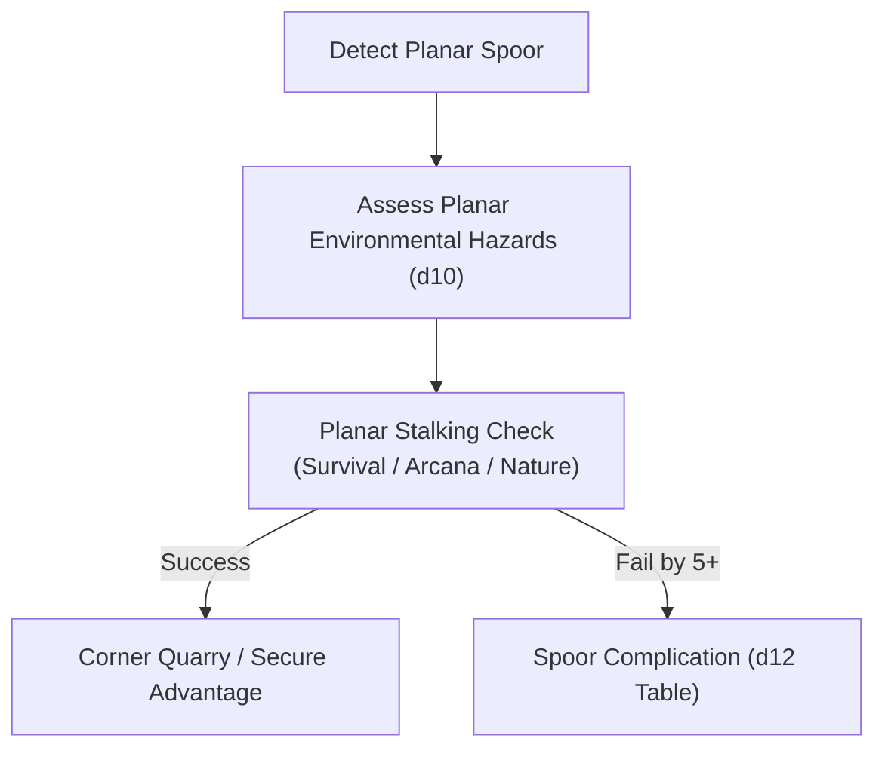
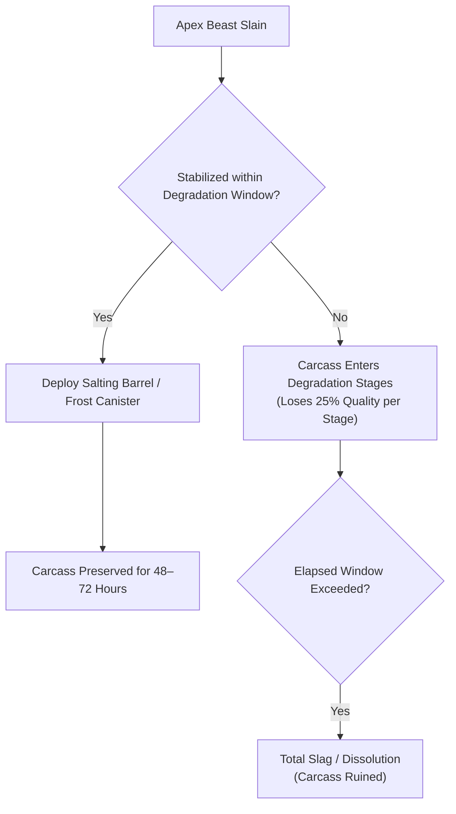
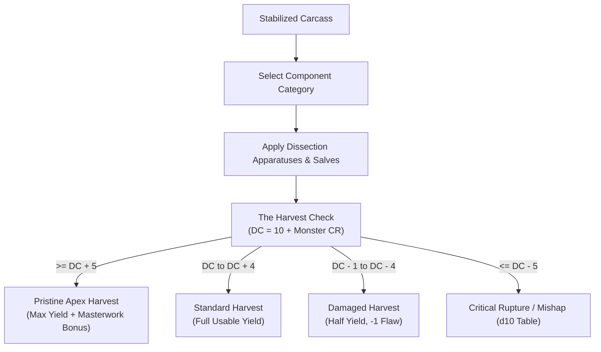
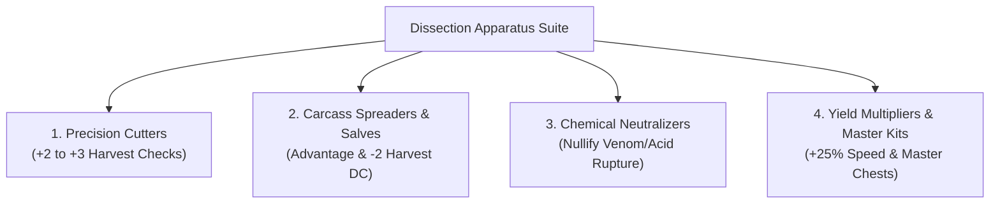
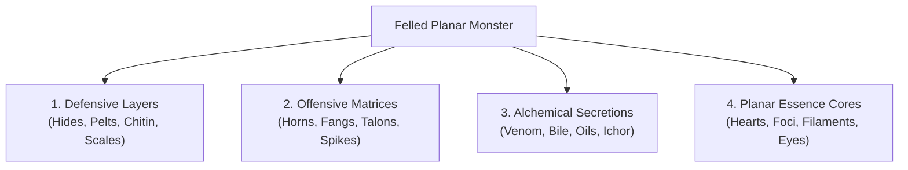
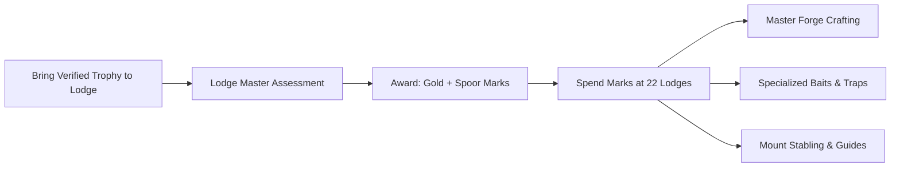
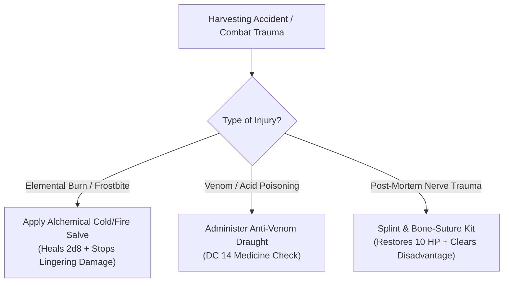

# 🏹 The Interplanar Hunting, Harvesting & Trophy-Crafting Ruleset
### *A Modular System of Planar Stalking, Carcass Anatomy, Field Butchery Apparatuses, Relic Smithing, and Hunting Lodge Economy*

> *"A mundane stag dies when you pierce its lungs. An Everblaze scorpid bleeds liquid magma until its armor cools into brittle obsidian, while an Abyssal fray-goristro begins to rot into acidic sludge the heartbeat its breath ceases. If you don't know the thermodynamic anatomy of the planes, your prize dissolves before you draw your skinning knife. Carry proper shears, pack cold salt, and treat the carcass like a live furnace—or go home with empty packs and third-degree elemental burns."*  
> — **Grand Huntmaster Torvald Blood-Tracer**, Treatise on the Planar Spoor

---

## 📖 System Philosophy & Core Design

Across the drifting shards of the **Shattered Loom**, survival demands far more than mundane iron. The apex fauna, elemental monstrosities, and fiendish beasts prowling the planes possess hides infused with environmental resistance, bones resonating with Loom-harmonics, and glands harboring potent magical venom.

Standard D&D 5e rules provide minimal guidance for tracking quarry across exotic planes, butchering volatile remains, or forging monster organs into epic equipment. This modular system integrates with:
1. **[[Custom Rules/The Eldritch Madness & Dream-Fracture Ruleset|The Eldritch Madness & Dream-Fracture Ruleset (Module II)]]**: Handling psychic backlash and oneiric hazards when hunting dreaming or void-tainted fauna.
2. **[[Custom Rules/The Eldritch Horror Hunting & Sanity-Harvesting Ruleset|The Eldritch Horror Hunting & Sanity-Harvesting Ruleset (Module IV)]]**: Complementing standard beast/monstrosity harvesting with specialized non-Euclidean aberration butchery.
3. **[[Custom Rules/Planar Bestiary & Hunting Lodges Compendium|Planar Bestiary & Hunting Lodges Compendium]]**: Directory of all 22 branch lodges, local lodge masters, and 66 apex quarry targets.

### The Five Axioms of Planar Butchery
1. **Biology Is Elemental**: Organs do not operate on mortal blood alone; they are thermodynamic engines of elemental, celestial, or fiendish energy. When circulation stops, that energy destabilizes.
2. **The Decay Clock Ticks in Minutes**: Carcasses exposed to opposing planar atmospheres degrade exponentially faster than mundane game. Immediate stabilization is mandatory.
3. **Precision Trumps Brute Force**: A dull cleaver shatters brittle chitin and ruptures venom bladders. Precision tools, rib spreaders, and neutralizing balms are what separate master harvest yields from catastrophic explosions.
4. **The Four Matrices of Power**: Every apex beast yields four distinct component tiers: *Defensive Layers*, *Offensive Matrices*, *Alchemical Secretions*, and *Planar Essence Cores*.
5. **The Lodge Is the Crucible**: Planar materials cannot be worked in mundane village forges. True awakening requires the specialized bellows, quenching vats, and anvil rites of the **Grand Guild of the Iron Spoor**.

---

## 🧭 Phase 1: Planar Spoor Tracking & Scent-Weaving

Tracking an apex beast across planar shatterpoints requires reading how planar environments warp tracks, scents, and thermal signatures.

### 1. The Planar Stalking Check
To locate quarry across planar terrain, the lead tracker makes a **Planar Stalking Check** combining **Wisdom (Survival)**, **Intelligence (Nature)** for beasts/plants/elementals, or **Intelligence (Arcana)** for constructs/dragons/fiends:

| Planar Biome | Characteristic Environmental Spoor Clues | Base Stalking DC | Typical Apex Quarry |
| :--- | :--- | :---: | :--- |
| **Material Plane & Echoes** | Smashed foliage, flattened reeds, territorial claw-ruts in ancient oaks. | **DC 13** | Dire beasts, owlbears, hydras, wyverns. |
| **The Fractured Nexus** | Vibrating golden thread-fur, ozone clouds, footprints hovering above void-rifts. | **DC 14** | Thread-Stalkers, Rift Gryphons, Weft-Lynxes. |
| **Elemental Expanses** | Glass-slag footprints (Fire), localized vacuum vortexes (Air), boiling silt trenches (Water), pulverized granite ruts (Earth). | **DC 15** | Magma scorpids, cinder-drakes, abyssal leviathans, basalt behemoths. |
| **Outer Divine Shards** | Crystallized gold dust (Avarice), weeping mirror fragments (Memories), singing steam vents (Craft). | **DC 16** | Aurous gorgons, memory-thieves, ironbound chimerae. |
| **The Lower Planes (Hells & Abyss)** | Boiling sulfur tracks, coagulated blood-pools, screaming earth-groans of Pandemonium. | **DC 17** | Fray-goristros, Stygian hell-mastiffs, brimstone manticores. |
| **Anomalous Realities (Far Realm / Ry'leh)** | Displaced spatial geometry, inverted shadows, puddles of liquid violet starlight. | **DC 18** | Warp-stalkers, mind-leeches, scythe-crawlers. |

### 2. Planar Environmental Tracking Hazards (d10 Table)
While following the spoor through untamed planar wilderness, roll a **d10** every 4 hours of travel:

| d10 | Environmental Hazard | Mechanical & Wilderness Effect |
| :---: | :--- | :--- |
| **1** | **Ash Blizzard / Fire-Geyser** | Visibility drops to 10 ft. Trackers must succeed on a DC 14 Dex save or take 3d6 fire damage; non-elemental tracks are buried. |
| **2** | **Gravity Shearing** | Local gravity drops to zero or spikes to triple. Movement is halved; DC 14 Athletics check or suffer 2d6 bludgeoning damage. |
| **3** | **Memory-Fog Seep** | Ethereal mist drifts through. Each tracker must make a DC 15 Wis save or forget the trail, losing 1d4 hours of progress. |
| **4** | **Corrosive Bog / Acid Bog** | Mud pools bubble with vitriol. Stepping into them deals 2d8 acid damage and degrades nonmagical boots/armor by -1 AC. |
| **5** | **Harmonic Filament Static** | A frayed Loom thread hums violently. Spellcasters must make a DC 14 Con save or lose their lowest-level unexpended spell slot. |
| **6** | **Suffocating Silt Storm** | Airborne particulate forces DC 13 Con saves every 10 minutes or gain 1 level of exhaustion. Torches and mundane flames are snuffed out. |
| **7** | **Mirrored Shard Blind** | Reflective crystal spires blind travelers. Wisdom (Perception) checks suffer disadvantage for 2 hours. |
| **8** | **Sulfur Geyser Burst** | Pressurized gas erupts. DC 14 Con save or be poisoned and incapacitated with violent coughing for 10 minutes. |
| **9** | **Planar Anathema Pulse** | Native planar energy surges. Weapons and gear without protective salves take 1d6 structural wear damage. |
| **10** | **Quarry Ambush Terrain** | Quarry detects hunters first and sets a tactical trap, gaining high ground and surprise on the opening combat round. |

### 3. Planar Spoor Complications Table (d12 Table)
When a stalking check fails by **5 or more**, roll on the **Planar Spoor Complications Table**:

| d12 | Complication | Narrative & Mechanical Consequence |
| :---: | :--- | :--- |
| **1** | **False Mirage Spoor** | Tracks loop through a dimensional eddy. Party wastes 1d4 hours and emerges at a dangerous cliff edge or lava flow. |
| **2** | **Elemental Backdraft** | Quarry's thermal spoor ignites ambient gas. Lead tracker takes 4d6 fire or cold damage (DC 14 Dex save halves). |
| **3** | **Carrion Scavenger Pack** | A pack of lesser planar predators (e.g. 1d4 Hell Hounds or Shadow Mastiffs) is feasting on the quarry's kill; roll immediate initiative. |
| **4** | **Territorial Pheromone Trap** | Quarry marked a narrow choke point with acidic musk. DC 15 Con save or suffer disadvantage on Stealth checks for 8 hours. |
| **5** | **Dimensional Flicker** | Quarry stepped through a micro-shatterpoint, teleporting 1,000 feet laterally across an impassable chasm. |
| **6** | **Frayed Loom Filament** | A taut, vibrating strand crosses the path. A tracker who succeeds on a DC 15 Arcana check can attune to it, gaining advantage on the next tracking check. |
| **7** | **Apex Rivalry Clash** | The quarry is locked in mortal combat with a rival apex beast when discovered; both begin combat at 75% maximum HP. |
| **8** | **Crumbling Terrain** | Ground collapses beneath the lead tracker into an elemental rift. DC 15 Dex save or fall 30 ft onto razor-sharp planar shards. |
| **9** | **The Screaming Scent** | Scent particles resonate telepathically. Harvester hears agonizing roars, suffering disadvantage on concentration for 1 hour. |
| **10** | **Apex Nesting Sanctuary** | Party tracks the beast into its primary nesting lair; contains untouched eggs or juvenile trophies (+25% harvest value), but quarry fights with +2 AC. |
| **11** | **Rival Hunting Party** | A rival crew from the Iron Spoor or poachers from Aurous Grasp has cornered the quarry; must negotiate, intimidate, or fight. |
| **12** | **Primal Challenge Roar** | The beast scents the party, roars across the horizon, and charges head-on, initiating combat with a surprise charge. |

### 4. Specialized Stalking & Snaring Equipment
* **Elemental Tracking Lantern (140 gp)**: Brass lantern burning powdered brimstone and cold-salts. Sheds light that illuminates footprints that are invisible to the naked eye (such as flying, ethereal, or phase-shifting beasts) within 30 ft.
* **Scent-Anchoring Stakes (Set of 4: 60 gp)**: Cold-iron stakes driven into trails that trap beast pheromones, giving trackers +2 on subsequent Survival checks to re-acquire lost trails.
* **Tethering Harpoon & Cable (180 gp)**: Heavy steel harpoon with 50 ft of braided adamant wire. On hit, tethers Huge or smaller beasts; target cannot fly, burrow, or teleport away unless it breaks the tether (DC 18 Strength).
* **Concentrated Pheromone Lures (75 gp per phial)**: Distilled musk of a receptive mate or territorial rival. Smearing on rocks lures quarry within 2 miles toward an ambush zone.

---

## ⏳ Phase 2: Carcass Degradation Physics & Stabilization

Unlike mundane stags or wolves whose meat spoils over days, planar apex beasts are kept alive by intense elemental circulation or fiendish pressure. Once dead, their matter rapidly destabilizes.

### 1. The Carcass Degradation Clock
Hunters have an **Ambient Degradation Window** based on the creature's size category to begin stabilization or field dressing:
* **Medium**: 30 minutes.
* **Large**: 1 hour.
* **Huge**: 2 hours.
* **Gargantuan**: 4 hours.

### 2. Rapid Planar Degradation Triggers
On certain hostile planes, the environment accelerates decay:
* **The Everblaze Expanse (Fire)**: Liquid magma blood cools into inert basalt slag in **20 minutes**.
* **The Abyss / Pandemonium**: Corpse dissolves into acidic, bubbling sludge in **15 minutes** unless cold-salted.
* **The River Styx / Stygia**: Frost-rime crystallizes marrow; components shatter if struck without gentle thawing in **30 minutes**.
* **The Plane of Avarice**: Gilded scales tarnish and turn to lead if not kept under alchemical mercury-varnish within **1 hour**.

### 3. Degradation Stages Table

| Degradation Stage | Elapsed Time Beyond Window | Harvest Quality Penalty | Crafting Consequences |
| :--- | :---: | :---: | :--- |
| **Stage 0: Pristine** | Within Window | None | Full component yield; eligible for Pristine Apex masterwork crafting (+1 bonuses). |
| **Stage 1: Leeching** | +30 Minutes | -2 to Harvest Checks | Component yield reduced by 25%; elemental resistance items have reduced durations. |
| **Stage 2: Putrefying / Slagging** | +1 Hour | -5 to Harvest Checks | Yield halved (50%); crafted items suffer -1 to attack rolls or AC bonuses. |
| **Stage 3: Inert Sludge / Slag** | +2 Hours | Automatic Failure | Carcass dissolves into toxic goo, basalt stone, or ash. Zero usable crafting materials remain. |

### 4. Preservation Tools & Stabilization Methods
* **Lodge Salting Barrel (Cost: 25 gp, 30 lbs)**: Packed with coarse mineral salt and cold-iron flakes. Preserves up to 1 Large or 4 Medium carcasses for **72 hours**.
* **Canian Frost-Canister (Cost: 85 gp, 15 lbs)**: A brass cylinder venting Stygian vapor. Instantly freezes up to 1 Huge creature's organs, halting the decay clock for **7 days**.
* **Alchemical Embalming Mist (Cost: 50 gp per flask)**: Pressurized aerosol sprayed across incisions. Coats exposed muscle in a protective resin, extending the Ambient Degradation Window by **2 hours**.
* **Gentle Repose (Spell)**: Halts the degradation clock completely for the spell's 10-day duration.

---

## 🔪 Phase 3: Field Harvesting & Specialized Dissection Apparatuses
### *(Instruments to Make Field Harvesting Easier, Faster & Safer)*

Field harvesting is precision surgery under extreme environmental stress. Harvesting an organ requires a dedicated check, specialized tools, and safety protocols to avoid catastrophic organ rupture.

### 1. The Harvesting Check & DC Formula
Harvesting takes **10 minutes per size category** of the quarry. A character rolls their check based on the component sought:

$$\text{Harvest DC} = 10 + \text{Monster Challenge Rating (CR)} \quad (\text{Max DC 25})$$

| Tool Proficiency & Ability Check | Target Component Categories |
| :--- | :--- |
| **Leatherworker's Tools or Survival (Wis)** | Pelts, Leathers, Hides, Scales, Feathers, Sinew. |
| **Smith's Tools or Athletics (Str)** | Chitinous Carapace, Horns, Adamantine Claws, Spines, Skulls. |
| **Alchemist's Supplies or Nature (Int)** | Venom Sacs, Acid Bile, Elemental Glands, Bioluminescent Fluids. |
| **Arcana or Cook's Utensils (Wis/Int)** | Planar Essence Cores, Soul-Threads, Primordial Hearts, Sensory Eyes. |

### 2. Harvest Yield Tiers
* **Critical Rupture (Roll $\le$ DC - 5)**: Component ruined. Gland or elemental sac detonates: harvester takes **3d6 to 6d6 elemental damage** (see Mishap Table).
* **Damaged Harvest (Roll between DC - 4 and DC - 1)**: Yield halved. Crafted items made with this component suffer a -1 penalty to their bonus.
* **Standard Harvest (Roll between DC and DC + 4)**: 100% full standard yield. Clean, viable components ready for the forge.
* **Pristine Apex Harvest (Roll $\ge$ DC + 5)**: Flawless extraction. Crafted items gain **+1 enhancement bonus**, **1 additional charge**, or a radiant elemental visual aesthetic.

### 3. Carcass Extraction Mishaps & Critical Failures (d10 Table)
When a harvest check fails by **5 or more** or rolls a **Natural 1**, roll on the **Carcass Extraction Mishap Table**:

| d10 | Mishap Phenomenon | Dangerous Consequence |
| :---: | :--- | :--- |
| **1** | **Elemental Gland Detonation** | Volatile fire or cold gland ruptures. 20-ft radius takes 4d8 elemental damage (DC 15 Dex save halves); adjacent components destroyed. |
| **2** | **Acidic Bile Geyser** | Pressurized bile sprays into harvester's face. Takes 4d6 acid damage; leather gloves and aprons melt; blinded for 10 minutes. |
| **3** | **Venom Sac Piercing** | Needle-sharp bone punctures venom bladder. Harvester is poisoned, takes 3d8 poison damage, and is paralyzed for 1 hour (DC 15 Con save). |
| **4** | **Post-Mortem Muscular Spasm** | Severed talon or jaw snaps shut with reflex force. Harvester is struck by an attack with +8 to hit, taking full melee weapon damage. |
| **5** | **Necrotic Bone Splinter** | Fiendish rib shatters into jagged shards. Harvester takes 2d6 piercing and 2d6 necrotic damage; maximum HP reduced until long rest. |
| **6** | **Essence Core Burnout** | Magical core discharges ambient lightning. Harvester is stunned for 1 round and core loses all magical attunement, becoming inert glass. |
| **7** | **Caustic Gas Bloom** | Carcass cavity releases suffocating sulfuric cloud. Harvester gains 1 level of exhaustion and is incapacitated with coughing for 5 minutes. |
| **8** | **Chitin Flaw Fracture** | Heavy carapace plates split along stress fractures; yields only cracked fragments (-50% armor value). |
| **9** | **Soul-Thread Whiplash** | Severed spiritual filament lashes out. Harvester takes 3d8 psychic damage and is deafened by phantom screams for 1 hour. |
| **10** | **Chain Reaction Rupture** | Both bile and elemental glands explode simultaneously; entire carcass is incinerated/melted into worthless slag. |

---

### 4. Specialized Dissection Apparatuses: Making Harvesting Easier & Safer

Master harvesters of the Grand Guild of the Iron Spoor rely on precision gear, chemical neutralizers, and mechanical spreaders to systematically eliminate harvesting risks:

#### A. Precision & DC-Reduction Tools
* **Adamantine-Edged Skinning Shears (240 gp, 2 lbs)**: Micro-serrated shears honed with crushed diamond and adamantine dust. Slices effortlessly through petrified leather, dragon scales, and basalt hide. Grants **+3 to Harvest Checks for pelts, scales, and hides**.
* **Thermic Dissection Scalpel (160 gp, 1 lb)**: Clockwork heated blade powered by a minor fire-gem. Melts through frozen sinew in cold planes and prevents magma blood from hardening into slag during incisions. Adds **+2 to Harvest Checks for internal glands**.
* **Elemental Gland Forceps (130 gp, 1 lb)**: Insulated brass clamps lined with lead and asbestos. Prevents accidental puncturing of fragile venom sacs and bile ducts, granting **+2 to Harvest Checks for alchemical secretions**.
* **Magnifying Optic Visor (110 gp, 1 lb)**: Multi-lens ocular visor fitted with brass magnifying loupes. Illuminates subcutaneous nerve junctions and gland boundaries, **granting advantage on checks made to harvest Essence Cores**.

#### B. Tissue Stabilizers & DC-Lowering Balms
* **Planar Embalming Balm (65 gp / jar - 3 applications)**: Thick botanical grease infused with lavender, ground lotus, and Mechanus grease. Massaged into an incision, it halts rapid elemental cooling or putrefaction for 1 hour, **lowering the Harvest DC by 2**.
* **Spoor-Jack & Carcass Rib-Spreaders (180 gp, 15 lbs)**: Heavy iron ratchet jacks and mechanical ribs spreaders. Holds massive ribcages and thick chitin carapaces rigidly open, granting **advantage on all Harvest Checks for internal organs** and preventing post-mortem muscular collapse.
* **Alchemical Quick-Flay Brine (80 gp / bottle)**: A mild chemical solvent painted over pelts that dissolves subcutaneous fat in seconds, **cutting skinning time in half** (to 5 minutes per size category).

#### C. Mishap Neutralizers & Safety Apparatuses
* **Gland Neutralizing Powder (45 gp per pouch - single use)**: A dry, alkali powder derived from crushed celestial chalk. Poured over an exposed venom or acid sac before cutting: **if a Critical Rupture or Natural 1 occurs, the explosion/spray is completely absorbed and neutralized**, dealing 0 damage to the harvester (the component is still lost).
* **Galvanic De-Spasming Stake (95 gp, 4 lbs)**: Driven into the quarry's spinal column before incisions begin; grounds residual muscular electricity, **completely preventing Mishap 4 (Post-Mortem Muscular Spasm)**.
* **Lead-Lined Organ Flasks (Set of 4: 80 gp, 6 lbs)**: Airless containers that isolate explosive or necrotic essences, preventing accidental detonation during transit.
* **Elemental Dampening Apron & Gauntlets (120 gp, 8 lbs)**: Heavy hide apron treated with fire-salts and cold-wax. Wearer has **resistance to all elemental damage** (fire, cold, lightning, acid) while conducting field autopsies.

#### D. The Master Planar Skinner's Field Chest (Deluxe Kit)
* **Market Cost**: 750 gp or 15 Spoor Marks (Weight: 25 lbs).
* **Contents**: Adamantine Shears, Thermic Scalpel, Gland Forceps, Optic Visor, Spoor-Jacks, 2 jars of Balm, 2 pouches of Neutralizing Powder, and 4 Lead Flasks packed in a velvet-lined ironbound chest.
* **Masterwork Benefit**: While utilizing the Master Chest, the harvester gains **advantage on all Harvest Checks**, adds a **+2 bonus to the check**, and **never triggers Mishap 10 (Chain Reaction Rupture)** on a failure.

---

### 5. Master Field Dissection Equipment Catalog

| Equipment / Item | Market Cost | Weight | Primary Mechanical Bonus & Utility |
| :--- | :---: | :---: | :--- |
| **Adamantine-Edged Skinning Shears** | 240 gp | 2 lbs | **+3 to Harvest Checks** for hides, scales, and pelts; ignores natural armor hardness. |
| **Thermic Dissection Scalpel** | 160 gp | 1 lb | **+2 to Harvest Checks** for internal glands; prevents magma blood from hardening. |
| **Elemental Gland Forceps** | 130 gp | 1 lb | **+2 to Harvest Checks** for alchemical secretions and venom sacs. |
| **Magnifying Optic Visor** | 110 gp | 1 lb | Grants **advantage on Harvest Checks** when extracting delicate Essence Cores. |
| **Planar Embalming Balm (3 doses)** | 65 gp | 1 lb | **Lowers the Harvest DC by 2** and suspends planar bleed for 1 hour. |
| **Spoor-Jack & Rib-Spreaders** | 180 gp | 15 lbs | Grants **advantage on internal organ checks**; locks heavy carapaces open. |
| **Alchemical Quick-Flay Brine** | 80 gp | 2 lbs | **Halves skinning duration** (reduces to 5 minutes per size category). |
| **Gland Neutralizing Powder** | 45 gp | 0.5 lbs | **Completely neutralizes venom/acid explosions** on a critical failure (consumed). |
| **Galvanic De-Spasming Stake** | 95 gp | 4 lbs | Driven into spine; **prevents post-mortem reflex attacks (Mishap 4)**. |
| **Elemental Dampening Apron** | 120 gp | 8 lbs | Grants **resistance to fire, cold, acid, and lightning** during field autopsies. |
| **Lead-Lined Organ Flasks (Set of 4)** | 80 gp | 6 lbs | Safely transports volatile essences without risk of leaking or detonation. |
| **Lodge Salting Barrel** | 25 gp | 30 lbs | Preserves up to 1 Large carcass for **72 hours** against decay. |
| **Canian Frost-Canister** | 85 gp | 15 lbs | Flash-freezes up to 1 Huge carcass; suspends decay clock for **7 days**. |
| **Alchemical Embalming Mist** | 50 gp | 2 lbs | Extends Ambient Degradation Window by **2 hours** via spray resin. |
| **Master Skinner's Field Chest** | 750 gp | 25 lbs | Deluxe suite: **Advantage on all checks**, **+2 bonus**, and immunity to Mishap 10. |

---

## 🔨 Phase 4: The Four Component Categories & Master Trophy-Forging

Harvested monster components are categorized into four distinct functional tiers, each yielding specialized gear when taken to a Planar Lodge.

### 1. Master Trophy-Crafting Table

| Item Category & Name | Required Planar Components | Crafting Time & Cost | Resulting Item Properties & D&D 5e Mechanics |
| :--- | :--- | :---: | :--- |
| **Apex Hide Mail / Armor** | 1 Pristine Hide + 200 gp Lodge Salts | 3 Days / 300 gp | *Medium/Light Armor, Rare*. AC 14 + Dex (max 2). Grants **permanent resistance to the creature's primary elemental damage type** (fire, cold, lightning, acid). |
| **Carapace Bastion Plate** | 3 Heavy Chitin Plates + Forge Access | 5 Days / 750 gp | *Heavy Armor (AC 18), Very Rare*. While worn, **critical hits against you become normal hits**. Grants +1 to saving throws against planar hazards. |
| **Planar Fang / Talon Blade (+1 or +2)** | 2 Apex Fangs + Tempered Crucible Steel | 3 Days / 350 gp | *Weapon (Any Melee), Rare*. Deals an extra **1d6 elemental damage** matching the beast. On a critical hit, the target is afflicted with the creature's status effect for 1 round. |
| **Apex Hunter's Recurve (+1)** | 1 Flexible Horn + Loom Sinew + Yew | 3 Days / 400 gp | *Weapon (Longbow/Shortbow), Rare*. Ignores half and three-quarters cover; normal firing range increased by +30 feet. |
| **Tremor-Maul of the Behemoth (+2)** | 1 Basalt Horn / Heavy Bone Club + Steel | 4 Days / 600 gp | *Weapon (Maul/Warhammer), Rare*. Deals +1d8 bludgeoning damage. On a hit, large or smaller targets must make a DC 15 Str save or be knocked **prone**. |
| **Distilled Apex Venom (3 Doses)** | 1 Intact Venom Sac + Alchemical Solvent | 1 Day / 150 gp | *Poison, Rare*. Applied to blade as an action (lasts 1 minute). Target takes **4d6 poison/acid damage** and is poisoned/blinded for 1 minute (DC 16 Con save ends). |
| **Amulet of the Planar Heart** | 1 Pristine Essence Core + Golden Wire | 4 Days / 500 gp | *Wondrous Item, Rare (Attunement)*. Allows wearer to cast **1 signature spell of the beast once per long rest** (e.g. *Fireball*, *Cone of Cold*, *Dimension Door*). |
| **Cloak of Shifting Scent** | 1 Apex Leech-Pelt / Shadow Hide | 3 Days / 380 gp | *Wondrous Item, Rare*. Beasts, hounds, and monstrosities have **disadvantage on Perception checks to detect you by scent or sound**. Grants +2 to Stealth. |
| **Buckler of the Elemental Bastion (+1)** | 1 Elemental Chitin Plate + Steel Boss | 3 Days / 420 gp | *Shield (+1), Rare*. As a reaction when taking elemental damage, absorb the blast, reducing damage by **2d10** and storing it; your next weapon strike deals +1d10 of that type. |
| **Elixir of Primal Vigor (2 Doses)** | 1 Primordial Heart Gland + Distilled Water | 2 Days / 200 gp | *Potion, Rare*. Drinking grants **20 Temporary Hit Points** for 8 hours and advantage on Strength checks and saving throws. |

---

## 🪙 Phase 5: The Lodge Economy & Spoor Marks

The **Grand Guild of the Iron Spoor** operates an interplanar sovereign currency: **Spoor Marks**—stamped iron and meteoric tokens bearing an indented beast paw and braided loom filament.

### 1. Earning Spoor Marks & Trophy Payouts
Bringing verified apex trophies (head, pristine skull, or core) to any of the 22 Planar Lodges yields standard bounties:

| Quarry Classification | Typical Challenge Rating | Gold Bounty | Spoor Mark Reward | Guild Renown Points |
| :--- | :---: | :---: | :---: | :---: |
| **Lesser Quarry** | CR 1–4 | 150 gp | **2 Spoor Marks** | +1 Renown |
| **Greater Beast** | CR 5–8 | 450 gp | **5 Spoor Marks** | +3 Renown |
| **Apex Predator** | CR 9–12 | 1,200 gp | **12 Spoor Marks** | +8 Renown |
| **Planar Terror** | CR 13–16 | 3,000 gp | **25 Spoor Marks** | +15 Renown |
| **Primal Behemoth** | CR 17–20 | 7,500 gp | **50 Spoor Marks** | +30 Renown |
| **World-Eater / Titan** | CR 21+ | 20,000 gp | **100 Spoor Marks** | +60 Renown |

### 2. Guild Renown Ranks & Lodge Privileges

* **Rank 1: Spoor-Finder (0–10 Marks)**: Free bunk, clean water, and access to the public bounty boards across all 22 lodges.
* **Rank 2: Field Harvester (11–30 Marks)**: 10% discount on salting barrels, embalming balms, and traps; access to the communal butchery vats and salting cellars.
* **Rank 3: Beast-Slayer (31–60 Marks)**: Access to the Master Trophy Forge; permitted to purchase concentrated pheromone lures and hire lodge guide retinues.
* **Rank 4: Master Stalker (61–100 Marks)**: Access to classified Apex Bounties (CR 15+); lodge masters provide private planar mount stabling and bespoke weapon tuning.
* **Rank 5: Apex Huntmaster (100+ Marks)**: Holds a permanent voting seat on the Grand Council of the Spoor; Lodge Masters craft custom Legendary-tier relics without labor fees.

### 3. Spoor Mark Redemption Catalog
Spoor Marks can be redeemed at any of the 22 Chapter Lodges for specialized gear and services:

| Lodge Goods / Services | Mark Cost | Mechanical Properties & Utility |
| :--- | :---: | :--- |
| **Master Skinner's Field Chest** | 15 Marks | Complete deluxe surgical suite with Adamantine Shears, Thermic Scalpels, and Spoor-Jacks. |
| **Canian Frost-Canister** | 3 Marks | Flash-freezes up to 1 Huge carcass, stopping decay for 7 days. |
| **Lodge Guide Retinue (1 Week)** | 6 Marks | A veteran CR 5 hunter NPC who provides +4 to all local Planar Stalking checks. |
| **Planar Mount Stabling & Feed** | 2 Marks | Houses exotic beasts (hippogriffs, hell hounds, basalt rams) in safe stables for 1 month. |
| **Adamantine Weapon Quenching** | 8 Marks | Treats any weapon to overcome nonmagical resistances and deal maximum damage to objects/chitin. |
| **Apex Trophy Mount Service** | 5 Marks | Preserves a trophy head for display; radiates an aura granting +2 to Intimidation checks in your home base. |

---

## 🩹 Phase 6: Field Triage & Hunting Mishap Containment

When a hunt goes wrong, hunters must stabilize injured companions before the quarry's pack or scavengers arrive.

### 1. Emergency Venom Extraction
* If an ally is poisoned by a ruptured venom sac, another character can spend an action with a **Healer's Kit** or **Poisoner's Kit** to make a **DC 14 Wisdom (Medicine) check**.
* On a success, the poisoned condition ends immediately, and lingering poison damage is negated.

### 2. Elemental Burn Salves (25 gp per jar)
* Soothes third-degree burns caused by magma blood or frost-rime. Restores **2d8 HP** and clears any vulnerability to elemental damage caused by planar exposure.

### 3. Subduing Surviving Offspring & Young
* When encountering juvenile quarry in a nest, hunters proficient in **Animal Handling** can make a **DC (12 + Quarry CR) Wisdom (Animal Handling) check** to capture the beast alive for lodge stabling, yielding **double Spoor Marks** upon live delivery.

---

## 🗺️ Cross-Vault Links & Regional Directories

* **The 22 Branch Lodges Compendium**: [[Custom Rules/Planar Bestiary & Hunting Lodges Compendium|Planar Bestiary & Hunting Lodges Compendium]]
* **Aberration & Cosmic Dissection**: [[Custom Rules/The Eldritch Horror Hunting & Sanity-Harvesting Ruleset|Module IV: The Eldritch Horror Hunting Ruleset]]
* **Madness & Lucidity Rules**: [[Custom Rules/The Eldritch Madness & Dream-Fracture Ruleset|Module II: The Eldritch Madness & Dream-Fracture Ruleset]]
* **Central Faction Dossier**: [[Factions/The Grand Guild of the Iron Spoor|The Grand Guild of the Iron Spoor]]
* **Lodge Leadership Profiles**: [[NPCs/Key NPCs - The Grand Guild of the Iron Spoor|Key NPCs: The Grand Guild of the Iron Spoor]]
* **Comprehensive Species Compendium**: [[Species/Species|The Multiversal Species Directory]]
* **Master Rules Hub**: [[Custom Rules/Custom Rules|Custom Rules & Mechanics Hub]]
