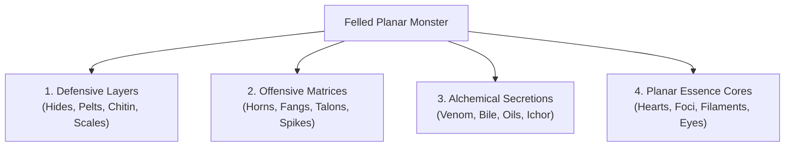

# 🏹 The Interplanar Hunting, Harvesting & Trophy-Crafting Ruleset
### *A Modular System of Planar Stalking, Carcass Anatomy, Relic Smithing, and Hunting Lodge Economy*

> *"A mundane stag dies when you pierce its lungs. An Everblaze scorpid bleeds liquid magma until its armor cools into obsidian, while an Abyssal fray-goristro begins to rot into acidic sludge the heartbeat its breath ceases. If you don't know the anatomy of the planes, your prize dissolves before you draw your skinning knife."*  
> — **Grand Huntmaster Torvald Blood-Tracer**, Treatise on the Planar Spoor

---

## 📖 System Philosophy & Design Goals

Across the drifting shards of the **Shattered Loom**, survival demands more than mundane steel. The apex fauna and fiendish monstrosities of the planes possess hides infused with elemental resistance, bones resonating with Loom-harmonics, and glands harboring potent magical venom.

The standard D&D 5e rules provide minimal guidance for tracking monsters, harvesting their remains, or forging their parts into equipment. This modular ruleset provides:
1. **Dynamic Planar Stalking**: Environmental tracking DCs and planar tracking complications.
2. **Tactile Carcass Harvesting**: Structured checks, tool proficiencies, and risk-reward harvest tiers.
3. **Planar Trophy-Forging**: Detailed crafting formulas to turn pelts, chitin, cores, and glands into specialized weapons, armor, and planar relics.
4. **The Lodge Economy & Spoor Marks**: A universal barter currency recognized at all 22 Planar Lodges of the **Grand Guild of the Iron Spoor**.

---

## 🧭 Phase 1: Planar Spoor Tracking & Stalking

Tracking an apex beast across planar shatterpoints requires understanding how planar physics distort scents, tracks, and essence.

### 1. The Tracking Check
To locate an apex quarry, the party's lead tracker makes a **Planar Stalking Check** (typically **Wisdom (Survival)**, though **Intelligence (Arcana)** can be used for aberrations/constructs, and **Intelligence (Nature)** for beasts/plants):

| Planar Biome | Environmental Stalking Complication | Base Tracking DC |
| :--- | :--- | :---: |
| **Material Plane & Echoes** | Mundane terrain, shifting fey mists, or Barovian fog. | **DC 13** |
| **Elemental Expanses** | Ash plumes (Fire), gale-winds (Air), crushing silt (Water), shifting bedrock (Earth). | **DC 15** |
| **The Fractured Nexus** | Drifting islands, golden filament winds, dimensional echoes. | **DC 14** |
| **The Lower Planes (Hells & Abyss)** | Boiling sulfur pools, blood tides, screaming winds of Pandemonium. | **DC 17** |
| **Outer Divine Shards** | Crystallized gold dust (Avarice), singing thought-waters (Secrets), mirror-shards (Memories). | **DC 16** |
| **Anomalous Realities (Ry'leh & Far Realm)** | Inverted gravity, non-Euclidean angles, memory-wiping brine. | **DC 18** |

### 2. Planar Spoor Complications Table (d8)

| d8 | Stalking Complication | Mechanical Effect |
| :---: | :--- | :--- |
| **1** | **False Mirage Spoor** | The tracks loop back on themselves. Party must succeed on a DC 14 Wisdom (Perception) save or lose 1d4 hours. |
| **2** | **Planar Anathema Flare** | Local planar bleed ignites (fire storm, shadow chill). Each tracker takes 2d8 elemental damage. |
| **3** | **Carrion Scavengers** | A pack of lesser planar predators is already picking at the quarry's feeding grounds. Roll an ambush encounter. |
| **4** | **Territorial Ward** | The quarry marked its territory with corrosive musk. DC 15 Con save or suffer disadvantage on stealth checks for 4 hours. |
| **5** | **Dimensional Flicker** | The quarry stepped through a minor shatterpoint, shifting 500 feet laterally. Requires DC 15 Arcana check to reacquire trail. |
| **6** | **Frayed Loom Filament** | A vibrating golden filament crosses the path. Touching it grants advantage on the next tracking check. |
| **7** | **Looming Apex Duel** | The quarry is locked in combat with a rival predator when found; both start at 80% maximum hit points. |
| **8** | **Pristine Lair Discovery** | The party corners the beast in its lair, discovering untainted nesting trophies (+20% salvage yield). |

---

## 🔪 Phase 2: Carcass Degradation & Harvesting Mechanics

Once an apex creature is slain, the hunters must act quickly. The alien physics of the planes cause corpses to degrade, cool, or rot rapidly if left unprotected.

### 1. The Decay Clock
* **Standard Ambient Window**: Hunters have **1 hour** following a creature's death to complete harvesting before the carcass degrades by one quality tier.
* **Rapid Planar Decay**:
  * In the **Everblaze Expanse (Fire)**, elemental magma blood hardens into brittle slag in **30 minutes**.
  * In the **Abyss**, corpses dissolve into bubbling, toxic sludge within **20 minutes** unless salted.
  * In the **City of Ry'leh**, bodies submerged in thought-brine lose physical density, turning into translucent jellyfish-gel in **45 minutes**.
* **Preservation Tools**:
  * *Lodge Salting Barrel* (Cost: 25 gp): Preserves 1 Large carcass for 48 hours.
  * *Gentle Repose* spell: Suspends decay clock for the spell's duration.
  * *Canian Frost-Canister* (Cost: 75 gp): Suspends decay clock indefinitely while frozen.

### 2. The Harvesting Procedure
Harvesting takes **10 minutes per size category** of the beast (10 min Medium, 20 min Large, 30 min Huge, 40 min Gargantuan). A creature can attempt to harvest one specific component category, rolling the appropriate check:

$	ext{Harvest DC} = 10 + 	ext{Monster Challenge Rating (CR)}$

*(Maximum DC 25 for CR 15+ creatures).*

| Tool / Skill Proficiency | Primary Component Categories Harvested |
| :--- | :--- |
| **Leatherworker's Tools / Survival** | Pelts, Leathers, Hides, Scales, Sinew. |
| **Smith's Tools / Athletics** | Chitinous Carapace, Horns, Adamantine Claws, Spikes. |
| **Alchemist's Supplies / Nature** | Venom Sacks, Acid Bile, Elemental Glands, Bioluminescent Oils. |
| **Arcana / Cook's Utensils** | Planar Essence Cores, Soul-Threads, Brain Lobe Filaments, Primordial Hearts. |

### 3. Harvest Yield Tiers

| Roll Result | Harvest Quality Tier | Salvage Yield & Mechanical Consequence |
| :---: | :--- | :--- |
| **<= DC - 5** | **Critical Rupture** | Component destroyed. Venom/acid ruptures: harvester takes 3d6 damage of creature's elemental type. |
| **DC - 4 to DC - 1** | **Damaged Harvest** | Salvage yield halved. Crafted items made with this component suffer -1 to their primary bonus. |
| **DC to DC + 4** | **Standard Harvest** | Full standard component yield. Clean, functional materials ready for the forge. |
| **>= DC + 5** | **Pristine Apex Harvest** | Flawless yield. Crafted item gains +1 enhancement bonus, 1 extra charge, or unique aesthetic glow. |

---

## 🔨 Phase 3: The Four Component Categories

Every huntable apex monster yields components belonging to four core categories:

1. **Defensive Layers (Hides, Pelts, Chitin)**: Used to forge light, medium, and heavy armor, bucklers, and cloaks granting elemental resistances or stealth advantages.
2. **Offensive Matrices (Horns, Fangs, Talons)**: Used to forge melee and ranged weapons, ammunition, and weapon coatings granting bonus damage dice or armor-piercing traits.
3. **Alchemical Secretions (Venoms, Biles, Oils)**: Distilled into 3-dose weapon oils, cleansing draughts, or explosive grenades at an alchemy bench.
4. **Planar Essence Cores (Hearts, Foci, Eyes)**: The magical engine of the beast, used to craft wondrous wondrous items, wands, rings, and Spelljammer rigging.

---

## ⚒️ Phase 4: Trophy-Crafting at the Planar Lodges

Mundane village blacksmiths lack the specialized knowledge and hearth temperatures required to work planar monster materials. All trophy crafting must take place at one of the **Planar Lodges of the Grand Guild of the Iron Spoor**.

### Master Trophy-Crafting Table

| Item Category | Required Components | Base Crafting Time | Base Crafting Cost | Resulting Item Properties (D&D 5e) |
| :--- | :--- | :---: | :---: | :--- |
| **Apex Hide Armor / Mail** | 1 Pristine Pelt + 200 gp Lodge Salts | 3 Days | 300 gp | Medium/Light armor; grants resistance to creature's elemental damage type. |
| **Carapace Plate Armor** | 3 Heavy Chitin Plates + Forge Access | 5 Days | 750 gp | Heavy Armor (AC 18); critical hits against the wearer become normal hits. |
| **Planar Talon/Fang Weapon** | 2 Apex Fangs + Tempered Crucible Steel | 2 Days | 250 gp | +1 or +2 Weapon; deals an extra 1d6 elemental damage matching the beast. |
| **Distilled Apex Venom (3 Doses)** | 1 Intact Venom Sac + Alchemical Base | 1 Day | 150 gp | Applied to weapon (action); target takes 3d6 poison/acid and is blinded/poisoned for 1 min (DC 15 Con). |
| **Amulet of the Planar Heart** | 1 Intact Essence Core + Golden Wire | 4 Days | 500 gp | Wondrous Item; allows wearer to cast 1 signature spell of the beast 1/day. |
| **Apex Hunter's Bow** | 1 Flexible Horn + Loom Sinew | 3 Days | 400 gp | Longbow/Shortbow (+1); ignores half-cover and adds +10 ft to normal range. |

---

## 🪙 Phase 5: The Lodge Economy & Spoor Marks

The **Grand Guild of the Iron Spoor** maintains a universal credit system across all planes: **Spoor Marks** (stamped iron tokens bearing an indented beast paw and loom thread).

### 1. Earning Spoor Marks
* **Bounty Turn-in**: Bringing a verified hunt trophy (head, horn, or apex pelt) to any Lodge Master rewards **Spoor Marks** based on monster Challenge Rating:
  * **CR 1–4**: 2 Spoor Marks
  * **CR 5–8**: 5 Spoor Marks
  * **CR 9–12**: 12 Spoor Marks
  * **CR 13–16**: 25 Spoor Marks
  * **CR 17+**: 50 Spoor Marks
* **Raw Component Barter**: Lodge alchemists and smiths purchase raw harvested organs at market rates (gp or Marks).

### 2. Guild Renown Ranks & Benefits

* **Rank 1: Spoor-Finder (0–10 Marks)**: Free bunk, clean water, and access to basic hunting notice boards at any lodge.
* **Rank 2: Field Harvester (11–30 Marks)**: 10% discount on lodge salting barrels, traps, and tracking kits; access to the Lodge butchery vats.
* **Rank 3: Beast-Slayer (31–60 Marks)**: Access to the Master Trophy Forge; ability to purchase specialized monster baits and planar tracking compasses.
* **Rank 4: Master Stalker (61–100 Marks)**: Access to classified Apex Bounties (CR 15+); lodge masters provide local guide retinues and planar mount stabling.
* **Rank 5: Apex Huntmaster (100+ Marks)**: Seat on the Grand Council of the Spoor; Lodge Masters craft custom legendary tier relics without labor fees.

---

## 🗺️ Cross-Vault Links & Regional Directories

* **All 22 Planar Lodges & Quarry Compendium**: [[Custom Rules/Planar Bestiary & Hunting Lodges Compendium|Planar Bestiary & Hunting Lodges Compendium]]
* **Central Faction Dossier**: [[Factions/The Grand Guild of the Iron Spoor|The Grand Guild of the Iron Spoor]]
* **Key Lodge NPCs & Personalities**: [[NPCs/Key NPCs - The Grand Guild of the Iron Spoor|Key NPCs: The Grand Guild of the Iron Spoor]]
* **Master Rules Hub**: [[Custom Rules/Custom Rules|Custom Rules & Mechanics Hub]]
