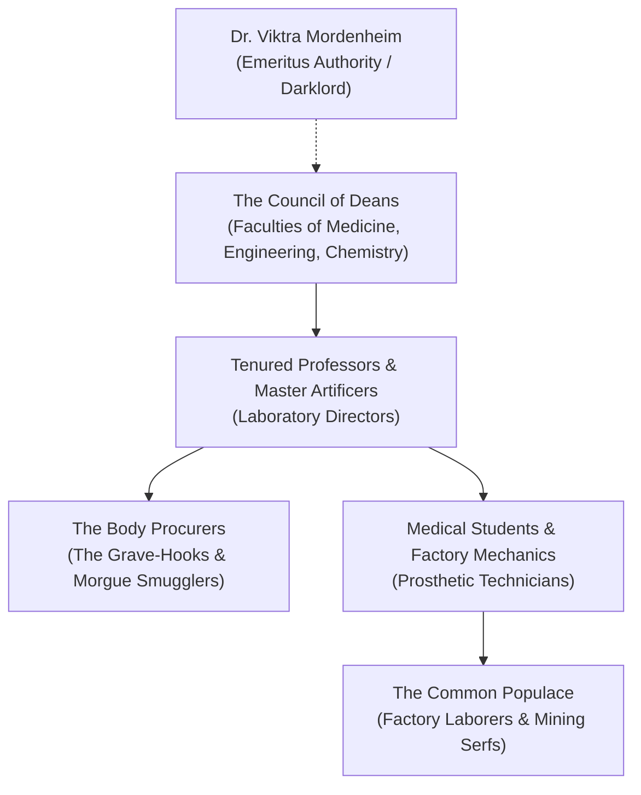

---
---
# The Academic Syndicate of Ludendorf

The **Academic Syndicate** is the powerful union of university deans, galvanic engineers, surgeons, and natural philosophers who govern the institutions of higher learning, industrial docks, and scientific laboratories in the sub-arctic realm of **Lamordia**. Centered within the sprawling stone campus of **Ludendorf University**, the Syndicate views mortal biology as an engineering problem waiting to be solved.

> _"Faith is the delusion of the primitive; death is merely a temporary interruption of the electrical current. With enough galvanic power and clean tissue, we shall forge gods of our own making."_
> — Chancellor Aris, Faculty of Anatomical Engineering

---

## Structure & Modus Operandi

The Syndicate operates with chilling rationality and zero moral hesitation. In pursuit of medical and technological breakthrough, its researchers conduct radical galvanic surgeries, limb amputations, brain-jar transplants, and construct reanimations.

### The Four Faculties of the Syndicate
1. **The Faculty of Galvanic Engineering**:
   Artificers who maintain the lightning towers of Mount Grysl, harness storm batteries, and build steam engines and clockwork prosthetics.
2. **The Faculty of Experimental Anatomy**:
   Surgeons and fleshcrafters who develop subdermal cybernetics, organ grafts, and synthetic tissues in massive subterranean dissection amphitheaters.
3. **The Resurrection Men (The Procurers)**:
   The Syndicate's officially denied yet lavishly funded network of grave-robbers, whalers, and body-snatchers who supply fresh cadavers to the university morgues.
4. **The Municipal Watch Commission**:
   Constables who ensure that "public disturbances" (such as escaped flesh golems or distraught families seeking stolen corpses) are quietly eliminated.

---

## Organization & Hierarchy

---

## Magic, Aesthetic & Emblems

- **The Symbol**: A brass gear bisected by an anatomical lightning bolt, worn as an enameled lapel pin or embroidered onto oilcloth lab coats.
- **Aesthetic**: Utilitarian, soot-stained industrialism—high-collared wool coats, vulcanized rubber gloves, brass magnifying goggles, and leather tool aprons bristling with bone-saws.
- **Galvanic Science**: The Syndicate rejects divine magic, relying instead on lightning-infused batteries, chemical stimulants, and mechanical life-support apparatuses.

---

## Relationships with Other Factions

### Dr. Viktra Mordenheim
**Feared Genius.** While Dr. Mordenheim maintains her private redoubt on the Isle of Agony, the Syndicate treats her word as scripture. Faculty members compete desperately for her research notes and occasional guest lectures.

### The Consortium of the Gilded Caliper
**Technology Exchange.** Smugglers from the Plane of Eternal Craft secretly purchase Lamordian galvanic batteries and surgical designs, trading raw adamantine, titanium rods, and clockwork escapements in return.

### The Church of Ezra
**Mutual Revulsion.** The Syndicate legally bans the Church of Ezra from operating within the University district, ridiculing their veneration of the Mists as backwards superstition.

---

## Adventure Hooks

1. **The Escaped Specimen**: An advanced flesh construct carrying a prototype artificial lung escapes from the university vaults into the icy harbor. The party is hired by the Faculty of Anatomy to recapture it before the city constables destroy it.
2. **The Grave-Hook Heist**: The Resurrection Men intercept a shipment of rare preserved planar specimens intended for an off-plane collector. The party must track them to an abandoned ice-house along the canal.
3. **The Storm Conductor Crisis**: A lightning surge over Mount Grysl threatens to overload the city's power grid. The Syndicate hires bold adventurers to climb the frozen summit and ground the main pylon.

---
[[Project Shattered Loom/Project Shattered Loom/Planes of Existence/The Material Plane/Shadowfell]]
[[Project Shattered Loom/Project Shattered Loom/NPC's/Dr. Viktra Mordenheim]]
[[Project Shattered Loom/Project Shattered Loom/NPC's/Elise, the Living Core]]
