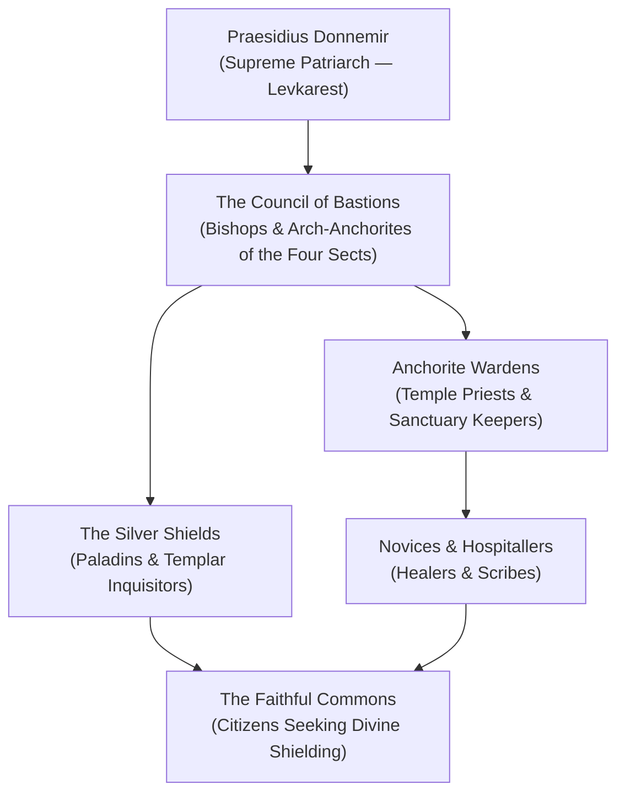

---
---
# The Church of Ezra (The Anchorites)

The **Church of Ezra** is the most widespread organized religion across the **Domains of Dread**, founded in the alpine realm of **Borca** and centered within the majestic white marble walls of **The Great Cathedral of Ezra** in **Levkarest**. Devoted to **Our Lady of the Mists**, a mortal woman who ascended to godhood by sacrificing herself to shield humanity from the horrors of the Mists, the Church provides spiritual sanctuary, healing, and holy protection across a decaying multiverse.

> _"When the darkness gathered and the world unraveled, Ezra gave herself to the Mists that we might not be consumed. Shelter behind Her shield, for beyond it lies only the void."_
> — The Book of Ezra, Verse 12

---

## Structure & Modus Operandi

The clergy of Ezra are known as **Anchorites**. They are holy clerics, paladins, and ward-weavers trained to battle undead, exorcise dark vestiges, and construct sanctified barriers capable of repelling the mist-madness of the Shadowfell.

### The Four Sects of Ezra
1. **The First Sect (The Home Faith of Borca)**:
   Led by the **Praesidius** in Levkarest. Traditionalist, politically astute, and heavily entwined with the Boritsi and Dilisnya noble houses. They focus on preserving church hierarchy and maintaining physical sanctuary.
2. **The Second Sect (The Inquisitive Faith of Dementlieu)**:
   Centered in Port-a-Lucine. Philosophically refined, scholarly, and dedicated to exposing supernatural evil and corruption through logic and holy law.
3. **The Third Sect (The Healing Faith of Darkon)**:
   Centered in Nevichar. Devoted to medical hospice care, curing the amnesia curse, and giving peace to wandering spirits.
4. **The Fourth Sect (The Militant Zealots)**:
   A fanatical splinter order who believe that the Mists are divine retribution sent to cleanse the impure, hunting down heretics and witches with silver and fire.

---

## Organization & Hierarchy

---

## Magic, Aesthetic & Emblems

- **The Symbol**: A silver kite shield adorned with an alabaster sprig of belladonna or white sprig of mist-heather.
- **Vestments**: Pristine white and silver robes with silver pectoral crosses and hooded travel cloaks lined with silk.
- **The Shield of Ezra**: Anchorites wield a unique divine prayer that manifests a shimmering translucent silver barrier (granting bonus AC and resistance to necrotic damage).

---

## Relationships with Other Factions

### The High Houses of Borca (Boritsi & Dilisnya)
**Uneasy Symbiosis.** The Church receives massive land endowments and tithes from Lady Ivana and Ivan Dilisnya, but must constantly maneuver to avoid being used as pawns in their mutual assassination plots.

### The Keepers of the Feather
**Quiet Allies.** In Barovia and Borca, Anchorites quietly coordinate with wereraven scouts to shelter refugees fleeing vampire raids.

### The Academic Syndicate of Ludendorf
**Theological Conflict.** The Church considers the Syndicate's galvanic reanimation of corpses an abomination against natural law and the divine order of the soul.

---

## Adventure Hooks

1. **The Poisoned Chalice**: An assassin attempts to poison Praesidius Donnemir during communion at the Great Cathedral of Levkarest. The party is retained by Brother Thaddeus to uncover which noble house forged the chalice.
2. **Sanctuary of the Lost**: An Anchorite sanctuary along the Svalich Road is besieged by night-prowlers. The party must defend the church until dawn without breaking the consecrated boundary circle.
3. **The Fourth Sect Incursion**: A militant band of Fourth Sect Anchorites arrives in town, declaring that all arcane spellcasters and tieflings are agents of the Mists who must be purged in holy fire.

---
[[Project Shattered Loom/Project Shattered Loom/Planes of Existence/The Material Plane/Shadowfell]]
[[Project Shattered Loom/Project Shattered Loom/NPC's/Lady Ivana Boritsi]]
[[Project Shattered Loom/Project Shattered Loom/Factions/The Keepers of the Feather]]
