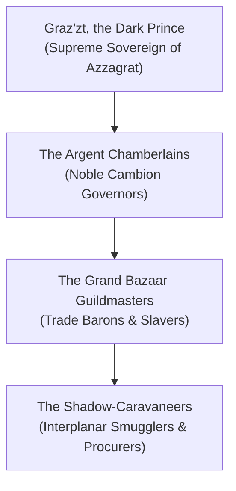

# **The Consortium of Azzagrat**
*The Argent Guild, The Merchants of Sensation, The Shadow-Coin Brokers*

> *"Everything in the multiverse has a price. Some pay in gold, others in blood; but the wise pay in the sweet, exquisite memories they never needed anyway."*  
> — **Master Malakor of the Grand Bazaar**

***

## **Faction Overview**

* **Philosophy**: Decadence, Profit, and Exploitation of the Multiverse’s Fractured State.
* **Headquarters**: The Triple-City of Zelatar (Layers 45–47).
* **Leader**: Graz'zt, the Dark Prince, supervised by his noble cambion chamberlains.
* **Core Agenda**: Monopolize the interplanar trade in forbidden luxuries, stolen Loom fragments, soul-static, and mind-altering abyssal distillates.

***

## **Commercial Spheres & Monopolies**

1. **The Soul-Static Exchange**: Harvesting mortal memories and distilling them into narcotic liquids and crystal vials sold to planar connoisseurs.
2. **The Contraband Flesh-Trade**: Trafficking exotic planar species, charmed champions, and captured celestials across the Black Market.
3. **Loom-Shard Smuggling**: Acquiring unstable Loom fragments salvaged from Astral shipwrecks and using their volatile magic to forge reality-warping luxury artifacts.
4. **The Mirrored Banking Guild**: Lending soul-coins and interplanar gold at exorbitant interest rates, backed by magical contracts that forfeit the debtor’s identity upon default.

***

## **Related Links**
* [[The Dark Cartel of Minauros|The Dark Cartel of Minauros (Infernal Rivals)]]
* [[The Consortium of the Gilded Caliper|The Consortium of the Gilded Caliper (Mortal Guild Rivals)]]
* [[The Interplanar Black Market & Smuggling Ruleset|The Interplanar Black Market & Smuggling Ruleset]]
* [[The Abyss|The Abyss Overview]]
