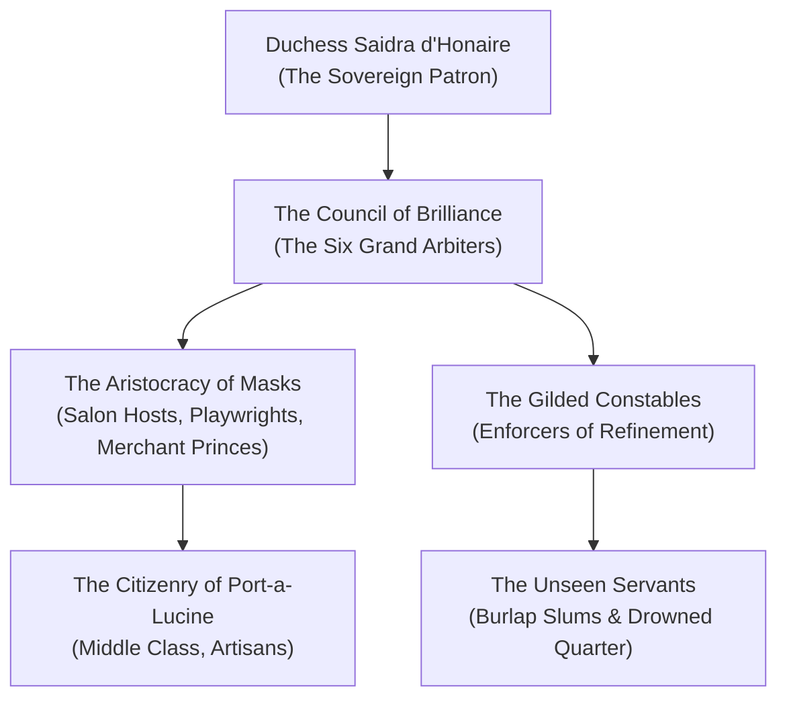

---
---
# The Council of Brilliance

The **Council of Brilliance** is the governing cabal of aristocrats, virtuoso artists, playwrights, and wealthy merchant lords who hold political and economic dominion over **Dementlieu**, operating from the gilded salons of **Port-a-Lucine** under the mercurial favor of **Duchess Saidra d’Honaire**. 

> _"In Port-a-Lucine, beauty is not an aspiration—it is an iron shackle. A dropped fork at dinner can lose you your fortune; a faux pas at the opera will lose you your head."_
> — Madame Josephine of The Gilded Mirror

---

## Structure & Modus Operandi

While Duchess Saidra is the supreme arbiter of taste, she delegates daily civil administration, patent approvals, and theater licensing to the Council of Brilliance. The Council is a viper's nest of backstabbing, social extortion, and perfumed assassinations.

### The Inner Circles of Brilliance
1. **The Arbiters of Taste (The High Council)**: 
   The six wealthiest patrons of the arts who control city budgets, approve architecture, and determine which citizens are invited to the Duchess's weekly Grand Masquerade.
2. **The Saloniers**:
   Noble hostesses and salon proprietors who gather daily to dissect reputations, sponsor fashionable duelists, and trade blackmail ciphers.
3. **The Gilded Constables (The Porcelain Watch)**:
   An elite security force dressed in immaculate powdered wigs and porcelain smiling masks, arresting anyone who commits public offenses of "ugliness, poverty, or vulgarity."
4. **The Unseen Laborers**:
   The disenfranchised servant caste whose faces must always be masked and whose voices are legally forbidden from addressing aristocrats directly.

---

## Organization & Hierarchy

---

## Magic, Aesthetic & Emblems

- **The Symbol**: A gilded opera mask crowned with three peacock feathers, worn as an enameled broach or stamped onto royal invitations.
- **Aesthetic**: Neoclassical opulence—powdered wigs, velvet coats embroidered with platinum thread, diamond-dusted masquerade masks, and scented handkerchiefs.
- **Glamour Arcana**: The Council employs specialized illusionists and alchemists who brew *Eau de Glamour*—lotions that temporarily hide deformities, age, and disease beneath youthful illusions.

---

## Relationships with Other Factions

### The Church of Ezra (The Dementlieu Sect)
**Uneasy Compromise.** The Council allows the Church of Ezra to preach in Port-a-Lucine, provided the Anchorites hold masses in gilded cathedrals and wear ornate vestments that match the city's aesthetic.

### Alanik Ray & The Inquisitives
**Constant Surveillance.** The Council views master detective Alanik Ray as an insufferable meddler who threatens to expose the financial embezzlement and murders hiding beneath high-society decorum.

### The Brotherhood of the Bare Face
**Brutal Suppression.** The underground resistance movement operating from the Drowned Quarter, which rejects the tyranny of masks and false refinement, is hunted ruthlessly by the Porcelain Watch.

---

## Adventure Hooks

1. **Invitation to Midnight**: The party receives an unsolicited, gold-leaf invitation to Duchess Saidra's Masquerade of the Red Rose, bearing a secret note warning that one of the six Council members is marked for ritual execution at midnight.
2. **The Stolen Perfume Recipe**: Monsieur Lucian of *L'Apothicaire des Songes* hires the party to recover a stolen perfume formula capable of compelling absolute obedience, before a Council member uses it to usurp the mayoralty.
3. **The Glass Garden Scandal**: An influential Council member's corpse is found impaled on a razor-glass orchid inside the botanical conservatories. Alanik Ray hires the party to perform discreet forensic analysis before the crime scene is cleaned.

---
[[Project Shattered Loom/Project Shattered Loom/Planes of Existence/The Material Plane/Shadowfell]]
[[Project Shattered Loom/Project Shattered Loom/NPC's/Duchess Saidra d'Honaire]]
[[Project Shattered Loom/Project Shattered Loom/NPC's/Alanik Ray]]
