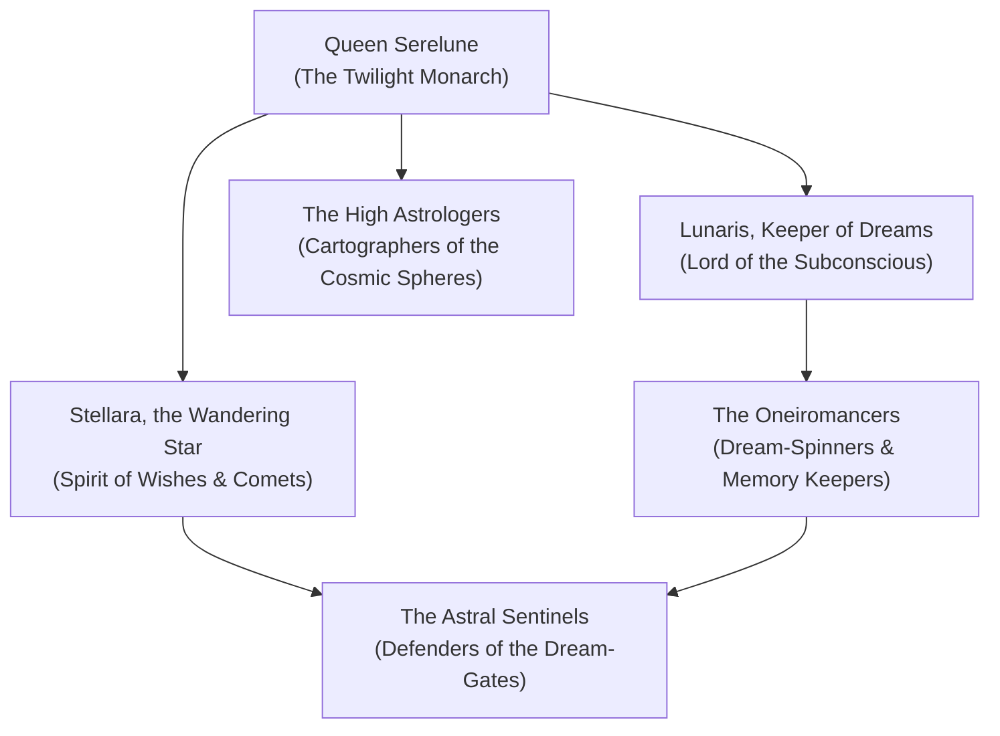

# The Court of Stars (The Oneiric Astrologers of Twilight)

The **Court of Stars** is a serene, contemplative, and cosmic assembly of celestial Archfey, dream-weavers, and astrologers residing within the **Twilight Glade** of [[Project Shattered Loom/Project Shattered Loom/Planes of Existence/The Material Plane/Feywild|The Feywild]]. Presided over by **Queen Serelune, the Twilight Monarch**, this court exists above the petty squabbles of the Seelie and Unseelie, focusing instead on mapping the movements of planar constellations, interpreting cosmic prophecies, protecting the boundary of dreams, and preserving the threads of destiny.

Their palaces are woven of starlight, pearlescent cloud, and silver birch boughs. They navigate the multiverse through the dream-currents of sleeping mortals, collecting visions and preventing Far Realm horrors from infiltrating the subconscious of the planes.

> _"While the courts below fight over flowers and frost, we watch the stars turn. Every mortal dream is a thread; lose enough threads, and the sky itself will fall."_
> — Lunaris, Keeper of Dreams

---

## Organization & Hierarchy

### 1. The Twilight Monarch
**Queen Serelune**, sovereign arbiter of celestial prophecy and cosmic balance.

### 2. The Dream Lords
**Lunaris**, shepherd of sleeping mortals, and **Stellara**, herald of comets, wishes, and cosmic anomalies.

### 3. The High Astrologers
Ancient eladrin sages who operate the great Planar Orrery within the Spire of Constellations.

### 4. The Oneiromancers
Artisans who spin dream-silk into astral sails, prophecy scrolls, and memory wards.

---

## Core Doctrines

1. **Sanctity of the Dream**: The subconscious minds of living beings are sacred sanctuaries that must be defended against nightmare fiends.
2. **Cosmic Neutrality**: The Court does not take sides in terrestrial wars; their duty is to the greater planar equilibrium.
3. **Preservation of the Tapestry**: Constellations reflect the state of the Shattered Loom; any star that falls must be recovered before reality unravels.

---

## Relationships with Other Factions

### The Seelie & Unseelie Courts
**Neutral Mediators.** Both courts bring their most intractable diplomatic disputes to the Twilight Glade for arbitration under the stars.

### The Shadar-kai Memory-Sworn
**Philosophical Allies.** Both understand the sacred value of memories and dreams, occasionally exchanging dream-shards for historical knowledge.

---
[[Project Shattered Loom/Project Shattered Loom/Planes of Existence/The Material Plane/Feywild]]
[[Project Shattered Loom/Project Shattered Loom/NPC's/Queen Titania]]
[[Project Shattered Loom/Project Shattered Loom/NPC's/The Queen of Air and Darkness]]
