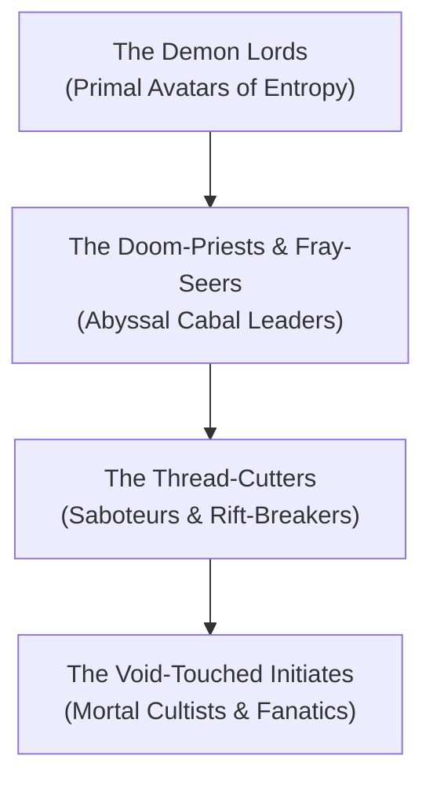

# **The Cults of Chaos and the Fray**
*The Unravelers, The Void-Kissed, The Disciples of Entropy*

> *"Why mend what the cosmos had the wisdom to break? To stitch the Loom is to build a cage. We hold the shears; we celebrate the tearing."*  
> — **Creed of the Fray-Cultists**

***

## **Faction Overview**

* **Philosophy**: Cosmic Nihilism and Boundless Liberty through Total Dissolution.
* **Headquarters**: Subterranean fracture-shrines in Zelatar, the catacombs of Naratyr, and hidden cells across the Material Plane.
* **Leader / Patrons**: The Demon Lords (Demogorgon, Orcus, Graz'zt, Baphomet) and the slumbering Great Dreamer.
* **Core Agenda**: Oppose all restoration efforts of the Pale Lodge and Keepers of the Sacred Weft; tear at planar seams; accelerate the unraveling of the multiverse.

***

## **Ranking Hierarchy & Roles**

1. **The Doom-Priests & Fray-Seers**: High clerics and warlocks who receive prophetic visions from the Entropic Wake, interpreting the seismic stirrings of the Great Dreamer.
2. **The Thread-Cutters**: Elite infiltrators, assassins, and planar saboteurs equipped with shears of abyssal iron that physically sever Golden Filaments.
3. **The Rift-Breakers**: Mad mages who deliberately overload magical ley-lines and shatterpoint portals, allowing abyssal static to bleed into mortal cities.
4. **The Void-Touched Initiates**: Mortal outcasts, nihilists, and desperate souls who tattoo unweaving glyphs onto their flesh and perform sacrificial rites.

***

## **Tactics & Resources**
* **Planar Sabotage**: The Cult plants abyssal seed-crystals at the convergence points of Golden Filaments, corroding the bonds holding drifting planar shards in orbit.
* **Psychic Contagion**: Spreading Indefinite Abyssal Madness through poisoned water supplies, enchanted texts, and hypnotic sermons.
* **Abyssal Iron Weaponry**: Forged with cold void-metal that inhibits magical healing and unravels protective wards.

***

## **Related Links**
* [[The Abyss|The Abyss Overview]]
* [[The Cult of the Broken Thread|The Cult of the Broken Thread]]
* [[The Pale Lodge|The Pale Lodge (Arch-Enemies)]]
* [[The Blood War|The Blood War]]
