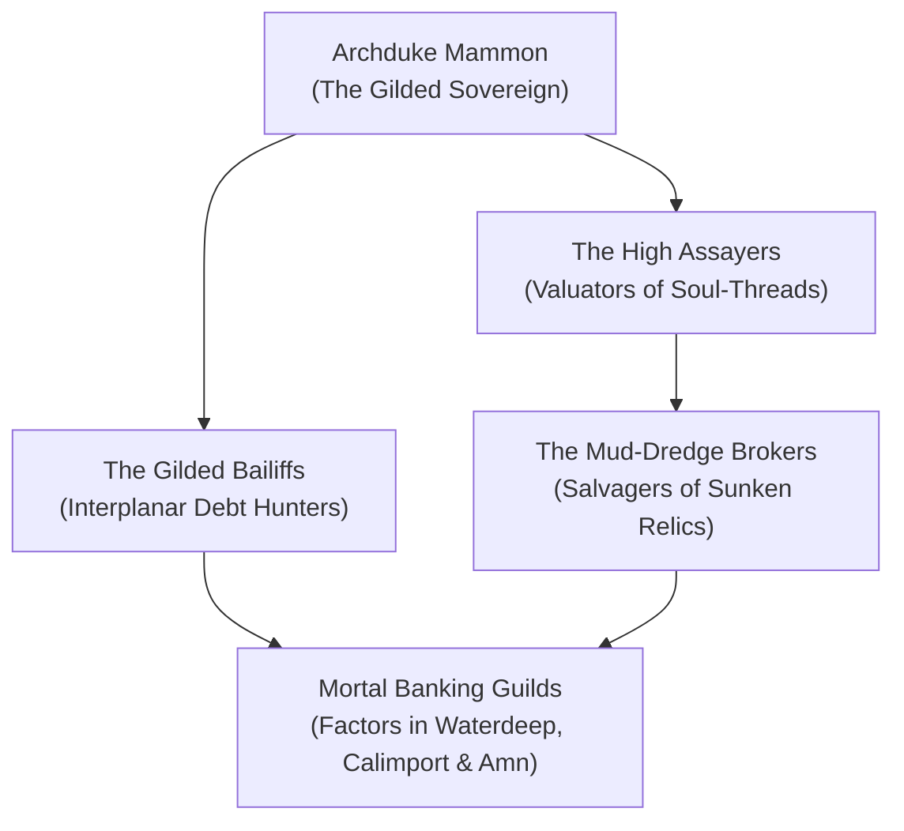

# The Dark Cartel of Minauros (The Usurers of Baator)

The **Dark Cartel of Minauros** is the vast financial syndicate, loan-sharking empire, and debt-enforcement agency operating from the sunken towers of **Jangling Hiter** in the third layer of the Hells. Controlled by **Archduke Mammon**, the Cartel manages interplanar money-lending, soul-thread mortgages, and the trafficking of salvaged artifacts dredged from the muck of the multiverse.

Through networks of disguised merchant-factors, planar fences, and corrupt banking guilds on the Material Plane, the Cartel finances wars, secures the mortgages on mortal dynasties, and collects compound interest in the form of eternal souls.

> _"Gold is the anchor of the soul. Borrow our coin today, and we will own your great-grandchildren's tomorrows."_
> — Appraiser Balthazar of Jangling Hiter

---

## Organization & Hierarchy

### 1. The Gilded Throne
**Archduke Mammon**, who personally audits the ledgers of universal bankruptcy.

### 2. The High Assayers
Valuators who weigh mortal soul-threads and determine the interest rates on divine compacts.

### 3. The Gilded Bailiffs
Cross-planar enforcers who repossess collateral, kingdoms, and souls when loans default.

---

## Core Doctrines

1. **Compound Interest is Sacred**: Every loan must bear fruit; debts never die, they merely accumulate penalties.
2. **The Tangible Anchor**: Material wealth represents physical gravity; the more gold Mammon holds, the stronger his grip on reality.
3. **Foreclose Without Mercy**: Pity is a breach of contract; default means total forfeiture of soul and property.

---
[[Project Shattered Loom/Project Shattered Loom/Planes of Existence/The Nine Hells/The Nine Hells]]
[[Project Shattered Loom/Project Shattered Loom/Planes of Existence/The Interplanar Black Market & Smuggling Ruleset|The Interplanar Black Market & Smuggling Ruleset]]
