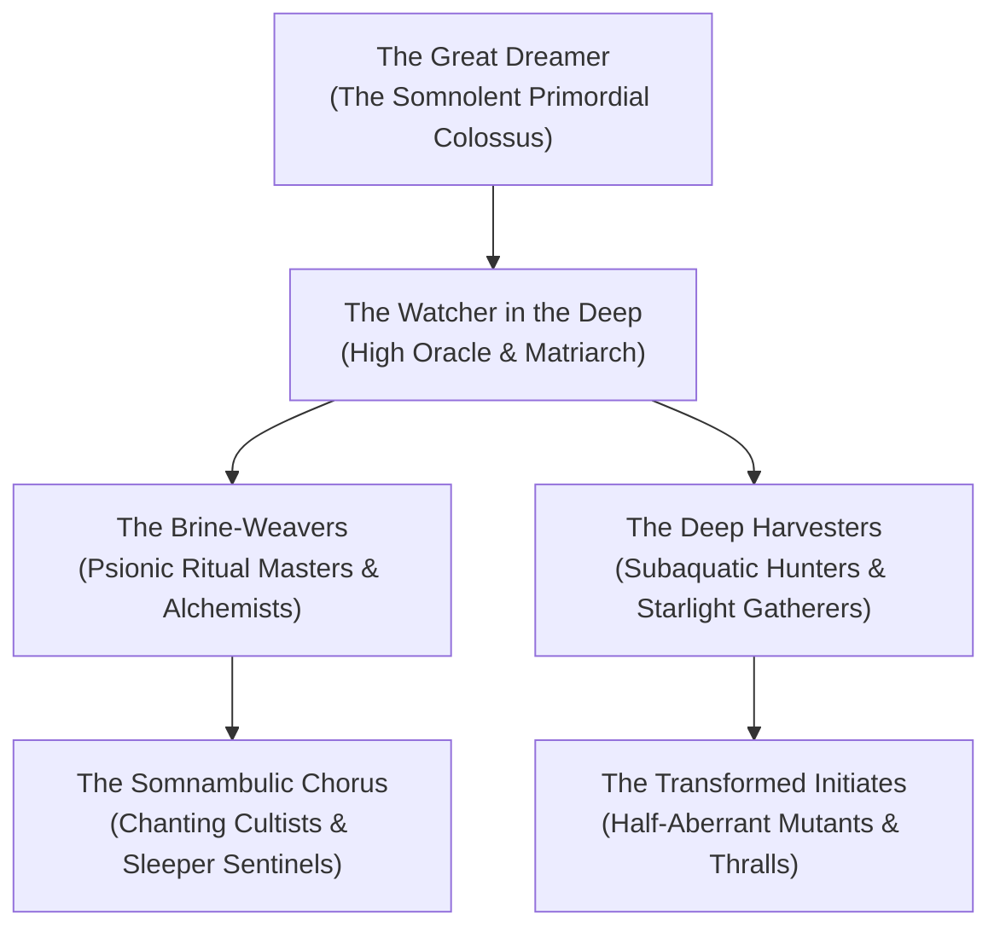

# 🐙 The Dreambound of Ry'leh
### *Guardians of the Slumbering Eye, Harvesters of Starlight Brine, Priests of the Un-Woven Reality*

> *"We do not serve a god of brass and thunder. We serve the Mind that dreams the heavens. When the dream trembles, we sing the soothing verses; when dry-landers bring violence, we feed their sanity to the brine."*  
> — **First Acolyte Thaelis, Litany of the Submerged Threshold**

---

## 🏛️ Faction Overview

The **Dreambound of Ry'leh** are a secretive, plane-spanning cabal of mutated cultists, psionic scholars, and half-aberrant humanoids who inhabit the sunken cyclopean ruins and spires of **Ry'leh**. Their sole objective is the preservation of the **Great Dreamer's** eternal slumber—believing that should the primordial titan ever fully awake, the entire cosmic tapestry of the multiverse will unravel like a loose stitch.

* **Faction Headquarters**: The Submerged Ziggurat (Tiers 1 & 2), City of Ry'leh.
* **Leader**: [[NPCs/The Watcher in the Deep|The Watcher in the Deep]] (High Oracle).
* **Deity / Sovereign**: [[NPCs/The Great Dreamer|The Great Dreamer]] (Cosmic Patron).
* **Membership**: Approximately 2,400 active devotees in Ry'leh; sleeper cells across the Astral Plane, Shadowfell, and coastal ports of the Material Plane.
* **Alignment**: Neutral Evil / Chaotic Neutral.

---

## 🕸️ Organizational Structure & Hierarchy

### The Ranks of the Dreambound

1. **The High Oracle**: Direct psionic conduit to the Dreamer's sleeping emanations. Currently held by [[NPCs/The Watcher in the Deep|The Watcher in the Deep]].
2. **The Brine-Weavers**: Elder psions who refine Starlight Brine into mind-stabilizing tonics, oneiric poisons, and non-Euclidean scrying focal points.
3. **The Deep Harvesters**: Amphibious hunters armed with harpoons of petrified memory-stone who plumb the Abyssal Trench for ancient Loom-shards.
4. **The Somnambulic Chorus**: Groups of hundreds of initiates who maintain continuous, polyphonic chants throughout the Ziggurat to keep the Great Dreamer placated.
5. **The Transformed Initiates**: Mortal converts who have ingested Starlight Brine, gaining gills, cephalopoid features, and telepathic sensitivity at the expense of their sanity.

---

## 🎯 Faction Goals & Philosophy

* **Preserve the Great Torpor**: Prevent planar intruders, demon lords, or celestial inquisitions from disturbing the Sanctum of the Sleeper.
* **Extract Starlight Brine**: Harvest the glowing astral secretions weeping from the Ziggurat's ocular stones to empower psionic rituals.
* **Silence the Waking Heretics**: Hunt down interplanar cartographers and scholars seeking to map Ry'leh's shifting geometry.

---

## 🤝 Relationships & Planar Standing

* **Allies**:
  * **The Starlight Syndicate**: Neutral black market consortiums in the Starlight Harbor who purchase raw dream-crystals in exchange for dry-land metals.
  * **Aboleth Broods of the Deep Ethereal**: Distant philosophical allies who respect the ancient pre-deity sovereignty of the Dreamer.
* **Enemies**:
  * **The Clockwork Concordance (Mechanus)**: Inevitables and modrons dispatched to extinguish the non-Euclidean anomalies of Ry'leh.
  * **The Inquisitors of the Radiant Hearth**: Paladins and clerics who view the Dreambound as an existential aberrant plague.
  * **Graz'zt and the Abyssal Hosts**: Demon lords seeking to corrupt the Dreamer's torpor into a font of infinite madness.

---

## 🎲 Dreambound Faction Quests & Hooks

| d6 | Quest Title | Objective & Complications | Reward |
| :---: | :--- | :--- | :--- |
| **1** | **The Screaming Chime** | A clockwork resonance device was smuggled into the Dreaming Spires. Destroy it before the vibrations awaken Tier 3. | 800 pp + *Phial of Lucid Brine* |
| **2** | **The Drowned Apostle** | Escort a dying Brine-Weaver through the Abyssal Trench so his mind can dissolve into the Dreamer's flesh. | *Amulet of Inverted Space* |
| **3** | **Tears of the Ziggurat** | Harvest 3 flasks of pure weeping oil from the cyclopean eyes in Tier 2 while evading the Watcher's gaze. | 1,200 gp + *Ring of Dream-Warding* |
| **4** | **The Heretic Archivist** | Infiltrate the Fractured District and assassinate an archivist mapping the city's angles. | *Tome of Non-Euclidean Theorems* |

---

## 🗺️ Cross-Vault Links

* **Metropolis Hub**: [[Planes of Existence/City Of Ry'leh/City Of Ry'leh|City Of Ry'leh]]
* **Sacred Megadungeon**: [[Planes of Existence/City Of Ry'leh/The Submerged Ziggurat|The Submerged Ziggurat]]
* **High Oracle Dossier**: [[NPCs/The Watcher in the Deep|The Watcher in the Deep]]
* **Cosmic Sovereign**: [[NPCs/The Great Dreamer|The Great Dreamer]]
* **Madness Rules**: [[Custom Rules/The Eldritch Madness & Dream-Fracture Ruleset|Eldritch Madness & Dream-Fracture Rules]]
