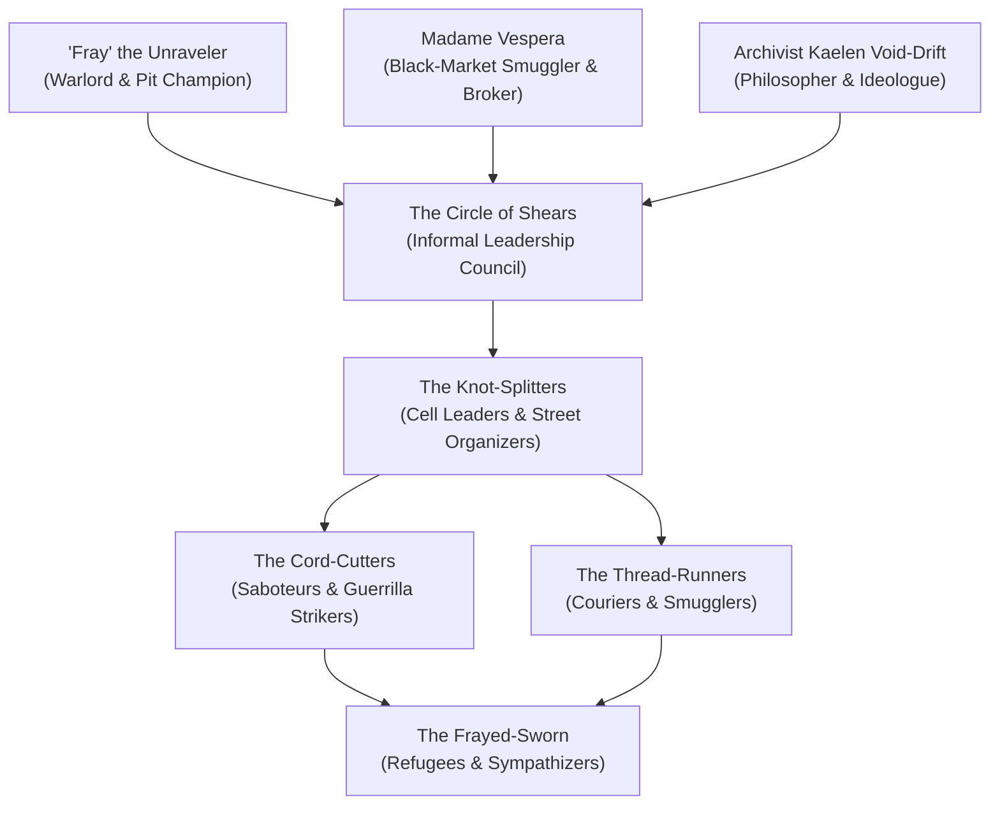

# The Frayed Ones

**The Frayed Ones** (known to their enemies as *The Cord-Breakers* or *The Unspun*) are a decentralized, anti-authoritarian syndicate of planar freedom fighters, outlaws, disenfranchised refugees, and rogue arcanists operating within the [[Project Shattered Loom/Project Shattered Loom/Planes of Existence/The Fractured Nexus/The Fractured Nexus#3. The Frayed Undercroft & The Void-Side (The Lower Lattice)|Frayed Undercroft and the Void-Side of the Nexus]].

While [[Project Shattered Loom/Project Shattered Loom/Factions/The Threadbearers|The Threadbearers]] and [[Project Shattered Loom/Project Shattered Loom/Factions/The Pale Lodge/The Pale Lodge|The Pale Lodge]] view the Shattering of Telara's Loom as a cosmic tragedy to be reversed at all costs, the Frayed Ones hold the radical belief that the Shattering was an act of supreme multiversal liberation. To them, Telara’s original "Divine Blueprint" was an absolute cosmic cage—a predetermined script where mortals had no true free will, their destinies dictated by the tension of divine threads.

> _"A tied knot is a chain; a severed thread is a path. We do not mourn the broken loom—we celebrate the freedom to weave our own unraveling."_  
> — **Manifesto of the Severed Skein**

* * *

## The Charter of the Fray

The Frayed Ones reject centralized dogma, but coordinate their disparate cells across the underbelly using the **Charter of the Fray**:

1. **The Rejection of the Blueprint**: No mortal soul shall be forced to conform to the predestined patterns of the gods or the municipal decrees of the Spire Ward.
2. **Sanctuary of the Undercroft**: Any fugitive fleeing religious tyranny, debt slavery from [[Project Shattered Loom/Project Shattered Loom/Cosmology/Beings of Power/Malphas the Broker|Malphas the Broker]], or the judicial inquisitions of the Threadbearers shall be granted safe passage through the Folding Alleys, provided they do not sell out their protectors.
3. **Opposition to Absolute Entropy**: While the Frayed Ones fight against the rigid order of the Threadbearers, they fiercely oppose the nihilistic suicide of the Entropic Hand. They want to live free in a fragmented multiverse, not drown in the void.

* * *

## Presence & Secret Strongholds

The Frayed Ones maintain no grand palaces, relying on decentralized, shifting hideouts scattered throughout the lowest tiers of the Nexus:

### 1. The Den of the Broken Spindle
A camouflaged sanctuary built inside the cavernous hollow of a shattered dwarven ore-barge suspended beneath the Sump Ring. It houses a clandestine printing press, an armory of stolen military weapons, and emergency cots for escaped prisoners.

### 2. The Shifting Safehouses of the Folding Alleys
A network of interconnected reality-pockets that phase into existence only when the background hum of the Loomforge drops to specific acoustic frequencies. The Frayed Ones utilize these shifting rooms to hold war councils and evade patrol sweeps.

### 3. The Spindle Ring Redoubt
The fighters' lounge and private cantina beneath the Spindle Ring fighting pits, where gladiators, saboteurs, and shadow-runners gather to celebrate victories and plan guerrilla operations under the patronage of [[Project Shattered Loom/Project Shattered Loom/NPC's/Fray, the Unraveler|Fray the Unraveler]].

* * *

## Organization & Hierarchy

### 1. The Circle of Shears
The informal council of veteran leaders who coordinate major actions across the Undercroft. They hold no formal titles and make decisions by collective debate.
* **[[Project Shattered Loom/Project Shattered Loom/NPC's/Fray, the Unraveler|Fray the Unraveler]]**: A renegade Riftborn of discordant light who commands the faction's shock troops and fights as the champion of the Spindle Ring.
* **Madame Vespera**: The enigmatic fence who funds the movement through black-market revenues from the Cartel of the Severed Seam.
* **Archivist Kaelen Void-Drift**: A philosopher who pens radical treatises distributed across the markets.

### 2. The Knot-Splitters (Cell Leaders)
Veteran street captains who manage local neighborhoods within the Shatter-Warrens, operate soup kitchens for planar refugees, and plan sabotage runs against Threadbearer infrastructure.

### 3. The Cord-Cutters (Saboteurs)
The combat specialists of the faction. Equipped with void-shears and disruption chimes, they ambush Spindle Guard patrols, liberate confiscated shipments, and disable divine anchors.

### 4. The Thread-Runners (Smugglers & Couriers)
Acrobatic rogues and monks who leap between secondary filaments and roof cantilevers, transporting contraband, false identification documents, and fugitive planar dissidents.

### 5. The Frayed-Sworn (Sympathizers & Citizens)
The thousands of working-class laborers, dockhands, and slum dwellers of the Undercroft who hide the faction's operatives and share intelligence.

* * *

## Magic, Aesthetic, & Symbols

* **Insignia**: A frayed golden thread severed in two by a diagonal slash, tattooed onto the inside of the wrist or worn as a hidden silver charm.
* **Faction Magic**: Focuses on **Transmutation** (loosening bonds, softening stone, phasing through matter) and **Illusion** (misdirection, holographic cloaks, sensory dissonance).
* **The Frayed Cloak**: Operatives wear patchwork cloaks stitched together from mismatched planar fabrics, allowing them to blend seamlessly into the chaotic crowds of the Rift Market.

* * *

## Adventure Hooks

1. **The Heist of the Golden Vault**: The Frayed Ones hire the party to infiltrate a Threadbearer treasury barge moored at the Drift District docks and liberate a cache of unspun golden filaments meant to reinforce a quarantine wall around the Undercroft.
2. **The Defector's Extraction**: A brilliant elven apprentice of the Pale Lodge has realized that her research is being used to build an authoritarian tracking matrix across the Nexus. She contacts the Frayed Ones to help her vanish into the Folding Alleys, but Thread-Knights are closing in on her safehouse.
3. **The False Shears**: A radical terrorist cell calling itself the "True Fray" has begun blowing up civilian suspension bridges in the Drift Market, killing innocent traders. Fray the Unraveler contacts the party to hunt down the extremists and expose that they are actually puppets manipulated by the Entropic Hand.

* * *

## Related Links

* [[Project Shattered Loom/Project Shattered Loom/Planes of Existence/The Fractured Nexus/The Fractured Nexus|The Fractured Nexus]]
* [[Project Shattered Loom/Project Shattered Loom/Planes of Existence/The Fractured Nexus/Map of the Fractured Nexus|Map & Geography of the Fractured Nexus]]
* [[Project Shattered Loom/Project Shattered Loom/Factions/The Threadbearers|The Threadbearers]]
* [[Project Shattered Loom/Project Shattered Loom/Factions/The Pale Lodge/The Pale Lodge|The Pale Lodge]]
* [[Project Shattered Loom/Project Shattered Loom/NPC's/Fray, the Unraveler|Fray, the Unraveler]]
* [[Project Shattered Loom/Project Shattered Loom/NPC's/Key NPCs - The Fractured Nexus|Key NPCs - The Fractured Nexus]]

