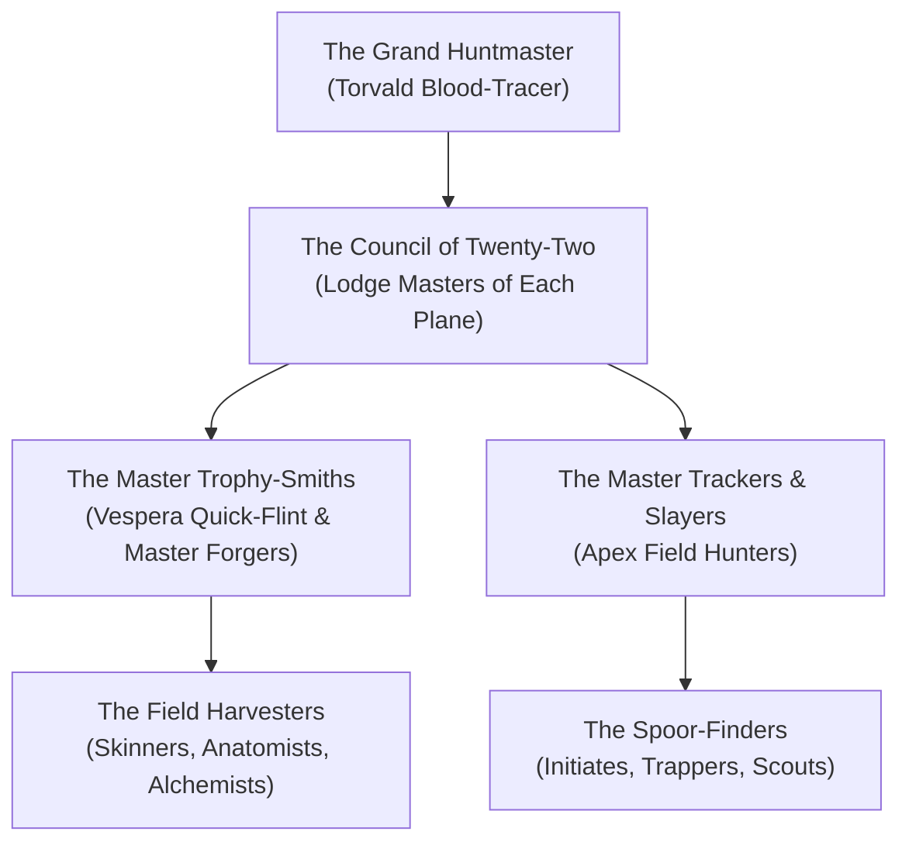

# 🏹 The Grand Guild of the Iron Spoor
### *The Sovereign League of Planar Trackers, Carcass Harvesters, and Trophy-Smiths*

> *"Empires fall to politics and gods bicker over prayers. But when a sixty-foot slag-drake breaches the forge-walls or a kraken-spawn capsizes an astral caravel, they don't call high priests—they send for the Iron Spoor. We follow the tracks, we harvest the beast, and we wear its strength."*  
> — **Grand Huntmaster Torvald Blood-Tracer**, Address to the Lodge Masters

---

## 🏛️ Faction Overview

The **Grand Guild of the Iron Spoor** is an ancient, plane-spanning confederation of apex trackers, big-game slayers, monster anatomists, and trophy-forgers. Originating in the immediate wake of the Shattering of the Loom, when mutated horrors spilled through cosmic shatterpoints, the Guild established permanent outposts—known as **Planar Hunting Lodges**—on all twenty-two known planes of the multiverse.

* **Faction Headquarters**: The Hearth of the Spoor (The Fractured Nexus), with 22 regional branch lodges.
* **Guild Leader**: [[NPCs/Grand Huntmaster Torvald Blood-Tracer|Grand Huntmaster Torvald Blood-Tracer]] (CR 16).
* **Chief Trophy-Smith**: [[NPCs/Forge-Mistress Vespera Quick-Flint|Forge-Mistress Vespera Quick-Flint]] (CR 12).
* **Guiding Creed**: *"Track what has teeth; harvest what was woven; forge the mantle of the apex."*
* **Active Membership**: Approximately 4,500 sworn hunters, scouts, skinners, and smiths across the planes.
* **Alignment**: True Neutral (Operates beyond planar alignment wars; devils, celestials, and mortal hunters share the same lodge hearth).

---

## 🕸️ Hierarchy & Operational Ranks

### The Ranks of the Spoor

1. **The Grand Huntmaster**: Supreme executive commander of the Guild, presiding over the Hearth of the Spoor in the Fractured Nexus. Holds the casting vote on apex culls and interplanar sanctions.
2. **The Council of Twenty-Two (Lodge Masters)**: Sovereign wardens who oversee regional lodges, maintain local salting tanks, and issue regional hunting licenses and bounties.
3. **Master Trophy-Smiths**: Elite artisans who understand how to temper planar monster bone, weave filament sinew, and quench slag-carapaces without losing magical resonance.
4. **Master Trackers & Slayers**: Veteran hunters licensed to hunt CR 13+ apex monstrosities; entitled to retain apex essence cores.
5. **Field Harvesters**: Skilled skinners and alchemists who dissect felled beasts under the [[Custom Rules/The Interplanar Hunting, Harvesting & Trophy-Crafting Ruleset|Harvesting Ruleset]] before planar decay sets in.
6. **Spoor-Finders**: Initiates and apprentices who map game trails, salt minor hides, and guard lodge perimeters.

---

## 🎯 Faction Goals & Principles

* **Ecological Containment**: Prevent apex planar monsters from migrating through shatterpoints into civilized mortal realms or destroying delicate Golden Filaments.
* **Mastery of Anatomical Craft**: Advance the science of trophy-crafting, turning dangerous predatory biological assets into armor, weapons, and alchemical tonics.
* **Absolute Planar Neutrality**: Inside a Lodge of the Iron Spoor, all planar wars, divine grudges, and blood war rivalries are strictly forbidden. A devil and an archon who draw steel over the lodge hearth are both stripped of their weapons and cast out into the wilderness naked.

---

## 🤝 Relationships & Planar Standing

* **Allies**:
  * **The Consortium of the Gilded Caliper**: Regular commercial buyers of bulk monster hides, rare pelts, and alchemical venom glands.
  * **The Pale Lodge**: Mutual respect; the Pale Lodge mends reality's tears, while the Iron Spoor culls the beasts that escape from them.
  * **Planar Frontiersmen & Settlers**: Outpost towns rely heavily on the Guild to eliminate roaming territorial behemoths.
* **Enemies**:
  * **The Cult of the Broken Thread**: Cultists who view planar monsters as sacred avatars of entropy and assassinate Guild tracking parties.
  * **Poachers & Shadow Smugglers**: Unlicensed hunters who leave rotting carcasses behind, triggering massive swarms of necrotic scavengers and planar bleed.

---

## 🎲 Guild Quests & Apex Contracts

| d6 | Contract Title | Quarry & Planar Realm | Bounty & Guild Reward |
| :---: | :--- | :--- | :--- |
| **1** | **The Flame-Scorpid Cull** | Slag-nest of Magma Scorpions in the Everblaze Expanse. | 1,200 gp + 25 Spoor Marks + *Magma-Forged Plate* |
| **2** | **The Starlight Harpoon** | Slay an Abyssal Kraken-Spawn menacing Tidehaven shipping lanes. | 2,500 gp + 50 Spoor Marks + *Slick-Grip Harpoon* |
| **3** | **Tears of the Sphinx** | Capture an intact memory-core from an archive sphinx without destroying the scroll-wings. | 3,000 gp + 40 Spoor Marks + *Tome-Hunter's Mantle* |
| **4** | **The Hellfire Juggernaut** | Bring down a runaway infernal siege-beast on the bridge of Dis. | 4,000 gp + 60 Spoor Marks + *Hellfire-Barbed Greatsword* |

---

## 🗺️ Cross-Vault Links

* **Master Ruleset**: [[Custom Rules/The Interplanar Hunting, Harvesting & Trophy-Crafting Ruleset|The Interplanar Hunting, Harvesting & Trophy-Crafting Ruleset]]
* **Lodges & Bestiary Atlas**: [[Custom Rules/Planar Bestiary & Hunting Lodges Compendium|Planar Bestiary & Hunting Lodges Compendium]]
* **Guild Leadership**: [[NPCs/Key NPCs - The Grand Guild of the Iron Spoor|Key NPCs: The Grand Guild of the Iron Spoor]]
* **Headquarters Gazetteer**: [[Planes of Existence/The Fractured Nexus/The Hearth of the Spoor (Grand Central Lodge)|The Hearth of the Spoor (Grand Central Lodge)]]
