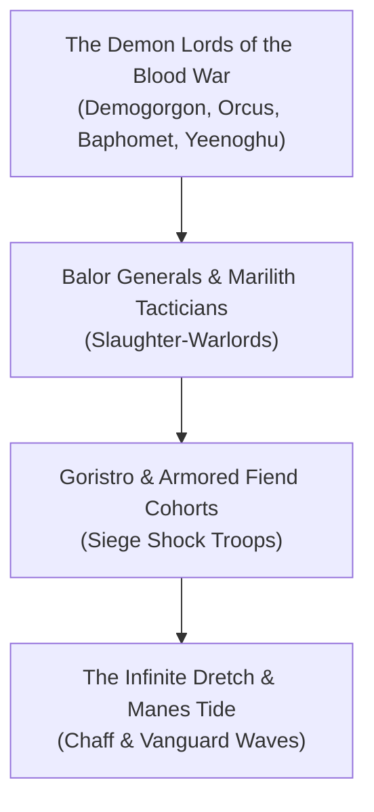

# **The Hordes of the Blood War (Demonic)**
*The Shrieking Tide, The Fray-Host, The Breakers of the Iron Line*

> *"The devils fight with orders, formations, and coward's contracts. We fight because to exist is to hunger, and the iron of Avernus will melt beneath our claws."*  
> — **Chieftain Vrok-Tor, Balor Commander**

***

## **Faction Overview**

* **Philosophy**: Unstoppable Kinetic Entropy and Absolute Annihilation.
* **Staging Grounds**: Pazunia (The Plain of Infinite Portals) and the blood-soaked banks of the River Styx where it crashes into Avernus.
* **Leaders**: Independent Balor slaughter-lords acting under the intermittent commands of Demogorgon, Orcus, and Yeenoghu.
* **Core Agenda**: Shatter the defensive fortifications of the Bronze Citadel on Avernus, eradicate the devil legions of Baator, and flood the Nine Hells with pure abyssal static.

***

## **Tactics & Military Organization**

1. **The Infinite Swarm**: Unlike the rigid phalanxes of the Infernal Legions, the Demonic Host relies on sheer, incomprehensible numbers. Millions of Manes and Dretches are hurled into devil fire to deplete ammo and siege traps.
2. **Titanic Breakers**: Goristros, Glabrezus, and Abyssal Hydras act as living siege engines, tearing down iron gatehouses and smashing Infernal War Machines with bare fists.
3. **Aerial Skirmishers**: Swarms of Vrocks and Chasme drop necrotic spores from above, blinding devil artillery crews and vomiting toxic bile upon infantry ranks.
4. **Styx-Raft Armadas**: Crude, iron-spiked barges navigated by mariliths and aquatic fiends that ram directly into infernal docks along the Avernian front.

***

## **Related Links**
* [[The Legions of the Blood War|The Legions of the Blood War (Infernal Nemesis)]]
* [[The Blood War|The Blood War Overview]]
* [[The Nine Hells|The Nine Hells]]
* [[Zariel, Archduchess of Avernus|Archduchess Zariel]]
