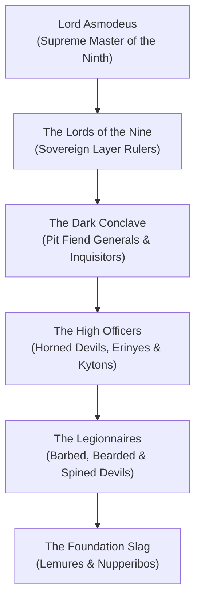

# The Infernal Hierarchy of Baator (The Chain of Command)

The **Infernal Hierarchy of Baator** is the most rigid, comprehensive, and legally binding power structure in the multiverse. Operating across all nine descending layers of [[Project Shattered Loom/Project Shattered Loom/Planes of Existence/The Nine Hells/The Nine Hells|The Nine Hells]], this diabolical civilization serves as the "Tension Weights" of reality. 

Governed under the cosmic mandates of the **Pact Primeval**, the hierarchy enforces absolute obedience to law. Devils do not merely accumulate power; they advance through a precise, metered chain of promotion—rising from mindless lemures up to barbed devils, horned devils, and pit fiends—based upon their ability to secure mortal soul-threads and defend cosmic order against the chaos of the Abyss.

> _"In the Hells, there are no accidents, no spontaneous choices, and no unrecorded breaths. There is only the Law, the Contract, and the Chain. Obey, and you shall rise; hesitate, and you shall be fuel for the furnace."_
> — Chancellor Adramalech of Malsheem

---

## Organization & Hierarchy

### 1. The Throne of Malsheem
**Lord Asmodeus**, the supreme sovereign whose word is cosmic law.

### 2. The Lords of the Nine
The eight ruling Archdevils who govern the administrative, military, and industrial machinery of their respective layers.

### 3. The Dark Conclave (Pit Fiends)
The ruling aristocratic generals, judges, and inquisitors who command legions and execute the will of the Archdevils.

### 4. The High Officers
Horned devils, erinyes, and chain devils who manage field operations, legal tribunals, and prison complexes.

---

## Core Doctrines

1. **The Sanctity of the Pact**: A contract signed in blood is immutable; words hold the physical weight of reality.
2. **Order Over Existence**: Absolute tyranny is preferable to chaotic dissolution; the multiverse must be bound into an unbreakable framework.
3. **The Eternal Promotion**: Every soul has its price and its place; merit is measured in obedience and harvested threads.

---

## Relationships with Other Factions

### The Pale Lodge
**Philosophical Adversaries.** The Lodge views the Hells as a rigid cancer that freezes life into stone; the Hells view the Lodge as naive dreamers unable to prevent the Loom's unraveling.

### The Cult of the Broken Thread
**Mortal Enemies.** The Cult seeks to shatter all bindings, making them the primary internal terrorists against infernal operations.

---
[[Project Shattered Loom/Project Shattered Loom/Planes of Existence/The Nine Hells/The Nine Hells]]
[[Project Shattered Loom/Project Shattered Loom/NPC's/Asmodeus, Lord of the Ninth]]
