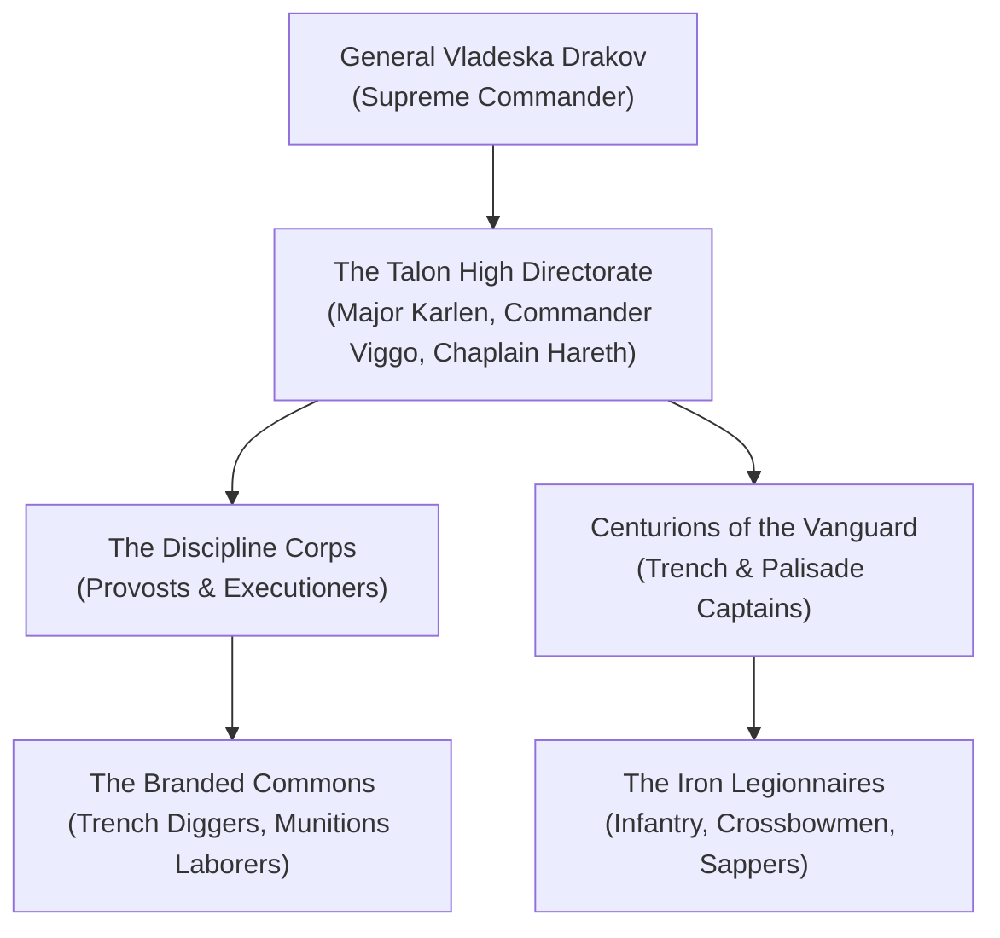

---
---
# The Iron Talons of Falkovnia

The **Iron Talons** is the brutal, militarized standing army and ruling apparatus of the besieged realm of **Falkovnia**, founded and commanded by **General Vladeska Drakov**. Designed with austere, Spartan efficiency, the Talons exist for a single existential objective: to hold the fortified ramparts of **Lekar** against the apocalyptic, unceasing hordes of the dead that erupt from the **Dead Fields** during every New Moon.

> _"In Falkovnia, you are a soldier from your twelfth year to your death. And when you die, you pray the Talons burn your bones before the mud breathes you back to life."_
> — Inscription over the Iron Gate of Lekar

---

## Structure & Modus Operandi

Falkovnia operates under absolute martial law. There is no civilian government, no private commerce without military requisition permits, and no freedom of movement. Every citizen is tattooed on the forehead with the **Falcon Brand**, designating their labor battalion, specialty, and combat unit.

### The Four Battalions of the Talon
1. **The Falcon Vanguard (The Iron Legion)**: 
   Heavily armored shock troops armed with trench-breaker pikes, flaming greatswords, and alchemical quicklime throwers. They hold the breaches and execute counter-charges into the mud.
2. **The Siege Engineers & Sappers**:
   Specialists who design, build, and maintain the miles of barbed ditches, spiked ironwood pikes, boiling pitch cauldrons, and repeating ballistas ringing Lekar.
3. **The Talon Inquisitors (The Discipline Corps)**:
   Military political officers who hunt deserters, execute cowards, conduct conscription raids, and manage the impalement stakes surrounding the outer walls.
4. **The Labor Corps (The Branded)**:
   The mass populace who dig trenches, harvest diseased winter crops, and melt scrap iron into crossbow bolts under armed supervision.

---

## Organization & Hierarchy

---

## Magic, Aesthetic & Emblems

- **The Symbol**: A stooping silver falcon grasping crossed pikes over an iron fortress, branded into skin, stamped onto armor plates, and painted onto barricades.
- **Uniform & Gear**: Charcoal-blackened plate or splint armor adorned with heavy shoulder spikes and thick charcoal filter masks. Weapons are reinforced with silvered serrations and alchemical pitch reservoirs.
- **Doctrine of the Stake**: Enemies, looters, and deserters are executed by impalement along the **Forest of Stakes**, their mouths filled with quicklime to prevent them from animating as zombies.

---

## Relationships with Other Factions

### The Kargat of Darkon
**Tense Border Raids.** Falkovnia shares a northern mountain border with Darkon. The Talons view the Kargat's undead masters with furious hatred, frequently engaging in border skirmishes with Kargat soul-caravans.

### The Consortium of the Gilded Caliper
**Desperate Munitions Trade.** Drakov trades captured planar relics and raw iron ore from the Razor Mountains to Consortium smugglers in exchange for dwarven siege engines, adamantine drill heads, and alchemical gunpowder.

### The Pale Insurgent Network
**Domestic Insurgency.** A growing underground network of deserters, led by the mysterious figure known as the Pale Insurgent, sabotages Talon supply lines and smuggles marked civilians out of Falkovnia through forgotten subterranean drains.

---

## Adventure Hooks

1. **The Breach at Gate Four**: A catastrophic undead siege breaches Sector 4. The party is pressed into emergency mercenary service by Major Karlen to hold the line until engineers drop the iron portcullis.
2. **The Deserter's Escort**: A former Talon centurion marked for the stakes begs the party to escort his branded family across the Dead Fields to a hidden rebel bunker.
3. **The Stolen Core**: Drakov discovers that a vital thermal foundry core was stolen from the city armory by an agent of the Gilded Caliper, threatening the city's flamethrower defense grid.

---
[[Project Shattered Loom/Project Shattered Loom/Planes of Existence/The Material Plane/Shadowfell]]
[[Project Shattered Loom/Project Shattered Loom/NPC's/General Vladeska Drakov]]
[[Project Shattered Loom/Project Shattered Loom/Factions/The Kargat]]
