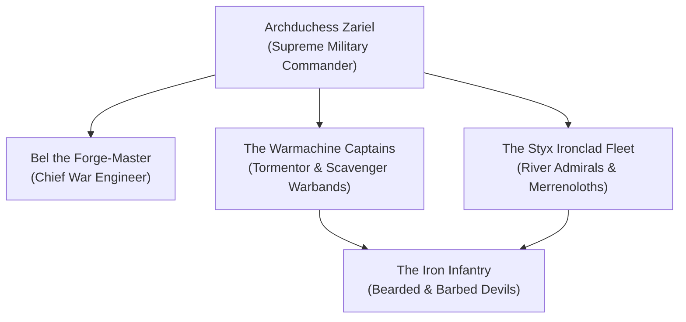

# The Legions of the Blood War (The Stitch-Legions)

The **Legions of the Blood War**, based primarily within the blood-soaked plains of **Avernus**, represent the supreme military standing army of the Nine Hells. Commanded by **Archduchess Zariel**, these legions are the primary cosmic shield preventing the demonic hordes of the **Abyss** from spilling across the multiverse and unmaking the fabric of reality.

Equipped with soul-coin-powered infernal war machines, hellfire siege artillery, and ironclad Styx galleys, the Legions fight with mechanical discipline against the infinite, howling chaos of the demonic invasion.

> _"We do not fight for glory, nor for gold. We stand in the blood-mud of Avernus so that your fragile mortal kingdoms can sleep one more night in the illusion of peace."_
> — Commander Kalgor of the Bronze Citadel

---

## Organization & Hierarchy

### 1. High Command (The Bronze Citadel)
**Archduchess Zariel** and her senior war council, tracking Abyssal breaches across the River Styx.

### 2. The Siege Artificers
Led by **Bel**, responsible for mass-producing infernal war machines, hellfire cannons, and cold-iron munitions.

### 3. The Warmachine Cohorts
Motorized shock-troops who patrol the dunes of Avernus, hunting demon scouting parties and rogue mortal warlords.

---

## Core Doctrines

1. **Hold the Line**: Not one inch of Avernus may fall to the Abyss; retreat is treason punishable by demotion to lemure.
2. **Feed the Furnace**: Soul coins are the fuel of victory; harvest the soul-threads of the dead to power the engines.
3. **Discipline Over Numbers**: The chaos of the demon horde is endless, but flawless coordination breaks all waves.

---
[[Project Shattered Loom/Project Shattered Loom/Planes of Existence/The Nine Hells/The Nine Hells]]
[[Project Shattered Loom/Project Shattered Loom/NPC's/Zariel, Archduchess of Avernus]]
