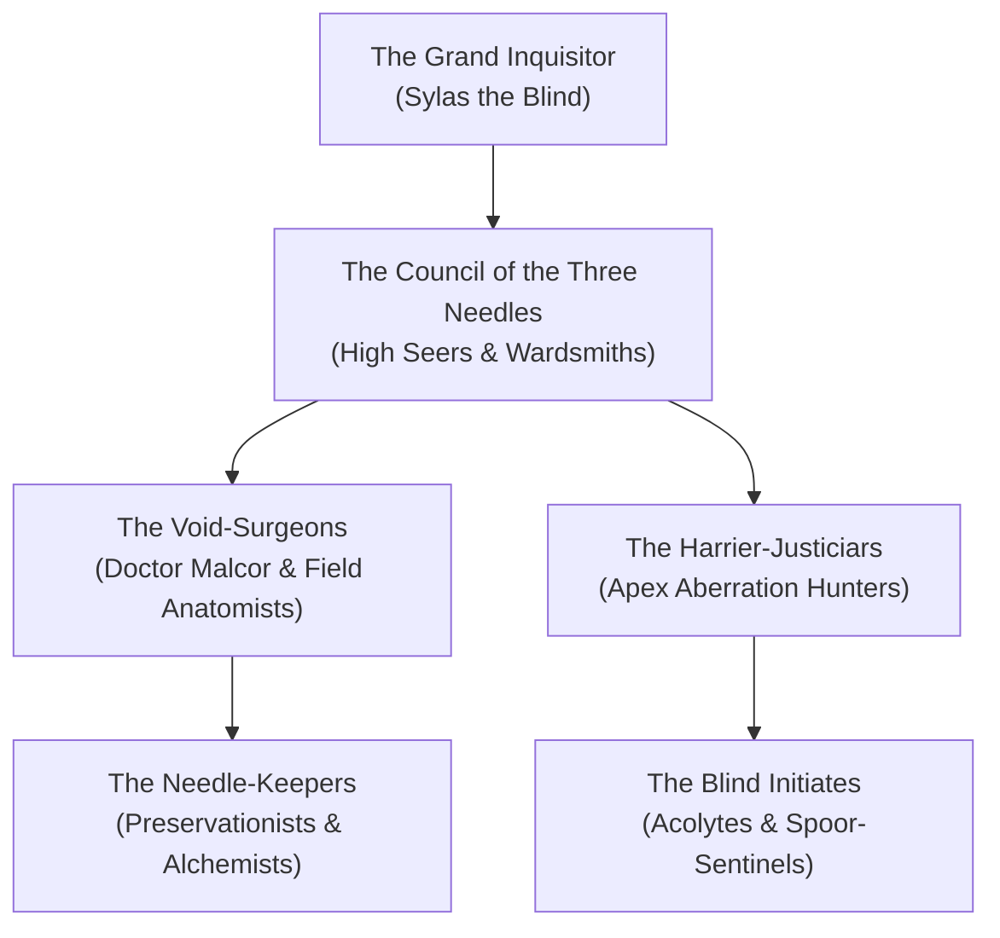

# 👁️ The Order of the Severed Eye
### *The Blindfolded Inquisitors, Surgeons of the Void-Weft, Exterminators of Cosmic Paradox*

> *"To see an eldritch god with mortal eyes is to invite blindness or madness. So we cut the sight from our faces and teach our minds to see the fracture in the threads. We do not fear the dark; we are the blade waiting within it."*  
> — **Grand Inquisitor Sylas the Blind**, Litany of the Severed Lid

---

## 🏛️ Faction Overview

The **Order of the Severed Eye** is a secretive, highly disciplined holy order and monster-hunting cabal dedicated entirely to the containment, tracking, and systematic dissection of **Eldritch Horrors**, Far Realm incursions, and aberrant parasites spawned from the sleep of the **Great Dreamer**. 

Unlike the rugged trackers of the [[Factions/The Grand Guild of the Iron Spoor|Grand Guild of the Iron Spoor]], who hunt biological beasts for pelts and horns, the Severed Eye operates as an esoteric surgical inquisition. They view aberrations not as game, but as malignant cosmic tumors upon the body of the Loom that must be cleanly excised and neutralised.

* **Faction Headquarters**: The Sanctorum of the Blind Needle, deep lead-vaults beneath the Fractured Nexus.
* **Supreme Leader**: [[NPCs/Grand Inquisitor Sylas the Blind|Grand Inquisitor Sylas the Blind]] (CR 16).
* **Chief Anatomist**: [[NPCs/Doctor Vaelen Malcor, Void-Surgeon|Doctor Vaelen Malcor, Void-Surgeon]] (CR 13).
* **Affiliated Rules**: [[Custom Rules/The Eldritch Horror Hunting & Sanity-Harvesting Ruleset|Eldritch Horror Hunting Ruleset]] & [[Custom Rules/The Eldritch Madness & Dream-Fracture Ruleset|Eldritch Madness Ruleset]].
* **Alignment**: Lawful Neutral / Neutral Good.
* **Symbol**: A stylized silver needle piercing an open, lidless eye weeping three golden threads.

---

## 🕸️ Organizational Hierarchy

### The Ranks of the Severed Eye

1. **The Grand Inquisitor**: Supreme commander of the Order; commands the blind inquisitions across all planes.
2. **The Council of the Three Needles**: Three venerable seers who monitor the psychic resonance of the Astral Sea for signs of awakening elder evils.
3. **The Void-Surgeons**: Elite medical and arcane specialists trained in non-Euclidean dissection and the extraction of intact neural filaments.
4. **The Harrier-Justiciars**: Martial paladins and rangers armed with telepathic harpoons, cold-iron blades, and lead-lined bucklers.
5. **The Needle-Keepers**: Quartermasters who forge specialized surgical tools, brew Lucidity-restoring tonics, and manage the lead vaults.
6. **The Blind Initiates**: Novices who undergo the *Ritual of the Veiled Brow*, binding silver-filament blindfolds over their eyes to develop echolocation and psychic blindsight.

---

## 🎯 Faction Tenets & Operational Codes

1. **Never Look Unshielded**: To look upon a Tier III or IV abomination with naked eyes is a dereliction of discipline. Members always employ silver mirrors, lead glass, or telepathic blindsight.
2. **Excise, Never Cultivate**: While the Iron Spoor trades monster parts for gold, the Severed Eye strictly regulates all eldritch trophies. Unstable paradox cores are encased in lead and buried in consecrated vaults.
3. **Protect the Lucidity of the Mortal Sphere**: The Order provides free mental grounding and psychic debriefs to travelers afflicted by Dream-Bleed.

---

## 🤝 Relationships & Planar Standing

* **Allies**:
  * **The Pale Lodge**: Close ideological partners; the Severed Eye provides specialized strike teams when the Pale Lodge discovers reality-tears infested with void-leeches.
  * **The Grand Guild of the Iron Spoor**: Professional respect; the Iron Spoor sells aberrant carcasses to the Order, while the Order provides specialized void-salting kegs.
* **Enemies**:
  * **The Dreambound of Ry'leh**: Existential foes; the Order seeks to sever the somnambulic resonance of the Great Dreamer, while the Dreambound seek to expand it.
  * **Cults of the Elder Evils & Star Spawn**: Fanatical sects attempting to summon Far Realm horrors into the Material Plane.

---

## 🎲 Order Inquisitorial Bounties & Quests

| d6 | Contract Title | Threat & Quarry | Reward & Order Standing |
| :---: | :--- | :--- | :--- |
| **1** | **The Screaming Sentry** | A void-leech has infected a Nexus guard captain. Excise it before his mind ruptures. | 15 Severed Marks + *Phial of Loom-Sap* |
| **2** | **The Non-Euclidean Nest** | Clear a brood of polyhedral horrors nesting inside a shattered filament pylon. | 35 Severed Marks + *Aegis of the Severed Gaze* |
| **3** | **Tears of the Void-Worm** | Plumb the Abyssal Trench in Ry'leh to harvest 3 intact paradox glands. | 50 Severed Marks + *Blade of the Inverted Angle* |
| **4** | **The Sleeper's Echo** | Silence a wandering dream-avatar driving an entire mining outpost into catatonic sleep. | 75 Severed Marks + *Ocular Circlet of Thousand Lids* |

---

## 🗺️ Cross-Vault Links

* **Custom Ruleset**: [[Custom Rules/The Eldritch Horror Hunting & Sanity-Harvesting Ruleset|The Eldritch Horror Hunting & Sanity-Harvesting Ruleset]]
* **Madness Rules**: [[Custom Rules/The Eldritch Madness & Dream-Fracture Ruleset|The Eldritch Madness & Dream-Fracture Ruleset]]
* **Order Leadership**: [[NPCs/Key NPCs - The Order of the Severed Eye|Key NPCs: The Order of the Severed Eye]]
* **Headquarters**: [[Planes of Existence/The Fractured Nexus/The Fractured Nexus|The Fractured Nexus (Sanctorum Vaults)]]
