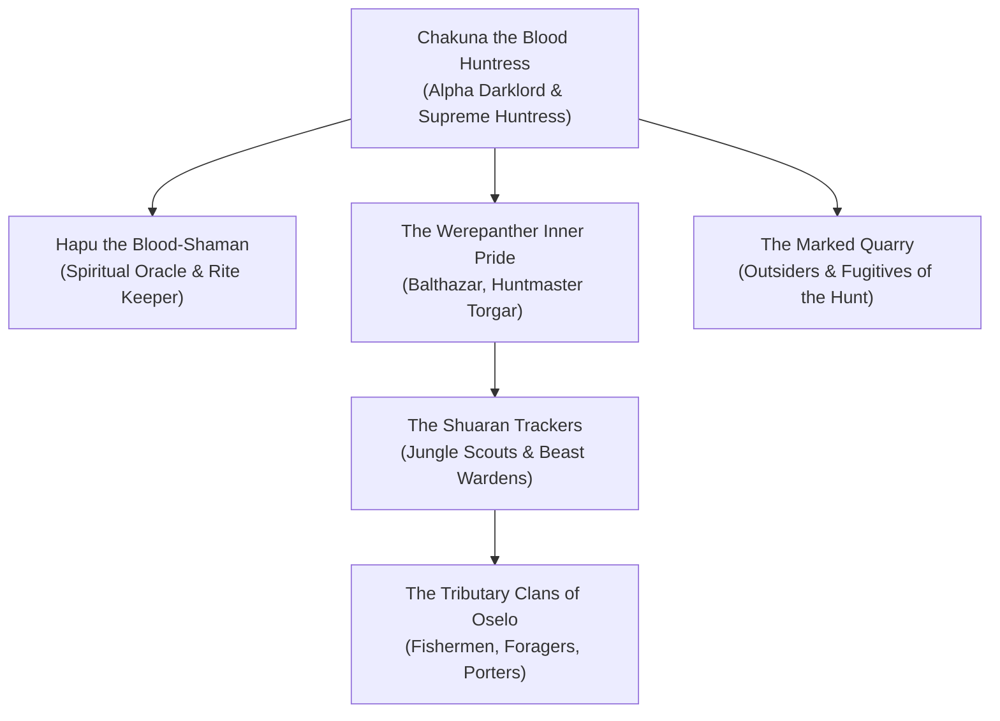

---
---
# The Pack of the Blood Moon

The **Pack of the Blood Moon** is the apex predatory order and martial brotherhood of werepanthers, tribal trackers, and shapechangers who enforce the primal dominion of **Chakuna the Blood Huntress** across the tropical wilderness of **Valachan**. Centered upon the stepped obsidian ziggurat of **The Temple of Shuaran**, the Pack lives by a single inviolable commandment: *The strong hunt; the weak bleed.*

> _"In the cities of the north, men hide behind laws and stone walls. In Valachan, the jungle strips away your gold and titles until you are only meat running through the dark."_
> — Huntmaster Torgar of the Shuaran Ziggurat

---

## Structure & Modus Operandi

The Pack of the Blood Moon views civilization as a sickness. They do not maintain courts or prisons; their justice is delivered exclusively through **The Trial of the True Heart**—the great seasonal hunt where outsiders and traitors are designated as quarry and pursued through the **Twilight Jungle**.

### The Three Circles of the Pride
1. **The Blood-Fangs (The Werepanther Alpha Pride)**: 
   Chakuna's personal circle of lycanthropes who possess supernatural speed, shadow-blending stealth, and the ability to command jungle beasts.
2. **The Stalkers of the Shuaran (Elite Trackers)**:
   Veteran mortal hunters, shamans, and scouts armed with obsidian-tipped blowguns, serrated spears, and curare poisons.
3. **The Beast Wardens**:
   Keepers who breed and train giant dire panthers, blood-sniffing hounds, and venomous constrictors to flush prey from mangrove hides.
4. **The Tributary Villages (The River Enclaves)**:
   Settlements like Oselo that provide periodic offerings of captured outsiders and river grain to avoid having their own children designated as quarry.

---

## Organization & Hierarchy

---

## Magic, Aesthetic & Emblems

- **The Symbol**: A crimson panther's paw with obsidian claws, carved into trees along territorial borders or painted in fresh blood on the foreheads of marked prey.
- **Aesthetic**: Minimalist, athletic jungle gear—pelt wraps of cured panther and crocodile hide, bone necklaces, obsidian blades, and ritual body scarring.
- **Primal Blood Magic**: The shamans brew oils from carnivorous pitcher plants that completely erase biological scent and allow hunters to phase through dense foliage without disturbing a leaf.

---

## Relationships with Other Factions

### The Pale Lodge
**Territorial War.** The hunting lodges of the Pale Lodge frequently attempt to mount secret safari expeditions into Valachan to capture displacement beasts and giant panthers, resulting in bloody ambushes by Chakuna's pride.

### The Dissident Tree-Dwellers (The Bleeding Vine)
**Hunted Insurgents.** A loose coalition of escaped quarry and sympathetic village scouts who live in high treehouses, sabotaging beast pens and guiding fugitives toward the Shadowsea coast.

### The Consortium of the Gilded Caliper
**Barter for Metal.** While Chakuna disdains metal weapons as clumsy, the Pack trades rare botanical poisons and exotic monster hides to Gilded Caliper smugglers in exchange for obsidian tools and forged spearheads.

---

## Adventure Hooks

1. **Mark of the Quarry**: The party wakes to find their campsite encircled by bloody panther-claw totems. Chakuna's war drums begin beating from the ridge; they have until dawn to reach the Rio Panto or be hunted down.
2. **The Blood-Totem Heist**: Suriya of *The Bleeding Vine* recruits the party to infiltrate the lower crypts of the Temple of Shuaran to retrieve a stolen spirit-totem that binds Chakuna's scrying senses to marked runners.
3. **The Frenzied Beast Pack**: A pack of dire panthers infected with planar necrotic spores breaks loose from the Beast Warden's pens, threatening to slaughter the stilt-village of Oselo.

---
[[Project Shattered Loom/Project Shattered Loom/Planes of Existence/The Material Plane/Shadowfell]]
[[Project Shattered Loom/Project Shattered Loom/NPC's/Chakuna]]
[[Project Shattered Loom/Project Shattered Loom/Factions/The Pale Lodge/The Pale Lodge]]
