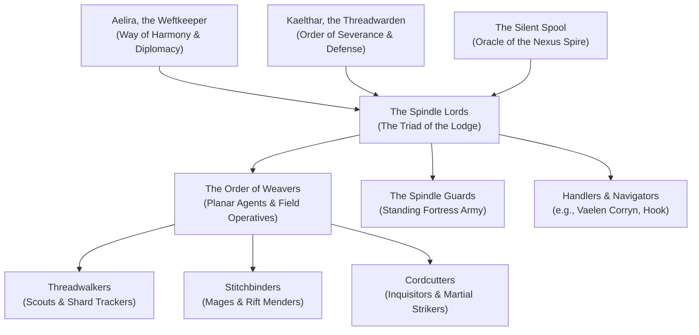

# The Pale Lodge: The Keepers of Balance and Restorers of the Loom

The **Pale Lodge** is a mystical and enigmatic multiversal order dedicated to maintaining peace across the fractured cosmos and pursuing the supreme quest of restoring the **Shattered Loom of Creation**. Bound by oaths to the remnants of the Loom itself, its members are known as **Weavers**, and they serve as guardians, negotiators, arcanists, and planar arbiters across all 22 planes.

While municipal orders like [[Project Shattered Loom/Project Shattered Loom/Factions/The Threadbearers|The Threadbearers]] govern the civil infrastructure of the [[Project Shattered Loom/Project Shattered Loom/Planes of Existence/The Fractured Nexus/The Fractured Nexus|Fractured Nexus]], the Pale Lodge directs the cosmic search for lost **Loom Shards**, striving to prevent the total dissolution of reality into the Astral Void.

> _"Every soul is a strand; every world is a skein. When the Loom fell, the cloth of reality tore, but the weaver's hand does not falter. We gather the threads, we hold the tension, and we shall mend what was broken."_  
> — **Aelira, the Weftkeeper**

* * *

## The Accord of the Silver Thread

The Pale Lodge operates across planes under the **Accord of the Silver Thread**, establishing their non-partisan mandate:

1. **The Retrieval Mandate**: Loom Shards are the sovereign inheritance of existence itself; no god, demon lord, or mortal monarch may claim private dominion over a fragment of Telara’s Loom.
2. **The Defense of the Nexus**: As the core of multiversal crossings, the **Nexus Spire** within the Fractured Nexus remains the sacred, inviolable sanctuary of the Lodge, defended against all extraplanar incursions.
3. **The Pact with the Grand Archive**: The Lodge works in tandem with [[Project Shattered Loom/Project Shattered Loom/Planes of Existence/The Grand Archive|The Grand Archive]] to verify the original blueprints of creation before attempting major planar mending rites.

* * *

## Presence & Guildhalls

### 1. The Nexus Spire (Supreme Headquarters — The Fractured Nexus)
A crystalline needle of white stone at the vertical apex of the Fractured Nexus. Existing simultaneously across multiple timelines, it houses the **Chamber of the Spindle Lords**, the **Needle of Eternity**, and the primary staging portals for deep planar expeditions.

### 2. The Frontier Sanctuaries (Material Plane & Shard Outposts)
Hidden chapterhouses concealed within mortal worlds, disguised as peaceful weaving monasteries or astronomical observatories (such as the Monastery of the Quiet Loom).

### 3. The Grand Central Lodge (The Hearth of the Spoor)
The Lodge maintains close diplomatic ties and shared research archives with [[Project Shattered Loom/Project Shattered Loom/Planes of Existence/The Fractured Nexus/The Hearth of the Spoor (Grand Central Lodge)|The Hearth of the Spoor]], utilizing guild trackers to hunt planar beasts that feed on golden filaments.

* * *

## Organization & Hierarchy

### 1. The Spindle Lords (The Triad of the Lodge)
The three supreme directors of the Pale Lodge, each embodying a different philosophical approach to mending the Loom:
* [[Project Shattered Loom/Project Shattered Loom/NPC's/Aelira, the Weftkeeper|Aelira, the Weftkeeper]]: An Eladrin archmage who embodies harmony, patience, and multilateral diplomacy. She believes mending requires the voluntary consensus of all planes.
* [[Project Shattered Loom/Project Shattered Loom/NPC's/Kaelthar, the Threadwarden|Kaelthar, the Threadwarden]]: A grim Shadar-kai warrior-warlock who commands the Order of Severance. He advocates for preemptive martial force against anyone tampering with the weave.
* [[Project Shattered Loom/Project Shattered Loom/NPC's/The Silent Spool|The Silent Spool]]: An ancient, hovering eldritch construct of twelve rotating golden rings that communes directly with the fractured consciousness of Telara.

### 2. Handlers & Planar Navigators
Liaisons who manage field operatives, supply expeditionary teams, and interpret oracle prophecies.
* Notable figures: [[Project Shattered Loom/Project Shattered Loom/NPC's/Vaelen Corryn|Vaelen Corryn]] ("The Stitcher") and [[Project Shattered Loom/Project Shattered Loom/NPC's/Hook, the Thread-Cartographer|Hook]].

### 3. The Order of Weavers (Field Agents)
* **Threadwalkers**: Far-ranging scouts and planar rangers who track the vibrations of stray Loom Shards.
* **Stitchbinders**: Transmutation and abjuration arcanists who stabilize minor planar rifts and seal void breaches.
* **Cordcutters**: Covert martial specialists and assassins tasked with neutralizing cosmic threats, void-cultists, and rogue extraplanar warlords.

### 4. The Spindle Guards (Standing Defense Army)
A disciplined military legion composed of mortal and construct sentinels who defend the Nexus Spire, patrol the Golden Highway, and safeguard the Loomforge.

* * *

## Magic, Aesthetic, & Artifacts

* **Aesthetic**: Ivory-white robes embroidered with silver and gold threads, silver spindles worn as brooches, and polished mithral weapons that hum in harmony with the Loom.
* **The Mark of Telara**: Initiates and chosen champions receive a luminescent thread-mark on their flesh that vibrates painfully in the presence of Loom Shards, granting heightened perception of planar seams.
* **Relics of the Lodge**:
  * **The Needle of Eternity**: A colossal divine implement housed in the Spire vaults, capable of sewing shut planar rifts between worlds.
  * **The Threadkeeper’s Gauntlet**: A relic gauntlet that can manipulate the threads of fate, granting allies advantage or severing a foe's destiny.
  * **The Loomspindle Relic**: An ancient shard that functions as a multiversal compass, pointing directly toward the nearest concentrated shard of the Loom.

* * *

## Adventure Hooks

1. **The Fractured Shard of Darkfire**: Following the events of [[Project Shattered Loom/Project Shattered Loom/Sessions/Session 2 - The Silent Singularity|Session 2]], the party arrives at the Nexus Spire with the **Heart of the Darkfire**. Spindle Lord Kaelthar demands the shard be sealed in the Spire Vaults, while Aelira insists it must be carried to the Dais of Alignment in the Convergence Cradle.
2. **The Infiltration of the Silent Spire**: Strange black void-bile has begun weeping from the Silent Spire, threatening the structural lattice of the city. The Silent Spool projects a psychic vision to the party, guiding them to delve into the void undercroft and retrieve a corrupted spindle before the Entropic Hand activates it.
3. **The False Blueprint**: A rogue faction within the Weavers' Guild has produced a fraudulent copy of the Telarian Codices that deliberately omits the Lower Planes from the reconstruction map, risking a catastrophic multiversal war with the Legions of Baator.

* * *

## Related Links

* [[Project Shattered Loom/Project Shattered Loom/Planes of Existence/The Fractured Nexus/The Fractured Nexus|The Fractured Nexus]]
* [[Project Shattered Loom/Project Shattered Loom/Planes of Existence/The Fractured Nexus/Map of the Fractured Nexus|Map & Geography of the Fractured Nexus]]
* [[Project Shattered Loom/Project Shattered Loom/Factions/The Threadbearers|The Threadbearers]]
* [[Project Shattered Loom/Project Shattered Loom/Factions/The Frayed Ones|The Frayed Ones]]
* [[Project Shattered Loom/Project Shattered Loom/NPC's/Key NPCs - Pale Lodge|Key NPCs - The Pale Lodge]]
* [[Project Shattered Loom/Project Shattered Loom/NPC's/Aelira, the Weftkeeper|Aelira, the Weftkeeper]]
* [[Project Shattered Loom/Project Shattered Loom/NPC's/Kaelthar, the Threadwarden|Kaelthar, the Threadwarden]]
* [[Project Shattered Loom/Project Shattered Loom/NPC's/The Silent Spool|The Silent Spool]]
