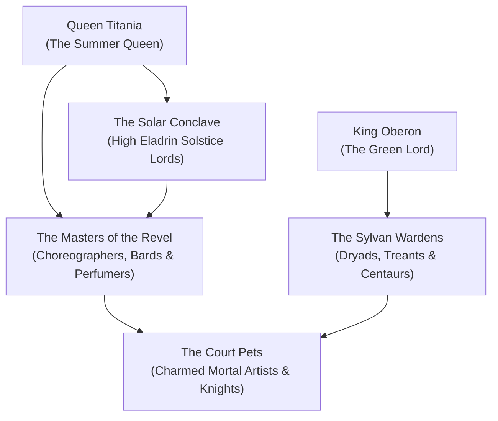

# The Seelie Court (The Court of Light & Summer)

The **Seelie Court**, also known anciently as the **Court of Light**, is the grandest, most radiant, and most culturally magnificent civilization in [[Project Shattered Loom/Project Shattered Loom/Planes of Existence/The Material Plane/Feywild|The Feywild]]. Governed from the towering living branches of the **Verdant Spire** in the heart of the Summerlands, the Seelie Court embodies the boundless vibrancy of life, beauty, artistic genius, romance, and the eternal golden noon of summer.

Where the mortal world sees winter and decay as natural necessities, the Seelie Court seeks to elevate nature to a perpetual, breathtaking state of ecstatic bloom. Yet beneath their golden smiles and gossamer silks lies an ancient, terrifying arrogance: Seelie fey are capricious, fiercely prideful, and regard mortals as amusing, fragile playthings whose brief lives are best spent entertaining the Court.

> _"To be invited to the Summer Revel is the highest honor a mortal can achieve. To stay until the second song is to forget the names of your children, your kingdom, and your gods."_
> — Seneschal Silverglade of the Verdant Spire

---

## Organization & Hierarchy

### 1. The Solar Crown
The dual monarchs: **Queen Titania**, arbiter of beauty and charm, and **King Oberon**, warden of the beasts and martial commander of the groves.

### 2. The Solar Conclave
High Eladrin lords and ladies representing the summer and spring aspects, managing vast estates of silverwood and golden orchards across the plane.

### 3. The Masters of the Revel
High artists, bards, and courtiers whose aesthetic creations dictate fashion, court standing, and social survival.

### 4. The Sylvan Wardens
Treants, dryads, and centaur chieftains who police the borders, repel Unseelie incursions, and tend the sacred wildlands.

---

## Core Doctrines

1. **Mandatory Magnificence**: Beauty, art, and passion are the supreme duties of existence; mediocrity and dullness are offensive to the Court.
2. **The Sanctity of Hospitality**: A guest who follows proper etiquette must never be harmed under the host's roof—though their host is free to trap them in a bargain before they leave.
3. **The Cycle of the Golden Sun**: Light must be nurtured and celebrated; darkness and despair must be banished to the borders.

---

## Influence Across Faerie

* **The Summerlands**: Complete sovereign control; no unseelie fey may enter without diplomatic immunity.
* **The Blooming Vale**: Allied through shared revelry with Lord Faelthorn.
* **The Material Plane**: Operates through druidic circles, elven kingdoms, and artists inspired by faerie dreams.

---

## Relationships with Other Factions

### The Unseelie Court
**Ancient Blood Feud.** The Seelie view the Unseelie as bitter, diseased spoilers of beauty; the Unseelie view the Seelie as shallow, arrogant children living in denial of death.

### The Wild Hunt
**Uneasy Detente.** Titania respects Cernunnos's ancient pedigree, though Oberon frequently rides alongside him.

### The Court of Stars
**Neutral Respect.** The Seelie frequently consult Queen Serelune for astrological divinations and prophetic guidance.

---
[[Project Shattered Loom/Project Shattered Loom/Planes of Existence/The Material Plane/Feywild]]
[[Project Shattered Loom/Project Shattered Loom/NPC's/Queen Titania]]
[[Project Shattered Loom/Project Shattered Loom/NPC's/King Oberon]]
