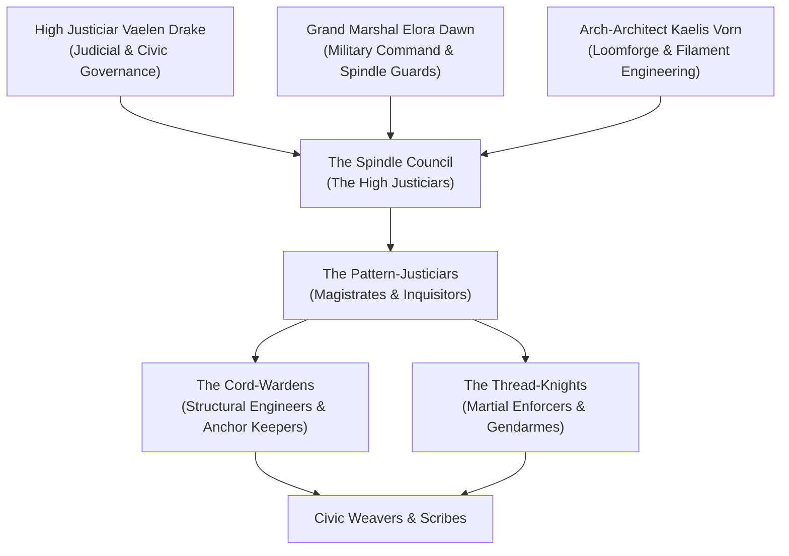

# The Threadbearers

The **Threadbearers** (formally designated as **The Order of the Sacred Pattern**) are the primary civic governors, magistrates, and martial lawkeepers of [[Project Shattered Loom/Project Shattered Loom/Planes of Existence/The Fractured Nexus/The Fractured Nexus#1. The Spire Ward (Nexus Prime & The Upper Lattice)|Nexus Prime and the Spire Ward]]. While [[Project Shattered Loom/Project Shattered Loom/Factions/The Pale Lodge/The Pale Lodge|The Pale Lodge]] focuses upon the grand, multiversal campaign of locating and gathering scattered Loom Shards, the Threadbearers govern the daily life, structural engineering, and legal sanctity of the Fractured Nexus itself.

To the Threadbearers, the Shattering of Telara’s Loom was the ultimate crime against existence. They believe that reality cannot endure in an improvised, chaotic state; every drifting island must be tethered by precise golden filaments, every gateway cataloged, and every citizen held to the unyielding blueprint of the fallen goddess.

> _"A single loose strand unravels the tapestry. Measure your step, honor the weave, and let no knot be cut."_  
> — **High Justiciar Vaelen Drake, Oath of the Pattern**

* * *

## The Accord of the Weft

The Threadbearers operate under **The Accord of the Weft**, a binding civil code ratified with the embassies of the Upper Planes and the merchant syndicates of the Rift Market:

1. **The Filament Tithe**: All merchant guilds and trading vessels operating within the Nexus must pay a 5% tithe in refined starmetal or raw planar essence to fund the maintenance of the city's Golden Filaments.
2. **The Sanctity of the Anchors**: Damaging, loosening, or tapping power from a structural Golden Filament is classified as High Sabotage, punishable by immediate exile into the Astral Void or permanent confinement in the Spire Vaults.
3. **The Sovereign Neutrality**: Hostile planar forces (such as fiends of Baator and celestials of Mount Celestia) may maintain diplomatic enclaves within the Spire Ward, provided all open violence ceases outside designated embassy boundaries.

* * *

## Presence & Strongholds

The Threadbearers maintain administrative fortresses, courthouses, and guard stations throughout the upper and middle tiers of the city:

### 1. The High Hall of the Pattern (Spire Ward)
A monumental basilica of polished white granite and brass situated at the base of the Nexus Spire. It houses the **Registry of Strands** (where every citizen and registered merchant is assigned an astrological identity filament), the civil courts, and the council chambers of the High Justiciars.

### 2. Anchor-Hold Seven (Northern Bastion)
A heavily fortified military fortress resting atop a meteoric iron shard at the city's northern perimeter. It houses the standing garrison of **Thread-Knights** and scans incoming astral skiffs for void-corruption, unregistered portal keys, and entropic contagion.

### 3. The Toll-Gate of the Golden Highway
The fortified checkpoint suspended over the primary filament connecting the Spire Ward to the Drift District. Armed with anti-magic ballistas and truth-crystals, the Justiciars inspect cargo, collect tithes, and apprehend fleeing criminals.

* * *

## Organization & Hierarchy

### 1. The Spindle Council (The High Justiciars)
The supreme executive triad of the faction. They establish municipal policy, negotiate treaties with the Pale Lodge, and allocate resources to prevent the drifting shards from colliding.
* **High Justiciar Vaelen Drake**: An unyielding aasimar paladin who serves as the civic voice of the council.
* **Grand Marshal Elora Dawn**: A seasoned veteran who commands the standing military forces.
* **Arch-Architect Kaelis Vorn**: A master gnome artificer responsible for the mathematical stability of the Golden Filaments and the Loomforge gimbals.

### 2. The Pattern-Justiciars (Magistrates & Inquisitors)
The judicial officers who preside over the High Hall courts, investigate planar espionage, interrogate captured cultists of the Entropic Hand, and ensure that foreign ambassadors respect local neutrality.

### 3. The Cord-Wardens (Structural Engineers)
The unsung heroes of the Nexus. Equipped with magical climbing harnesses and liquid golden binders, these daring artificers rappel along high-altitude filaments daily to inspect tension, reinforce frayed strands, and replace worn anchor pins.

### 4. The Thread-Knights (Martial Enforcers)
The elite martial branch of the faction. Clad in enchanted mithral plate etched with glowing geometric runes and wielding force-tethered halberds, they patrol the promenades, man the checkpoints, and eliminate rogue extraplanar monsters.

### 5. Civic Weavers & Scribes
The civil service backbone: tax collectors, ledger-keepers, bridge tenders, and census clerks who ensure that commerce flows smoothly across the lattice.

* * *

## Magic, Aesthetic, & Symbols

* **Insignia**: A pair of crossed silver needles threading a perfect golden diamond ring, worn as an enameled brooch on blue-and-gold tabards.
* **Faction Magic**: Heavily focused upon **Abjuration** (protective barriers, dimensional anchors, antimagic locks) and **Divination** (detecting lies, tracing dimensional rifts, reading personal soul-threads).
* **The Seal of the Weft**: A radiant glyph stamped onto passports, cargo manifests, and judicial warrants. The mark glows faint gold under true light and alerts nearby Thread-Knights if forged or tampered with.

* * *

## Adventure Hooks

1. **The Corrupted Anchor-Pin**: Arch-Architect Kaelis discovers that an anchoring pin holding a major bridge to the Drift District has been intentionally replaced with brittle cursed slag. The Threadbearers hire the party as covert investigators to uncover which merchant cartel or anarchist cell commissioned the sabotage.
2. **The Diplomatic Defector**: An inquisitor from the Nine Hells seeking asylum in the Nexus claims to possess proof that a high-ranking Pattern-Justiciar is secretly taking bribes from the Cult of the Broken Thread. The party must escort the defector across the city while surviving ambushes from both devilish assassins and corrupt guards.
3. **The Unraveler's Strike**: [[Project Shattered Loom/Project Shattered Loom/NPC's/Fray, the Unraveler|Fray the Unraveler]] leads a coordinated raid on the Toll-Gate of the Golden Highway, liberating dozens of captured contraband consignments. Grand Marshal Elora Dawn commissions the party to lead the counter-strike into the Frayed Undercroft.

* * *

## Related Links

* [[Project Shattered Loom/Project Shattered Loom/Planes of Existence/The Fractured Nexus/The Fractured Nexus|The Fractured Nexus]]
* [[Project Shattered Loom/Project Shattered Loom/Planes of Existence/The Fractured Nexus/Map of the Fractured Nexus|Map & Geography of the Fractured Nexus]]
* [[Project Shattered Loom/Project Shattered Loom/Factions/The Pale Lodge/The Pale Lodge|The Pale Lodge]]
* [[Project Shattered Loom/Project Shattered Loom/Factions/The Frayed Ones|The Frayed Ones]]
* [[Project Shattered Loom/Project Shattered Loom/NPC's/Key NPCs - The Fractured Nexus|Key NPCs - The Fractured Nexus]]

