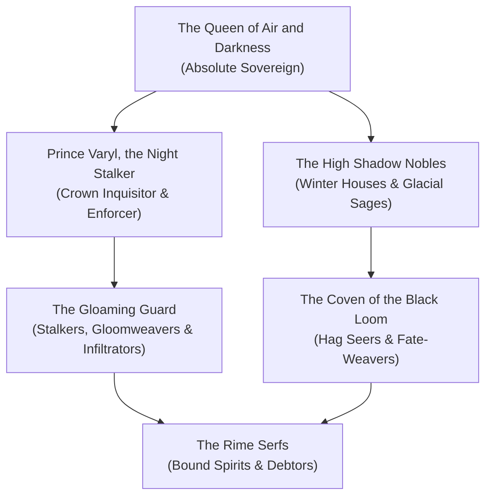

# The Unseelie Court (The Court of Air, Darkness & Winter)

The **Unseelie Court**, known anciently as the **Court of Shadows**, is the brooding, gothic, and ruthlessly disciplined counterweight to the Seelie Court in [[Project Shattered Loom/Project Shattered Loom/Planes of Existence/The Material Plane/Feywild|The Feywild]]. Operating from the obsidian and glacial fastness of the **Gloaming Cradle** in the perpetual midnight of the Duskwood, the Unseelie Court embodies winter, decay, predation, forbidden secrets, and the fierce elegance of shadow magic.

Where the Seelie Court drowns in hedonistic excess, the Unseelie Court is razor-sharp, calculated, and strictly meritocratic. They do not view themselves as evil; rather, they recognize that life without death is stagnant rot, and that winter is the necessary, purifying crucible that tempers the spirit. Every noble in the Unseelie Court is a master of political intrigue, poison, and the deadly dance of dark bargains.

> _"The Seelie dance because they are terrified of the dark. We rule the dark because we are the only ones honest enough to admit that everything eventually freezes."_
> — Prince Varyl, the Night Stalker

---

## Organization & Hierarchy

### 1. The Obsidian Throne
**The Queen of Air and Darkness**, the faceless sovereign whose whispers shape the politics and magic of winter.

### 2. The Crown Enforcer
**Prince Varyl**, commander of the huntsmen, inquisitors, and shadow assassins.

### 3. The High Shadow Nobles
Ancient houses of winter eladrin who command vast frozen domains and compete through subtle assassinations.

### 4. The Coven of the Black Loom
Night hags and sorrowsworn seers who weave cursed artifacts and harvest dark prophecies.

---

## Core Doctrines

1. **The Crucible of Winter**: Pain, hardship, and fear are the great teachers; those who cannot endure the frost deserve to be swept away.
2. **The Letter of the Law**: A bargain spoken in shadow is unbreakable; words possess the weight of adamantine chains.
3. **Purity of the Hunt**: The strong rule the weak; mercy is an insult to both predator and prey.

---

## Influence Across Faerie

* **The Duskwood**: Total territorial dominion, patrolled by shadow wolves and gloomweavers.
* **Bramble-Cross**: Substantial economic influence through the black-market broker networks and hag covens.
* **The Shadowfell**: Deep diplomatic and trade connections with the Domains of Dread (particularly Darkon and Dementlieu).

---

## Relationships with Other Factions

### The Seelie Court
**Existential War.** Perpetual ideological and military conflict, punctuated only by fragile equinox truces.

### The Shadar-kai Memory-Sworn
**Pragmatic Trade.** The Unseelie trade sorrowful memories and cursed relics with the Raven Queen's disciples in exchange for shadow magic.

### The Wild Hunt
**Cautious Respect.** The Unseelie revere the savagery of the Hunt, though Cernunnos fiercely rejects the Queen's attempts to command his riders.

---
[[Project Shattered Loom/Project Shattered Loom/Planes of Existence/The Material Plane/Feywild]]
[[Project Shattered Loom/Project Shattered Loom/NPC's/The Queen of Air and Darkness]]
[[Project Shattered Loom/Project Shattered Loom/NPC's/Prince Varyl, the Night Stalker]]
