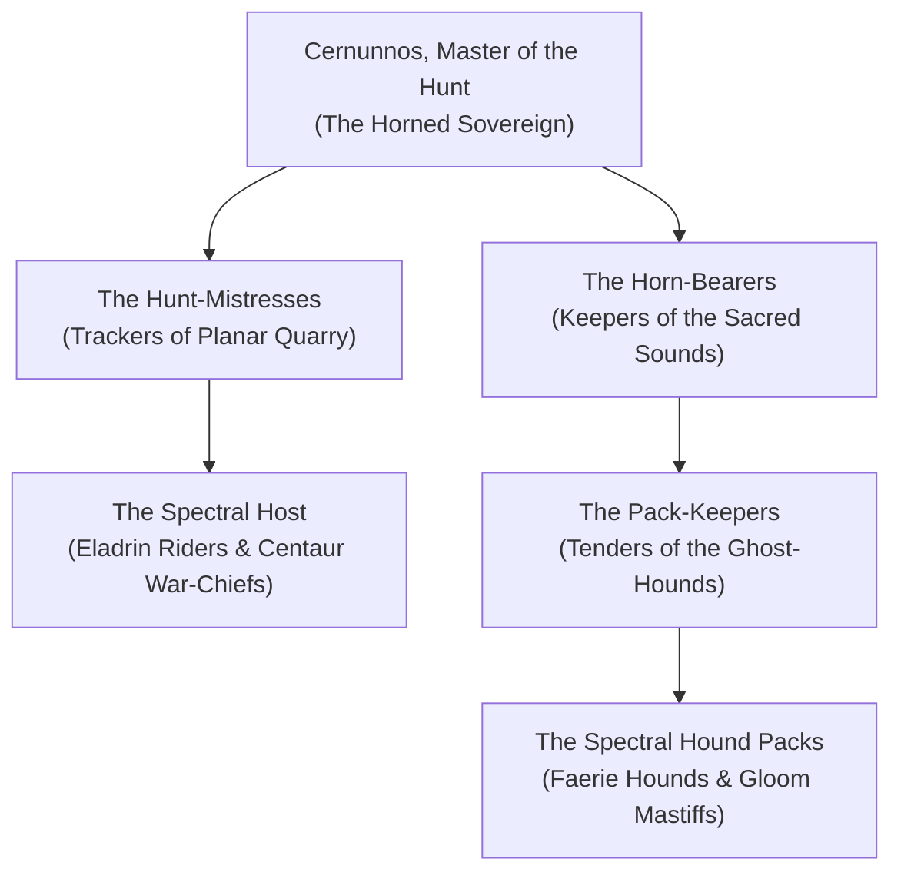

# The Wild Hunt (The Brotherhood of the Chase)

The **Wild Hunt** is a nomadic, primeval brotherhood of sylvan hunters, phantom riders, and apex predators that roams the untamed forests, misty mountains, and cross-planar tracks of [[Project Shattered Loom/Project Shattered Loom/Planes of Existence/The Material Plane/Feywild|The Feywild]]. Led by the ancient horned Archfey **Cernunnos**, the Hunt operates outside the jurisdiction of both the Seelie and Unseelie Courts, recognizing only the primal laws of the ancient wild: the rhythm of the chase, the honor of the quarry, and the sanctity of blood and bone.

When the horn of the Hunt sounds, civilized laws cease to exist. The riders gallop across treetops and through clouds on spectral mounts, accompanied by packs of green-eyed faerie hounds whose baying strikes terror into the hearts of mortals and kings alike.

> _"We do not hunt for gold, nor for thrones, nor for malice. We hunt because the forest must breathe, the weak must flee, and the strong must be tested."_
> — Hunt-Mistress Valerie

---

## Organization & Hierarchy

### 1. The Master of the Hunt
**Cernunnos**, the primeval horned Archfey whose will directs the season's chase.

### 2. The Hunt-Mistresses
Elite trackers who can follow a quarry across planes, rivers, and dreams.

### 3. The Horn-Bearers
Sacred bards who sound the carved ram's horns that summon the spectral host.

### 4. The Spectral Host
Nomadic warriors who ride shadow steeds, giant elk, and wyrms.

---

## Core Doctrines

1. **The Law of the Chase**: A quarry that fights with valor and survives until dawn must be granted freedom and rewarded.
2. **Punishment of the Defiler**: Those who slaughter beasts without need or burn ancient trees are marked as quarry for the Great Equinox Hunt.
3. **Freedom from Courts**: The Hunt kneels to no queen, pays no taxes, and obeys no mortal or immortal crown.

---

## Relationships with Other Factions

### The Seelie Court
**Kinship through Oberon.** King Oberon frequently rides with the Hunt, though Titania finds the riders too uncivilized for the Verdant Spire.

### The Unseelie Court
**Mutual Wariness.** Prince Varyl envies the hounds' tracking prowess, but Cernunnos violently repels Unseelie interference.

---
[[Project Shattered Loom/Project Shattered Loom/Planes of Existence/The Material Plane/Feywild]]
[[Project Shattered Loom/Project Shattered Loom/NPC's/Cernunnos, Master of the Wild Hunt]]
[[Project Shattered Loom/Project Shattered Loom/NPC's/King Oberon]]
