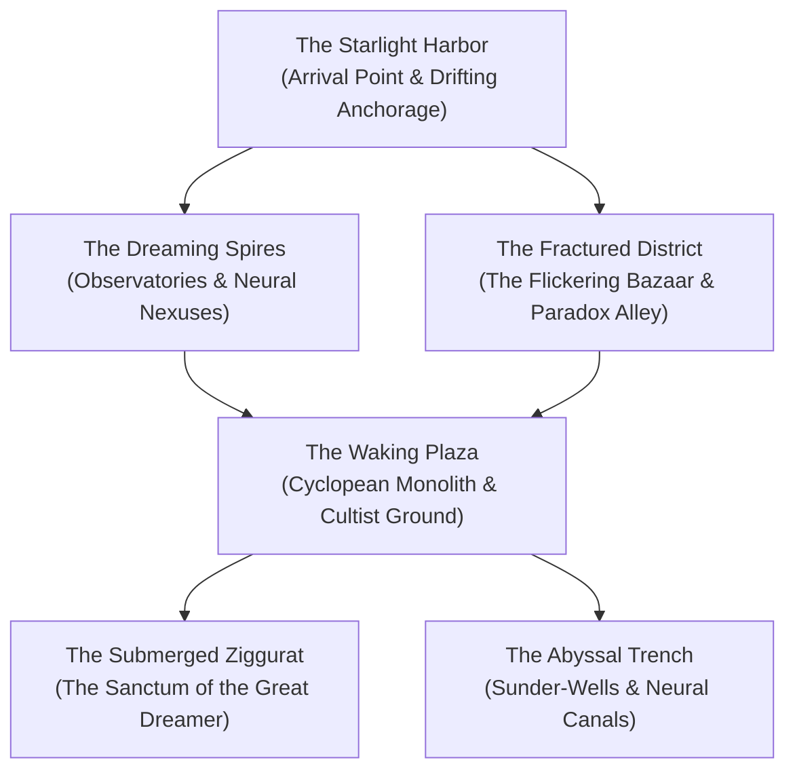

# **City of Ry'leh: The Extradimensional City of the Great Dreamer**
*The Somnolent Metropolis, The Drowned Spire-City, The Nexus of Un-Woven Thoughts*

> *"The harbor water is not water; it is starlight and chilled thought. The towers of black stone rise at angles that make the optic nerve ache with nausea. Walk three paces forward and you find yourself standing behind where you started. And through the stones, through your boots, through the hollows of your teeth, vibrates the soft, endless breathing of the Sleeper beneath the waves."*  
> — **Captain Seris Vael, Logbook of The Wraith**

***

## **Planar Nature & Loom Metaphysics**

Adrift in an isolated dimensional eddy of the **Astral Sea**, **Ry'leh** is an extradimensional paradox—partially physical, partially a sentient dreamscape projected into existence by the subconscious mind of the **Great Dreamer**, an ancient primordial entity who slumbers in the colossal **Submerged Ziggurat** at the city's heart.

Where the Golden Tapestry of Telara holds the cosmos together with linear, tensioned filaments, Ry'leh is a zone of **Oneiric Entanglement**. Here, the Loom’s threads did not snap into shards; instead, they have dissolved into an ocean of liquid consciousness known as the **Tides of Thought**. Space here is strictly non-Euclidean: parallel lines intersect, ceilings become floors depending on the direction of thought, and time dilates unpredictably based on the Sleeper's dream-cycles.

### **The Three Core Truths of Ry'leh**:
1. **Subjective Physicality**: Structures exist only as long as they are observed or dreamed. An alleyway that leads to a busy bazaar in the morning may fold into a blank cliff face by nightfall.
2. **The Lucidity Drain**: Mortal minds visiting Ry'leh are subjected to continuous mental erosion, governed by **[[Custom Rules/The Eldritch Madness & Dream-Fracture Ruleset|The Eldritch Madness & Dream-Fracture Ruleset]]**. As Lucidity decreases, characters gain forbidden cosmic insights while their hold on reality slips.
3. **The Somnolent Wake**: The city serves as both the eternal sanctuary and the dimensional anchor for the Great Dreamer. Its cultists—the **Dreambound**—strive to interpret its murmurs, maintaining rituals to soothe its slumber or harvest its reality-altering essence.

***

## **The Six Districts of Ry'leh**

### **1. The Starlight Harbor & Drifting Anchorage**
* **Atmosphere & Read-Aloud**: A vast, mirror-calm expanse of phosphorescent, silver-indigo liquid extends toward a horizon of violet mist. Trapped within this semi-solid sea float hundreds of ships from across the multiverse—githyanki astral skiffs, elven spelljammers, mortal galleons, and derelict planar barges—suspended motionless as if caught in amber.
* **The Veil of Ripples**: An iridescent dome of swirling runes and spatial refraction surrounds the harbor, preventing vessels from exiting unless guided by a Dreambound navigator.
* **Environmental Trait**: Breathing in the harbor vapor fills the lungs with cold, lavender-scented air; creatures without psychic shielding experience mild auditory hallucinations (+1d4 Lucidity Drain on arrival, DC 13 Wis save negates).

### **2. The Dreaming Spires & Echo Chambers**
* **Atmosphere & Read-Aloud**: Needle-thin towers of green-black volcanic basalt twist toward an impossible sky where constellations rearrange themselves like living glyphs. The spires are connected by gossamer sky-bridges of hardened starlight that vibrate with polyphonic lullabies.
* **The Echo Chambers**: Vaults within the spires where spoken memories take physical shape. Visitors stepping into these chambers often witness solid, touchable phantoms of their own childhood homes or dead loved ones.
* **Key Landmark — The Starbind Observatory**: The highest needle in Ry'leh, where the elder astromancers of the Dreambound chart the slow, rhythmic turning of the Great Dreamer's mind against the cosmic weave.

### **3. The Tides of Thought & Neural Canals**
* **Atmosphere & Read-Aloud**: Wide, luminescent canals cut through the cyclopean masonry, carrying viscous, glowing cyan fluid that pulses in rhythm with a heartbeat deep below the bedrock. Strange, transparent jellyfish-like entities drift along the surface, flickering with the stolen memories of drowning dreamers.
* **Environmental Trait**: Submerging any part of the body in the Tides grants temporary insight (advantage on next Arcana check), but inflicts 2d6 psychic damage and forces a DC 15 Int save; failure drains 2d6 Lucidity.

### **4. The Fractured District & The Flickering Bazaar**
* **Atmosphere & Read-Aloud**: A maze of leaning facades, shattered colonnades, and stairways that terminate mid-air. In the central courtyard, shadowy vendors with glowing violet eyes hawk impossible merchandise from stalls made of petrified astral coral.
* **The Flickering Bazaar**: The primary trading hub of Ry'leh. Transactions are conducted not in gold, but in bottled memories, secrets, mathematical formulas, and soul-static.
* **Spatial Glitch**: Every 10 minutes, the layout of the district rotates 90 degrees. Navigating without an extradimensional compass requires a DC 15 Int (Investigation) check.

### **5. The Waking Plaza & The Cyclopean Monolith**
* **Atmosphere & Read-Aloud**: A colossal plaza paving of interlocking, non-Euclidean basalt blocks centered around an 80-foot monolith depicting a sleeping entity whose tentacles and human faces shift beneath the stone. Thousands of Dreambound cultists kneel here in silent communion.
* **The Resonating Choir**: At irregular intervals, the monolith emits a low subsonic chime that vibrates through mortal skeletons. All non-aberrations in the plaza must make a DC 14 Con save or be incapacitated with awe for 1 round.

### **6. The Abyssal Trench & Sunder-Pits**
* **Atmosphere & Read-Aloud**: Jagged rifts at the city's seaward perimeter where the astral bedrock drops off into bottomless, pitch-black oceanic trenches. Deep below, bioluminescent Deep Watchers glide between sunken megaliths.
* **Conduit to the Un-Woven**: These pits descend directly into the deepest subconscious layer of the Great Dreamer, venting raw entropic static into the Astral Sea.

***

## **Unique Eldritch Commerce: Shops of Ry'leh**

### **1. The Flickering Bazaar of Lost Ideas** *(Proprietor: Xar-Thon, Mind Flayer Outcast)*
* *Bottle of Stolen Reminiscence*: A glass phial filled with swirling sepia smoke. When uncorked and inhaled, grants the user proficiency in one tool, language, or weapon for 24 hours, but they forget the face of one loved one until their next long rest. (Cost: 400 gp or 1 Significant True Memory).
* *Lens of Inverted Space*: A spectacle lens ground from green-black crystal. Looking through it reveals invisible creatures, hidden doors, and secret planar seams within 30 feet, but the user suffers disadvantage on Dexterity saving throws due to spatial disorientation. (Cost: 650 gp).
* *Extradimensional Sextant*: A brass apparatus with six rotating rings that indicates true orientation in non-Euclidean space; grants advantage on all checks made to navigate Ry'leh and prevents spatial loop-traps. (Cost: 500 gp).

### **2. The Starlight Scavenger** *(Proprietor: Morwen the Drift-Diver, Githzerai Salvager)*
* *Anchor-Spike of True Geometry (x3)*: Cold iron pitons carved with Telaran stabilization glyphs. When driven into stone or wood, anchors a 20-foot radius sphere of space, preventing gravity shifts, dimensional warping, and teleportation for 8 hours. (Cost: 150 gp each).
* *Driftwood Harpoon of Thought (+1)*: Harpoon carved from astral wreckage. On hit, deals an extra 2d6 psychic damage and anchors the target; the target cannot teleport or shift planes while impaled (DC 15 Str to pull free). (Cost: 1,200 gp).
* *Oil of the Slumbering Sea (Flask)*: Applied to armor or skin; grants the ability to breathe liquid thought and swimming speed equal to walking speed for 8 hours. (Cost: 250 gp).

### **3. The Oneiric Apothecary** *(Proprietor: Scribe Elidyr, Dreambound Heretic)*
* *Iron-Salt Grounding Draught*: Pungent alchemical tonic brewed from sea salt, cold iron, and dried lavender. Restores **3d6 Lucidity**, but forces a DC 13 Con save against gaining 1 level of exhaustion. (Cost: 180 gp).
* *Vial of Liquid Lucidity*: Shimmering golden fluid distilled from Loom-thread essence. Imbibing restores **25 Lucidity** instantly with no side effects and grants advantage on Wisdom saves for 1 hour. (Cost: 500 gp).
* *Spore of the Dreaming Lotus*: Inhaling this purple dust induces a lucid trance; allows the user to cast *Contact Other Plane* without risk of insanity, communing directly with an astral dream-echo. (Cost: 350 gp).

***

## **Regional Taverns: Atmospheric Dens of Ry'leh**

1. **The Sleeping Kraken**: Built inside the petrified skull of a titanic astral cephalopod stranded on the breakwater of the Starlight Harbor. Dimly lit by bioluminescent sea-fungus, this tavern caters to stranded astral spelljammer crews, tiefling smugglers, and renegade githyanki. The house special is *Deep Brine Ale*, a potent spirit that deadens telepathic noise and restores 1d4 Lucidity upon first drink.
2. **The Drowned Reflection**: A salon suspended over a churning neural canal in the Dreaming Spires. The tables and chairs are made of solidified thought, and the mirrors on the walls show patrons how they will look twenty years after their death. Patrons sip shimmering indigo absinthe while listening to harpists playing melodies composed by the Great Dreamer’s sleeping mind.

***

## **Notice Board / Oneiric Whispers Contracts**

* **[Contract: Sunder-Well Exploration]**: "A pulsating golden resonance was detected 300 fathoms down Sunder-Well 4. Descend into the deep trench, recover the metallic cylinder, and return it to the Starbind Observatory before the Deep Watchers claim it. Reward: 2,500 gp + a Vial of Liquid Lucidity."
* **[Bounty: The Wandering Dream-Echo]**: "A dream-echo of an ancient Netherese arcanist has escaped the Echo Chambers and is causing localized gravity storms in the Fractured District. Dissipate the echo and bottle its psychic core. Bounty: 1,400 gp."
* **[Recovery: The Stolen Anchor-Stone]**: "A rogue cell of the Cult of the Broken Thread stole a consecrated anchor-stone from the Waking Plaza, threatening to tear the Starlight Harbor into the Astral Sea. Track them to the docks and restore the stone to its socket. Reward: 1,800 gp + an Extradimensional Sextant."

***

## **Master d20 Encounter Table: Anomalies of the Somnolent City**

| d20 | Encounter / Environmental Paradox | Threat / Resolution |
| :---: | :--- | :--- |
| **1** | **The Vanishing Boulevard**: The street ahead folds into an acute angle, placing the party upside down on a ceiling street with reverse gravity. | DC 14 Dex save or take 3d6 bludgeoning damage from falling onto the inverted roadway. |
| **2** | **The Echo of Yourself**: A party member meets a physical duplicate of themselves who claims to have entered Ry'leh forty years ago and warns them to turn back. | DC 15 Wis save against 1d8 Lucidity Drain; duplicate vanishes if touched. |
| **3** | **Starlight Fog Surge**: A sudden bank of luminescent cyan fog sweeps across the plaza, muffling all sound and projecting whispers of dead relatives. | Disadvantage on Perception checks; stealthy ambush by 1d4 **Astral Spawn**. |
| **4** | **The Sleeping Monolith Chime**: The central statue hums with subsonic resonance, causing nearby stone to turn rubbery and soft. | Difficult terrain for 10 minutes; DC 14 Con save or deafened for 1 hour. |
| **5** | **The Drifting Galleon**: An abandoned spelljammer from the Starlight Harbor breaks free of its moorings, crashing through rooftops above the canal. | DC 16 Dex save to evade falling debris; wreckage contains salvaged charts. |
| **6** | **Deep Watcher Ambush**: A gargantuan, tentacled Deep Watcher lunges from a neural canal, attempting to drag an adventurer beneath the liquid thought. | Combat Encounter: 1 **Deep Watcher** (CR 18) or 2 **Chuuls**. |
| **7** | **The Memory Merchant**: A vendor with mirrors for eyes offers to trade a map of the Submerged Ziggurat in exchange for the party's happiest memory. | Roleplay dilemma; trading grants map but causes 1 level of exhaustion. |
| **8** | **Non-Euclidean Loop**: The party walks straight for 15 minutes, only to find themselves exiting a doorway they passed half an hour earlier. | DC 15 Int (Investigation) check to locate the hidden geometric seam and escape. |
| **9** | **The Drowned Choir**: A school of bioluminescent thought-jellyfish surfaces in the canal, singing an ancient elven hymn of the Unbroken Tapestry. | Listening restores 1d6 Lucidity to characters who succeed on a DC 14 Wis check. |
| **10** | **Dreambound Inquisition**: A squad of eight Dreambound cultists and an Aberrant Preacher confront the party, demanding to inspect their dreams for blasphemy. | Social interaction or Combat (DC 16 Intimidation/Persuasion to bypass peacefully). |
| **11** | **Spontaneous Gravity Flip**: Gravity rotates 90 degrees toward the nearest spire. Everyone slides 40 feet along walls until catching handholds. | DC 15 Athletics or Acrobatics check; failure results in 4d6 falling damage. |
| **12** | **The Loom-Thread Fissure**: A crack opens in a basalt wall, exposing a single glowing golden thread of Telara trapped in green slime. | Skill check: DC 16 Sleight of Hand with an iron tool extracts 1 intact Loom Thread. |
| **13** | **Chamber of the Somnolent Gaze**: The party stumbles into an alcove lined with weeping stone eyes that turn to watch their movement in unison. | DC 15 Wis save or roll on the **Dream-Fracture Afflictions Table**. |
| **14** | **The Liquid Starlight Geyser**: A canal canalizes a geyser of hot starlight brine into the air, raining down burning psychic droplets. | 20-ft radius; DC 14 Dex save or take 3d8 psychic damage and lose 1d6 Lucidity. |
| **15** | **Astral Corsair Deserters**: A crew of four battered Githzerai warriors ask the party for an Iron-Salt Draught to stave off creeping madness. | Social encounter: trading tonics earns loyal allies and a guide to the Ziggurat. |
| **16** | **The Shadow-Severance**: A party member's shadow detaches itself from their feet and attempts to flee down an alleyway toward the Sunder-Pits. | Chase encounter: catching the shadow requires DC 15 Athletics/Acrobatics before it escapes. |
| **17** | **The Waking Nightmare**: An illusionary manifestation of the party's most feared enemy forms from ambient psychic fog, dealing psychic damage. | Manifested Nightmare (use statistics of an Oni or Wraith, dealing psychic damage). |
| **18** | **The Sleeper’s Exhalation**: The entire city drops 5 degrees in temperature as a cold, lavender-scented breeze blows from the Submerged Ziggurat. | All active dream-fracture penalties are magnified (+2 to all save DCs) for 1 hour. |
| **19** | **Discovery of an Astral Skiff**: An intact, two-seater skiff is wedged between two leaning spires, equipped with a functional starlight engine. | Investigation check (DC 14): repairable with 1 hour of tinker work; provides city flight. |
| **20** | **The Grand Alignment**: The constellations above form the eye-sigil of the Great Dreamer. A wave of peaceful, terrifying euphoria washes over the city. | DC 18 Cha save: on success, gain inspiration and 10 Lucidity; on failure, fall asleep for 1d4 minutes. |

***

## **Related Dossiers & Planar Navigation**

* **The Megadungeon Core**: [[The Submerged Ziggurat|The Submerged Ziggurat (Sanctum of the Great Dreamer)]]
* **Custom Ruleset**: [[The Eldritch Madness & Dream-Fracture Ruleset|The Eldritch Madness & Dream-Fracture Ruleset]]
* **Cartographic Atlas**: [[Map of the City of Ry'leh|Map of the City of Ry'leh (Approach Currents & Districts)]]
* **Cosmic Entity Dossier**: [[The Great Dreamer|The Great Dreamer (Colossal Eldritch Primordial)]]
* **Rival Faction**: [[The Dreambound of Ry'leh|The Dreambound of Ry'leh (Guardians of the Slumber)]]
* **Regional NPC Hub**: [[Key NPCs - City of Ry'leh|Key NPCs of City of Ry'leh]]
