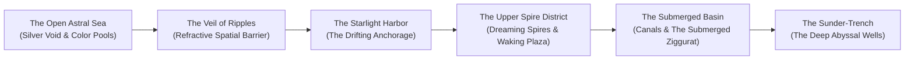

# **Map & Regional Atlas: City of Ry'leh**
*The Somnolent Anchorage & The Submerged Districts*

> *"Do not steer by the stars when approaching Ry'leh. The stars here are eyes, and they will turn your ship into their own pupil. Steer by the sound of the breathing, and pray the tide does not pull your hull beneath the Veil."*  
> — **Captain Lysara Driftwave, Void-Caravel Corsair**

***

## **Cartographic Overview & Astral Geography**

The City of Ry'leh rests within a sunken pocket dimension anchored to the silver depths of the **Astral Sea**. Unlike standard planetary bodies or floating asteroid fragments, Ry'leh occupies a concave depression in the fabric of space itself—a **Somnolent Sinkhole** created by the mass of the Great Dreamer’s dormant consciousness.

Approaching vessels must navigate the **Veil of Ripples**, an iridescent boundary of refracted space that hides the city from casual astral navigation.

***

## **District Gazetteer & Navigational Coordinates**

| District / Landmark | Depth / Elevation | Coordinates / Alignment | Key Architectural Features | Primary Hazards |
| :--- | :--- | :--- | :--- | :--- |
| **The Veil of Ripples** | Surface Boundary | Outer Spatial Perimeter | Swirling translucent glyphs and light-bending refraction. | Spatial rebound; DC 16 Pilot check to breach without hull breach. |
| **The Starlight Harbor** | Sea Level (0 ft) | Northern Bay | Sunken anchorages, derelict galleons, silver liquid surface. | Drifting wreckage, starlight vapors (+1d4 Lucidity Drain). |
| **The Dreaming Spires** | +150 to +600 ft | Eastern Ridge | Basalt needle-towers connected by starlight bridges. | Extreme vertigo, echo-chambers, non-Euclidean stairwells. |
| **The Fractured District** | -50 to +100 ft | Western Slopes | Leaning ruins, floating masonry, The Flickering Bazaar. | Rotational glitches, collapsing streetways, memory thieves. |
| **The Waking Plaza** | +50 ft | Central Axis | Cyclopean stone plaza, 80-foot shifting monolith. | Subsonic chimes, mass cultist crowds, psychic resonance. |
| **The Submerged Ziggurat** | -100 to -1,500 ft | Central Basin | Five-tiered stepped pyramid of green-black basalt. | Liquid thought pressure, ocular friezes, reality ripples. |
| **The Sunder-Trench** | -1,500 to -5,000 ft | Southern Chasm | Pitch-black ocean abyss dropping into the void. | Complete darkness, Deep Watcher patrols, Lucidity collapse. |

***

## **Astral Approach Currents & Nautical Corridors**

| Corridor Name | Approach Vector | Nautical Conditions | Navigational Hazards & DCs |
| :--- | :--- | :--- | :--- |
| **The Silver Inflow** | Astral North -> Starlight Harbor | Smooth, phosphorescent current. | DC 14 Vehicles (Air or Water); on failure, ship is grounded on drifting wreckage. |
| **The Siren's Wake** | Astral East -> Spire Bay | Resonating choral soundwaves. | DC 15 Wisdom save for helmsman; failure inflicts 1 hour of somnambulic drifting. |
| **The Sunder-Draft** | Astral South -> Abyssal Wells | Violent downward suction current. | DC 17 Strength (Athletics or Vehicles); failure pulls vessel 200 feet downward. |
| **The Whispering Eddy** | Astral West -> Fractured District | Spatial turbulence and compass failure. | Non-Euclidean drift; DC 16 Int (Navigation) or emerge in a random layer of the Abyss. |

***

## **Planar Hazards & Navigational Threats**

| Hazard | Occurrence | In-Game Mechanics |
| :--- | :--- | :--- |
| **Oneiric Static Fog** | 20% chance on open waters. | Visibility reduced to 20 feet; radar and magical detection fail; DC 14 Wis save each hour or lose 1d6 Lucidity. |
| **Spatial Inversion Surge** | Triggered near the Dreaming Spires. | Up and down invert for 1d4 rounds; unrestrained crew members fall upward into the astral sky (4d6 bludgeoning). |
| **The Sleeper’s Tidal Wave** | Occurs when the Great Dreamer turns. | 40-foot wave of liquid thought sweeps through the canals; DC 16 Str save or swept overboard and take 4d8 psychic damage. |
| **Deep Watcher Feeding Run**| At midnight in the Sunder-Trench. | Huge tentacles breach the surface; ships must succeed on DC 15 Dex check or suffer 6d10 bludgeoning damage to hull. |

***

## **Related Links & Planar Codex**

* **City Overview**: [[City Of Ry'leh|City Of Ry'leh (The Extradimensional City)]]
* **Megadungeon Core**: [[The Submerged Ziggurat|The Submerged Ziggurat (Sanctum of the Great Dreamer)]]
* **Madness Ruleset**: [[The Eldritch Madness & Dream-Fracture Ruleset|The Eldritch Madness & Dream-Fracture Ruleset]]
* **Cosmic Entity**: [[The Great Dreamer|The Great Dreamer (Colossal Aberration Profile)]]
* **Regional NPC Hub**: [[Key NPCs - City of Ry'leh|Key NPCs of City of Ry'leh]]
* **Guarding Faction**: [[The Dreambound of Ry'leh|The Dreambound of Ry'leh (Faction Dossier)]]
