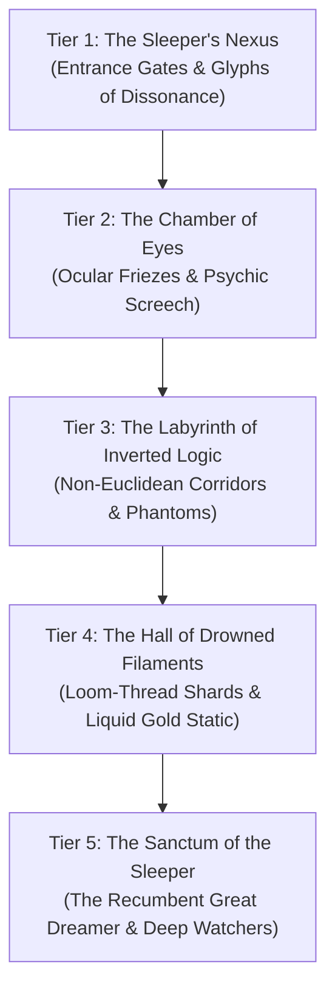

# **The Submerged Ziggurat: Megadungeon Gazetteer**
*The Sanctum of the Sleeper, The Drowned Spire-Pyramid, The Vault of Un-Spun Destiny*

> *"The upper steps of the ziggurat break through the starlight sea like the spine of a petrified titan. Descend past the waterline, and you do not drown—you sink through an ocean of heavy, cold consciousness where every breath tastes of forgotten centuries and the walls watch with thousands of weeping eyes."*  
> — **Vexiryn the Unbowed, Planar Diver**

***

## **Megadungeon Overview & Planar Physics**

Rising from the depths of the Starlight Harbor, the **Submerged Ziggurat** is the physical and metaphysical anchor of the City of Ry'leh. Constructed from cyclopean blocks of green-black stone veined with glowing bioluminescent runes, this monolithic five-tiered pyramid plunges thousands of feet into the liquid starlight of the Astral Sea.

### **Planar Environmental Dynamics**:
1. **Breathing the Thought-Sea**: The liquid surrounding and filling the lower tiers of the Ziggurat is not ordinary water, but condensed psychic fluid. Creatures can breathe within it as if it were air, but the mental pressure exerts continuous strain: every hour submerged requires a **DC 14 Intelligence saving throw**; failure drains **1d6 Lucidity** (see **[[The Eldritch Madness & Dream-Fracture Ruleset]]**).
2. **Subjective Buoyancy**: Movement operates as if in zero gravity or underwater at the creature's choice. Characters with a swim speed have advantage on Dexterity (Acrobatics) checks.
3. **The Pulse of the Sleeper**: At the start of every combat round within the Ziggurat, the DM rolls a **d6**. On a **6**, an **Oneiric Reality Ripple** triggers (see table below).

### **Oneiric Reality Ripple Table (Roll on a 6)**:
| d6 | Reality Distortion Effect (Lasts 1 Round) |
| :---: | :--- |
| **1** | **Gravity Inversion**: Gravity flips toward the ceiling. All non-anchored creatures fall 30 feet upward, taking 3d6 bludgeoning damage upon impact. |
| **2** | **Psychic Backlash**: Ambient static flares. All spellcasters must make a DC 15 Concentration check or lose any active concentration spells. |
| **3** | **Dimensional Double**: Every creature flickers, splitting into two visual images. Attacks suffer a 20% miss chance. |
| **4** | **Time Eddy**: Initiative order is reversed for the round, with the lowest initiative acting first. |
| **5** | **The Sleeper’s Sigh**: A wave of exhaustion passes through the chamber. DC 15 Con save or speed is halved and reactions are denied. |
| **6** | **Golden Filament Flare**: A trapped Loom-thread pulses with radiant light; all fiends and aberrations take 4d8 radiant damage, and mortals regain 10 Lucidity. |

***

## **The Five Submerged Tiers**

---

### **Tier 1: The Sleeper's Nexus (The Threshold)**
* **Read-Aloud**: The topmost tier rises 60 feet above the starlight ocean, an immense square terrace crowned by a portal of non-Euclidean obsidian slabs. Glyphs carved into the threshold shift and rearrange themselves whenever direct gaze is broken. The air hums with a deep vibrational frequency that makes weapons and armor ring like tuning forks.
* **Guardians**: 6 **Dreambound Zealots**, 2 **Astral Spawn** (CR 3 aberrations), and 1 **Nexus Gatekeeper** (CR 8 Aberrant Knight wielding a thought-halberd).
* **Hazard — Glyphs of Dissonance**: Anyone crossing the threshold without wearing a Dreambound sigil must make a **DC 16 Wisdom saving throw** or suffer disadvantage on Perception and Insight checks for 24 hours and lose **2d6 Lucidity**.
* **Key Treasure**: The *Amulet of the Starlight Ward* (grants resistance to psychic damage and immunity to the drowned breath while inside the Ziggurat).

---

### **Tier 2: The Chamber of Eyes (The Ocular Gallery)**
* **Read-Aloud**: Descending down an impossibly wide flight of stairs submerged in clear, glowing blue fluid brings you into a colossal circular rotunda. The curved walls are inlaid with hundreds of organic, bioluminescent eyes ranging from human-sized pupils to gargantuan, faceted insect lenses. Every eye blinks in asynchronous rhythm, tracking your every movement.
* **Hazard — The Watchful Gaze**: At the start of their turn, any creature within the chamber must make a **DC 17 Wisdom saving throw** or suffer an effect rolled on the table below:
  * *1: Psychic Screech*: 22 (4d8 + 4) psychic damage and deafened for 1 minute.
  * *2: Memory Fragmentation*: Forgets proficiency in one skill until completing a long rest outside the Ziggurat.
  * *3: Paranoia of the Ally*: Frightened of the nearest party member for 1d4 rounds.
  * *4: Oneiric Revelation*: Glimpses the cosmic weave; gains advantage on Arcana checks for 24 hours, but loses **2d8 Lucidity**.
* **The Puzzle of the Central Iris**: At the center of the rotunda floor lies a sealed 15-foot iris door of black coral. Opening it requires placing four *Loom-Cores* into matching ocular sockets while withstanding three rounds of the Watchful Gaze.
* **Key Treasure**: Embedded in the master eye is an intact **Golden Filament Shard** (worth 2,500 gp; restores 30 Lucidity upon touch).

---

### **Tier 3: The Labyrinth of Inverted Logic**
* **Read-Aloud**: Beyond the Iris Door lies an impossible, non-Euclidean maze where walls flow like thick glass and stairs climb in infinite closed loops. Gravity shifts depending on the hallway's color: red halls pull toward the left wall, green halls pull toward the ceiling, and violet halls possess zero gravity.
* **Enemies**: 3 **Chuuls of the Deep**, 2 **Mindwhisper Specters**, and phantasmal **Dream-Echoes** of the party’s fallen adversaries.
* **Mechanics — Navigating the Loop**: Navigating through the labyrinth requires a three-stage skill challenge:
  1. *DC 16 Intelligence (Investigation)*: Identifying which corridors are mathematical impossibilities.
  2. *DC 16 Wisdom (Survival)*: Anchoring mental compass orientation against the flow of the thought-tides.
  3. *DC 16 Charisma (Insight)*: Disbelieving the waking nightmares projected by the walls.
  * *Failure Outcome*: Each failure costs **2d6 Lucidity** and extends travel time by 1d4 hours.
* **Key Treasure**: The **Key of the Sleeper**, a helical bone rod that pulses with warm starlight, required to unlock the final sanctum.

---

### **Tier 4: The Hall of Drowned Filaments**
* **Read-Aloud**: A breathtaking, heartbreaking hall where the ancient Golden Filaments of Telara's Loom hang suspended from cyclopean arches, partially submerged in the cyan brine. But the threads here are not golden—they are infected with deep purple veins of eldritch static, weeping drops of luminous liquid thought into massive collection basins.
* **Enemies**: 1 **Corrupt Weaver Aberration** (CR 12, casts *Web of Static* and *Psychic Lance*) and 4 **Dread Larvae**.
* **Environmental Hazard — Corrupted Weave Surge**: Every turn, static arcs between the hanging threads. Any creature wearing metal armor or carrying magical weapons must make a **DC 15 Dexterity save** or take 18 (4d8) lightning and psychic damage.
* **Key Reward**: A spool of **Un-Woven Gold** (can be spun by a master artificer into an *Armor of Invulnerability* or used to repair a damaged Spelljammer helm).

---

### **Tier 5: The Sanctum of the Sleeper (The Core)**
* **Read-Aloud**: A chamber of boundless dimensions that defies the exterior footprint of the pyramid. The floor is an ocean of glowing liquid starlight stretching beneath a ceiling of swirling, bruised-violet nebulae. In the center rests the **Great Dreamer**—a recumbent, 120-foot colossus whose skin is an undulating tapestry of sleeping mortal faces, crowned by a halo of floating dendrites of solidified moonlight. Around it circle four colossal leviathans: the **Deep Watchers**.
* **The Living Aura**: The Great Dreamer does not actively attack unless provoked, but its subconscious aura exerts immense pressure:
  * Entering within 120 feet forces a **DC 20 Wisdom saving throw** or the creature is paralyzed with awe and horror, taking 28 (5d10) psychic damage and losing **3d10 Lucidity**.
* **Enemies (If Provoked or Ritual Disrupted)**:
  * **The Watcher in the Deep (Matriarch)**: CR 18 Elder Aberration (see dedicated dossier).
  * 2 **Astral Behemoths** (CR 11).
  * The Great Dreamer’s legendary lair actions (reality warps, somnambulic waves, psychic bursts).
* **The Ultimate Relic — The Eye of the Dreamer**: Floating above the entity's halo is a crystalline orb the size of a carriage, pulsating with pure multiversal potential. Touching it allows a spellcaster to rewrite one historical event in their campaign or stabilize an entire drifting planar shard permanently.

***

## **Megadungeon Loot & Relics Table**

| Tier | Room / Location | Relic / Item | Value / Mechanical Properties |
| :---: | :--- | :--- | :--- |
| **Tier 1** | Sleeper's Nexus | *Amulet of the Starlight Ward* | Resistance to psychic damage; allows breathing in liquid thought. (1,200 gp). |
| **Tier 2** | Chamber of Eyes | *Golden Filament Shard* | Primordial Loom relic; restores 30 Lucidity; acts as a +2 arcane focus. (2,500 gp). |
| **Tier 2** | Central Iris Socket | *Ring of the Third Lid* | Grants 60 ft darkvision and advantage on saves against illusion spells. (800 gp). |
| **Tier 3** | Labyrinth Center | *Key of the Sleeper* | Unlocks all non-Euclidean portals in Ry'leh; deals 2d8 psychic damage on hit. (Priceless). |
| **Tier 3** | Phantom Vault | *Tome of Inverted Geometry* | Reading over 40 hours grants permanent +2 to Intelligence (max 22). (4,000 gp). |
| **Tier 4** | Drowned Filaments | *Spool of Un-Woven Gold* | Crafting component for legendary planar artifacts. (5,000 gp). |
| **Tier 4** | Weaver's Altar | *Chitin Dagger of the Deep (+2)* | Deals 1d4 piercing + 2d6 acid + 1d6 psychic damage; ignores armor bonuses. (2,200 gp). |
| **Tier 5** | Sanctum Core | *Eye of the Dreamer* | Cosmic artifact; rewrites 1 major campaign event or stabilizes a planar realm. (Artifact). |

***

## **Cross-Vault Navigation**

* [[City Of Ry'leh|City Of Ry'leh (City Overview)]]
* [[Map of the City of Ry'leh|Map of the City of Ry'leh (Atlas & Travel Corridors)]]
* [[The Eldritch Madness & Dream-Fracture Ruleset|The Eldritch Madness & Dream-Fracture Ruleset]]
* [[The Great Dreamer|The Great Dreamer (CR 26 Profile)]]
* [[The Watcher in the Deep|The Watcher in the Deep (CR 18 Boss)]]
* [[The Dreambound of Ry'leh|The Dreambound of Ry'leh (Faction Dossier)]]
