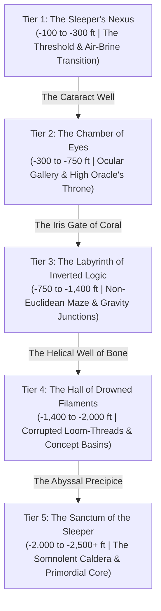
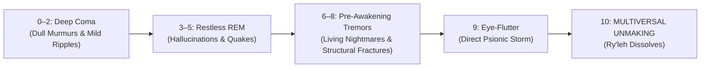
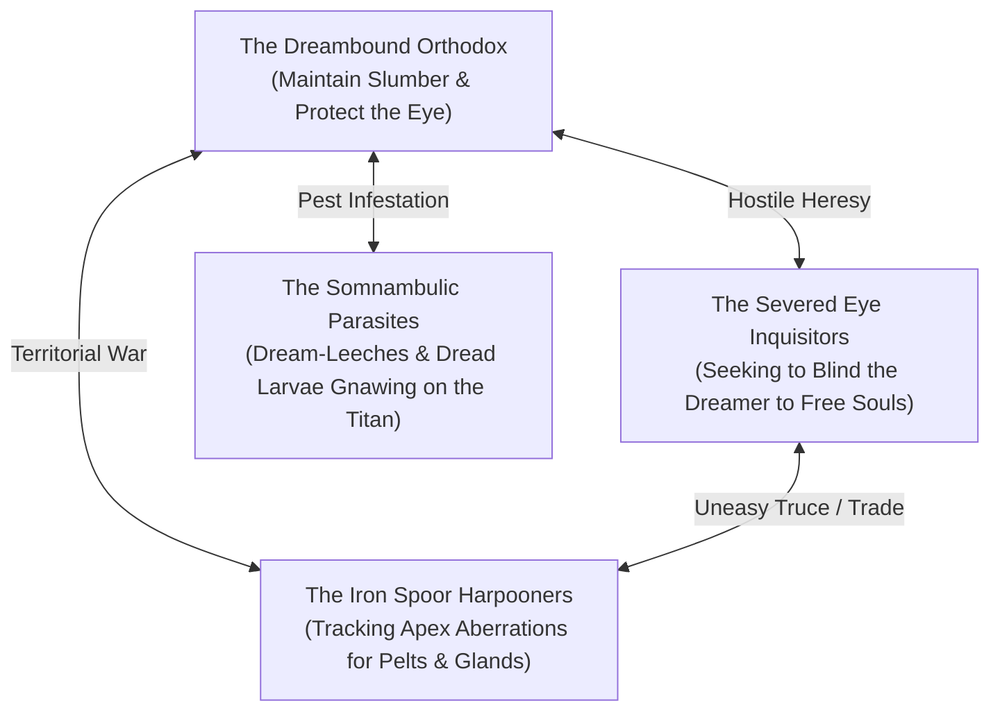
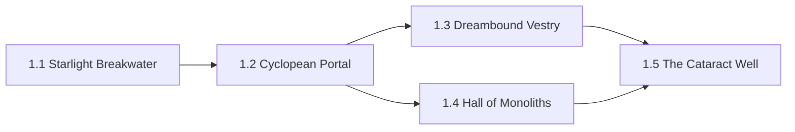
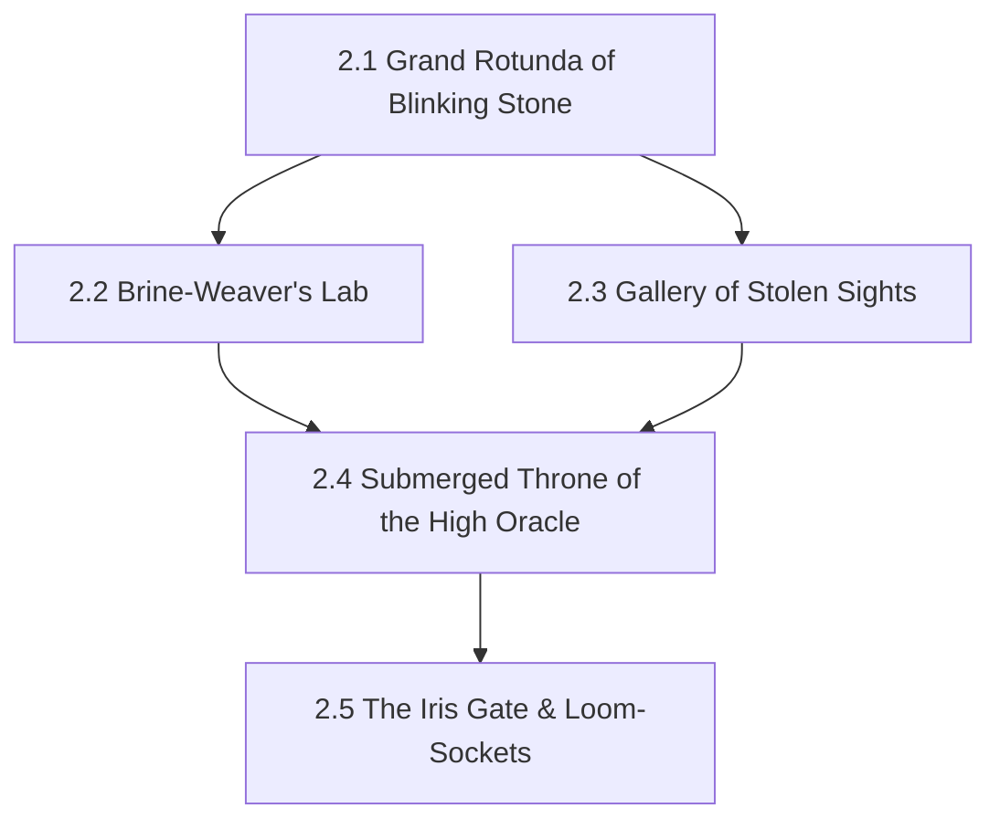
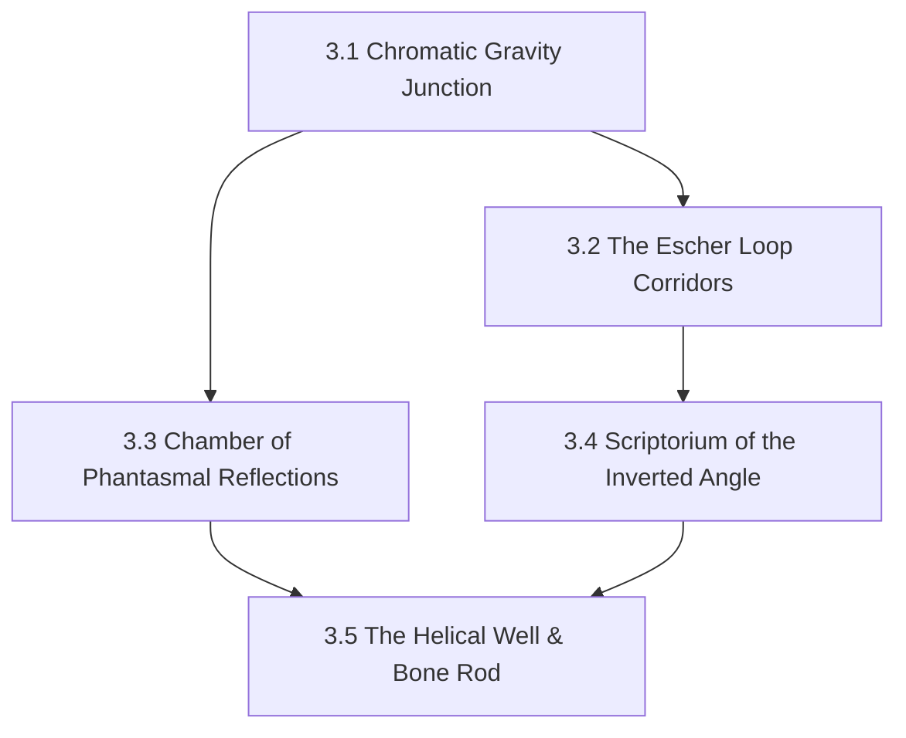
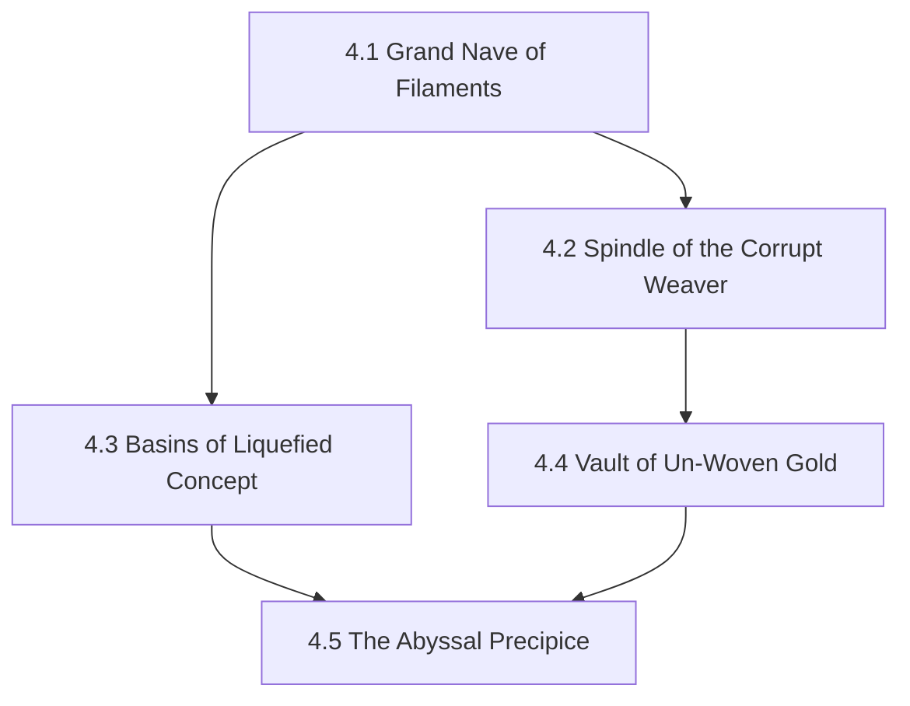
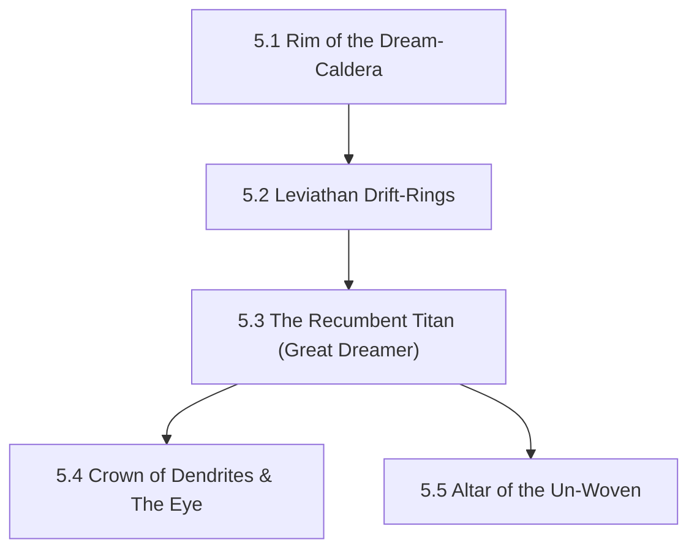
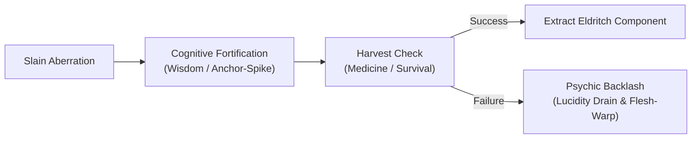
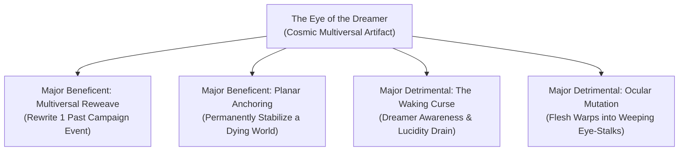

# 🏛️ The Submerged Ziggurat: Megadungeon Gazetteer
### *The Sanctum of the Sleeper, The Drowned Spire-Pyramid, The Vault of Un-Spun Destiny*

> *"The upper steps of the ziggurat break through the starlight sea like the petrified vertebrae of a sleeping god. Descend past the waterline, and you do not drown—you sink through an ocean of heavy, cold consciousness where every breath tastes of forgotten centuries and the stone walls watch you with thousands of weeping, unblinking eyes. Do not shout down there; the Sleeper might hear you, and should the Dreamer wake, our entire reality will fold into nothingness like a closed fist."*  
> — **Vexiryn the Unbowed**, Planar Diver & Envoy of the Ironbound Covenant

---

## 🌊 Megadungeon Overview & Metaphysical Foundations

Rising from the abyssal depths of the Starlight Harbor within the **[[Planes of Existence/City Of Ry'leh/City Of Ry'leh|City of Ry'leh]]**, the **Submerged Ziggurat** is the physical anchor and psychic heatsink of the somnolent metropolis. Constructed from cyclopean megaliths of green-black basalt veined with glowing, bioluminescent ocular runes, this monolithic five-tiered pyramid plunges over 2,500 feet into the dense, pressurized thought-sea of the Astral Basin.

The Ziggurat is not a tomb, nor was it built as a monument for mortal worship. It is an extradimensional cage and reality-stabilizing loom designed to contain the recumbent bulk of **[[NPCs/The Great Dreamer|The Great Dreamer]]**—a cosmic primordial entity whose sleeping mind unconsciously dreams the non-Euclidean streets, impossible spires, and shifting alleyways of Ry'leh into continuous physical existence. 

Should the Ziggurat’s geometric integrity crumble, or should the entity below be prematurely startled from its somnolent stupor, the un-woven dream will collapse, unmaking the surrounding planar fabric into raw entropic static.

---

## 🌀 Planar Environmental Dynamics & Diving Mechanics

Exploring the Submerged Ziggurat introduces non-standard environmental rules governed by the psychic density of the thought-sea and the proximity of the Great Dreamer's dreaming psyche.

### 1. Breathing the Thought-Sea & The Lucidity Siphon
The liquid filling Tiers 2 through 5 of the Ziggurat is not mundane saline water, but **Condensed Starlight Brine (Liquid Thought)**. 

* **Psychic Respiration**: Mortal creatures submerged in the brine do not drown. Their lungs adapt to oxygenate through psychic osmosis, allowing normal breathing and verbal spellcasting. However, breathing someone else's ancient thoughts exerts crushing mental strain.
* **Hourly Lucidity Drain**: Every hour spent submerged within the thought-sea requires an **Intelligence or Wisdom saving throw** (player's choice) against the tier's **Environmental DC**. On a failed save, the character loses Lucidity as detailed in the depth table below, governed by **[[Custom Rules/The Eldritch Madness & Dream-Fracture Ruleset|The Eldritch Madness & Dream-Fracture Ruleset]]**.
* **Psychic Damage Translation**: Whenever a creature takes direct psychic damage while inside the Ziggurat, they simultaneously lose Lucidity equal to **half the psychic damage taken** (rounded down).
* **Grounding Remedies**: Ingesting an *Iron-Salt Grounding Draught* (restores 3d6 Lucidity) or a *Vial of Liquid Lucidity* (restores 25 Lucidity) temporarily re-anchors the mind against the pressure.

### 2. Subjective Buoyancy & Non-Euclidean Hydrodynamics
* **Movement Vectors**: Characters may choose at the start of each of their turns whether to operate under **Underwater Swimming Physics** (swim speed applies, disadvantage on certain weapon attacks per 5e rules) or **Subjective Zero-Gravity Drifting** (flying speed equal to walking speed, controlled by mental orientation via a DC 12 Intelligence check).
* **Piercing the Depths**: Spells that produce fire function normally, but their flames manifest as ghostly blue or lilac phantoms that do not produce bubbles. Lightning spells arc violently: whenever a spell dealing lightning damage is cast, all creatures within 10 feet of the target take 1d8 psychic damage from reverberating neural feedback.
* **Anchor-Spikes of True Geometry**: Driving a consecrated cold-iron anchor-spike into the cyclopean floor stabilizes a 20-foot radius sphere of space, granting advantage on saving throws against spatial drift and gravity flips for 8 hours.

---

## ⚡ The Somnambulic Pulse (Oneiric Reality Ripple Table)

At the start of **Round 1** of every combat encounter inside the Ziggurat, and at the top of every subsequent round on a roll of **5 or 6 on a d6**, the Great Dreamer turns in its sleep, triggering an **Oneiric Reality Ripple**. Roll on the table below:

| d12 | Reality Distortion Effect (Lasts 1 Round Until Next Initiative Count 20) |
| :---: | :--- |
| **1** | **Gravity Inversion**: Gravity violently snaps toward the ceiling. All non-anchored creatures fall 30 feet upward, taking 3d6 bludgeoning damage upon impact unless they succeed on a DC 15 Dexterity save. |
| **2** | **Acoustic Thought-Echo**: Spoken words and verbal spell components echo telepathically across the chamber. Spellcasters must succeed on a DC 15 Concentration check when casting any leveled spell or the spell fizzles, expending the slot. |
| **3** | **Dimensional Bifurcation**: Every creature flickers and duplicates into two visual phantoms. All attack rolls suffer a 20% miss chance (roll 1–4 on a d20). |
| **4** | **Temporal Eddy**: The initiative order is inverted for this round; the creature with the lowest initiative count acts first, progressing to the highest. |
| **5** | **The Sleeper's Sigh**: A wave of somnambulic exhaustion washes over the chamber. Every mortal must make a DC 16 Constitution saving throw or have their movement speed halved and lose the ability to take reactions until the start of their next turn. |
| **6** | **Golden Filament Flare**: A submerged strand of Telara’s Loom hums with pure axiomatic light. All Aberrations and Fiends in the chamber take 4d8 radiant damage; all mortal creatures regain 10 Lucidity. |
| **7** | **Optical Displacement**: Straight lines bend into 60-degree curves. Ranged weapon and ranged spell attacks suffer disadvantage, while melee attack reach increases by 5 feet. |
| **8** | **Memetic Bleed**: A sudden surge of alien memory floods all minds. Each creature must make a DC 15 Wisdom saving throw or spend their action staring into empty space, murmuring in Deep Speech. |
| **9** | **Cellular Liquefaction**: Organic tissue becomes rubbery and semi-liquid. Creatures gain resistance to bludgeoning, piercing, and slashing damage, but take an extra 2d6 psychic damage from all psionic sources. |
| **10** | **Choral Resonance**: Thousands of invisible voices sing a mournful lament of the Unbroken Loom. Any creature currently below 50 Lucidity gains advantage on spell attack rolls and saving throws this round. |
| **11** | **Spontaneous Spatial Wormhole**: Two 10-foot portals snap open in opposite corners of the chamber. Entering one instantly expels the creature from the other, preserving momentum. |
| **12** | **Somnolent Surge**: The ambient brine temperature drops below freezing. Creatures without cold resistance take 2d8 cold damage and must make a DC 14 Constitution save or gain 1 level of exhaustion. |

---

## 📈 The Dreamer's Somnolence & Wakefulness Dial

The Great Dreamer exists in a delicate state of perpetual torpor. As adventurers delve into the Ziggurat, their actions threaten to elevate the **Wakefulness Dial** from **0 (Deep Comatose Slumber)** to **10 (Multiversal Cataclysm)**.

### Events That Advance the Wakefulness Dial:
* **Casting Thunderous / Sonic Spells** of 5th level or higher within Tiers 4 or 5: **+1 Point**.
* **Severing or Destroying an Intact Loom-Thread**: **+1 Point**.
* **Killing an Elder Aberration Boss** (*The Watcher in the Deep* or *Corrupt Weaver*): **+2 Points**.
* **Attacking or Siphoning the Body of the Great Dreamer**: **+3 Points**.
* **Removing the Eye of the Dreamer** from its neural cradle: **+4 Points**.

### Escalating Planetary Consequences:
* **Dial 3–5 (Restless REM)**: Reality Ripples occur on a 4, 5, or 6 on a d6. All Lucidity saving throw DCs throughout the dungeon permanently increase by +1.
* **Dial 6–8 (Pre-Awakening Tremors)**: Cyclopean stones groan and crack; small fissures vent burning starlight brine (2d10 fire/psychic damage). Manifested Nightmares (treat as Wraiths dealing psychic damage) spawn randomly in corridors.
* **Dial 9 (Eye-Flutter)**: The Dreamer's eyes twitch beneath their lids. All creatures in the Ziggurat must make a DC 18 Wisdom saving throw every 10 minutes or suffer 4d10 psychic damage and 15 Lucidity drain.
* **Dial 10 (Total Awakening)**: The physical city of Ry'leh instantly vanishes from the Astral Sea as the Dreamer's consciousness awakens, ejecting surviving party members into a random plane and permanently erasing the local timeline.

---

## 🏛️ Megadungeon Vertical Architecture & Depth Gradient

| Tier | Name & Sector | Depth Elevation | Environmental DC | Lucidity Drain (Hourly) | Primary Inhabitants / Guardians | Key Relic / Objective |
| :---: | :--- | :---: | :---: | :---: | :--- | :--- |
| **Tier 1** | **The Sleeper's Nexus** | -100 to -300 ft | DC 13 Wis | 1d4 points | Dreambound Zealots, Aberrant Knights, Astral Spawn | *Amulet of the Starlight Ward* |
| **Tier 2** | **The Chamber of Eyes** | -300 to -750 ft | DC 15 Int | 1d6 + 1 points | Brine-Weavers, Ocular Thralls, **The Watcher in the Deep** | *Golden Filament Shard*, Loom-Cores |
| **Tier 3** | **Labyrinth of Inverted Logic** | -750 to -1,400 ft | DC 17 Wis | 2d6 points | Chuuls of the Deep, Mindwhisper Specters, Dream-Echoes | *Key of the Sleeper*, *Tome of Geometry* |
| **Tier 4** | **Hall of Drowned Filaments**| -1,400 to -2,000 ft| DC 19 Int | 3d6 points | Corrupt Weavers, Dread Larvae, Static Golems | *Spool of Un-Woven Gold*, *Chitin Dagger* |
| **Tier 5** | **Sanctum of the Sleeper** | -2,000 to -2,500+ ft| DC 21 Wis | 4d8 points | Deep Watcher Leviathans, Astral Behemoths, **The Great Dreamer** | *The Eye of the Dreamer* (Artifact) |

---

## ⚔️ In-Dungeon Factions & Intrigue Matrix

Four distinct factions operate within the flooded corridors of the Ziggurat, each with clashing objectives that skilled adventurers can exploit:

1. **The Dreambound Orthodox**: Commanded from Tier 2 by **[[NPCs/The Watcher in the Deep|The Watcher in the Deep]]**. They believe that waking the Dreamer ends existence. They actively harvest starlight brine and sacrifice intruders to the ocular stones.
2. **The Severed Eye Heretics**: A splinter cell led by **Scribe Elidyr** (operating out of the Fractured District). They believe the Dreamer is a cosmic parasite feeding on mortal souls; they infiltrate the Ziggurat using *Anchor-Spikes* to carve out living ocular nerves and blind the Sleeper.
3. **The Iron Spoor Harpooners**: An expeditionary strike team from **[[Planes of Existence/City Of Ry'leh/The Drowned Lantern Lodge|The Drowned Lantern Lodge]]**, commanded by **Harpooner Kael**. They care little for planar politics; they seek to harvest apex monster organs—specifically the *Eye-Pelt of the Octopod* and the *Resonance Glands of the Mind-Leviathan* under the **[[Custom Rules/The Eldritch Horror Hunting & Sanity-Harvesting Ruleset|Sanity-Harvesting Ruleset]]**.
4. **The Somnambulic Parasites**: Mindless aberrant horrors that gestate in the wounded Loom-threads of Tier 4, feeding on the Dreamer’s subconscious discharge.

---

## 🗺️ Keyed Room-by-Room Walkthrough: All 5 Tiers

---

### **Tier 1: The Sleeper's Nexus (-100 to -300 ft)**
*The Threshold & Air-Brine Transition Zone. The upper terrace breaks through the Starlight Harbor into open air; the lower chambers bridge dry basalt and flooded galleries.*

#### **Area 1.1: The Starlight Breakwater & Dock of the Slumbering**
* **Sensory Read-Aloud**: *A colossal landing of jagged obsidian steps rises 40 feet above the phosphorescent silver-purple waters of the Starlight Harbor. Moisture coats the stones, smelling of lavender and cold ozone. Moored to iron bollards carved like coiled tentacles are three derelict astral skiffs, their sails hanging limp in air that does not stir.*
* **Dimensions & Physics**: Open-air terrace 180 ft wide by 120 ft deep. Damp basalt flagstones. Ambient gravity is standard, but looking over the edge reveals no seabed—only an endless vertical drop of glowing starlight.
* **Encounter / Threat Profile**: 
  * 4 **Dreambound Zealots** (CR 2 cultists armed with serrated coral scythes and psionic whispers).
  * 1 **Astral Spawn** (CR 4 aberrant hound with shifting tentacle-flukes).
  * The zealots challenge any arriving vessel. If the party displays a *Dreambound Sigil* or succeeds on a DC 16 Charisma (Deception or Persuasion) check, they are permitted passage as "pilgrims of the deep dream." Otherwise, the sentries blow a conch of carved bone, alerting Area 1.3.
* **Interactive Elements**: The three moored skiffs contain salvageable components: 1 damaged *Starlight Engine* (repairable with a DC 15 Tinker's Tools check) and 2 coils of *Eldritch Silk Rope* (50 ft, immune to acid and psychic unraveling).

#### **Area 1.2: The Cyclopean Portal & Glyphs of Dissonance**
* **Sensory Read-Aloud**: *An immense rectangular archway, 45 feet tall, constructed from green-black slabs tilted at sickening, non-Euclidean angles. Carved across the lintel are shifting bioluminescent hieroglyphs that reorder themselves whenever you blink. A low, vibrational hum makes your ribs ache and your teeth vibrate.*
* **Hazard — Glyphs of Dissonance**: Any creature passing under the arch without averting their gaze or presenting a consecrated sigil must make a **DC 16 Wisdom saving throw**.
  * *Failure*: Takes 18 (4d8) psychic damage, loses **2d6 Lucidity**, and suffers disadvantage on Wisdom (Perception and Insight) checks for 24 hours.
  * *Success*: Takes half damage and avoids Lucidity loss.
* **Secret Seam**: A DC 17 Intelligence (Investigation) check uncovers a hairline fracture along the left megalith where a former thief wedged a cold-iron chisel, partially disrupting the glyph circuit. Disabling the trap requires an *Anchor-Spike* or a DC 16 Dexterity (Thieves’ Tools) check.

#### **Area 1.3: The Vestry of the Dreambound Zealots**
* **Sensory Read-Aloud**: *Dozens of stone bunks carved directly into the basalt walls are covered in damp mats of woven sea-kelp. The air is thick with the aroma of burning dream-lotus incense. In the center stands a broad font of carved black coral filled with shimmering indigo brine, surrounded by kneeling figures chanting in monotonic cadence.*
* **Encounter / Threat Profile**:
  * 6 **Dreambound Zealots** and 1 **Brine-Chanter Preacher** (CR 5 psionic spellcaster).
  * If alerted by Area 1.1, they prepare an ambush, casting *Hold Person* and *Dissonant Whispers* through the doorways.
* **Sanity-Harvesting Opportunity**: The incense burners contain dried **Dream-Lotus Cones**. Harvesting them yields 3 doses of *Dream-Lotus Spores* (ingesting allows casting *Augury* or *Detect Thoughts* at the cost of 1d6 Lucidity).
* **Key Treasure**: In a hollow alcove behind the font lies the *Vestry Ledger of Inflows*, detailing the delivery of 4 *Loom-Cores* down to Tier 2, along with 420 gp in ancient Netherese platinum bars and 2 *Vials of Liquid Lucidity*.

#### **Area 1.4: The Hall of the Resonating Monoliths**
* **Sensory Read-Aloud**: *Eight monolithic pillars of dark volcanic stone stand in two parallel rows, yet as you look between them, the pillars appear to cross over each other without touching. Each pillar emits a distinct musical chord that oscillates in pitch, creating an unbearable psychic drone that turns your vision blurry.*
* **Encounter / Threat Profile**:
  * 1 **Nexus Gatekeeper** (CR 8 Aberrant Knight in plate armor made of living mollusks, wielding a *Thought-Halberd* that deals psychic damage).
  * 2 **Astral Spawn** lurking on the ceiling.
* **Tactical Hazard — Harmonic Feedback**: At initiative count 20 of each round, the pillars pulse. All creatures within the hall must make a **DC 15 Constitution save** or be deafened and incapacitated by dizziness until the end of their next turn.
* **Loot**: The Gatekeeper carries a *Thought-Halberd (+1)* (deals 1d10 slashing + 1d8 psychic damage, reach 10 ft) and wears the **Amulet of the Starlight Ward**.

#### **Area 1.5: The Cataract Well (Transition to Tier 2)**
* **Sensory Read-Aloud**: *A yawning circular pit 80 feet across pierces the floor. Instead of descending into empty darkness, a vast, spiraling ramp of seamless stone descends into a pool of calm, glowing cyan brine. The surface does not ripple; it looks like a sheet of polished lapis lazuli. The waterline marks the threshold between dry air and the liquid consciousness of the deep.*
* **Environmental Mechanics**: Stepping into the brine requires an immediate **DC 14 Intelligence save** to adjust to psychic breathing. On a failure, the character takes 2d6 psychic damage and coughs up glowing starlight fluid, losing **1d6 Lucidity**.
* **Navigation Vector**: Descending the spiral stair takes 10 minutes, leading 200 feet downward into Area 2.1.

---

### **Tier 2: The Chamber of Eyes (-300 to -750 ft)**
*The Ocular Gallery & High Oracle's Throne. Fully flooded with glowing cyan thought-sea. Gravity transitions to subjective buoyancy.*

#### **Area 2.1: The Grand Rotunda of Blinking Stone**
* **Sensory Read-Aloud**: *You glide through a gargantuan domed rotunda 200 feet in diameter. The curved stone walls are not carved; they are studded with thousands of living, organic biological eyes. Some are golden and cat-like, others are faceted compound insect lenses, and many are unmistakably human. All blink asynchronously, their pupils widening and narrowing in unison as they follow your movements through the blue brine.*
* **Environmental Hazard — The Watchful Gaze**: At the start of their turn within the rotunda, any creature not blinded or magically veiled must make a **DC 17 Wisdom saving throw** or roll on the Ocular Affliction Table:
  1. *Psychic Screech*: 22 (4d8 + 4) psychic damage and deafened for 1 minute.
  2. *Memory Fracture*: Loses proficiency in one chosen skill until finishing a long rest outside the Ziggurat.
  3. *Paranoid Delirium*: Considers all allies to be shape-shifted aberrations for 1d4 rounds.
  4. *Oneiric Epiphany*: Gains advantage on Arcana and History checks for 24 hours, but loses **2d8 Lucidity**.
* **Encounter / Threat Profile**: 4 **Ocular Thralls** (Medium aberrations with eyes protruding from their palms and mouths, CR 4) that swim with uncanny speed to grapple adventurers and expose them directly to the wall-eyes.

#### **Area 2.2: The Brine-Weaver's Laboratory & Distillation Vats**
* **Sensory Read-Aloud**: *A sunken vaulted laboratory where cyclopean siphon tubes draw liquid thought directly from weeping ocular veins in the ceiling into massive glass vats. Suspended within the vats are bubbling alchemical distillations that shimmer with iridescent pink, violet, and gold pigments.*
* **Encounter / Threat Profile**: 3 **Brine-Weavers** (CR 7 psionic apothecaries) assisted by 2 **Flesh-Warped Chitin Servitors** (CR 5). They throw alchemical globes of *Concentrated Amnesiac Brine* (DC 16 Con save or forget all spells prepared above 3rd level for 1 hour).
* **Sanity-Harvesting & Field Alchemy**:
  * The distillation vats contain 4 intact *Flasks of Concentrated Lucidity Oil* (restores 20 Lucidity each).
  * A dissection table holds the freshly severed ocular stalk of an astral cephalopod. A successful **DC 20 Wisdom (Medicine or Survival)** check extracts 1 *Iris Core of Ry'leh* (worth 800 gp).
* **Lore Cache**: A stone lectern holds the *Papyrus of the Slumber-Tether*, revealing that the Iris Gate in Area 2.5 was locked with four *Loom-Cores* taken from Tier 4.

#### **Area 2.3: The Gallery of Stolen Sights**
* **Sensory Read-Aloud**: *A long curving hallway flanked by fifty-four recessed alcoves. Within each alcove floats an orb of solid glass preserving the severed eye of a notable historical figure—ancient archmages, planar conquerors, and elven queens. As you swim past, the preserved eyes project floating phantasms of the memories they witnessed just before death.*
* **Encounter / Traps**: The gallery is rigged with **Memory-Trap Glyphs**. Stepping within 5 feet of alcoves #7, #19, or #42 triggers a telepathic flash of dying worlds: DC 16 Intelligence save or suffer 27 (6d8) psychic damage and become stunned for 1 round.
* **Treasure**: Alcove #29 contains the *Eye of Archmage Kaelith* (functions as a *Gem of Seeing* with 3 charges remaining). Embedded in the central pedestal is the **Ring of the Third Lid**.

#### **Area 2.4: The Submerged Throne of the High Oracle**
* **Sensory Read-Aloud**: *The ceiling arches 100 feet overhead into a dome of solid green obsidian. Floating in the center of the chamber, surrounded by a swirling spiral of violet starlight brine, is a colossal cephalopoid matriarch over 25 feet across. Her domed mantle is studded with forty-nine weeping human eyes, and her six primary tentacles trace glowing geometric runes through the brine. This is the High Oracle, Voice of the Slumbering Eye.*
* **Encounter / Boss Profile**: **[[NPCs/The Watcher in the Deep|The Watcher in the Deep]]** (CR 18 Elder Aberration Boss) attended by 2 **Chuuls of the Deep** (CR 6).
* **Social / Roleplay Dynamics**:
  * The Watcher does not immediately attack. She communicates via deep, omnidirectional telepathy that reverberates in the marrow of the party's bones.
  * She demands to know why "waking vermin" disturb the Ziggurat. If the party can prove they seek to *preserve* the Dreamer’s sleep or eliminate the parasites in Tier 4, she may bargain, providing 2 *Loom-Cores* and safe passage through the Iris Gate in exchange for bringing her the severed ganglion of the *Corrupt Weaver*.
  * If attacked or provoked, she utilizes 3D mobility, lair actions, and her *Psychic Maelstrom* to crush mortal minds.
* **Tactical Features**: The chamber features four 30-foot basalt pillars that block line of sight and provide total cover against her ocular beams.

#### **Area 2.5: The Iris Gate & The Four Loom-Sockets**
* **Sensory Read-Aloud**: *At the southern floor of the rotunda lies a massive 20-foot circular diaphragm door constructed from petrified black coral. Arranged around its perimeter are four empty octagonal sockets, each inscribed with Loom-runes of tension, warp, weft, and binding. A faint golden luminescence flickers through the micro-fissures in the coral center.*
* **Puzzle / Unlock Mechanics**:
  * To open the Iris Gate, the party must insert four **Loom-Cores** (recovered from Area 2.2, Area 2.4, or brought down from Sunder-Wells).
  * *Bypass Alternative*: A character possessing the *Key of the Sleeper* (from Tier 3) or casting *Knock* at 7th level combined with a DC 22 Arcana check can bypass the mechanism.
  * *Failure Consequence*: Forcing the door triggers a *Static Arc Shock*: 36 (8d8) lightning and psychic damage to all creatures within 20 feet (DC 17 Dex save for half) and advances the **Wakefulness Dial by +1**.
* **Key Treasure**: Embedded in the lintel above the gate is an intact **Golden Filament Shard** (worth 2,500 gp; restores 30 Lucidity upon touch; functions as a +2 Arcane Focus).

---

### **Tier 3: The Labyrinth of Inverted Logic (-750 to -1,400 ft)**
*The Non-Euclidean Nexus. Space folds along impossible angles. Corridors loop infinitely; gravity changes based on wall hue.*

#### **Area 3.1: The Chromatic Gravity Junction**
* **Sensory Read-Aloud**: *Passing through the Iris Gate brings you into a staggering crossroads where physics ceases to obey reason. Corridors branch in six directions, but each hallway is lined with bioluminescent tiles of a distinct color. Ahead of you, a hallway paved in emerald stone runs vertically up a cliff face like a flat road, while an indigo tunnel spirals like the inside of a nautilus shell.*
* **Chromatic Gravity Rules**:
  * **Crimson Halls**: Gravity pulls toward the *left wall*. Moving along the floor requires climbing or subjective flying checks.
  * **Emerald Halls**: Gravity pulls toward the *ceiling*. Stepping into the hall causes creatures to fall 20 feet "upward" unless anchored.
  * **Violet Halls**: **Zero Gravity Zone**. Creatures drift freely; movement requires pushing off walls or utilizing subjective buoyancy (DC 12 Int check).
  * **Amber Halls**: **Double Gravity Zone**. Movement speed is halved; jump distances are reduced to 0; heavy armor imposes disadvantage on all Dexterity checks and saves.
* **Tactical Warning**: Combat within the junction is disorienting: missing a melee attack by 5 or more forces a DC 14 Dexterity save or the attacker tumbles into an adjacent gravity zone.

#### **Area 3.2: The Escher Loop Corridors**
* **Sensory Read-Aloud**: *You swim down a rectangular passage of green-black masonry, past a carved relief of an octopus swallowing a sun. You take three consecutive right turns, descending flights of stone steps each time. Yet after the third flight, you emerge exactly where you began, staring at the exact same carving of the octopus.*
* **Navigation Mechanics — The Non-Euclidean Skill Challenge**:
  Escaping the closed spatial loop requires a 3-stage group skill challenge:
  1. *Stage 1 (DC 17 Intelligence/Investigation)*: Calculating the acute mathematical paradox in the corner masonry where the wall folds through a fourth dimension.
  2. *Stage 2 (DC 16 Wisdom/Survival)*: Reading the current of the thought-brine against the pull of the Sleeper’s subconscious pulse.
  3. *Stage 3 (DC 16 Charisma/Insight)*: Forcibly disbelieving the illusory stairs and swimming directly through what appears to be a solid basalt dead-end.
  * *Failure Outcome*: Each failed stage costs the party **2d6 Lucidity** and 1 hour of wandering, triggering a check on the Wandering Horrors table.
* **Encounter**: 3 **Chuuls of the Deep** (adapted with psionic cloaking and swim speed 50 ft) use the impossible angles to ambush the party from behind walls that have no rear side.

#### **Area 3.3: The Chamber of Phantasmal Reflections**
* **Sensory Read-Aloud**: *A polygonal chamber whose walls are sheathed in seamless plates of mirror-polished silver alloy. As you look into the mirrors, your reflections do not mimic your actions. They stand still, weeping tears of black blood, pointing accusing fingers at you. Shadows detach from the silver glass and slide across the floor.*
* **Encounter / Threat Profile**:
  * **Dream-Echoes of the Party**: 1 exact shadow-duplicate per player character (use statistics of a **Ghost** or **Shadow Assassin**, AC matching the target's unarmored AC, HP 65, possessing the character's primary attack cantrip or basic weapon strike).
  * The Echoes mock the characters, reciting their darkest campaign secrets, failures, and regrets.
  * *Psychic Vulnerability*: Each hit from a Dream-Echo deals weapon damage + 2d6 psychic damage and drains 1d4 Lucidity.
* **Shattering the Illusion**: A character who uses an action to verbally forgive themselves or confront their guilt with a successful **DC 16 Charisma (Persuasion or Intimidation) check** instantly dispels their own Dream-Echo without rolling an attack.

#### **Area 3.4: The Scriptorium of the Inverted Angle**
* **Sensory Read-Aloud**: *A hidden library constructed inside an acute triangular prism. Scrolls of petrified membranous parchment sit on shelves that spiral into a vanishing point that seems miles away despite the room being forty feet wide. Hovering in the center are three spectral entities whose faces shift continuously between different ages of mortal life.*
* **Encounter / Threat Profile**: 2 **Mindwhisper Specters** (CR 7 undead aberrations with *Incorporeal Movement* and *Psychic Drain*) guarding the archives.
* **Key Treasure**: 
  * Resting on an obsidian lectern is the **Tome of Inverted Geometry**. Reading this cyclopean grimoire over 40 hours grants a permanent +2 bonus to Intelligence (to a maximum of 22) and immunity to non-Euclidean spatial disorientation, but permanently reduces maximum Lucidity by 10.
  * 3 scrolls of rare spells: *Dimension Door*, *Synaptic Static*, and *Telekinesis*.

#### **Area 3.5: The Helical Well & The Living Coral Cyst**
* **Sensory Read-Aloud**: *At the heart of Tier 3, a vertical helical shaft 30 feet wide plunges straight down toward the deeper darkness. Growing across the center of the shaft is a pulsating, bioluminescent cyst of pale pink brain-coral. Inside the translucent membrane of the cyst, suspended in amber fluid, rests an intricately carved helical rod of white leviathan bone.*
* **Hazard & Guardian**:
  * The cyst is guarded by 1 **Non-Euclidean Trench-Stalker** (CR 12 apex predator spider-aberration; see *The Drowned Lantern Lodge* quarry dossier). It attacks from acute angles in the shaft, darting through spatial seams.
  * The coral cyst has AC 15, 80 HP, and immunity to psychic and poison damage. Damaging it causes it to discharge a 30-foot burst of bio-electric static (DC 16 Dex save or take 4d8 lightning damage).
* **Key Treasure**: Inside the cyst is the **Key of the Sleeper**, an essential relic required to unlock the descent into Tier 5 and bypass all spatial loops in Ry'leh.

---

### **Tier 4: The Hall of Drowned Filaments (-1,400 to -2,000 ft)**
*The Wounded Weave. Colossal cyclopean halls draped in corrupted golden filaments of Telara’s Loom, weeping purple eldritch static.*

#### **Area 4.1: The Grand Nave of Suspended Loom-Threads**
* **Sensory Read-Aloud**: *An awe-inspiring, tragic cathedral of colossal proportions. Titanic arches of green basalt soar 120 feet into darkness. Hanging from these arches like the ropes of a shattered bridge are hundreds of glowing golden cables—the primordial filaments of Telara's Loom. But they are not pristine; thick violet fungal veins of eldritch static pulse along their length, dripping sizzling droplets of luminous thought into the black brine below.*
* **Environmental Hazard — Corrupted Weave Surge**:
  * At the start of each round, static arcs between adjacent hanging threads. 
  * Any creature wearing medium or heavy metal armor, or carrying three or more magical items, must make a **DC 16 Dexterity saving throw** or take 22 (4d8 + 4) lightning and psychic damage (half on success).
  * Characters moving along the threads can attempt a DC 16 Acrobatics check to slide along them at double movement speed.
* **Encounter**: 4 **Dread Larvae** (CR 4 undulating maggot-like aberrations with barbed mouths that chew on Loom-threads) drop from the ceiling onto swimming characters.

#### **Area 4.2: The Spindle of the Corrupt Weaver**
* **Sensory Read-Aloud**: *In a massive polygonal transept, hundreds of golden filaments have been dragged together into a sickening web resembling an inverted cocoon. At the center crawls a horrifying entity—part bloated arachnid, part withered humanoid elder with twelve jointed chitinous limbs. Her fingers spin corrupted starlight into webs of crackling purple energy.*
* **Encounter / Boss Profile**: 
  * **The Corrupt Weaver Aberration** (CR 12 Unique Aberration, AC 17, HP 195, casts *Web of Static*, *Psychic Lance*, and *Chain Lightning*).
  * 3 **Dread Larvae** (CR 4) acting as bodyguards.
* **Tactics**: The Weaver stays anchored to her web of filaments 40 feet above the floor, using legendary actions to reel players into her web and siphon their spell slots or Lucidity.
* **Harvesting Profile (Sanity-Harvesting Ruleset)**:
  * Harvesting the Weaver’s silk glands (**DC 22 Survival/Nature check**) yields 2 spools of *Corrupted Loom-Thread* (used to craft the *Cloak of the Dream-Fracture* or psionic bowstrings).
  * Harvesting the venom sac (**DC 20 Medicine**) yields 3 vials of *Static Venom* (injury, DC 16 Con save or paralyzed for 1 minute).
* **Treasure**: Resting on the Weaver’s altar is the **Chitin Dagger of the Deep (+2)**.

#### **Area 4.3: The Basins of Liquefied Concept**
* **Sensory Read-Aloud**: *Five massive circular cisterns, each forty feet wide, are sunken into the floor. Within each basin churns a slurry of radiant liquid of a different luminescent hue. Inscriptions in Primordial and Deep Speech identify them as dissolved concepts siphoned from the dying worlds of the Astral Sea: Memory, Geometry, Mortality, Language, and Despair.*
* **Interactive Mechanics — Imbibing the Concepts**:
  A character can use an action to bottle or drink 1 draught from a basin. Each draught has a powerful, double-edged effect (each creature can benefit from each basin only once):
  * **Basin 1 (Memory)**: Recalls every moment of life with crystalline clarity. Grants inspiration and restores all expended spell slots of 3rd level or lower, but inflicts **2d8 Lucidity drain**.
  * **Basin 2 (Geometry)**: Can cast *Misty Step* at will for 1 hour, but loses the ability to distinguish left from right (disadvantage on Dexterity checks).
  * **Basin 3 (Mortality)**: Grants 30 temporary hit points and resistance to necrotic damage, but ages the character 1d10 years.
  * **Basin 4 (Language)**: Understands and speaks all languages in the multiverse for 24 hours, but loses the ability to write or read common scripts.
  * **Basin 5 (Despair)**: DC 18 Charisma save; on success, gains advantage on all saving throws for 8 hours; on failure, takes 4d10 psychic damage and is incapacitated by grief for 1 minute.

#### **Area 4.4: The Vault of Un-Woven Gold**
* **Sensory Read-Aloud**: *A heavily reinforced cubic chamber sealed by three slabs of solid Telaran adamantite. Inside, floating in absolute stasis, is an unwoven spool of pure golden Loom-thread four feet in diameter. It radiates a warm, soothing golden light that pushes back the oppressive chill of the thought-sea.*
* **Wards**: Opening the vault requires solving a triple-rune balance puzzle on the adamantite slab (DC 18 Arcana check or three successful Sleight of Hand checks using cold-iron tools).
* **Key Treasure**: The **Spool of Un-Woven Gold** (priceless legendary crafting relic; can be woven by a master artificer into an *Armor of Invulnerability*, used to permanently repair a damaged Spelljammer helm, or used to stitch a dying planar shard into stability).
* **Sanctuary Effect**: Resting within Area 4.4 is completely safe from random encounters; sleeping here restores **20 Lucidity** upon completing a long rest.

#### **Area 4.5: The Abyssal Precipice (Descent to Tier 5)**
* **Sensory Read-Aloud**: *The floor abruptly terminates. Beyond lies a sheer vertical drop plunging into an abyssal trench of unfathomable proportions. Thousands of feet below, colossal shadows glide through the starlight brine like living islands. In the far distance, a massive halo of solid moonlight illuminates a recumbent shape whose scale defies mortal comprehension. A cold, slow pulse washes over you, carrying the scent of lavender and ancient oceans.*
* **Descent Vector**: The party must descend 500 feet into the caldera of Tier 5. Swimming down requires a **DC 16 Athletics check** or subjective flying control; non-swimmers require magical flight or an *Eldritch Silk Rope*.
* **Apex Guardian Encounter**: Patrolling the precipice is 1 **Somnolent Mind-Leviathan** (CR 14; see *The Drowned Lantern Lodge* apex bestiary). It ambushes descending parties from the dark void, attempting to swallow an adventurer whole.

---

### **Tier 5: The Sanctum of the Sleeper (-2,000 to -2,500+ ft)**
*The Primordial Core. An extradimensional caldera of boundless dimensions housing the recumbent body of The Great Dreamer.*

#### **Area 5.1: The Rim of the Dream-Caldera**
* **Sensory Read-Aloud**: *You emerge onto floating platforms of black obsidian basalt suspended around the perimeter of a colossal subterranean amphitheater. The ceiling is not rock—it is an infinite, churning nebula of bruised violet and starlight silver. Below stretches an ocean of glowing liquid thought. Floating throughout this space are gargantuan stone rings, slowly revolving around a central island of soft memory-stone.*
* **Atmospheric Pressure**: The ambient psychic pressure is suffocating. Entering the chamber forces an immediate **DC 20 Wisdom saving throw**.
  * *Failure*: 28 (5d10) psychic damage, loss of **3d10 Lucidity**, and paralyzed with cosmic awe for 1 minute (repeat save at end of each turn).
  * *Success*: Half damage and 1d10 Lucidity loss.
* **Environmental Rule**: Any spell cast in this chamber has a 50% chance to trigger an immediate Oneiric Reality Ripple.

#### **Area 5.2: The Leviathan Drift-Rings**
* **Sensory Read-Aloud**: *Four concentric rings of carved basalt, each wide enough to support a fortress, revolve slowly through the brine. Circling between them like predatory whales are four colossal leviathans, their bodies covered in bioluminescent plates and long sensory whiskers.*
* **Encounter / Threat Profile**:
  * 2 **Astral Behemoths** (CR 11 Colossal Aberrations with bite attacks dealing 4d10 force damage and swallowed whole mechanics).
  * 2 **Deep Watcher Sentry Drones** (CR 9 psionic guardians).
* **Tactics**: The behemoths circle lazily unless an adventurer crosses within 60 feet of the Dreamer’s resting caldera or attacks with radiant/fire magic.
* **Harvesting Opportunity**: Slaying an Astral Behemoth allows harvesting 1 *Behemoth Void-Bladder* (DC 22 Survival; value 1,200 gp; can be crafted into a *Potion of Planar Shifting*).

#### **Area 5.3: The Recumbent Titan (The Great Dreamer)**
* **Sensory Read-Aloud**: *Resting within a caldera of pale, yielding memory-stone is the colossus itself. Measuring over 120 feet in recumbent length, the Great Dreamer slumbers. Its flesh is not skin or scale, but an undulating tapestry of millions of translucent mortal faces pressed against the surface from within. Their expressions shift between ecstasies and horrors. Four titanic wings of woven desire, terror, nostalgia, and prophecy curve around its body like shrouds. From its apex blooms a colossal halo of solidified moonlight neural architecture that stretches toward the false stars above.*
* **Entity Profile**: **[[NPCs/The Great Dreamer|The Great Dreamer]]** (CR 30 Colossal Aberration Titan).
* **Combat Mechanics & Lair Effects**:
  * The Great Dreamer does not roll initiative or make standard weapon attacks; it is asleep.
  * However, its subconscious mind possesses **Legendary Lair Actions** acting on Initiative Count 20:
    1. *Somnambulic Tidal Wave*: A wall of condensed thought sweeps across the caldera; DC 20 Strength save or swept 60 feet and knocked prone.
    2. *Manifested Guilt*: Each player character sees an illusion of someone they failed to save; DC 20 Wis save or 33 (6d10) psychic damage and 2d8 Lucidity drain.
    3. *Reality Rewind*: Resets all damage dealt to any aberration in the chamber during the last round by rolling back the local timeline.
  * Direct attacks on the Dreamer's body automatically advance the **Wakefulness Dial by +3**.

#### **Area 5.4: The Crown of Dendrites & The Eye of the Dreamer**
* **Sensory Read-Aloud**: *Hovering 80 feet above the Dreamer's brow, nestled within the intricate branching lattice of solidified moonlight dendrites, is a crystalline orb the size of a carriage. The sphere pulses with pure, blinding prismatic light, illuminating the faces on the titan's flesh. Inside the crystal, infinite miniature timelines spiral like silver galaxies.*
* **The Cosmic Relic — [[#The Eye of the Dreamer (Artifact)|The Eye of the Dreamer]]**:
  * The core objective of planar arcanists and cosmic cartographers.
  * Extracting the Eye requires scaling the dendrites (DC 18 Athletics check) and succeeding on a 3-turn ritual (DC 20 Arcana, Religion, or Sleight of Hand) using cold-iron needles to sever the neural tethers without startling the titan.
  * Severing the Eye advances the **Wakefulness Dial by +4**.

#### **Area 5.5: The Altar of the Un-Woven**
* **Sensory Read-Aloud**: *At the base of the Dreamer’s caldera stands an altar carved from a single block of meteoric iron. Resting upon the altar is a massive basin etched with the ancient cosmological seals of the Weaver-Goddess Telara. Tubes of silver capillary glass connect the altar directly to the Dreamer's heart-dendrite.*
* **Campaign Climax Decision Point**: The party can utilize the Altar to perform one of three world-shaping rituals:
  1. **Stabilize the Great Torpor**: Pouring 3 spools of *Un-Woven Gold* into the basin permanently lulls the Dreamer into deep comatose sleep for another millennium, permanently resetting the Wakefulness Dial to 0 and stabilizing the City of Ry'leh.
  2. **Sever the Reality Anchor**: Dispelling the capillary connections with *Dispel Magic* (9th level) or physical disruption allows Ry'leh to drift free into the Far Realm, severing the Dreamer's siphon on mortal souls across the multiverse.
  3. **Harvest the Cosmic Dream**: Siphoning the pure starlight essence into an arcane battery creates 1 *Seed of Creation*, capable of forging a brand-new prime material plane, but immediately advances the Wakefulness Dial to 9.

---

## 🦁 Eldritch Harvesting & Sanity-Dissection Guide

In accordance with **[[Custom Rules/The Eldritch Horror Hunting & Sanity-Harvesting Ruleset|The Eldritch Horror Hunting & Sanity-Harvesting Ruleset]]**, specimens slain within the Ziggurat can be harvested for rare planar components. Field dissections carry extreme Lucidity risks.

| Quarry Monster | CR | Harvestable Component | Classification | Harvest DC | Yield & Base Value | Trophy-Forge Item (Crafted Relic) |
| :--- | :---: | :--- | :--- | :---: | :--- | :--- |
| **Dreambound Zealot** | 2 | *Starlight-Brine Gland* | Alchemical | DC 14 Med | 1 Gland (75 gp) | *Iron-Salt Grounding Draught* |
| **Nexus Gatekeeper** | 8 | *Chitinous Mollusk Plate* | Defensive | DC 18 Surv | 2 Plates (300 gp each) | *Plate of the Abyssal Ward (+1)* |
| **Chuul of the Deep** | 6 | *Psionic Sensory Pincer* | Offensive | DC 17 Surv | 2 Pincers (250 gp each) | *Pincer Gauntlet of Telekinesis* |
| **Corrupt Weaver** | 12 | *Static-Infused Silk Gland* | Defensive | DC 22 Surv | 2 Spools (600 gp each) | *Cloak of the Dream-Fracture* |
| **Corrupt Weaver** | 12 | *Neural Weaver Heart* | Essence Core | DC 24 Med | 1 Shimmering Core (1,200 gp)| *Spindle of the Weave-Shatter* |
| **Mindwhisper Specter**| 7 | *Ectoplasmic Echo-Vapor* | Alchemical | DC 18 Arc | 2 Phials (200 gp each) | *Phial of the Incorporeal Drift* |
| **The Watcher in the Deep**| 18 | *Iris Core of Ry'leh* | Essence Core | DC 25 Med | 1 Giant Iris (2,500 gp) | *Mantle of the Many-Eyed (+2)* |
| **The Watcher in the Deep**| 18 | *Weeping Ocular Tendril* | Offensive | DC 23 Surv | 4 Tendrils (800 gp each) | *Whip of the Drowned Mind (+3)* |
| **Somnolent Mind-Leviathan**| 14 | *Translucent Jelly-Pelt* | Defensive | DC 24 Surv | 1 Large Skin (1,500 gp) | *Robes of Non-Euclidean Phase* |
| **Astral Behemoth** | 11 | *Void-Resonance Bladder* | Essence Core | DC 22 Med | 1 Bladder (1,200 gp) | *Horn of the Astral Wake* |

> [!CAUTION]
> **Field Dissection Lucidity Toll**: Failing a harvest check on any CR 10+ aberration by 5 or more causes the corpse’s neural tissue to discharge a psychic burst: the harvester takes **4d8 psychic damage** and loses **3d6 Lucidity**, rolling immediately on the **Dream-Fracture Afflictions Table**.

---

## 💎 Master Relics & Artifacts Catalog

### 1. *Amulet of the Starlight Ward*
*Wondrous Item, Rare (Requires Attunement)*  
Carved from iridescent green obsidian mined from the Ziggurat’s apex.
* **Psychic Resistance**: You have resistance to psychic damage.
* **Liquid Thought Respiration**: You can breathe normally within condensed starlight brine and thought-seas.
* **Mind-Shield**: You have advantage on saving throws against being charmed, frightened, or having your thoughts read.

### 2. *Golden Filament Shard*
*Wondrous Item / Arcane Focus, Very Rare (Requires Attunement by a Spellcaster)*  
A two-foot calcified shard of primordial Loom-thread, thrumming with radiant axiomatic warmth.
* **Spellcasting Focus**: Functions as a +2 Arcane Focus, granting a +2 bonus to spell attack rolls and spell save DCs.
* **Lucidity Anchor**: Once per long rest, you can touch the shard to restore **30 Lucidity** instantly to yourself or a willing creature.
* **Radiant Retaliation**: When hit by a melee attack from an Aberration or Fiend, you can use your reaction to deal 3d8 radiant damage to the attacker.

### 3. *Ring of the Third Lid*
*Ring, Rare (Requires Attunement)*  
A band of blackened silver set with an organic, blinking eye fashioned from violet sapphire.
* **True Sight Flash**: Grants darkvision out to 60 feet. As a bonus action, you can open the third lid to gain truesight out to 30 feet for 1 minute (1/day).
* **Illusion Ward**: You have advantage on saving throws against illusion spells and effects that inflict the frightened condition.

### 4. *Key of the Sleeper*
*Wondrous Item / Weapon, Very Rare (Requires Attunement)*  
A 14-inch helical rod carved from the petrified bone of a primordial leviathan, engraved with interlocking ocular spirals.
* **Master Portal Key**: Unlocks any sealed door, gate, or non-Euclidean spatial barrier within the City of Ry'leh and the Submerged Ziggurat.
* **Combat Profile**: Can be wielded as a +2 club. On a hit, it deals 1d6 bludgeoning damage plus 2d8 psychic damage. The target must make a DC 16 Wisdom save or be stunned until the end of its next turn as alien dreams flood its mind.

### 5. *Tome of Inverted Geometry*
*Wondrous Item, Very Rare*  
A triangular grimoire bound in chitinous stingray leather, written in non-Euclidean glyphs that hurt mortal eyes to read.
* **Study Requirement**: Requires 40 hours of study and a DC 18 Intelligence check to comprehend.
* **Cosmic Transcendence**: Upon completing the study, your Intelligence score permanently increases by +2 (to a maximum of 22). You gain immunity to spatial disorientation and can navigate non-Euclidean mazes without making skill checks.
* **The Toll of Insight**: Your maximum Lucidity is permanently reduced by 10 points.

### 6. *Chitin Dagger of the Deep (+2)*
*Weapon (Dagger), Very Rare (Requires Attunement)*  
Carved from the razor-sharp mandible of a Corrupt Weaver, dripping with translucent paralytic brine.
* **Combat Properties**: +2 bonus to attack and damage rolls. Deals 1d4 piercing + 2d6 acid + 1d6 psychic damage.
* **Armor Piercer**: Attacks with this dagger ignore AC bonuses granted by shields and natural armor.
* **Paralytic Strike (3/Day)**: On a hit, the target must make a DC 16 Constitution saving throw or be paralyzed for 1 minute (can repeat save at end of each turn).

### 7. *The Eye of the Dreamer*
*Wondrous Item, Artifact (Requires Attunement by an Archmage, Cleric, or Warlock)*  
A translucent crystalline sphere the size of a carriage, containing the condensed, pulsating neural core of the Great Dreamer’s cosmic eye. It floats effortlessly under mental command.

* **Properties**:
  * **Omnipresent Vision**: While attuned to the Eye, you have truesight out to 120 feet, cannot be surprised, and can cast *Scrying* at will (no components, save DC 22).
  * **Reweave the Broken Thread (1/Campaign)**: As an action, you touch the Eye and channel the Dreamer’s subconscious to rewrite **one historical event** that occurred within the past 100 years of your campaign world. Reality ripples, and the world reshapes itself around the altered event.
  * **Planar Stabilizer**: By anchoring the Eye into the core of a fractured or drifting planar realm, you permanently prevent it from dissolving into the Astral Sea or the Abyss.
* **Detrimental Curses**:
  * **The Somnolent Call**: While attuned, you cannot sleep naturally; whenever you finish a long rest, you must make a DC 18 Wisdom saving throw or lose 2d10 Lucidity as you dream the Dreamer’s nightmares.
  * **Flesh-Warp Mutation**: Over 30 days of attunement, your physical body warps: 1d4 living human eyes sprout across your face and forearms, granting +2 to Perception but imposing disadvantage on Charisma checks when dealing with non-aberrations.

---

## 🎲 Master Wandering Horrors Table (d12)

Check for wandering encounters every **2 in-game hours** or whenever the party makes excessive noise, casts thunder spells, or fails a non-Euclidean skill challenge. Roll a **d12**:

| d12 | Encounter / Anomaly | Threat & Resolution |
| :---: | :--- | :--- |
| **1** | **The Drowned Inquisitor Patrol** | 4 **Dreambound Zealots** and 1 **Nexus Gatekeeper** tracking intruders with a *Starlight Lantern*. Can be ambushed or bypassed with DC 16 Stealth. |
| **2** | **Spatial Collapse Bubble** | A 30-foot pocket of space suddenly implodes: DC 16 Dexterity save or take 4d10 force damage and be displaced 40 feet downward. |
| **3** | **Dream-Leech Swarm** | Hundreds of translucent, bioluminescent leeches (treat as a Swarm of Quippers with swim 40 ft and psionic bite dealing psychic damage) swarm the party, draining 1d6 Lucidity per hit. |
| **4** | **Phantasmal Duplicate** | A party member sees themselves floating dead ahead, their ribcage picked clean by starlight octopods. DC 15 Wisdom save against 2d6 Lucidity drain. |
| **5** | **The Drift-Diver’s Corpse** | The body of a Githzerai hunter caught in a basalt fissure. Searching the corpse yields 1 *Anchor-Spike*, 1 *Potion of Superior Healing*, and a journal warning about Area 3.3. |
| **6** | **The Sleeper’s Convulsion** | The Ziggurat shakes violently. All creatures must make a DC 16 Strength (Athletics) save or be pinned under falling basalt blocks (take 4d6 bludgeoning damage). Advances Wakefulness Dial by +1. |
| **7** | **The Ocular Infiltration** | Living eyes temporarily sprout across the party's weapons and armor, weeping blue brine. Weapons deal an extra 1d6 psychic damage for 1 hour, but characters suffer disadvantage on Stealth checks. |
| **8** | **Chuul Ambush from the Angle** | 2 **Chuuls of the Deep** step through an acute angle in the wall, grappling the rearmost party member and dragging them into an Escher loop. |
| **9** | **The Siren Hymn of Telara** | A distant, haunting melody echoes through the brine. Hearing it restores 2d6 Lucidity to characters who succeed on a DC 14 Charisma save; on a failure, the character is charmed and swims 60 ft toward Tier 4. |
| **10** | **The Severed Eye Strike Team** | 3 Githzerai and 1 Human rogue from Scribe Elidyr’s cell. Initial reaction is wary; will trade information, *Liquid Lucidity*, or maps for *Anchor-Spikes* or Loom-shards. |
| **11** | **Static Flash Surge** | A discharge of corrupted Loom-energy arcs through the water: all creatures must make a DC 16 Con save or be blinded and deafened for 1 minute. |
| **12** | **Somnolent Mind-Leviathan Shadow** | The colossal silhouette of a Mind-Leviathan swims across the ceiling overhead. Everyone must succeed on a DC 17 Stealth check or the apex predator dives to attack. |

---

## 🔗 Cross-Vault Navigation & Related Dossiers

* **Regional Metropolis Codex**: [[Planes of Existence/City Of Ry'leh/City Of Ry'leh|City of Ry'leh (City Overview, Districts & Lore)]]
* **Regional Atlas & Coordinates**: [[Planes of Existence/City Of Ry'leh/Map of the City of Ry'leh|Map & Regional Atlas: City of Ry'leh]]
* **Hunter's Outpost & Trophy Forge**: [[Planes of Existence/City Of Ry'leh/The Drowned Lantern Lodge|The Drowned Lantern Lodge (Iron Spoor Branch)]]
* **Core Sanity System**: [[Custom Rules/The Eldritch Madness & Dream-Fracture Ruleset|The Eldritch Madness & Dream-Fracture Ruleset (Lucidity System)]]
* **Harvesting & Butchery Mechanics**: [[Custom Rules/The Eldritch Horror Hunting & Sanity-Harvesting Ruleset|The Eldritch Horror Hunting & Sanity-Harvesting Ruleset]]
* **Trophy Crafting System**: [[Custom Rules/The Interplanar Hunting, Harvesting & Trophy-Crafting Ruleset|The Interplanar Hunting, Harvesting & Trophy-Crafting Ruleset]]
* **Colossal Titan Dossier**: [[NPCs/The Great Dreamer|The Great Dreamer (CR 30 Primordial Aberration)]]
* **High Oracle Boss Dossier**: [[NPCs/The Watcher in the Deep|The Watcher in the Deep (CR 18 Boss Dossier)]]
* **Guarding Cult Faction**: [[Factions/The Dreambound of Ry'leh|The Dreambound of Ry'leh (Faction Dossier)]]
* **Hunter Guild Faction**: [[Factions/The Grand Guild of the Iron Spoor|The Grand Guild of the Iron Spoor]]
* **Key NPC & Diver**: [[NPCs/Vexiryn the Unbowed|Vexiryn the Unbowed (Planar Diver)]]
