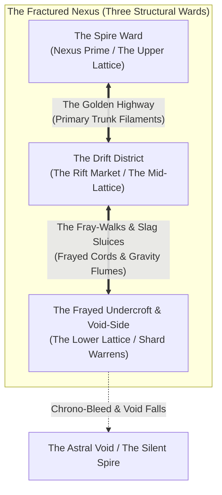
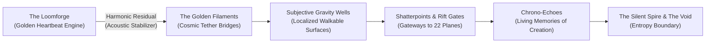

# Map & Geography of the Fractured Nexus (The City of Broken Threads)

![[fractured_nexus_map.jpg]]

> _"In the Nexus, 'up' is merely a suggestion, 'down' is whatever rock you are currently standing upon, and the distance between two worlds is measured not in leagues, but in the tension of a golden cord. Walk softly, keep your eyes off the void, and never step on a frayed filament."_  
> — **Hook, Thread-Cartographer of the Pale Lodge**

* * *

## The Three Great Wards

The Fractured Nexus is not a continuous terrestrial landmass; it is a sprawling, three-dimensional architectural archipelago suspended within the violet expanse of the **Tide of Threads** (the Astral Sea). The city is divided into three major structural tiers or "Wards," interconnected by humming bridges of divine energy known as the **Golden Filaments**.

### 1. [[Project Shattered Loom/Project Shattered Loom/Planes of Existence/The Fractured Nexus/The Fractured Nexus#1. The Spire Ward (Nexus Prime & The Upper Lattice)|The Spire Ward (Nexus Prime & The Upper Lattice)]]
* **Location**: The apex of the Nexus lattice, floating directly above the planar gravitational center.
* **Role**: The civic, diplomatic, and theocratic crown of the Nexus; headquarters of planar order and restoration.
* **Key Landmarks**:
  * **The Nexus Spire**: A crystalline needle of impossibly pure white stone that pierces the astral canopy, existing simultaneously across multiple timelines. It serves as the primary sanctuary and council seat of [[Project Shattered Loom/Project Shattered Loom/Factions/The Pale Lodge/The Pale Lodge|The Pale Lodge]] and the Spindle Lords.
  * **The Loomforge**: A gargantuan, clockwork-ringed engine of gold and platinum that beats with the rhythmic pulse of a dying god. It radiates the **Harmonic Residual**, preventing the drifting shards from colliding or slipping into the void.
  * **The Shimmering Hall (Cathedral of Strands)**: A cathedral formed from thousands of petrified divine threads, where pilgrims come to meditate on the last thoughts of the Prime Weaver, Telara.
  * **The High Archon Promenade**: Sweeping boulevards paved with celestial marble salvaged from destroyed planar realms, lined with the embassies of the Upper Planes.
* **Ruler / Leadership**: The Spindle Lords of [[Project Shattered Loom/Project Shattered Loom/Factions/The Pale Lodge/The Pale Lodge|The Pale Lodge]]—[[Project Shattered Loom/Project Shattered Loom/NPC's/Aelira, the Weftkeeper|Aelira the Weftkeeper]], [[Project Shattered Loom/Project Shattered Loom/NPC's/Kaelthar, the Threadwarden|Kaelthar the Threadwarden]], and [[Project Shattered Loom/Project Shattered Loom/NPC's/The Silent Spool|The Silent Spool]]—alongside the Justiciars of [[Project Shattered Loom/Project Shattered Loom/Factions/The Threadbearers|The Threadbearers]].

### 2. [[Project Shattered Loom/Project Shattered Loom/Planes of Existence/The Fractured Nexus/The Fractured Nexus#2. The Drift District (The Rift Market & The Mid-Lattice)|The Drift District (The Rift Market & The Mid-Lattice)]]
* **Location**: The central equatorial layer of the city, spanning several hundred floating islands tethered by webbed arrays of golden cords.
* **Role**: The roaring commercial, mercenary, and cultural crossroads of the multiverse; the primary trading hub for travelers from all 22 planes.
* **Key Landmarks**:
  * **The Rift Market**: A multi-tiered floating bazaar where market stalls cling to sheer cliff faces and suspended iron platforms. Everything from planar navigation compasses to bottled starlight is traded for gold, memories, or portal keys.
  * **The Frayed End Tavern**: Built within a titanic, solidified "Thread-Knot" that petrified during the Shattering. The renowned tavern boasts a floor of transparent **Clear-Stone** overlooking the endless abyss, strictly maintained as inviolable neutral ground by its multi-limbed construct barkeep, [[Project Shattered Loom/Project Shattered Loom/NPC's/Stitch, the Frayed End Barkeep|Stitch]].
  * **The Ossuary of Rebirth**: A gleaming, sterile clinic of white stone and brass operating out of the White Ribs shard, where the devil-surgeon [[Project Shattered Loom/Project Shattered Loom/Cosmology/Beings of Power/Malphas the Broker|Malphas the Broker]] grafts infernal iron prosthetics and soul-threaded enhancements onto the wounded.
  * **The Mooring Gantries**: Titanic docks of celestial timber and adamantine hooks where astral galleons, solar skiffs, and ethereal barges anchor between planar voyages.
* **Ruler / Leadership**: Officially under Threadbearer patrol, but effectively self-regulated by the merchant syndicates, tavern arbiters, and neutral brokers.

### 3. [[Project Shattered Loom/Project Shattered Loom/Planes of Existence/The Fractured Nexus/The Fractured Nexus#3. The Frayed Undercroft & The Void-Side (The Lower Lattice)|The Frayed Undercroft & The Void-Side (The Lower Lattice)]]
* **Location**: The shadowed, downward-hanging underbelly of the city, tilting dangerously toward the entropic expanse of the Astral Void.
* **Role**: The lawless black market, criminal haven, and frontline against cosmic entropy; sanctuary for outcasts, cultists, and rebels.
* **Key Landmarks**:
  * **The Silent Spire**: A jagged, obsidian needle that hangs downward into the void like a dagger poised over the abyss. It stands as a terrifying monument to the **Silent Spindle** and the Great Betrayal that shattered existence. Black void-bile continually weeps from its foundations.
  * **The Spindle Ring (The Void Pits)**: metallurgic fighting pits and gladiator arenas suspended directly over an entropic sinkhole, where outlaws, disgraced knights, and beasts settle disputes through bloodsport and high-stakes wagers.
  * **The Folding Alleys**: A shifting subterranean labyrinth of crushed masonry and frayed filaments that changes layout each time the Harmonic Residual shifts in pitch.
  * **The Unraveler's Trench**: A shantytown of condemned hulls and slag scrap clinging to the lowest anchoring cables, inhabited by nihilists, deserters, and radical cells of [[Project Shattered Loom/Project Shattered Loom/Factions/The Frayed Ones|The Frayed Ones]] and [[Project Shattered Loom/Project Shattered Loom/Factions/The Cults of Chaos and the Fray|The Cults of Chaos and the Fray]].
* **Ruler / Leadership**: Ruled by underground pit bosses, fence syndicates, and the notorious renegade Riftborn warlord [[Project Shattered Loom/Project Shattered Loom/NPC's/Fray, the Unraveler|Fray the Unraveler]].

* * *

## Satellite Shards, Waystations & Anchor Holds

Beyond the three major wards, the space surrounding the Nexus is dotted with dozens of secondary drifting shards, watchtowers, and independent bastions:

### 1. [[Project Shattered Loom/Project Shattered Loom/Planes of Existence/The Fractured Nexus/The Hearth of the Spoor (Grand Central Lodge)|The Hearth of the Spoor (Grand Central Lodge)]]
* **Location**: A massive granite-and-iron shard anchored by three colossal Golden Filaments, hovering 2 miles off the eastern flank of the Drift District.
* **Population**: ~400 permanent guildmasters, hunters, and salters; surges up to 1,500 during apex bounty seasons.
* **Description**: The supreme multiversal headquarters of [[Project Shattered Loom/Project Shattered Loom/Factions/The Grand Guild of the Iron Spoor|The Grand Guild of the Iron Spoor]]. A vaulted fortress-hall boasting twenty-two monumental hearths, each burning wood harvested from one of the 22 planes. Here, master stalkers exchange Spoor Marks, salt planar monstrosities, and claim apex bounties.
* **Specialty**: Apex monster processing, universal salting tanks, custom trophy-forging under the [[Project Shattered Loom/Project Shattered Loom/Custom Rules/The Interplanar Hunting, Harvesting & Trophy-Crafting Ruleset|Trophy-Crafting Ruleset]], and planar tracking provisions.
* **Notable Feature — The Hearth of Twenty-Two Flames**: An awe-inspiring circular colonnade of burning hearths where seasoned hunters drink spiced marrow-broth and recite tracking lore from worlds that have unraveled.

### 2. Anchor-Hold Seven (The Spindle Guard Bastion)
* **Location**: Northern defensive perimeter, situated atop a monolithic shard of solid meteoric iron.
* **Population**: ~800 (Spindle Guards, Warforged Sentinels, Thread-Knights).
* **Description**: A heavily fortified military fortress that secures the primary thread-tether connecting the Nexus to the Upper Planes. Armed with heavy astral ballistas, void-seeking trebuchets, and anti-teleportation pylons, Anchor-Hold Seven scans incoming planar vessels for void-blight, entropic corruption, and unbonded planar pathogens.
* **Specialty**: Planar quarantine, astral ship repairs, military armaments, and conscription bounties.
* **Notable Feature — The Aegis Pylon**: A towering rod of spun brass that projects an anti-magic barrier over the northern shipping approach during void-storms.

### 3. The Gallow-Glass Anchorage (Skiff Haven)
* **Location**: Floating in the low gravity thermals below the Drift District.
* **Population**: ~650 (Githzerai, Astral Drifters, Plane-Sailors, Rogue Tieflings).
* **Description**: A ramshackle floating dry-dock cobbled together from the splintered hulls of seventy-two wrecked astral galleons and celestial skiffs. It operates outside the jurisdiction of the Spindle Guards, making it the preferred harbor for free-captains, smugglers, and corsairs.
* **Specialty**: Astral hull repairs, uncertified portal keys, void-sail canvas, and black-market fuel crystals.
* **Notable Feature — The Keel-Tavern**: A tavern built inside the inverted hull of a gilded solar bark, where patrons drink suspended in zero-gravity hammock pods.

### 4. The Convergence Cradle (The Paused Basin)
* **Location**: 4 miles northwest of the Spire Ward, drifting in an eddy of shimmering elemental fog.
* **Population**: ~150 (Monks, Hermit Evokers, Planar Scholars).
* **Description**: An ancient holy site composed of four colossal concentric rings of marble, obsidian, basalt, and glacier-ice that are frozen mid-rotation. As detailed in [[Project Shattered Loom/Project Shattered Loom/Sessions/Session 2 - The Silent Singularity|Session 2 — The Silent Singularity]], the Cradle is an architectural marvel where overlapping elemental energies (Fire, Water, Air, Earth) remain paused in eternal equilibrium.
* **Specialty**: Elemental alignment rituals, shard stabilization, meditation chambers, and Leyline calibration.
* **Notable Feature — The Dais of Alignment**: A central altar of white marble where Loom Shards can be attuned to open permanent Shatterpoints into the Prime planes.

### 5. Skein-Hollow (The Hermit's Weft)
* **Location**: Far eastern fringe, obscured within dense clouds of violet astral vapor.
* **Population**: ~90 (Ancient Eladrin, Shadar-kai Weavers, Ascetics).
* **Description**: A serene, silent cluster of weeping-willow-covered stone shards connected by gossamer threads so fine they are invisible to normal sight. Ascetics here take vows of utter silence, spending centuries listening to the faint vibrations of the Loom to record prophecies of cosmic restoration or final collapse.
* **Specialty**: Divination scrolls, memory-thread embroidery, silence-enchanted cloaks, and celestial meditation.
* **Notable Feature — The Well of Resonance**: A natural pool of glowing liquid light that reflects glimpses of timelines that were erased during the Shattering.

### 6. The Smuggler's Notch (The Folding Alley Outpost)
* **Location**: Subterranean pocket shard hidden between the Spire foundations and the Void-Side.
* **Population**: ~300 (Changelings, Kenku, Shadow-Thieves, Disgraced Mages).
* **Description**: A hidden shantytown built inside an unstable reality-pocket. The entire outpost phases in and out of tangible existence in sync with the micro-shifts of the Song of the Loom. If a visitor does not know the exact acoustic frequency required to phase into the Notch, they will walk through empty air.
* **Specialty**: Counterfeit documents, stolen soul-marks, portal lock-breakers, and untraceable lodgings.
* **Notable Feature — The Tone-Gate**: A chime-based lockbox that requires singing three precise resonant chords to make the entrance staircase solidify.

### 7. The Bleeding Needle (Outpost of the Silent Spire)
* **Location**: Clinging like a barnacle to the jagged base of the Silent Spire itself, suspended over the infinite abyss.
* **Population**: ~220 (Cultists of the Broken Thread, Entropic Nihilists, Void-Warriors).
* **Description**: An austere, fortress-monastery carved from obsidian and black iron. The members of the Entropic Hand gather here to bathe in the black void-bile leaking from the Spire's roots. They believe that by meditating in the Spire's shadow, they can accelerate the unraveling of existence and free all souls from divine predestination.
* **Specialty**: Void-iron blade coating, entropic poison brewing, unweaving rituals, and cursed talismans.
* **Notable Feature — The Weeping Maw**: A vertical fissure at the Spire's core that emits a terrifying acoustic shriek whenever a golden filament snaps somewhere in the multiverse.

### 8. [[Project Shattered Loom/Project Shattered Loom/Planes of Existence/The Fractured Nexus/The Sanctorum of the Blind Needle (Grand Chapterhouse Lodge)|The Sanctorum of the Blind Needle (Eldritch Hunting Lodge)]]
* **Location**: Subterranean lead-lined vaults carved into the basalt bedrock of the Spire Ward, directly beneath the High Archon Promenade.
* **Population**: ~350 (Blind Inquisitors, Void-Surgeons, Kalashtar Seers, Patient Harriers).
* **Description**: The supreme multiversal chapterhouse, sanatorium, and eldritch dissection lodge of [[Project Shattered Loom/Project Shattered Loom/Factions/The Order of the Severed Eye|The Order of the Severed Eye]]. Operating in lead-shielded secrecy beneath the Spire, its chambers feature Euclidean dissection vaults run by [[Project Shattered Loom/Project Shattered Loom/NPC's/Doctor Vaelen Malcor, Void-Surgeon|Doctor Vaelen Malcor]], cold-salt lucidity recovery baths, and holding pens for live cosmic horrors under the command of [[Project Shattered Loom/Project Shattered Loom/NPC's/Grand Inquisitor Sylas the Blind|Grand Inquisitor Sylas the Blind]].
* **Specialty**: Eldritch horror autopsies, Lucidity restoration, non-Euclidean harvesting, Void-Relic forging, and anti-psionic cognitive shielding.
* **Notable Feature — The Lead Vault of Thousand Needles**: A massive vault lined with lead and cold-iron where volatile paradox cores are neutralized in axiomatic mercury baths.

* * *

## Special Features & Planar Wonders

### 1. The Loomforge
* **Description**: A colossal construct of divine brass, gold, and astral crystal that hangs suspended at the vertical and metaphysical center of the Nexus. It beats like an immense clockwork heart, radiating waves of golden force that keep the city's shattered islands locked in stable orbital resonance.
* **Planar Mechanics**: The Loomforge produces the constant, soothing drone known as the **Harmonic Residual**. Characters within 1 mile of the Loomforge who take a short rest regain the maximum number of hit points from any spent Hit Dice, and spellcasters recover one expended spell slot of 2nd level or lower.

### 2. The Tide of Threads (The Astral Sea)
* **Description**: The infinite, violet-hued void that surrounds the Nexus. It is not empty space; it is a churning sea of latent divine energy, astral currents, and shredded timeline filaments.
* **Planar Mechanics**: A creature that falls from an island does not accelerate infinitely. Instead, after falling 300 feet, they enter the buoyant current of the Tide. They drift weightlessly (fly speed equal to their walking speed) but must make a **DC 15 Wisdom saving throw every hour** or suffer 1 level of **Planar Dissolution** (identical to exhaustion), as their physical form begins to unravel into loose threads of starlight.

### 3. The Golden Filaments & Thread-Walks
* **Description**: Translucent, glowing cords of spun divine essence ranging from the thickness of a ship's hawser to massive highways twenty feet wide. They physically lash the drifting islands together.
* **Planar Mechanics**: The filaments can support immense weight without buckling. Walking along a primary filament is treated as normal terrain. Walking along a secondary or frayed cord requires a **DC 12 Dexterity (Acrobatics) check**; failure causes the creature to slip and dangle by their hands. Cutting a Golden Filament requires dealing 50 slashing damage (AC 18, immunity to bludgeoning, piercing, and all magic except force damage). Severing a filament triggers an immediate **Planar Shockwave** (20-foot radius, 4d10 force damage and DC 16 Con save or stunned for 1 round).

### 4. The Harmonic Residual (Song of the Loom)
* **Description**: The omnipresent hum that vibrates in the teeth and bones of every being within the Nexus. It is the acoustic echo of reality being held together under immense tension.
* **Planar Mechanics**: The pitch of the Residual shifts dynamically:
  * *High-Pitched Ringing*: Indicates a Shatterpoint is opening nearby or an extraplanar entity is breaching the wards. Mages have advantage on Arcana checks to detect portals.
  * *Dissonant Screech*: Indicates a filament has snapped or a void-aberration has invaded. Animals become agitated, and concentration checks for spells have disadvantage.
  * *Sudden Silence (The Dead Drop)*: The most terrifying event in the Nexus. All magic items are suppressed for 1 round, and all living creatures must succeed on a **DC 14 Wisdom saving throw** or become frightened for 1 minute as cosmic dread overwhelms their minds.

### 5. Subjective & Multi-Axis Gravity
* **Description**: Gravity in the Nexus is not determined by a single planar floor; it is strictly localized to the mass of each individual floating island or structure.
* **Planar Mechanics**: "Down" is oriented toward the nearest solid surface with a diameter of 10 feet or greater. Travelers can walk horizontally along the side of a tower, or upside-down beneath a floating plaza, provided their boots remain within 5 feet of the surface. Transitioning between two perpendicular or inverted surfaces requires spending 5 feet of movement and succeeding on a **DC 10 Dexterity (Acrobatics) check** to reorient one's inner ear without falling prone.

### 6. Shatterpoints & Conceptual Gateways
* **Description**: Portals in the Nexus do not require stone archways; they exist as tears in reality that open in everyday surroundings—a door that opens into a sunny bakery on one turn and the screaming magma storms of Baator on the next.
* **Planar Mechanics**: Shatterpoints rarely open with traditional keys. Instead, they require **Conceptual or Emotional Keys**:
  * *Gateway to the Plane of Avarice*: Requires offering a gold coin that was stolen from a dying comrade.
  * *Gateway to the Plane of Eternal Craft*: Requires presenting an item forged by the traveler's own hands that has never been used.
  * *Gateway to the Plane of Wild Balance*: Requires presenting a live flower that bloomed under twin moons.
  * *Gateway to the Shadowfell*: Requires shedding a tear of genuine grief over an irreplaceable loss.

### 7. Chrono-Echoes of the Great Betrayal
* **Description**: In certain localized pockets of the Nexus—especially near the Silent Spire and the Loomforge—time "stutters," replaying fragments of the ancient cataclysm when the Silent Spindle snapped the Thread of Infinite Potential.
* **Planar Mechanics**: When entering a Chrono-Echo zone, characters must succeed on a **DC 15 Charisma saving throw** or be pulled into a brief temporal vision (see [[Project Shattered Loom/Project Shattered Loom/Sessions/Session 2 - The Silent Singularity#The Revelation (Echo of the Spire)|Session 2 Vision]]). While in the vision, the creature is incapacitated in the real world for 1d4 rounds, but gains deep metaphysical insight (granting advantage on all Arcana, History, and Religion checks for the next 24 hours).

* * *

## Travel Routes & Major Corridors

Because the city consists of three-dimensional drifting islands, transit relies on stabilized Thread-Walks, cable-cars, and aerial ferry-skiffs:

| Route Name | From / To | Distance / Travel Time | Hazards / Navigational Features |
|---|---|---|---|
| **The Golden Highway** | Spire Ward $\rightarrow$ Drift District | 1.5 miles (30 mins on foot, 10 mins by Cable-Car) | Heavy pedestrian traffic, Spindle Guard checkpoints, vertigo winds |
| **The Spool Traverse** | Drift District $\rightarrow$ Hearth of the Spoor | 2 miles (45 mins via Suspension Tram / 15 mins by Skiff) | Gusting astral crosswinds, filament vibration tremors, stray thread-mites |
| **The Silent Descent** | Drift District $\rightarrow$ The Void-Side / Silent Spire | 2.5 miles (1 hour down spiral stairs / 20 mins by Gravity Flume) | Rapid gravity shifts, black void-bile slicks, Entropic Hand ambushes |
| **The Skiff Corridor** | Gallow-Glass Anchorage $\rightarrow$ Anchor-Hold Seven | 3.5 miles (25 mins by Solar Skiff / Astral Barge) | Void-current turbulence, rogue starlight elementals, pirate spotters |
| **The Pilgrims' Path** | Spire Ward $\rightarrow$ The Convergence Cradle | 4 miles (1.5 hours on foot along tether-bridges) | Paused temporal rifts, freezing ghost-steam, elemental cinderspawn |
| **The Whispering Weft** | Drift District $\rightarrow$ Skein-Hollow | 5 miles (2 hours by Gossamer Ferry) | Extremely narrow threads, sensory silence zones, blinding astral fog |
| **The Unbound Run** | The Frayed End $\rightarrow$ Smuggler's Notch | 1 mile (Variable; 15 mins to 2 hours) | Shifting reality alleys, pitch-dependent doors, cutpurse traps |
| **The Blind Stair** | Spire Ward Promenade $\rightarrow$ Sanctorum Vaults | 0.2 miles (10 mins down lead-lined spiral stair) | Disorienting psychic dampening, cold-iron gravity doors, silence wards |

* * *

## Related Links

* [[Project Shattered Loom/Project Shattered Loom/Planes of Existence/The Fractured Nexus/The Fractured Nexus|The Fractured Nexus Gazetteer]]
* [[Project Shattered Loom/Project Shattered Loom/Planes of Existence/The Fractured Nexus/The Hearth of the Spoor (Grand Central Lodge)|The Hearth of the Spoor (Grand Central Lodge)]]
* [[Project Shattered Loom/Project Shattered Loom/Planes of Existence/The Fractured Nexus/The Sanctorum of the Blind Needle (Grand Chapterhouse Lodge)|The Sanctorum of the Blind Needle (Eldritch Hunting Lodge)]]
* [[Project Shattered Loom/Project Shattered Loom/Factions/The Order of the Severed Eye|The Order of the Severed Eye]]
* [[Project Shattered Loom/Project Shattered Loom/Custom Rules/The Eldritch Horror Hunting & Sanity-Harvesting Ruleset|The Eldritch Horror Hunting & Sanity-Harvesting Ruleset]]
* [[Project Shattered Loom/Project Shattered Loom/Factions/The Pale Lodge/The Pale Lodge|The Pale Lodge]]
* [[Project Shattered Loom/Project Shattered Loom/Factions/The Threadbearers|The Threadbearers]]
* [[Project Shattered Loom/Project Shattered Loom/Factions/The Frayed Ones|The Frayed Ones]]
* [[Project Shattered Loom/Project Shattered Loom/Cosmology/Beings of Power/The Loom Warden|The Loom Warden]]
* [[Project Shattered Loom/Project Shattered Loom/Cosmology/Beings of Power/Malphas the Broker|Malphas the Broker]]
* [[Project Shattered Loom/Project Shattered Loom/NPC's/Grand Inquisitor Sylas the Blind|Grand Inquisitor Sylas the Blind]]
* [[Project Shattered Loom/Project Shattered Loom/NPC's/Doctor Vaelen Malcor, Void-Surgeon|Doctor Vaelen Malcor, Void-Surgeon]]
* [[Project Shattered Loom/Project Shattered Loom/NPC's/Stitch, the Frayed End Barkeep|Stitch, the Frayed End Barkeep]]
* [[Project Shattered Loom/Project Shattered Loom/NPC's/Key NPCs - The Fractured Nexus|Key NPCs - The Fractured Nexus]]
* [[Project Shattered Loom/Project Shattered Loom/Sessions/Session 2 - The Silent Singularity|Session 2 — The Silent Singularity]]

