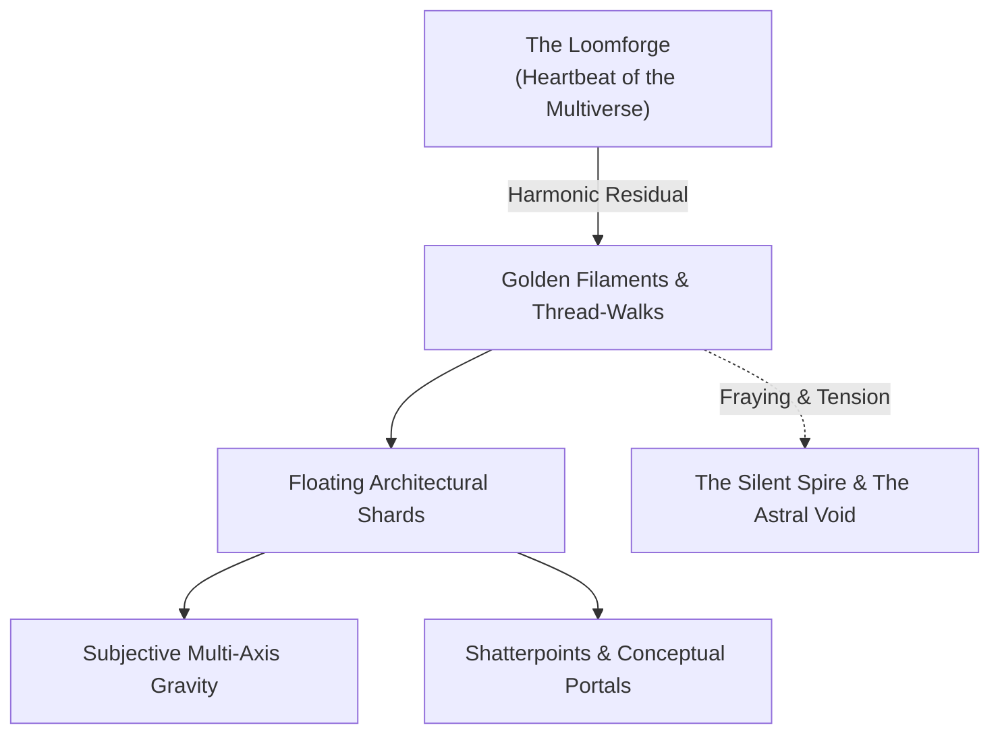
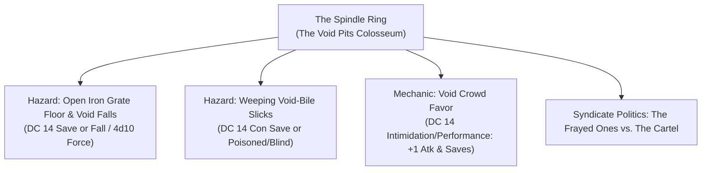

# The Fractured Nexus (The City of Broken Threads)

![[fractured_nexus_map.jpg]]

> **Cartographic Atlas**: See full geography, travel routes, floating wards, and regional details in [[Project Shattered Loom/Project Shattered Loom/Planes of Existence/The Fractured Nexus/Map of the Fractured Nexus|Map & Geography of the Fractured Nexus]].

* * *

### **[Lore Dump: Read-Aloud for Players]**

> *"As you step through the flickering threshold, the first thing that hits you isn’t the sight, but the sound. It is a low, vibrating hum that resonates in your teeth—the **Song of the Loom**. It is the sound of reality being held together by a thread, literally.*
>
> *You stand upon a shard of white celestial marble, once part of an emperor's palace in a world long since reduced to stardust. It floats in a vast, violet-hued infinity known as the **Tide of Threads**. Looking 'up' or 'down' offers no terrestrial comfort; there is only the shimmering expanse of the Astral Sea, where distant planar realms drift like dying embers.*
>
> *Connecting these floating islands of stone, obsidian, ironwood, and brass are the **Golden Filaments**—glowing, translucent bridges of divine energy. They are the living remnants of Telara’s Loom, the prime goddess who wove the multiverse before the Great Betrayal. Some threads are thick as aqueducts and steady, pulsing with a rhythmic golden heartbeat; others are frayed, sparking, and lashing wildly at the empty air.*
>
> *This is the **Fractured Nexus**, the city of broken threads. Here, a tavern is built inside a petrified knot of divine power, a sprawling market bazaar hangs suspended between a fragment of the Elemental Planes and a jagged spire from the Shadowfell, and gravity pulls toward whatever surface your boots touch.*
>
> *You see **Riftborn**—beings formed from solidified starlight and living geometric light—gliding silently along the lattice. You see planar corsairs, grizzled monster hunters, aasimar ambassadors, and tiefling smugglers, their shadows moving at slightly different speeds, all converging at this impossible crossroads.*
>
> *In the center of it all, the **Loomforge** beats like a titanic mechanical heart, casting a golden rhythm across the city. But if you look toward the shadowed abyss below, you see the **Silent Spire**—a dark, jagged needle pointing toward the emptiness, a weeping monument to the **Silent Spindle** and the betrayal that broke existence.*
>
> *In the Nexus, every door is a gateway, every stranger is a survivor, and every step is a choice between restoration... or unraveling."*

* * *

### **[The Player’s Cheat Sheet: Common Knowledge]**

* **Subjective Gravity**: Do not fear plummeting off the edge of the city into bottomless infinity. You are pulled toward the nearest solid surface of sufficient mass. However, the thread-walks between floating shards are narrow, high-altitude tightropes—mind your footing.
* **The Harmonic Residual**: That constant, resonant hum vibrating in your jaw? That is the Loom. If the pitch rises to a sharp crystalline ringing, a portal or planar rift is opening nearby. If it turns dissonant and screeching, a filament has snapped. If it cuts out entirely... drop everything and run.
* **The Peacekeepers (The Riftborn)**: The geometric beings of starlight do not care about mortal laws, local titles, or sacks of gold. They care solely for the integrity of the threads. Damaging a golden filament or attempting to force an unstable portal will cause them to unmake you with geometric force.
* **The Currency of Secrets**: While gold and platinum coins are accepted, seasoned merchants in the **Rift Market** prefer portal keys, bottled memories, authentic planar maps, or binding favors. In a city of infinite doors, true knowledge is the only stable currency.
* **Neutral Ground Sanctity**: By unspoken planar consensus (and enforced by the lethal, multi-limbed construct barkeep [[Project Shattered Loom/Project Shattered Loom/NPC's/Stitch, the Frayed End Barkeep|Stitch]]), **The Frayed End Tavern** is absolute neutral ground. Whether you are a solar from Mount Celestia, a pit fiend from Baator, or a mortal adventurer, blades remain sheathed while you drink the *Planar Bleed*.

* * *

## General Overview

The **Fractured Nexus** is the metaphysical crossroad and beating, stuttering heart of the shattered multiverse. It is not a planet, continent, or standard plane, but an immense, three-dimensional architectural lattice composed of floating planetary shards suspended within the **Tide of Threads** (the Astral Sea). When the Prime Weaver **Telara** was betrayed and her cosmic Loom shattered, the physical realms of the cosmos tore apart. The fragments that were caught in the primary web of divine threads coalesced here, held in delicate orbital tension by the **Loomforge**.

Today, the Nexus serves as the primary waystation, refugee hub, diplomatic neutral zone, and trading floor for the entire multiverse. Over two dozen planar civilizations meet upon its suspended bridges. It is a realm of staggering architectural diversity: an ancient elven library might be bolted to a smoking dwarven foundry from the [[Project Shattered Loom/Project Shattered Loom/Planes of Existence/Outer Planes; Divine Shards/Plane of Eternal Craft/Plane of Eternal Craft Forgeflame Expanse|Plane of Eternal Craft]], tethered by cables of spun gold to a gothic spire salvaged from the Shadowfell.

Yet for all its bustling wonder, the Nexus is inherently unstable. It borders the bottomless **Astral Void** and is haunted by the looming shadow of the **Silent Spire**—the site of the primordial betrayal. Municipal governance is fiercely contested: the zealous restorationists of [[Project Shattered Loom/Project Shattered Loom/Factions/The Threadbearers|The Threadbearers]] and [[Project Shattered Loom/Project Shattered Loom/Factions/The Pale Lodge/The Pale Lodge|The Pale Lodge]] struggle to enforce order and reweave the threads, while the anarchist rebels of [[Project Shattered Loom/Project Shattered Loom/Factions/The Frayed Ones|The Frayed Ones]] celebrate the Shattering as cosmic liberation, and the nihilists of the Entropic Hand actively seek to sever the remaining cords.

* * *

## Key Planar Features

1. **The Loomforge**:
   * Suspended at the vertical and metaphysical epicenter of the Nexus, the **Loomforge** is a colossal divine engine of gold, platinum, and astral crystals. It turns in perpetual, rhythmic motion, mimicking the heartbeat of the fallen goddess Telara. Its vibrations keep the floating islands from crashing into each other or tumbling into the Astral Void.
2. **The Golden Filaments**:
   * Massive, translucent cables of crystallized divine force that physically lash the drifting islands together. These threads hum with radiant energy and serve as the city's pedestrian expressways (known as "Thread-Walks"). They can support immense weight, but when severing tools or void-entropy touch them, they lash out violently.
3. **The Tide of Threads (The Astral Sea)**:
   * The infinite violet expanse surrounding the city. Gravity dissolves into weightless buoyant astral current 300 feet below the lowest shards. Those who drift too long in the Tide without anchoring risk **Planar Dissolution**, slowly disintegrating into starlight.
4. **The Harmonic Residual (Song of the Loom)**:
   * The omnipresent acoustic hum that permeates every corner of the city. Mages, navigators, and street urchins read its subtle shifts in pitch like a barometer to predict portal openings, void-squalls, and thread failures.
5. **Subjective & Multi-Axis Gravity**:
   * Gravity is strictly localized to the mass of each shard. Walking along the side of a tower or hanging upside-down from an archway is common practice. Moving between non-parallel surfaces requires only a momentary mental reorientation.
6. **Shatterpoints & Abstract Keys**:
   * Gateways in the Nexus open without formal arches—in cellar doorways, alleyway puddles, or curtained archways. Accessing specific planes requires "Abstract Keys" (emotional memories, specific items of betrayal, or crafted masterpieces) rather than physical iron keys.
7. **The Riftborn Guardians**:
   * Native extraplanar custodians made of hardened starlight and floating geometric fractals. They silently patrol the filaments, maintaining the tension of the weave and annihilating anyone who attempts to sabotage the city's structural anchors.

* * *

## 1. The Spire Ward (Nexus Prime & The Upper Lattice)

The **Spire Ward** (often called **Nexus Prime** or **The Weft**) is the grand architectural apex of the city. Floating atop the highest gravitational currents, this district is constructed from gleaming white marble, alabaster stone, and gilded brass salvaged from celestial realms and ancient utopian empires. The streets are pristine, wide promenades bordered by glowing trees of silver leaf that feed on astral light.

This is the seat of high law, diplomacy, and the grand campaign to restore the shattered cosmos. The district is governed by the Spindle Lords of [[Project Shattered Loom/Project Shattered Loom/Factions/The Pale Lodge/The Pale Lodge|The Pale Lodge]] and patrolled by the armored paladins and justiciars of [[Project Shattered Loom/Project Shattered Loom/Factions/The Threadbearers|The Threadbearers]]. Here, planar embassies from Mount Celestia, Baator, the Feywild, and the City of Brass negotiate fragile non-aggression pacts, while arch-arcanists labor to decipher the master blueprint of existence.

* * *

### Key Features

1. **The Nexus Spire**:
   * A towering needle of crystalline white stone that pierces the astral heavens, existing simultaneously in multiple planar timelines. It serves as the sovereign headquarters of the Pale Lodge and houses the grand chambers of the **Spindle Lords**—[[Project Shattered Loom/Project Shattered Loom/NPC's/Aelira, the Weftkeeper|Aelira the Weftkeeper]], [[Project Shattered Loom/Project Shattered Loom/NPC's/Kaelthar, the Threadwarden|Kaelthar the Threadwarden]], and the enigmatic [[Project Shattered Loom/Project Shattered Loom/NPC's/The Silent Spool|The Silent Spool]].
   * *Lore*: The Spire is built upon the very foundation where Telara sat when she cast the first warp-threads of creation. Its lower vaults contain the legendary **Needle of Eternity**, a divine implement capable of mending planar breaches.
2. **The Loomforge**:
   * The titanic divine clockwork heart of the city. Supported by four gargantuan gimbals of celestial adamantine, the forge spins endlessly, emitting a rhythmic golden pulse that synchronizes the subjective gravity of all surrounding wards.
   * *Lore*: Legend holds that should the Loomforge ever cease its turning, the Golden Filaments will instantly lose their tensile strength, casting the entire city into the bottomless void of the Astral Sea.
3. **The Shimmering Hall (Cathedral of Strands)**:
   * A breathtaking cathedral constructed entirely from thousands of petrified, glowing filaments of divine light. Pilgrims, mystics, and paladins travel across planes to kneel within its luminous nave and listen to the **Loom-Echoes**—whispers believed to be the final thoughts of Telara before the Great Betrayal.
4. **The High Archon Promenade**:
   * A grand, suspended avenue paved with smooth celestial quartz that links the Nexus Spire to the foreign embassies. Flanked by 60-foot statues of the ancient Weaver Saints holding aloft burning lanterns of perpetual dawn.
5. **The Sanctorum of the Blind Needle**:
   * The supreme multiversal chapterhouse, sanatorium, and eldritch hunting lodge of [[Project Shattered Loom/Project Shattered Loom/Factions/The Order of the Severed Eye|The Order of the Severed Eye]]. Located within deep, lead-shielded vaults carved into the bedrock beneath the Spire Ward, this austere sanctuary houses the dissection amphitheaters of Chief Anatomist [[Project Shattered Loom/Project Shattered Loom/NPC's/Doctor Vaelen Malcor, Void-Surgeon|Doctor Vaelen Malcor]] and the command of [[Project Shattered Loom/Project Shattered Loom/NPC's/Grand Inquisitor Sylas the Blind|Grand Inquisitor Sylas the Blind]], serving as the multiverse's primary hub for tracking and dissecting Far Realm horrors (see full dossier in [[Project Shattered Loom/Project Shattered Loom/Planes of Existence/The Fractured Nexus/The Sanctorum of the Blind Needle (Grand Chapterhouse Lodge)|The Sanctorum of the Blind Needle]]).

* * *

### Inhabitants

* **Spindle Lords & Weavers**: The archmages, diplomats, and military tacticians of the Pale Lodge who direct multiversal stabilization.
* **Threadbearer Justiciars**: Zealous lawkeepers dressed in polished silver armor with gold-embroidered tabards, dedicated to maintaining absolute order.
* **Blindfolded Inquisitors & Void-Surgeons**: The grim aberration hunters, seers, and surgeons of the Order of the Severed Eye operating out of the Sanctorum vaults.
* **Planar Ambassadors**: Dignitaries, envoys, and high arbiters from across the 22 planes, navigating intricate political webs.
* **Riftborn Custodians**: Silent, luminous geometric entities that glide through the cathedral vaults, polishing filaments and recalibrating the Loomforge.

* * *

### Adventure Hooks

1. **The Stuttering Heartbeat**: The Loomforge skips three beats during a civic festival, causing gravity across the Spire Ward to flip upside down for sixty seconds. The party is commissioned by [[Project Shattered Loom/Project Shattered Loom/NPC's/Kaelthar, the Threadwarden|Threadwarden Kaelthar]] to descend into the inner gearbox of the forge and eliminate a nesting cluster of planar chronovores.
2. **The Archon's Blackmail**: An ambassador from the Court of Stars is found assassinated inside the sealed Embassy of Dawn, their soul-thread excised. The Threadbearers suspect an inside job, and the party is hired as neutral investigators before a full-scale planar diplomatic rupture erupts.
3. **Echoes of the Heresy**: Pilgrims in the Shimmering Hall begin hearing a horrifying new voice echoing through the golden filaments—the cold, mechanical voice of the **Silent Spindle**, claiming that Telara's blueprint was a cosmic prison. The party must locate the psychic conduit poisoning the cathedral's resonance.

* * *

### Shops of the Spire Ward

### **1. The Thread-Bound Archive**

**Specialty**: Rare Planar Scrolls, Lost Codices, and Shard-Mapping Tomes  
**Location**: Perched atop the west terrace of the Nexus Spire, overlooking the Loomforge.  
**Proprietor**: **The Chronicler**, a timeless entity whose body is composed entirely of floating illuminated vellum manuscripts bound together by golden chord.  
**Description**: The air inside the Archive smells of aged leather, dried cedar, and ozone. Thousands of scrolls and codices hover in orderly orbits around a central spindle of pure light. The Chronicler communicates by rustling their parchment pages to display written sentences, speaking aloud only when pronouncing words of cosmic power.  

**Notable Items for Sale (D&D 5e)**:
* **Spell Scroll of Banishment** (*Rare*, 500 gp): Scribes Telara’s formula for severing an intruder's local planar thread.
* **Chime of Opening** (*Rare*, 1,500 gp): Forged from celestial brass; its resonant frequency aligns with the Song of the Loom, unlocking even extraplanar dimensional seals.
* **Gem of Seeing** (*Rare*, 2,000 gp): A cut sapphire that reveals "Ghost Threads"—the invisible architectural scaffolding of the multiverse and hidden Shatterpoints.
* **Planar Compass** (*Custom Magic Item, Rare*, 1,200 gp): Functions as a navigator's tool. While in the Nexus or Astral Sea, grants advantage on Survival and Arcana checks to locate specific Shatterpoints or planar tethers.
* **Tome of Clear Thought** (*Very Rare*, 25,000 gp): A collection of Telara’s prime theorems on planar geometry. Reading it increases Intelligence by 2 and maximum score by 2.

**Unique Services**:
* **Scroll Transcription & Translation**: The Chronicler can translate languages from dead worlds or transcribe rare planar spells for 100 gp per spell level.
* **Timeline Verification**: The Chronicler can examine an artifact and determine which branch of history or fallen plane it originated from (fee: 250 gp).

**Rumor**: The Chronicler allegedly holds a surviving scrap of the **Telarian Blueprint** detailing the lost 23rd plane that was utterly unspun during the cataclysm.

* * *

### **2. The Gossamer Gallery**

**Specialty**: Historical Curiosities, World-Fragments, and Chrono-Artifacts  
**Location**: The High Archon Promenade, nestled between the Baatorian and Arborean consulates.  
**Proprietor**: [[Project Shattered Loom/Project Shattered Loom/NPC's/Valerius the Unbound|Valerius the Unbound]], an ancient high elf whose shadow visibly lags two seconds behind his physical movements.  
**Description**: An elegant, museum-like boutique with polished obsidian floors and crystalline pedestals lit by iridescent fairy-fire. Each item on display is an authentic relic salvaged from a world that unraveled during the Shattering. Valerius treats customers with haughty courtesy, narrating the tragedy of each civilization whose bones he sells.  

**Notable Items for Sale (D&D 5e)**:
* **Driftglobe of the Loom** (*Uncommon*, 750 gp): A floating orb of crystallized golden thread that sheds bright daylight and can hover above its owner across multi-axis gravity planes.
* **Periapt of Proof against Poison** (*Rare*, 2,500 gp): Carved from the heartwood of a petrified world-tree; renders the wearer immune to planar poisons and void-bile.
* **Helm of Telepathy** (*Rare*, 3,000 gp): Fashioned from silver mesh, allowing instant telepathic contact with Riftborn and entities that communicate through geometric vibrations.
* **Deck of Planar Illusions** (*Rare*, 1,800 gp): A deck of 34 cards; when thrown, creates a vivid, sensory illusion of a landscape and denizens from one of the shattered planes.
* **Tethered Sending Stones** (*Uncommon Pair*, 500 gp): Forged from twin fragments of the same petrified Loom-Knot, enabling instantaneous communication across different planes of existence.

**Unique Services**:
* **Relic Authentication & Appraisals**: Valerius can accurately identify the age, plane of origin, and curse status of any ancient artifact for 150 gp.
* **Memory Extraction**: Using silver extraction needles, Valerius can harvest a specific memory from a willing creature and bottle it in crystal (fee: 300 gp).

**Rumor**: Valerius is secretly searching for a stolen **Memory Vial** containing the architectural plans of a destroyed star-system, believed to have been taken by the Frayed Ones.

* * *

### **3. Iron & Aether (The Interplanar Armory)**

**Specialty**: Planar Weaponry, Astral Steel Armor, and Force-Tethered Shields  
**Location**: The High Spire Bastion Plaza, adjacent to the Spindle Guard barracks.  
**Proprietors**: **Hulda Ironfoot** (a practical mountain dwarf smith from Metallos) and **Xerxes** (a flamboyant Noble Djinni armorer).  
**Description**: A blazing forge powered by conduits channeling golden heat directly from the Loomforge. The steady clang of Hulda's adamantine hammer alternates with Xerxes’ shimmering whirlwinds as they fuse raw planar metals with celestial wind and starlight. Rows of razor-sharp blades and burnished breastplates line the granite walls.  

**Notable Items for Sale (D&D 5e)**:
* **Mithral Plate / Half Plate** (*Uncommon*, 1,200 gp / 800 gp): Featherweight and flexible, allowing effortless movement along vertical thread-walks without stealth penalties.
* **Vicious Shatter-Blade (Any Sword or Axe)** (*Rare*, 1,500 gp): Forged from meteoric steel infused with planar shock-crystals. Deals an extra 7 damage on critical hits as it ruptures the target’s local weave.
* **Shield of Missile Attraction (Woven Variant)** (*Rare*, 2,000 gp): Inlaid with localized gravitational filaments that redirect incoming projectile attacks away from allies toward the shield’s hardened boss.
* **Winged Boots of the Weft** (*Uncommon*, 1,000 gp): Fashioned from phase-silk and gold wire; grants a flying speed equal to walking speed for up to 4 hours daily.
* **Sun Blade (Loom-Edge)** (*Rare*, 5,000 gp): A hilt carved from Spire marble that ignites into a blade of pure golden radiant thread, devastating to shadows, undead, and void aberrations.

**Unique Services**:
* **Thread-Tether Forging**: For 250 gp, Hulda can weave an elastic filament into any weapon, allowing the wielder to recall it to their hand as a bonus action (range 30 ft.).
* **Astral Tempering**: Xerxes can infuse an existing suit of armor with a permanent +1 bonus against force and psychic damage for 800 gp and an Astral Essence Core.

**Rumor**: Hulda and Xerxes are privately forging a weapon commissioned by a Spindle Lord designed specifically to kill a god if their thread turns entropic.

* * *

### **4. The Warp & Weft (Planar Survival Supplies)**

**Specialty**: Navigational Ropes, Stabilizing Oils, and Rift-Trekking Gear  
**Location**: Lower tier of the Spire Ward, overlooking the grand cable-car terminus to the Drift District.  
**Proprietor**: [[Project Shattered Loom/Project Shattered Loom/NPC's/Knot|Knot]], a dry-witted Riftborn whose faceted starlight body shifts colors when amused or annoyed.  
**Description**: The shop smells of ozone, chalk, and cured leather. Shelves twist in three dimensions across the ceiling and walls, loaded with coils of shimmering rope, brass carabiners, and sealed jars of luminescent powder. Knot hovers behind a stone desk, bantering with customers in a deadpan drone while manipulating three tasks simultaneously with floating geometric hands.  

**Notable Items for Sale (D&D 5e)**:
* **Oil of Etherealness** (*Rare*, 400 gp): Vital for slipping through solid obstacles during planar collisions or escaping pocket dimensions.
* **Rope of Climbing (Golden Filament)** (*Uncommon*, 500 gp): Woven from shed threads of the Loom; automatically anchors itself securely to any solid surface, supporting up to 4,000 lbs.
* **Lantern of Revealing (Rift-Finder)** (*Uncommon*, 600 gp): Illuminates invisible creatures and causes nearby hidden Shatterpoints to glow in distinct colors corresponding to their destination plane.
* **Potion of Resistance (Force)** (*Rare*, 350 gp): Shimmering silver draught that protects against raw Loom discharges, singularity pulses, and eldritch blasts.
* **Gravity Climber’s Harness** (*Custom Adventuring Gear*, 150 gp): Grants advantage on Athletics and Acrobatics checks made to scale vertical or inverted surfaces in subjective gravity environments.

**Unique Services**:
* **Portal Key Calibration**: Knot can examine an abstract portal key and tune it to ensure it opens the intended doorway rather than a lethal demiplane (cost: 75 gp).
* **Filament Splicing**: Repairs severed ropes, enchanted cords, or climbing gear using liquid golden binder (cost: 50 gp).

**Rumor**: Knot maintains a secret ledger tracking every unregistered traveler who has crossed into the Nexus over the past century—and sells copies to the highest bidder.

* * *

### **5. The Resonant Orrery**

**Specialty**: Planar Chronometers, Astro-Lenses, and Temporal Focuses  
**Location**: The Astronavigation Dome, perched on the highest cantilevered terrace of the Spire Ward.  
**Proprietor**: **Astro-chronomancer Oris**, a four-armed Vedalken scholar wearing multi-layered brass spectacles and silk robes.  
**Description**: A breathtaking domed chamber housing a three-story brass orrery that accurately models the rotational positions of all 22 planes relative to the Nexus. Spheres of obsidian, ruby, and glass spin silently on interlocking arms, humming in time with the Loomforge.  

**Notable Items for Sale (D&D 5e)**:
* **Chrono-Pocket Watch** (*Uncommon*, 250 gp): A self-winding brass timepiece that simultaneously tracks local Nexus time, Material Plane time, and the subjective time of up to three linked planes.
* **Lens of the Shifting Sky** (*Rare*, 1,500 gp): A hand-held magnifying glass that reveals planar convergence storms up to 24 hours before they manifest.
* **Hourglass of the Paused Step** (*Very Rare*, 6,000 gp): Once per long rest, turning this hourglass allows the user to cast *Haste* on themselves without suffering lethargy when it ends.
* **Planar Sextant** (*Rare*, 1,800 gp): Grants a +5 bonus to navigation checks made to guide astral skiffs through dimensional rifts.

**Unique Services**:
* **Temporal Calibration**: Oris can synchronize an adventurer's biological rhythm to a target plane, granting immunity to temporal fatigue or planar jetlag for 30 days (fee: 200 gp).
* **Planar Weather Forecasting**: Prepares detailed astrological forecasts detailing upcoming void-squalls, harmonic resonance surges, and portal collapses (fee: 50 gp).

**Rumor**: Oris claims his orrery recently began tracking a massive, dark celestial body drifting in from the Far Realm that is on a direct collision course with the Nexus.

* * *

### Unique System: The Filament Crucible (Sacred Loom-Weaving)

Within the Spire Ward, master artisans authorized by the Pale Lodge operate **The Filament Crucible**—a sacred facility where raw golden threads harvested from the Loomforge can be spun into existing mortal equipment.

#### Attunement to Woven Threads
Any nonmagical or magical weapon, shield, or armor can be infused with **Spun Filament Weaving** by undergoing a 24-hour ritual at the Crucible:

1. **Woven Bastion (Armor or Shield)**: Cost: 1,500 gp + 2 Golden Filaments. The armor gains a soft, golden sheen. When the wearer is subjected to an effect that would force them to move, teleport involuntarily, or knock them prone, they can use their reaction to anchor themselves to the local weave, ignoring the effect.
2. **Harmonic Edge (Melee Weapon)**: Cost: 2,000 gp + 2 Golden Filaments. The weapon hums with the Song of the Loom. On a hit, the wielder can choose to convert all damage dealt into force or radiant damage. Additionally, once per short rest on a critical hit, the weapon releases a 15-foot cone of harmonic resonance, forcing each enemy in the area to succeed on a DC 15 Constitution save or be deafened and incapacitated until the end of its next turn.
3. **Tether-Cord Attachment (Ranged Weapon or Focus)**: Cost: 1,000 gp + 1 Golden Filament. The wielder can cast the *Mending* cantrip at will (affecting nonmagical structures and cords), and when casting a spell of 1st level or higher that requires concentration, they gain a +2 bonus to Constitution saving throws to maintain concentration.

* * *

### Taverns of the Spire Ward

### **1. The Singing Spindle**

**Theme**: Acoustic Resonance Lounge and Choral Hall  
**Location**: The Cathedral Plazas, overlooking the Shimmering Hall.  
**Owner**: **Lyraea Dawnbreeze**, an Eladrin bard with hair that shifts like autumn sunlight and a voice of crystalline clarity.  
**Description**: The Singing Spindle is an upscale, luminous tavern constructed from pale driftwood and singing crystal flutes. Instead of raucous shouting, the tavern is filled with harmonious choral music and soft harp melodies tuned to the Harmonic Residual. Slender golden threads are strung across the high vaulted ceiling, vibrating gently as the Loomforge pulses, creating a natural musical accompaniment to conversations.  
**Signature Drinks and Dishes**:
* **Choral Mead**: Sweet, effervescent mead fermented with astral honey; leaves a pleasant ringing chord in the throat that grants +1 to Charisma checks for 1 hour.
* **Loom-Mist Nectar**: A pale golden liqueur served in frosted crystal flutes that sparkles like morning dew.
* **Astral Pheasant Roulade**: Succulent roast fowl stuffed with wild rice from the Feywild and glazed in sunberry reduction.
* **Spindle Cakes**: Delicate pastries spun from spun-sugar threads that melt on the tongue into flavors of cinnamon and vanilla.

**Entertainment & Features**:
* **The Harpist’s Challenge**: Bards and performers from across the planes compete nightly to weave original melodies that synchronize perfectly with the Loomforge’s rhythm. Winners receive the honored "Golden Spool" pin and free lodging.
* **The Velvet Whisper Booths**: Soundproofed alcoves insulated by enchanted gossamer curtains, where diplomats and guild emissaries negotiate confidential planar treaties.

**Rumor**: Lyraea is an undercover informant for Spindle Lord [[Project Shattered Loom/Project Shattered Loom/NPC's/Aelira, the Weftkeeper|Aelira the Weftkeeper]], listening for whispers of dissent among visiting planar dignitaries.

* * *

### **2. The Celestial Gilded Shard**

**Theme**: High-Society Planar Diplomatic Salon  
**Location**: The High Archon Promenade, directly opposite the Celestial Consulate.  
**Owner**: **Lord Balthazar Vane**, an immaculate Aasimar diplomat with silver-rimmed monocles and impeccably tailored brocade coats.  
**Description**: A breathtaking establishment decorated with velvet divans, gilded mirrors, and floating chandeliers of continual flame. The Gilded Shard caters exclusively to the elite—planetary nobility, archmages, wealthy guildmasters, and visiting celestials. Entry requires formal evening attire or official guild credentials; common mercenaries are politely turned away at the velvet ropes by six-foot-tall construct bouncers.  
**Signature Drinks and Dishes**:
* **Ambrosial Vintage 440**: Rare golden wine pressed from vineyards tended by devas on Mount Celestia (10 gp per glass).
* **The Platinum Chord**: A potent distillation of planar pear brandy, elderflower syrup, and edible gold foil.
* **Braised Gorgon Tenderloin**: Ultra-tender cut of prime beef imported from the Outer Plains, seasoned with mountain truffles.

**Rumor**: In the cellar vault beneath the private smoking lounge, Lord Balthazar hosts high-stakes card games where players wager not coins, but title deeds to unexplored planar demiplanes.

* * *

### Spire Ward Notice Board (The Archon's Registry)

Located outside the grand portico of the Nexus Spire, this bronze bulletin board displays high-priority contracts authorized by the Pale Lodge and the Threadbearer Council:

#### **Mission 1: The Loomforge Resonator Calibration**
* **Client**: Chief Artificer Maelen of the Pale Lodge.
* **Objective**: Three stabilizing quartz resonators inside the secondary steam-ring of the Loomforge have cracked due to seismic astral tremors. The party must climb the exterior gimbals (facing 200-foot vertical drops and spinning gears) to replace the crystals before harmonic drift destabilizes the Spire Ward.
* **Complication**: A swarm of *Thread-Mites* and two rogue *Clockwork Harvesters* have infested the intake flues, treating the broken crystals as nesting grounds.
* **Reward**: 1,200 gp, 2 Spun Golden Filaments, and official commendation from the Spindle Lords.

#### **Mission 2: The Errant Chrono-Phantom**
* **Client**: High Justiciar Vaelen Drake of the Threadbearers.
* **Objective**: A temporal phantom—an echo of a high sorcerer whose world was annihilated during the Shattering—has manifested inside the Archon Promenade, violently trapping civilians in repetitive time loops. The party must dispel the phantom without severing the local street threads.
* **Complication**: Every time the phantom takes damage, it triggers a temporal rewind (reaction), forcing players to make DC 14 Wisdom saves or repeat their previous turn's actions.
* **Reward**: 1,500 gp and a *Ring of Free Action*.

#### **Mission 3: Guarding the Archon's Caravan**
* **Client**: Ambassador Thorne of the Arborean Enclave.
* **Objective**: Escort a diplomatic carriage carrying sacred lunar silkworms across the Golden Highway from the Spire Ward down to the Drift District Mooring Gantries.
* **Complication**: Fanatical saboteurs belonging to the Frayed Ones have rigged three suspension anchors along the bridge with void-rot bombs, intending to drop the ambassador into the Astral Sea.
* **Reward**: 2,000 gp and an invitation to the private salon at the Gilded Shard.

* * *

## 2. The Drift District (The Rift Market & The Flotilla)

The **Drift District** (often called **The Mid-Lattice** or **The Great Bazaar**) is the roaring commercial, industrial, and social heart of the Fractured Nexus. Spanning several hundred floating islands of varied sizes, this district is linked by a chaotic web of suspension bridges, rope-tenders, gravity flumes, and cable-cars.

Here, the air is thick with the scents of foreign spices, burning coal, ozone, pipe-smoke, and roasting meats. Criers shout in sixty languages, selling wares from worlds that died yesterday or realms that exist only in dreams. Unlike the austere perfection of the Spire Ward, the Drift District is vibrant, messy, and fiercely competitive. Ships from the Astral Sea dock at towering cantilevered piers, unloading crates of starmetal, living seeds, planar spirits, and exotic beasts.

* * *

### Key Features

1. **The Rift Market**:
   * A multi-level bazaar that cascades down the sheer cliffs of the central floating island like an avalanche of awnings, platforms, and rope bridges. Stalls cling to the rock faces using iron pitons and subjective gravity pads, allowing shoppers to browse while walking horizontally or upside down.
2. **The Mooring Gantries (The Flotilla Docks)**:
   * Titanic docks constructed from petrified ironwood and celestial brass projecting outward into the violet void. Here, astral galleons with crystalline solar sails, ethereal skiffs, and elemental barges tie off to massive adamantine bollards.
3. **The Anchor Ring**:
   * A massive circular plaza built atop an ancient floating stadium. It acts as the central pedestrian terminal where four primary thread-walks converge, bustling with mercenary brokers, money-changers, and street performers.
4. **The White Ribs Shard**:
   * A curved, pale limestone island that resembles the skeletal ribcage of an ancient leviathan. It houses specialized medical clinics, mortuaries, and the infamous surgical clinic of [[Project Shattered Loom/Project Shattered Loom/Cosmology/Beings of Power/Malphas the Broker|Malphas the Broker]].

* * *

### Inhabitants

* **Planar Merchants & Traders**: Humanoids, djinn, rakshasas, dwarves, and tieflings bartering goods from all corners of the multiverse.
* **Astral Drifters & Sailors**: Weathered corsairs, free-captains, and void-farers who spend months navigating the currents of the Astral Sea.
* **Hunters & Trackers**: Members of [[Project Shattered Loom/Project Shattered Loom/Factions/The Grand Guild of the Iron Spoor|The Grand Guild of the Iron Spoor]], outfitting themselves for apex quarry expeditions.
* **Refugees & Drifters**: Survivors of fallen worlds seeking a fresh start, living in shanties built beneath the gantry platforms.

* * *

### Adventure Hooks

1. **The Runaway Galleon**: An astral caravel carrying a cargo of unstable fire-elemental cores snaps its mooring cables during an astral squall and drifts helplessly toward the market platforms. The party must leap onto the runaway ship, secure the rigging, and prevent a catastrophic collision.
2. **The Counterfeit Portal Keys**: Dozens of travelers have vanished after purchasing discount portal keys from a charming tiefling street peddler. The Threadbearers hire the party to track the con artist into the under-piers and rescue the surviving buyers from a pocket demiplane overrun by void-ghouls.
3. **The Flesh-Merchant's Debt**: A young hunter who purchased an enchanted arm prosthetic from the Ossuary of Rebirth has defaulted on their payments. Malphas's infernal collectors are hunting them through the crowded bazaar, and the hunter begs the party for sanctuary or assistance in negotiating a settlement.

* * *

### Shops of the Drift District

### **1. The Menagerie of Misfit Shards**

**Specialty**: Exotic Planar Pets, Familiars, and Dimensional Beasts  
**Location**: Clinging to the verdant underbelly of the Anchor Ring, surrounded by hanging ivy.  
**Proprietor**: **Bramble**, a sentient, gentle moss-covered Shambling Mound that communicates through rustling leaves and wooden signboards.  
**Description**: The shop is a lush, humid greenhouse suspended in mid-air. Crystalline cages, hollowed log-dens, and water spheres hang from ropes, home to strange creatures salvaged from drifting planar shards. Bramble tends to the animals with extraordinary gentleness, offering herbal treats to visitors.  

**Notable Items & Creatures for Sale (D&D 5e)**:
* **Rift-Touched Pseudodragon Familiar** (*Special*, 1,200 gp): Scales shimmer with the violet iridescence of the Astral Sea. In addition to standard stats, it possesses the *Magic Resistance* trait and can cast *Misty Step* once per short rest.
* **Figurine of Wondrous Power (Serpentine Owl)** (*Rare*, 2,500 gp): Carved from planar jade; transforms into a giant horned owl capable of navigating the shifting winds of the Nexus.
* **Bag of Tricks (Rift-Weave Variant)** (*Uncommon*, 600 gp): Produces strange, starlight-furred beasts that dissolve into glittering motes of thread when reduced to 0 HP.
* **Collar of Planar Binding (Variant Ring of Animal Influence)** (*Rare*, 1,800 gp): Allows the wearer to cast *Animal Friendship* and *Speak with Animals* on creatures with the Beast, Monstrosity, or Elemental tags.
* **Crate of "Thread-Bait"** (*Common Consumable, 5 Doses*, 100 gp): When scattered, attracts nearby planar beasts and pests, keeping them pacified for up to 10 minutes (DC 13 Wisdom save negates).

**Unique Services**:
* **Familiar Planar Attunement**: Bramble can attune an adventurer’s existing familiar to the Nexus, granting it immunity to subjective gravity disorientation and the ability to phase through solid obstacles 1/day (fee: 300 gp).
* **Beast Care & Boarding**: Secure lodging for planar mounts, griffin steeds, or hunting drakes while owners navigate the city (fee: 5 gp/day).

**Rumor**: Bramble is secretly nursing an orphaned, infant astral dreadnought in a submerged hollow beneath the shop floor, keeping its existence hidden from the Threadbearers.

* * *

### **2. The Ossuary of Rebirth**

**Specialty**: Magical Prosthetics, Bodily Grafts, and Infernal Surgeries  
**Location**: The White Ribs Shard, at the end of a clinical alley of white basalt.  
**Proprietor**: [[Project Shattered Loom/Project Shattered Loom/Cosmology/Beings of Power/Malphas the Broker|Malphas, the Broker of Marrow]] (a tall, six-armed contract fiend dressed in crimson silk and infernal iron surgical tools).  
**Description**: More of an ultra-clean, opulent hospital than a workshop. The walls are made of translucent **Clear-Stone**, revealing the swirling violet Tide of Threads below. Surgery is performed atop the **Anvil of Alignment** under cold, glowing surgical crystals. Malphas treats patients with polite, bedside professionalism, viewing the mortal body as an inefficient blueprint waiting to be upgraded.  

**Notable Prosthetics (Requires Attunement)**:
* **The Phase-Shift Arm** (*Rare*, 3,500 gp): Translucent obsidian limb. Once per short rest as a bonus action, the arm becomes incorporeal until the end of your turn, allowing you to reach through up to 1 foot of solid barriers (shields, armor, stone walls) to interact with an object or make an attack that ignores the target's armor AC bonus.
* **The Echo-Eye** (*Rare*, 3,000 gp): A swirling orb of silver mist replacing an eye. Grants Darkvision 60 ft. and *See Invisibility* 1/day. The eye stutters temporally, showing where enemies were one second ago; grants a +1 bonus to AC against opportunity attacks.
* **Astral-Strider Leg** (*Uncommon*, 1,500 gp): Forged from astral steel and kinetic coil springs. Walking speed increases by 10 feet, and jump distance is tripled.
* **The Force-Conduit Hand** (*Rare*, 3,200 gp): An intricate lattice of spun gold and brass wire. Grants the *Mage Hand* cantrip. Additionally, allows casting *Shield* twice per long rest without using a spell slot, creating a localized spatial rupture to intercept blows.
* **The Thread-Sensing Spine** (*Very Rare*, 7,500 gp): A series of glowing silver needles surgically inserted along the vertebrae. Grants Blindsight out to 15 feet as the wearer physically feels the vibrations of nearby creature soul-threads in the air.
* **The Void-Lung** (*Uncommon*, 1,200 gp): Crystalline mesh integrated into the chest cavity. The wearer can breathe freely in any environment (including underwater or the vacuum of the Astral Sea) and has advantage on saves against inhaled toxins, spores, or void-gases.
* **Clockwork-Loom Heart** (*Rare*, 4,000 gp): A mechanical heart pulsing in sync with the Loomforge. The wearer is immune to non-magical exhaustion and has advantage on Death Saving Throws.
* **Shimmering Skin-Patch** (*Rare*, 2,800 gp): Graft of displaced Fey-light over a limb or torso. Melee weapon attacks against the wearer have disadvantage if the attacker is within 5 feet, as the wearer’s body visually flickers several inches away from its true location.

**Bodily Enhancements & Grafts (Non-Attunement, Costly Surgery)**:
* **Weave-Laced Nervous System** (2,500 gp): Fine divine filaments threaded into spinal nerves. Grants a permanent +2 bonus to Initiative rolls.
* **Sub-Dermal Planar Threading** (3,000 gp): Golden filaments woven under the skin. While wearing no armor, your base AC is 13 + Dexterity modifier.
* **Synaptic Overload Core** (3,500 gp): An embedded psychic crystal at the base of the skull. Once per long rest, take an additional Action on your turn; after doing so, make a DC 15 Constitution save or gain 1 level of exhaustion.
* **Planar Anchor Sockets** (1,500 gp): Lead-silver sockets grafted into the heel bones. You cannot be moved against your will by nonmagical means, and have advantage on saves against being banished or teleported.
* **Mental Tap** (2,000 gp): Silver wire connecting the temples. Grants advantage on Intelligence saving throws against magical effects.

**Unique Services & Contracts**:
* **The Soul-Pact Line of Credit**: For adventurers lacking gold, Malphas will perform any surgery for free in exchange for signing an infernal contract pledging a "Future Favor"—payable when Malphas calls the debt.

**Rumor**: It is whispered that every iron prosthetic crafted by Malphas contains a microscopic "Surveillance Thread" that allows Asmodeus and the Lords of the Nine Hells to perceive whatever the user sees.

* * *

### **3. The Compass & Chord (Cartographic Annex)**

**Specialty**: Navigational Charts, Shard Maps, and Dimensional Measuring Gear  
**Location**: The Market Lower Promenade, hanging suspended by four brass chains.  
**Proprietor**: [[Project Shattered Loom/Project Shattered Loom/NPC's/Hook, the Thread-Cartographer|Hook, the Thread-Cartographer]] (an eccentric changeling scholar whose facial features shift subtly mid-sentence, fingers permanently stained with charcoal and glowing ember-red ink).  
**Description**: A cozy, cluttered shop packed floor to ceiling with wooden map cases, hanging brass armillaries, and partially completed parchment scrolls that hum softly when brought near magic. Hook darts about on stepladders, scribbling frantic notes while conversing with customers in rapid-fire bursts.  

**Notable Items for Sale (D&D 5e)**:
* **Living Shard Map (The Fractured Nexus)** (*Uncommon*, 300 gp): A magical parchment map whose ink dynamically shifts to display real-time positions of drifting islands, open Shatterpoints, and frayed bridge warnings. Grants advantage on checks to navigate the city.
* **Planar Drift Meter** (*Rare*, 1,200 gp): Handheld brass gauge that measures the proximity and velocity of approaching planar convergence storms.
* **Tuning Fork of the Planes (Choice of Plane)** (*Rare*, 500 gp to 1,500 gp): Attuned to a specific plane; required as a material component for casting *Plane Shift*.
* **Thread-Tension Caliper** (*Uncommon*, 250 gp): Artificer/Navigator tool; allows testing whether a bridge filament will support a given weight before stepping onto it.

**Unique Services**:
* **Bespoke Route Plotting**: Hook will draft a safe navigational itinerary to any known secondary shard or uncharted frontier atoll for 100 gp.
* **Shatterpoint Frequency Reading**: Hook can test an unknown gateway and predict where and when it will open next (fee: 50 gp).

**Rumor**: Hook is obsessively mapping the entire Nexus in a desperate bid to prove their genius and earn a permanent seat among the Spindle Lords of the Pale Lodge.

* * *

### **4. The Star-Glass Refinery**

**Specialty**: Astral Glass Vials, Force Prisms, and Optic Wares  
**Location**: The Kiln Shard, near the industrial blast chutes of the Market.  
**Proprietor**: **Master Caelis**, a Githzerai monk and glass-shaper who sculpts molten astral silica using telekinetic force rather than metal tongs.  
**Description**: An intensely hot, silent studio filled with glowing glass sculptures, cooling racks, and vats of liquid silica. Caelis works in complete serenity, floating inches above the stone floor while mentally spinning incandescent bubbles of glass into intricate geometric shapes.  

**Notable Items for Sale (D&D 5e)**:
* **Astral Glass Flask (Unbreakable)** (*Common*, 25 gp): Capable of holding volatile acids, fire-elemental bile, or void-matter without corroding or shattering.
* **Refractive Force Lens** (*Rare*, 1,400 gp): Spellcasting focus. When the bearer casts an attack spell that deals radiant or force damage, the spell’s range is doubled, and it ignores half cover.
* **Prismatic Goggles** (*Uncommon*, 500 gp): Grants darkvision 60 ft. and allows the wearer to see invisible creatures within 10 feet.

**Unique Services**:
* **Custom Glass Enclosures**: Caelis can blow custom glass containment vessels capable of capturing and storing planar sparks, ghosts, or gaseous entities (fee: 150 gp).

**Rumor**: Caelis once trapped an ancient void-specter inside a hollow glass marble, which he keeps in a velvet pouch around his neck.

* * *

### **5. The Planar Exchange & Memory Bank**

**Specialty**: Interplanar Currency Exchange, Memory Escrow, and Vault Storage  
**Location**: The Central Anchor Plaza, inside a heavily fortified granite dome.  
**Proprietor**: **Overseer Zorath**, an impeccably honest and ruthless Dwarven banker from the Ironhand guild of Metallos.  
**Description**: A fortress-bank protected by glyphs of warding, dimensional anchors, and eight-foot-tall iron golems. Clerks behind brass teller grates weigh strange currencies—astral starmetal coins, devilish soul-coins, fairy-rings, and gold ingots—converting them into standard Nexus trade scrip or certified gold bars.  

**Notable Services**:
* **Currency Exchange**: Converts foreign coinage, rare ores, or gems into standard trade currency (3% exchange fee).
* **Memory Escrow**: Customers can deposit valuable secrets, blueprints, or personal memories into sealed crystal vials stored in temporal vaults where time does not flow (vault rental: 25 gp/month).
* **Bonded Letters of Credit**: Issues secure letters of credit honored across the three major wards and at the [[Project Shattered Loom/Project Shattered Loom/Planes of Existence/The Fractured Nexus/The Hearth of the Spoor (Grand Central Lodge)|Hearth of the Spoor]].

**Rumor**: The deepest vault of the Exchange contains the living memories of an ancient emperor who remembers the location of Telara’s hidden tomb.

* * *

### Taverns of the Drift District

### **1. The Frayed End Tavern**

**Theme**: The Multiverse’s Neutral Ground and Information Crossroads  
**Location**: Built directly inside a massive, hollowed-out "Thread-Knot"—a petrified sphere of solidified golden divine energy hovering at the midpoint of the Drift District.  
**Owner**: [[Project Shattered Loom/Project Shattered Loom/NPC's/Stitch, the Frayed End Barkeep|Stitch]], a towering, six-armed construct assembled from celestial mithral, cold iron, void-steel, and Fey silver, whose face is an oval of Clear-Stone displaying shifting geometric emotional fractals.  
**Description**: The legendary epicenter of planar hospitality. The tavern’s main floor is a single, uninterrupted pane of **Clear-Stone**, looking directly down into the swirling violet vortex of the Astral Sea 300 feet below. The furniture is crafted from woven Feywild briars and upholstered in supple Shadowfell dusk-silk. Patrons from all corners of reality sit shoulder to shoulder: githyanki corsairs clinking tankards with solar angels, while drow assassins share platters with dwarven paladins. Stitch mixes six drinks simultaneously with their multi-limbed chassis, enforcing the tavern’s absolute neutrality with calm, overwhelming planar force.  

**Signature Drinks and Dishes**:
* **The Planar Bleed** (Signature Drink, 5 gp): An iridescent, swirling cocktail that tastes vividly like the drinker’s happiest childhood memory, but leaves a faint aftertaste of ozone and bittersweet nostalgia.
* **The Astral Drift Ale** (5 sp): Light, effervescent wheat beer brewed with floating yeast; bubbles rise upward into the mug before popping in tiny flashes of starlight.
* **The Void-Cutter Whiskey** (2 gp): Fiercely strong, smoky liquor that burns going down and temporarily grants advantage on saves against fear for 1 hour.
* **Fey-Spiced Wyvern Strips** (1 gp): Sizzling skewers of marinated wyvern tail meat seasoned with sweet and fiery herbs from the Court of Stars.
* **Knot-Bread with Starlight Butter** (4 sp): Warm, braided bread served with whipped butter that glows with a faint bioluminescent shimmer.

**Neutral Ground Rules (Enforced by Stitch)**:
* *No Blades, No Spells*: Violence, theft, or spellcasting within the tavern triggers Stitch’s **Lair Actions** (Gravity Lock, Silence the Dispute, or calling The Tab). Violators are swiftly subdued, disarmed, and either ejected into the air or charged astronomical damages on their house ledger.

**Rumor**: Stitch keeps a secret "Tab Ledger" containing the true names and debts of over a thousand notorious planar figures—and can summon any one of them to the tavern with a bonus action.

* * *

### **2. The Drifting Keg**

**Theme**: High-Energy Low-Gravity Brawling Pub  
**Location**: Suspended beneath the main cargo docks on a floating timber raft that rotates slowly on a central pivot.  
**Owner**: **Bront "Iron-Gullet" Skagson**, a boisterous half-orc ex-corsair with a gold tusk and a mechanical leg.  
**Description**: A noisy, raucous pub frequented by dockhands, void-sailors, and young adventurers. Because the entire tavern rotates on a central spindle, gravity shifts subtly depending on where you stand—tables on the outer rim experience light gravity, while the central bar is heavy. Drinking contests involve leaping from one rotating balcony to another without spilling your mug.  
**Signature Drinks**:
* **G-Force Stout**: Extremely thick black beer that settles to the bottom of the mug regardless of gravitational orientation.
* **Sailor’s Ruin**: High-proof rum infused with crushed fire-beetle glands; can be lit on fire to singe eyebrows.

**Rumor**: Bront lost his leg when he was pushed off the gantry during a bar fight by an operative of the Cult of the Broken Thread.

* * *

### The Unbound Board (The Frayed End Notice Board)

Covering an entire wall of petrified golden wood near the entrance of The Frayed End Tavern, the **Unbound Board** is a chaotic tapestry of flickering parchment, bloodstained bounties, missing-person notices, and high-paying contracts posted by travelers, merchants, and secret societies:

#### **Mission 1: [CONTRACT] The Bleeding Spire**
* **Client**: The Threadbearers & The Pale Lodge.
* **Objective**: Dark, tar-like "void-bile" has begun weeping heavily from the foundations of the **Silent Spire**, corroding the lowest anchoring cables. The party must descend into the undercroft beneath the Spire, locate the ruptured structural seam, and use a provided *Cauterizing Brand* to seal the leak.
* **Complication**: The site is guarded by a vanguard of Entropic Hand cultists and two void-spawn horrors that attempt to shove the party into the bottomless abyss.
* **Reward**: 1,500 gp, 1 free surgery at the Ossuary of Rebirth, and an official Writ of Safe Passage from the Threadbearers.

#### **Mission 2: [BOUNTY] "Fray" the Unraveler**
* **Client**: Knot of *The Warp & Weft*.
* **Objective**: The renegade Riftborn outlaw known as **"Fray"** has been actively sabotaging the secondary golden filaments connecting the Drift District to the Spire Ward. Fray communicates through jagged, aggressive light patterns and leads a gang of undercroft scavengers. Knot wants Fray captured alive (or their starlight core recovered for "re-weaving").
* **Complication**: Fray operates in the Spindle Ring fighting pits and has the fanatical loyalty of the local undercroft mob.
* **Reward**: A masterwork *Planar Compass*, 1,000 gp, and a discount on all gear at The Warp & Weft.

#### **Mission 3: [RECOVERY] The Stolen Memory in the Folding Alley**
* **Client**: Valerius the Unbound (*The Gossamer Gallery*).
* **Objective**: A priceless *Memory Vial* containing the blueprints of a dead star-system was snatched from Valerius's shop by a gang of Frayed Ones. The thieves are holed up inside a **Folding Alleyway**—a hidden street that only solidifies when the Song of the Loom reaches a specific pitch.
* **Complication**: Navigating the alley requires succeeding on three DC 14 Arcana or Performance checks to harmonize with the background hum; failing causes players to step into empty air.
* **Reward**: Choice of any rare wonder from Valerius's gallery + 800 gp.

#### **Mission 4: [COLLECTION] The Wild Balance Drift Rescue**
* **Client**: Dr. Vylari Thread-Singer (Alchemical Surgeon).
* **Objective**: A drifting shard that collided with the [[Project Shattered Loom/Project Shattered Loom/Planes of Existence/Outer Planes; Divine Shards/Plane of Wild Balance/Plane of Wild Balance Verdant Nexus|Plane of Wild Balance]] has begun drifting toward the Void-Side. The shard is overgrown with rare *Equilibrium Moss*. The party must land on the tumbling island, harvest 4 intact moss samples, and extract before the island collapses over the void rim.
* **Complication**: The island is inhabited by mutated, displaced briar-panthers who fight ferociously to defend their territory.
* **Reward**: One free *Prosthetic* or *Enhancement* surgery at the Ossuary of Rebirth.

#### **Mission 5: [ESCORT] The Weaver's Caravan across the Tide**
* **Client**: The Weavers' Guild of the Grand Archive.
* **Objective**: Guard a flatbed cargo-skiff transporting stabilized crates of Loom-Scraps from the Drift Market across the astral void to the Archive extension.
* **Complication**: The convoy is ambushed mid-crossing by *Cinderspawn Raiders* riding winged astral manta rays.
* **Reward**: 1,200 gp + access to the restricted planar codices of the Archive.

* * *

## 3. The Frayed Undercroft & The Void-Side (The Shard Warrens & Black Market)

Hanging beneath the paved boulevards and bustling markets of the upper tiers lies **The Frayed Undercroft**, also known as **The Void-Side** or **The Shard Warrens**. Here, the warm golden light of the Loomforge fades into dim violet shadows and cold, howling astral winds. Gravity here is erratic and aggressive, pulling sideways toward jagged rock crags or downward toward the yawning, bottomless abyss.

The Undercroft is formed from the shattered, condemned undersides of floating islands, connected by frayed, snapping cords of divine thread and rusted iron salvage chains. It is the lawless haven of outcasts, smugglers, planar deserters, void-cultists, and criminal syndicates. Here, far from the watchful gaze of the Threadbearer Justiciars, forbidden planar contraband, stolen souls, unregistered augmentations, and unweaving magic trade openly.

At the lowest, most terrifying precipice of the Void-Side hangs the **Silent Spire**—the dark, needle-sharp monument to the primordial betrayal that shattered reality.

* * *

### Key Features

1. **The Silent Spire**:
   * A jagged, obsidian needle pointing downward into the infinite void. It does not reflect light; rather, it drinks it. Thick, black, tar-like void-bile continually oozes from its base, dripping into the abyss. It is the spiritual epicenter of the **Entropic Hand** and the **Cult of the Broken Thread**.
   * *Lore*: When the Silent Spindle snapped the Thread of Infinite Potential, this was the needle that pinned the wound open. Standing in its shadow causes a creature’s soul-mark to burn with cold black fire, inducing horrific visions of the cataclysm (see [[Project Shattered Loom/Project Shattered Loom/Sessions/Session 2 - The Silent Singularity#The Revelation (Echo of the Spire)|Session 2 Revelation]]).
2. **The Void Falls**:
   * A breathtaking and terrifying planar phenomenon at the southern rim of the undercroft, where loose debris, rubble, and discarded industrial runoff spill over the lip of the floating islands, cascading downward into the Astral Void like a waterfall of stone and starlight.
3. **The Shatter-Warrens**:
   * A subterranean shantytown carved directly into the honeycomb hollows of a dead, porous planetary core. The Warrens are home to the poorest refugees and the most ruthless mercenary cutthroats.
4. **The Folding Alleys**:
   * A shifting labyrinth of suspended walkways, sewer flues, and narrow alleyways that dynamically alters its physical layout whenever the pitch of the Song of the Loom changes. Outlaws who memorize the acoustic cadence can lose any pursuer in seconds.

* * *

### Inhabitants

* **The Frayed Ones**: Anarchist rebels who view the Shattering of the Loom as an act of cosmic liberation; they actively sabotage Threadbearer order and maintain underground safehouses.
* **The Entropic Hand**: Doomsday cultists and nihilists aligned with the Silent Spindle, dedicated to unweaving the remaining threads of the multiverse.
* **Void-Scavengers & Rust-Crawlers**: Scavengers who rappel down long iron cables into the Astral Sea to trawl for floating relics from destroyed worlds.
* **Unregistered Augment-Seekers**: Desperate mortals seeking black-market cybernetic or fiendish modifications beyond the regulation of city authorities.

* * *

### Adventure Hooks

1. **The Void-Tear Widens**: A localized structural anchor beneath the Shatter-Warrens collapses, threatening to send an entire tenement island holding 300 innocent refugees tumbling into the void. The party has twenty minutes to brave erratic gravity and secure emergency tether-chains before catastrophe strikes.
2. **The Unweaving Ritual**: Cultists of the Entropic Hand have gathered at the base of the Silent Spire to sacrifice a captured Threadbearer Justiciar, attempting to funnel their soul-energy into the black needle to trigger a localized planar collapse.
3. **The Prison Break in the Warrens**: A veteran planar scout who discovered a hidden stable route to the forbidden [[Project Shattered Loom/Project Shattered Loom/Planes of Existence/The Prison Plane|Prison Plane]] is being held captive in a hidden undercroft cell by the Cartel of the Severed Seam. The party is hired to break them out before their mind is wiped by an intellect devourer.

* * *

### The Fighting Pits: The Spindle Ring (The Void Pits)

Deep within the subterranean belly of the Shatter-Warrens, suspended directly over an empty expanse of the Astral Void by four creaking adamantine chains, lies **The Spindle Ring** (widely known as **The Void Pits**). Carved from the hollowed-out hull of a ruined celestial war-barge, this multi-tiered, blood-soaked arena is the beating heart of the Nexus underbelly’s criminal entertainment, debt settlements, and gladiator wagers.

Here, when the crime syndicates clash over smuggling corridors, or when high-stakes debts between planar mercenaries must be settled without bringing down the wrath of Stitch's neutral ground, disputes are resolved in the cage with fists, blades, and raw gravity.

#### **The Arena Environment & Hazards**

* **The Iron Grate Floor**: The combat floor consists of rusted iron grating. Looking through the gaps reveals nothing but the dizzying, bottomless purple abyss 300 feet below.
* **The Singularity Vent**: In the center of the arena floor sits a 10-foot-wide circular pit ringed with glowing runes. Every 1d4 rounds on initiative count 20, the vent exhales an entropic pulse. Each creature within 20 feet must succeed on a **DC 14 Strength saving throw** or be pulled 10 feet toward the opening. Falling into the vent deals **4d10 force damage** and teleports the creature to an adjacent wall platform 20 feet in the air.
* **Void-Bile Puddles**: Slicks of toxic black fluid drip from overhead conduits onto the sand. Any combatant can use a bonus action to scoop up a handful and fling it (range 10 ft.). The target must succeed on a **DC 14 Constitution saving throw** or be blinded and poisoned until the end of its next turn.
* **The Gantries & Void-Favor Mechanic**:
  * Iron gantries hang suspended over the pit, packed with cutthroats, void-corsairs, and cultists yelling for blood.
  * **Crowd Favor**: Once per round on their turn, a combatant can spend a bonus action to roar at the crowd or perform a brutal flourish by making a **DC 14 Charisma (Intimidation or Performance) check**. On a success, their team earns **Crowd Favor**, gaining a **+1 bonus to attack rolls and saving throws** until another combatant takes it away.

#### **Key Underworld Figures & Syndicate Politics**

1. **The Cartel of the Severed Seam**:
   * The reigning black-market syndicate of the Void-Side. Led by **Madame Vespera**, a cunning Night Hag disguised as a tiefling noblewoman, the Cartel runs the betting ledgers, the poison trade, and the smuggling barges.
2. **The Frayed Ones**:
   * Anarchist faction fighters who frequent the arena to recruit muscle, test stolen military weaponry, and duel Threadbearer undercover agents.
3. **The Pit Champion: [[Project Shattered Loom/Project Shattered Loom/NPC's/Fray, the Unraveler|Fray, the Unraveler]]**:
   * A fearsome, renegade Riftborn warlord (*CR 8 Boss*) who defected from the peacekeepers. Made of jagged, discordant geometric starlight and wielding a pair of *Filament-Shearing Scythes*, Fray has defeated over thirty challengers in the Spindle Ring. Fray fights with dazzling, erratic teleportation and dirty void-tactics.

#### **Pit Bounties & Wagers**

* **The Blood-Thread Duel**: Disputed debt claims are deposited with Madame Vespera. Two champions fight to the surrender; the victor claims the purse, and the loser is branded with an unweaving rune.
* **The Gauntlet of the Void**: Adventurers enter the cage against three waves of captive planar beasts (phase-panthers, void-leeches, and rogue clockwork sentinels). Surviving all three rounds pays out **800 gp to 1,500 gp** plus an honorary *Black Filament Token* recognized by all undercroft fences.
* **The Champion's Bounty**: Slaying or subduing Fray the Unraveler earns a staggering **3,000 gp**, a *Void-Shearing Blade* from the Severed Spool, and instant legendary renown across the planar underworld.

* * *

### Black Market Shops of the Undercroft

### **1. The Severed Spool**

**Specialty**: Forbidden Void-Iron, Unraveling Weapons, and Portal Breakers  
**Location**: Tucked beneath the rotting keel of a crashed astral ship in the Lower Gutter.  
**Owner**: **Kaelen the Black-Smith**, a disgraced duergar armorer who was cast out of Metallos for practicing forbidden necrotic tempering.  
**Description**: A stifling, soot-blackened cave lit by the sickly emerald glow of cursed soul-coals. Broken anvil fragments and jagged scraps of abyssal iron litter the floor. Kaelen speaks in a harsh, rasping growl, hammering glowing blades with a sledgehammer forged from meteor glass.  

**Notable Items for Sale (D&D 5e)**:
* **Void-Shearing Blade (+1 Weapon)** (*Rare*, 2,800 gp): A blackened blade etched with frayed thread runes. On a hit, deals an extra 1d6 necrotic damage. When striking a creature created or bound by magic (such as a summon or construct), deals an additional 2d6 force damage.
* **Portal-Breaker Chime** (*Rare*, 1,200 gp): A cracked bronze chime; when rung, violently forces an open portal to destabilize and collapse, trapping creatures on the opposite side (DC 15 Arcana check to reopen).
* **Dimensional Anchor Spike** (*Uncommon*, 400 gp): A 1-foot iron piton. When driven into stone or a floating shard as an action, prevents any teleportation or dimensional travel within a 30-foot radius for 1 hour.
* **Serrated Shard-Dagger** (*Uncommon*, 350 gp): Forged from planar glass. On a hit, forces a DC 13 Con save or the target bleeds for 1d4 necrotic damage at the start of its turns until treated with a DC 12 Medicine check.

**Unique Services**:
* **Serial & Sigil Scrubbing**: Kaelen can grind away maker's marks, Threadbearer tracking runes, and divine seals from stolen gear for 75 gp per item.
* **Void Tempering**: Infuses a weapon with necrotic slag, allowing its damage to bypass radiant or force resistances for 24 hours (cost: 200 gp).

**Rumor**: Kaelen secretly possesses an adamantine ingot salvaged from the shattered frame of the original Loom itself, which he will only part with for the head of a Spindle Lord.

* * *

### **2. The Ashen Filament Apothecary**

**Specialty**: Lethal Poisons, Void-Bile Draughts, and Memory Leeches  
**Location**: The Drip-Walks, hidden behind a curtain of rotting moss.  
**Proprietor**: **Morwen the Pale**, an ancient Shadar-kai poisoner whose skin is chalk-white and veins pulse with dark purple fluid.  
**Description**: A damp, cold grotto dripping with sulfurous condensation. Rows of glass vials bubble on lead stands, filled with bioluminescent fluids, distilled serpent venoms, and preserved planar organs. Morwen speaks in soft, chilling murmurs, barely blinking her black eyes.  

**Notable Items for Sale (D&D 5e)**:
* **Distilled Void-Bile (Contact)** (*DMG Variant, Rare*, 800 gp): Harvested from the Silent Spire. When applied to a blade or surface, a creature touched must make a DC 15 Constitution save, taking 28 (8d6) necrotic damage on a failure, or half on a success.
* **Midnight Tears (Ingested)** (*DMG p. 258*, 1,500 gp): Odorless poison that triggers at midnight, dealing 31 (9d6) poison damage (DC 17 Con save half).
* **Torpor Draught (Ingested)** (*DMG p. 258*, 600 gp): DC 15 Con save or poisoned and incapacitated for 4d6 hours.
* **Essence of the Severed Thread (Inhaled)** (*Rare*, 500 gp): A gray powder. Creatures inhaling it must succeed on a DC 14 Wisdom save or lose the ability to cast spells of 1st level or higher for 10 minutes.
* **Dream-Leech Vial** (*Uncommon*, 250 gp): A small glass tube containing a parasitic astral grub. When pressed to a sleeping creature's temple, extracts one specific memory into the liquid.

**Unique Services**:
* **Poison Stabilization**: Morwen can coat up to 20 arrows or 3 melee blades in a long-lasting resin that keeps the poison active for 7 days (fee: 50 gp + poison cost).
* **Corpse Liquefaction Slurry**: Caustic acid carboys capable of dissolving a Medium corpse completely within 10 minutes (fee: 40 gp).

**Rumor**: Morwen is brewing an airborne poison designed to dissolve the golden filaments of the Spire Ward on a city-wide scale.

* * *

### **3. The Lock & Shroud (Fence & Secret Cache)**

**Specialty**: Fenced Planar Curiosities, Forged Passes, and False Identities  
**Location**: Hidden behind a false brick facade inside a drainage culvert of the Shatter-Warrens.  
**Proprietor**: **"Quick-Fingers" Jax**, a sly Kenku rogue who communicates using uncanny audio mimicry of city watch officers and weeping nobles.  
**Description**: A cramped, shadowy den packed with locked iron chests, stolen silk tapestries, forged diplomatic papers, and velvet-lined jewelry boxes. Jax operates under the flickering light of a single tallow candle, assessing goods with an expert eye.  

**Notable Wares**:
* **Forged Threadbearer Diplomatic Seal** (*Illegal*, 300 gp): Grants advantage on Deception checks made to bypass Spire Ward security checkpoints.
* **Void-Glass Thieves' Tools** (*Rare*, 750 gp): Phase-tempered lockpicks that grant a +2 bonus to Dexterity (Thieves' Tools) checks and never break on a failure.
* **Cloak of the Shrouded Step** (*Uncommon*, 800 gp): Grants advantage on Dexterity (Stealth) checks while in dim light or darkness.

**Unique Services**:
* **Fencing Stolen Goods**: Jax buys stolen magic items, noble jewels, and contraband at 50% market value in unmarked Nexus platinum.
* **Identity Erasure**: For 500 gp, Jax can provide an entirely new set of planar credentials, background records, and guild papers.

**Rumor**: Jax secretly works as a cut-out informant for Stitch at The Frayed End, trading underworld gossip for immunity from tavern debt collection.

* * *

### **4. The Stitch-Ripper Chop-Shop**

**Specialty**: Unlicensed Graft Alterations, Overloaded Cores, and Tracking Removal  
**Location**: The Sub-Sump, located near the exhaust vents of the Void Pits.  
**Proprietor**: **Dr. Varkus Slag-Eye**, an exiled goblin artificer with two mechanical arms and a fiery copper monocle.  
**Description**: A gory, chaotic garage smelling of burning grease, blood, and antiseptic alcohol. Varkus operates on iron tables using buzzing circular saws, steam cauterizers, and arc-welders. He laughs maniacally at the concept of surgical licenses, boasting that his modifications hit twice as hard as Malphas's polite clinic.  

**Notable Modifications & Services**:
* **Tracking Sigil Extraction**: Varkus can safely excise divinatory tracking runes, guild serial stamps, or infernal marks from a character’s flesh or prosthetics for 100 gp.
* **Overclocked Limb Mod**: For 400 gp, Varkus can modify an existing prosthetic limb, allowing the user to gain a +2 bonus to damage rolls for 1 minute once per long rest (takes 1d6 recoil fire damage when activated).
* **Emergency Meatball Patching**: Replaces a severed limb with a crude iron-and-piston appendage in under 30 minutes (cost: 250 gp; -1 Dex, but functional).

**Rumor**: Varkus once stole an entire crate of prototype prosthetics from Malphas's clinic, which he keeps buried beneath the floorboards of his operating table.

* * *

### Taverns of the Void-Side

### **1. The Broken Spindle**

**Theme**: Outlaw Hangout and Nihilist Haven  
**Location**: Clinging to the dark stone arches beneath the Spire Ward foundations.  
**Owner**: **Trevik the Frayed**, a human rogue covered in scars shaped like severed cords.  
**Description**: A dim, smoky drinking hole lit only by flickering tallow lamps and glowing green moss. The tables are rough wooden slabs resting on beer casks, and the patrons include escaped convicts, disgraced paladins, cultists, and void-corsairs. Strangers are met with cold stares and drawn daggers until they buy a round or show an undercroft mark.  
**Signature Drinks**:
* **Black-Bile Grog** (2 sp): Bitter, tarry ale that leaves the mouth numb and temporarily grants resistance to poison for 1 hour.
* **The Severed Knot** (1 gp): A shot of high-proof moonshine mixed with crushed glowing mushrooms that makes the skin tingle with static electricity.

**Rumor**: The basement of The Broken Spindle connects directly to a hidden escape tunnel that leads all the way down to the roots of the Silent Spire.

* * *

### **2. The Void's Edge**

**Theme**: Thrill-Seeker Tavern Cantilevered Over the Abyss  
**Location**: Bolted to the outermost cliff-lip of the southern void rim.  
**Owner**: **Captain Lysa Vance**, an elven ex-corsair with an eyepatch made of dark obsidian glass.  
**Description**: An open-air wooden tavern built on heavy iron cantilevers that extend out over empty space. The wind howls constantly, and the floorboards have gaps through which patrons can see the violet astral abyss thousands of feet below. All patrons must wear heavy leather harnesses clipped to overhead safety cables while drinking, though drunk brawlers occasionally unclip themselves for daredevil duels.  
**Signature Drink**:
* **The Leap of Faith** (3 gp): A smoking azure cocktail served in a pewter skull. Legend says if you finish the glass in one gulp without looking down at the void, your next initiative roll has advantage.

**Rumor**: Captain Lysa owns a secret solar skiff moored beneath the tavern deck, ready to flee into the Astral Sea at a moment’s notice.

* * *

### The Void-Side Notice Board (The Shadow Ledger)

Carved directly into the basalt rockface near the entrance to the Spindle Ring, this board is marked with chalk runes, coded underworld symbols, and bloody daggers pinning parchment contracts:

#### **Mission 1: Sabotage at the Singularity Gate**
* **Client**: The Frayed Ones.
* **Objective**: The Threadbearers are installing a new planar anchor near the Void Falls designed to lock down unauthorized portal travel. The Frayed Ones offer 1,500 gp to any team that can infiltrate the construction site, disable the four brass stabilizers, and escape without being captured.
* **Complication**: The site is guarded by a squad of veteran Spindle Guards and an elite *Clockwork Judicator*.
* **Reward**: 1,500 gp in unmarked platinum + high standing among the Frayed Ones.

#### **Mission 2: Hijacking the Threadbearer Tithe-Barge**
* **Client**: Madame Vespera (The Cartel of the Severed Seam).
* **Objective**: Intercept a cargo skiff transporting collected tithes of starmetal ingots and golden filaments from the Drift District down to the Spire Ward repository.
* **Complication**: The barge is escorted by two griffon-mounted Thread-Knights and is equipped with a self-destruct mana core that primes if the pilot is slain.
* **Reward**: 2,500 gp split of the cargo + a *Void-Glass Lockpick Set*.

#### **Mission 3: Purging the Maw of the Silent Spire**
* **Client**: An anonymous benefactor (Spindle Lord Kaelthar).
* **Objective**: An abhorrent entity—an *Astral Void-Leech Matron*—has nested in the primary fissure of the Silent Spire, drinking the black void-bile and birthing swarms of ravenous thread-mites that threaten to sever the city’s lower lattice. Slay the matron and bring back its pulsing core.
* **Complication**: Fighting near the Spire requires DC 15 Wisdom saves every 2 rounds to resist the maddening Chrono-Echoes of the Great Betrayal.
* **Reward**: 3,500 gp, an *Armor of Force Resistance*, and the permanent favor of the Spindle Lords.

* * *

## Related Links

* [[Project Shattered Loom/Project Shattered Loom/Planes of Existence/The Fractured Nexus/Map of the Fractured Nexus|Map & Geography of the Fractured Nexus]]
* [[Project Shattered Loom/Project Shattered Loom/Planes of Existence/The Fractured Nexus/The Hearth of the Spoor (Grand Central Lodge)|The Hearth of the Spoor (Grand Central Lodge)]]
* [[Project Shattered Loom/Project Shattered Loom/Planes of Existence/The Fractured Nexus/The Sanctorum of the Blind Needle (Grand Chapterhouse Lodge)|The Sanctorum of the Blind Needle (Eldritch Hunting Lodge)]]
* [[Project Shattered Loom/Project Shattered Loom/Factions/The Order of the Severed Eye|The Order of the Severed Eye]]
* [[Project Shattered Loom/Project Shattered Loom/Custom Rules/The Eldritch Horror Hunting & Sanity-Harvesting Ruleset|The Eldritch Horror Hunting & Sanity-Harvesting Ruleset]]
* [[Project Shattered Loom/Project Shattered Loom/Custom Rules/The Eldritch Madness & Dream-Fracture Ruleset|The Eldritch Madness & Dream-Fracture Ruleset]]
* [[Project Shattered Loom/Project Shattered Loom/Factions/The Pale Lodge/The Pale Lodge|The Pale Lodge]]
* [[Project Shattered Loom/Project Shattered Loom/Factions/The Threadbearers|The Threadbearers]]
* [[Project Shattered Loom/Project Shattered Loom/Factions/The Frayed Ones|The Frayed Ones]]
* [[Project Shattered Loom/Project Shattered Loom/Factions/The Cults of Chaos and the Fray|The Cults of Chaos and the Fray]]
* [[Project Shattered Loom/Project Shattered Loom/Cosmology/Beings of Power/The Loom Warden|The Loom Warden]]
* [[Project Shattered Loom/Project Shattered Loom/Cosmology/Beings of Power/Malphas the Broker|Malphas the Broker]]
* [[Project Shattered Loom/Project Shattered Loom/NPC's/Grand Inquisitor Sylas the Blind|Grand Inquisitor Sylas the Blind]]
* [[Project Shattered Loom/Project Shattered Loom/NPC's/Doctor Vaelen Malcor, Void-Surgeon|Doctor Vaelen Malcor, Void-Surgeon]]
* [[Project Shattered Loom/Project Shattered Loom/NPC's/Stitch, the Frayed End Barkeep|Stitch, the Frayed End Barkeep]]
* [[Project Shattered Loom/Project Shattered Loom/NPC's/Valerius the Unbound|Valerius the Unbound]]
* [[Project Shattered Loom/Project Shattered Loom/NPC's/Knot|Knot]]
* [[Project Shattered Loom/Project Shattered Loom/NPC's/Fray, the Unraveler|Fray, the Unraveler]]
* [[Project Shattered Loom/Project Shattered Loom/NPC's/Hook, the Thread-Cartographer|Hook, the Thread-Cartographer]]
* [[Project Shattered Loom/Project Shattered Loom/NPC's/Key NPCs - The Fractured Nexus|Key NPCs - The Fractured Nexus]]
* [[Project Shattered Loom/Project Shattered Loom/Sessions/Session 2 - The Silent Singularity|Session 2 — The Silent Singularity]]
