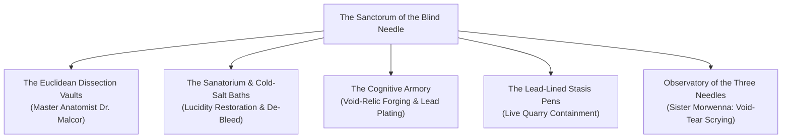
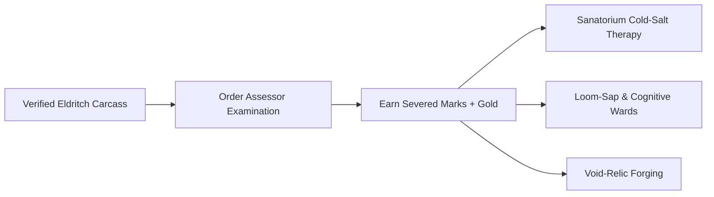

# 👁️ The Sanctorum of the Blind Needle (Grand Chapterhouse Lodge)
### *Supreme Planar Chapterhouse & Eldritch Hunting Lodge of the Order of the Severed Eye — The Fractured Nexus*

> *"You cannot hunt an aberration as you would a wolf. A wolf leaves mud on the ferns; an eldritch horror leaves a bruise on the memory of the glade. If you track its blood, you follow a color that doesn't exist. Step inside the lead vaults, wash your blade in cold brine, and let our surgeons check your lucidity before your thoughts begin to leak."*  
> — **Grand Inquisitor Sylas the Blind (Kalashtar Master Inquisitor, CR 16)**

---

## 🏛️ Lodge Overview & Geography

The **Sanctorum of the Blind Needle** serves as the supreme multiversal headquarters, sanatorium, and eldritch dissection lodge for [[Project Shattered Loom/Project Shattered Loom/Factions/The Order of the Severed Eye|The Order of the Severed Eye]]. While [[Project Shattered Loom/Project Shattered Loom/Planes of Existence/The Fractured Nexus/The Hearth of the Spoor (Grand Central Lodge)|The Hearth of the Spoor]] caters to standard planar monster hunters seeking pelts and horns, the Sanctorum operates as an austere surgical citadel dedicated exclusively to tracking, capturing, and butchering **Cosmic Horrors, Far Realm Incursions, and Aberrant Parasites**.

* **Precise Geographic Location**: Subterranean lead-vaults carved directly into the basalt bedrock beneath the Spire Ward foundations, accessed via a discreet spiral staircase of cold-quenched iron behind the High Archon Promenade.
* **Presiding Lodge Leadership**:
  * **Supreme Inquisitor**: [[Project Shattered Loom/Project Shattered Loom/NPC's/Grand Inquisitor Sylas the Blind|Grand Inquisitor Sylas the Blind (CR 16)]]
  * **Chief Void-Surgeon & Master Anatomist**: [[Project Shattered Loom/Project Shattered Loom/NPC's/Doctor Vaelen Malcor, Void-Surgeon|Doctor Vaelen Malcor, Void-Surgeon (CR 13)]]
  * **Chief Astral Seer**: **Sister Morwenna of the Pale Thread (CR 11)**
* **Affiliated Faction**: [[Project Shattered Loom/Project Shattered Loom/Factions/The Order of the Severed Eye|The Order of the Severed Eye]]
* **Associated Rulesets**: [[Project Shattered Loom/Project Shattered Loom/Custom Rules/The Eldritch Horror Hunting & Sanity-Harvesting Ruleset|The Eldritch Horror Hunting & Sanity-Harvesting Ruleset]] and [[Project Shattered Loom/Project Shattered Loom/Custom Rules/The Eldritch Madness & Dream-Fracture Ruleset|The Eldritch Madness & Dream-Fracture Ruleset]].
* **Atmosphere & Architecture**: Monastic solemnity combined with clinical precision. Thick sheets of lead stamped with silver warding runes line every corridor, humming quietly to block psychic feedback and telepathic radiation from the Astral Void. The air smells intensely of cold brine, crushed lavender, camphor, and ozone. Acolytes and harriers walk barefoot and silent, wearing white-and-silver blindfolds stitched with lead wire, relying on psionic blindsight to navigate.

---

## 🛠️ Specialized Lodge & Sanatorium Facilities

Every hunter and inquisitor operating out of the Sanctorum has access to state-of-the-art facilities designed for handling non-Euclidean horrors:

* **The Euclidean Dissection Vaults**: Run by [[Project Shattered Loom/Project Shattered Loom/NPC's/Doctor Vaelen Malcor, Void-Surgeon|Doctor Vaelen Malcor]]. Reinforced subterranean amphitheaters lined with white basalt slabs, cold-iron restraining clamps, and draining sluices of axiomatic mercury. Here, aberrant carcasses are systematically opened under lead hoods to prevent cognitive contamination under the [[Project Shattered Loom/Project Shattered Loom/Custom Rules/The Eldritch Horror Hunting & Sanity-Harvesting Ruleset|Eldritch Harvesting Ruleset]].
* **The Sanatorium & Cold-Salt Baths**: Recovery chambers equipped with submerged sensory-deprivation tanks filled with mineral brine and pulverized cold-iron dust. Submersion restores lost **Lucidity (0–100)** and cures chronic Dream-Fracture afflictions.
* **The Cognitive Armory**: A specialized forge staffed by blindfolded smiths who craft *Void-Relics*, quench blades in silver-mercury brine, and install lead-mesh lining into armor suits.
* **The Lead-Lined Stasis Pens**: Heavily warded subterranean vaults utilizing dimensional anchor spikes to safely house live captured aberrations awaiting surgical extraction.
* **The Observatory of the Three Needles**: A domed scrying sanctum where Sister Morwenna monitors the vibrational tension of the Astral Sea using silver-wire resonance bowls, forecasting reality-decay storms and Far Realm breaches up to 48 hours in advance.

---

## 🦁 Regional Apex Aberrant Quarry (3 Thematic Monsters)

Inquisitors registered with the Sanctorum track three distinct tiers of terrifying aberrant quarry that infest the structural fractures, void-currents, and underbelly of The Fractured Nexus:

### 1. The Singularity Weft-Horror (CR 11)
* **Quarry Profile**: *A predatory dimensional warp-stalker resembling a cluster of floating, razor-sharp polyhedral obsidian crystals bound together by writhing tentacles of inverted starlight. It nests near frayed Golden Filaments, feeding on the harmonic resonance of the Loomforge and causing localized gravity to invert.*
* **Quarry Classification**: `Tier II: Dimensional Warp-Stalker`
* **Type & Alignment**: `Large Aberration, Neutral Evil`
* **Harvest Check DC**: **DC 19** (*Wisdom/Medicine* or *Intelligence/Arcana*)
* **Sanity-Toll Risk**: DC 15 Wisdom saving throw; on a failure, the harvester suffers **2d6 Lucidity drain** from observing the creature's impossible four-dimensional geometry.

#### Harvestable Components
| Component | Classification | Yield & Base Value |
| :--- | :--- | :--- |
| **Inverted Starlight Tentacles** | Neural / Offensive Matrix | 3 Phase-Lash Tendrils (value 350 gp each) |
| **Polyhedral Obsidian Shell** | Non-Euclidean Defensive Layer | 2 Crystalline Chitin Plates (value 400 gp each) |
| **Gravitational Bile-Gland** | Volatile Alchemical Secretion | 2 Flasks of Inverted Liquid (value 250 gp each) |
| **Singularity Core-Node** | Paradox Essence Core | 1 Pulsing Void Spark (value 700 gp) |

#### Trophy-Forge Recipes (Void-Relics)
| Crafted Relic | Category | Mechanical Properties (D&D 5e) |
| :--- | :---: | :--- |
| **Aegis of the Inverted Angle (+2)** | Armor (Shield) | *Shield (+2), Rare (Attunement)*. Wearer is immune to forced movement and gravity shifts. When a spell attack misses the wielder, use a reaction to reflect the spell back at the caster (1/day). |
| **Warp-Tether Flail (+2)** | Weapon (Flail) | *Weapon, Rare (Attunement)*. Deals +1d8 force damage. On a hit, target must succeed on a DC 16 Strength save or be pulled 15 feet in any direction of the wielder's choice. |

---

### 2. The Silent Needle-Matron (CR 14)
* **Quarry Profile**: *A bloated, chitinous mind-leviathan that clings to the underside of the Silent Spire. It possesses a lamprey-maw ringed with spinning bone-needles and twelve compound eyes that weep black void-bile. It projects waking somnambulic nightmares across the Frayed Undercroft, luring despairing mortals into its open gullet.*
* **Quarry Classification**: `Tier III: Mind-Leviathan & Harbinger`
* **Type & Alignment**: `Huge Aberration, Chaotic Evil`
* **Harvest Check DC**: **DC 21** (*Wisdom/Medicine* or *Intelligence/Arcana*)
* **Sanity-Toll Risk**: DC 17 Wisdom saving throw; on a failure, the harvester suffers **3d6 Lucidity drain** and gains the *Auditory Paranoia* dream-fracture.

#### Harvestable Components
| Component | Classification | Yield & Base Value |
| :--- | :--- | :--- |
| **Compound Bile-Eyes** | Bioluminescent Ocular Organ | 2 Weeping Void-Lenses (value 500 gp each) |
| **Needle-Proboscis Mandibles** | Barbed Offensive Matrix | 4 Cold-Iron Needle Fangs (value 300 gp each) |
| **Black Void-Bile Flasks** | Toxic Paradox Secretion | 3 Vials of Concentrated Void-Ichor (value 400 gp each) |
| **Loom-Siphoning Hive-Heart** | Paradox Essence Core | 1 Resonant Nightmare Core (value 1,200 gp) |

#### Trophy-Forge Recipes (Void-Relics)
| Crafted Relic | Category | Mechanical Properties (D&D 5e) |
| :--- | :---: | :--- |
| **Mantle of the Severed Gaze** | Wondrous Item (Cloak) | *Very Rare (Attunement)*. Grants truesight 30 ft. and resistance to psychic damage. The wearer cannot be charmed, frightened, or forced to sleep. 2/day: cast *Synaptic Static* (DC 17). |
| **Surgical Estoc of the Spire (+3)** | Weapon (Rapier) | *Weapon, Very Rare (Attunement)*. Deals +2d6 psychic damage. Critical hits sever the target's concentration automatically and reduce the target's maximum hit points by the psychic damage dealt. |

---

### 3. The Chrono-Fracture Sovereign (CR 18)
* **Quarry Profile**: *An ancient, terrifying cosmic parasite spawned directly from the snapped Thread of Infinite Potential during the Great Betrayal. It manifests as a shifting silhouette of broken mirrors, clocks that run backwards, and golden cords drenched in black bile. It phases between seconds, undoing wounds and erasing hunters from temporal memory.*
* **Quarry Classification**: `Tier IV: Primordial Sleeper Scion`
* **Type & Alignment**: `Gargantuan Aberration (Cosmic), Chaotic Neutral`
* **Harvest Check DC**: **DC 24** (*Wisdom/Medicine* or *Intelligence/Arcana*)
* **Sanity-Toll Risk**: DC 20 Wisdom saving throw; on a failure, the harvester loses **4d8 Lucidity** and suffers 1 level of permanent temporal amnesia unless restored by *Greater Restoration*.

#### Harvestable Components
| Component | Classification | Yield & Base Value |
| :--- | :--- | :--- |
| **Chrono-Reflective Scales** | Paradox Defensive Matrix | 4 Shattered Timeline Shards (value 800 gp each) |
| **Temporal Neural Tendril** | Sensory Organ | 2 Intact Chrono-Filaments (value 1,000 gp each) |
| **Essence of Un-Spun Dawn** | Volatile Paradox Secretion | 2 Flasks of Liquid Causality (value 1,200 gp each) |
| **Primordial Thread-Spindle** | Sovereign Essence Core | 1 Heart of the Broken Weave (value 3,500 gp) |

#### Trophy-Forge Recipes (Void-Relics)
| Crafted Relic | Category | Mechanical Properties (D&D 5e) |
| :--- | :---: | :--- |
| **Hourglass of Temporal Severance** | Wondrous Item | *Legendary (Attunement)*. Once per long rest, the bearer can use a reaction to completely undo the last turn of any creature within 60 feet (restoring hit points lost, spell slots spent, and resetting position). |
| **Plate of the Euclidean Sovereign (+3)** | Armor (Plate) | *Armor, Legendary (Attunement)*. Wearer is immune to psychic and force damage, cannot be banished, and cannot be aged magically. Attackers who strike the wearer take 14 (4d6) psychic backlash damage. |

---

## 🪙 Lodge Store: The Severed Exchange & Specialized Gear

Hunters and inquisitors redeem their **Severed Marks** (hexagonal meteoric silver coins stamped with a pierced eye) or trade gold for specialized eldritch provisions:

### Inquisitorial Hunter Trophies & Mark Exchange Rates
* **Tier I: Dream-Leeches (CR 5–8)**: 5 Severed Marks + 300 gp.
* **Tier II: Dimensional Warp-Stalkers (CR 9–12)**: 15 Severed Marks + 900 gp.
* **Tier III: Mind-Leviathans (CR 13–16)**: 35 Severed Marks + 2,000 gp.
* **Tier IV: Primordial Scions (CR 17–20)**: 75 Severed Marks + 5,000 gp + Title of *High Inquisitor*.
* **Tier V: Void Sovereigns (CR 21+)**: 150 Severed Marks + 15,000 gp + Permanent Lead-Vault Sanctuary.

### Specialized Inquisitorial Inventory
* **Phial of Concentrated Loom-Sap** (8 Marks / 400 gp): Restores **4d10 Lucidity** instantly and removes 1 level of Exhaustion.
* **Master Void-Surgeon's Field Case** (15 Marks / 800 gp): Deluxe lead-lined surgical suite; grants advantage and +2 on Eldritch Harvest Checks and prevents carcass vapor flash.
* **Fail-Safe Singularity Clamps (Pack of 2)** (4 Marks / 200 gp): Lead buffers that negate any critical mishap (Natural 1) while extracting volatile paradox cores.
* **Sanatorium Cold-Salt Bath (3 Days)** (12 Marks / 600 gp): Submersion in mineral brine and pulverized cold iron; restores **all lost Lucidity** and cures 1 indefinite Dream-Fracture Affliction.
* **Euclidean Chalk & Axiomatic Pegs** (50 gp): Locks local angles to 90 degrees, preventing aberrations from phase-shifting through dungeon terrain.
* **Resonance Bells of Mechanus** (120 gp): Chimes that reveal non-Euclidean stealth and invisible horrors within 60 feet.
* **Chirality Net** (200 gp): Lead-wire net that prevents captured aberrations from teleporting, phase-shifting, or plane-shifting (escape DC 16).
* **Lead-Lined Plating Upgrade** (15 Marks / 500 gp): Adds lead-mesh lining to any armor suit, granting resistance to ambient Far Realm psychic radiation.

---

## 📜 Active Inquisitorial Contracts & Apex Bounties

| d4 | Contract Title | Threat & Quarry | Complications | Reward |
| :---: | :--- | :--- | :--- | :--- |
| **1** | **The Screaming Pylon** | Slay an alpha **Singularity Weft-Horror** nesting in the secondary filament truss of the Spire Ward. | The horror has inverted local gravity; combat takes place along vertical bridge towers over the Astral Sea. | 15 Severed Marks + 1,000 gp + *Phial of Concentrated Loom-Sap* |
| **2** | **Exorcism of the Silent Roots** | Purge the **Silent Needle-Matron** roosting in the deep fissures of the Silent Spire undercroft. | Ambient void-bile forces DC 15 Con saves each minute against blindness; Entropic Hand cultists ambush during the cull. | 35 Severed Marks + 2,500 gp + *Master Void-Surgeon's Field Case* |
| **3** | **The Paradox Tear at the Cradle** | Track and anchor a wandering **Chrono-Fracture Sovereign** tearing open a rift at the Convergence Cradle. | Local time stutters violently; round durations randomly reset, and dead-world phantoms spawn in waves. | 75 Severed Marks + 6,000 gp + Choice of 1 Tier IV Void-Relic |
| **4** | **Pristine Neural Extraction** | Deliver 1 unblemished *Resonant Nightmare Core* harvested without triggering catastrophic psychic decay. | Carcass must be dissected within 15 minutes of death using non-lethal stasis wards. | 50 Severed Marks + *Torc of Axiomatic Sanity* |

---

## 🗺️ Cross-Vault Links

* **Regional Realm Dossier**: [[Project Shattered Loom/Project Shattered Loom/Planes of Existence/The Fractured Nexus/The Fractured Nexus|The Fractured Nexus]]
* **Cartographic Atlas**: [[Project Shattered Loom/Project Shattered Loom/Planes of Existence/The Fractured Nexus/Map of the Fractured Nexus|Map & Geography of the Fractured Nexus]]
* **Sister Hunting Lodge (Biological Beasts)**: [[Project Shattered Loom/Project Shattered Loom/Planes of Existence/The Fractured Nexus/The Hearth of the Spoor (Grand Central Lodge)|The Hearth of the Spoor (Grand Central Lodge)]]
* **Parent Faction**: [[Project Shattered Loom/Project Shattered Loom/Factions/The Order of the Severed Eye|The Order of the Severed Eye]]
* **Lodge Leadership**:
  * [[Project Shattered Loom/Project Shattered Loom/NPC's/Grand Inquisitor Sylas the Blind|Grand Inquisitor Sylas the Blind]]
  * [[Project Shattered Loom/Project Shattered Loom/NPC's/Doctor Vaelen Malcor, Void-Surgeon|Doctor Vaelen Malcor, Void-Surgeon]]
  * [[Project Shattered Loom/Project Shattered Loom/NPC's/Key NPCs - The Order of the Severed Eye|Key NPCs - The Order of the Severed Eye]]
  * [[Project Shattered Loom/Project Shattered Loom/NPC's/Key NPCs - The Fractured Nexus|Key NPCs - The Fractured Nexus]]
* **Master Rulesets**:
  * [[Project Shattered Loom/Project Shattered Loom/Custom Rules/The Eldritch Horror Hunting & Sanity-Harvesting Ruleset|The Eldritch Horror Hunting & Sanity-Harvesting Ruleset]]
  * [[Project Shattered Loom/Project Shattered Loom/Custom Rules/The Eldritch Madness & Dream-Fracture Ruleset|The Eldritch Madness & Dream-Fracture Ruleset]]
  * [[Project Shattered Loom/Project Shattered Loom/Custom Rules/The Interplanar Hunting, Harvesting & Trophy-Crafting Ruleset|The Interplanar Hunting, Harvesting & Trophy-Crafting Ruleset]]
